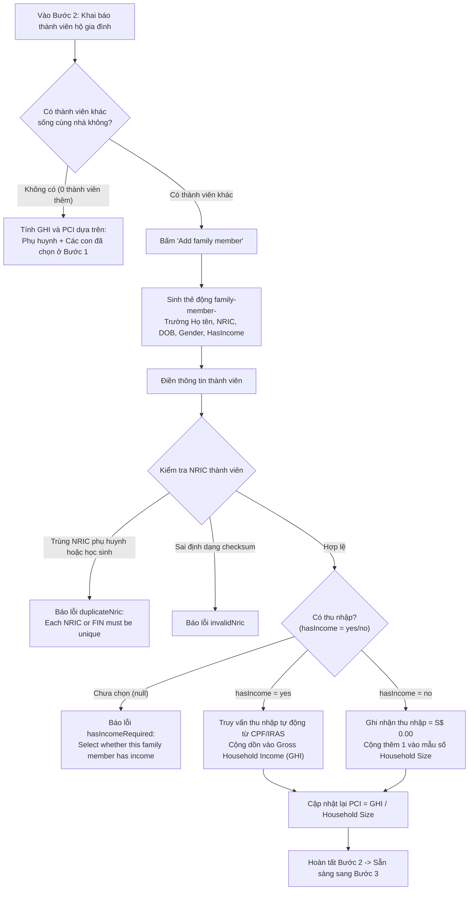

# 📋 BSK Locator & Functional Flow Spec: Step 2 - Household Members & Income

| Trường Thông Tin | Chi Tiết |
| :--- | :--- |
| **Portal / Cổng Dịch Vụ** | `localhost:5174` (EduSave E-Service Portal) |
| **Đường Dẫn Thực Tế (URL)** | `http://localhost:5174/fas-application` |
| **Tiêu Đề Trang (Title)** | `EduFAMS | E-Service` |
| **Heading Phần Hộ Gia Đình (H2)** | `Family member details` (`#family-members-heading`) |
| **Phân Hệ / Module** | `f10` / `FS-10` / `R10` (Wizard Step 2: Household & Income) |
| **Thời Điểm Trích Xuất (BSK)** | `Live DOM Verified via Chromium Headless CDP` |

---

## 🔍 1. Bảng Locators Chi Tiết (BSK Verified Live DOM Elements)

### 1.1 Khối Thành Viên Gia Đình Thẻ Động (Family Member Dynamic Cards)
> [!NOTE]
> Mặc định ban đầu danh sách thành viên gia đình là 0 thành viên.
> Khi bấm nút `"Add family member"`, hệ thống sinh ra thẻ động với tiền tố `family-member-<UUID>-<fieldName>`.

| Tên Trường / Nhãn | Loại | Cấu Trúc ID / Name | Selector Tổng Quát (Playwright) | Bắt Buộc | Ràng Buộc / Ghi Chú |
| :--- | :--- | :--- | :--- | :--- | :--- |
| **Heading Phần Hộ Gia Đình** | `h2` | `#family-members-heading` | `h2#family-members-heading` | - | `"Family member details"` |
| **Họ Tên Thành Viên** | `text` | `input[id^="family-member-"][id$="-fullName"]` | `input[id*="family-member-"][id$="-fullName"]` | Có (`*`) | Max 200 ký tự |
| **NRIC / FIN Thành Viên** | `text` | `input[id^="family-member-"][id$="-nric"]` | `input[id*="family-member-"][id$="-nric"]` | Có (`*`) | Regex 9 ký tự, không trùng phụ huynh/học sinh |
| **Ngày Sinh Thành Viên** | `date` | `input[id^="family-member-"][id$="-dateOfBirth"]` | `input[id*="family-member-"][id$="-dateOfBirth"]` | Có (`*`) | Định dạng `YYYY-MM-DD`, không tương lai |
| **Giới Tính Nam** | `radio` | `name="family-member-<UUID>-gender"` | `input[name*="family-member-"][value="MALE"]` | Có (`*`) | Nhãn: `Male` |
| **Giới Tính Nữ** | `radio` | `name="family-member-<UUID>-gender"` | `input[name*="family-member-"][value="FEMALE"]` | Có (`*`) | Nhãn: `Female` |
| **Giới Tính Khác** | `radio` | `name="family-member-<UUID>-gender"` | `input[name*="family-member-"][value="OTHER"]` | Có (`*`) | Nhãn: `Other` |
| **Có Thu Nhập: CÓ (Yes)** | `radio` | `name="family-member-<UUID>-hasIncome"` | `input[name*="family-member-"][value="yes"]` | Có (`*`) | Nhãn: `Yes` |
| **Có Thu Nhập: KHÔNG (No)**| `radio` | `name="family-member-<UUID>-hasIncome"` | `input[name*="family-member-"][value="no"]` | Có (`*`) | Nhãn: `No` |

### 1.2 Thao Tác Thẻ Động Thành Viên (Dynamic Card Actions)
| Nút Thao Tác | Loại | Selector Tối Ưu (Playwright) | Trạng Thái Ban Đầu | Hành Vi Khi Kích Hoạt |
| :--- | :--- | :--- | :--- | :--- |
| **Thêm Thành Viên Gia Đình** | `button` | `button:has-text("Add family member")` | 🟢 **Enabled** | Sinh thêm thẻ `family-member-<UUID>` mới |
| **Xóa Thành Viên Gia Đình** | `button` | `button:has-text("Remove family member")` | 🟢 **Enabled** trên từng thẻ | Xóa thẻ tương ứng, dọn dẹp state validation |

### 1.3 Thu Nhập CPF Tự Động & Chỉ Số GHI / PCI (Auto-Income & Metrics Display)
> [!IMPORTANT]
> Căn cứ theo `BR3` (`specs/md/FS document/FS-10_FAS_Family_Application_Portal.md Mục 11`) và đặc tả F10:
> Thu nhập hàng tháng được truy vấn tự động từ cơ quan Chính phủ (CPF / IRAS). Phụ huynh không tự nhập số tiền thủ công.

| Chỉ Số Tính Toán | Thẻ Hiển Thị | Selector Đại Diện | Công Thức Tính Toán |
| :--- | :--- | :--- | :--- |
| **Tổng Thu Nhập Gia Đình (GHI)** | `span / div` | `[data-testid='display-ghi-step2'], .ghi-value` | $\text{GHI} = \sum \text{Gross Monthly Income của các thành viên}$ |
| **Quy Mô Hộ Gia Đình (Size)** | `span / div` | `[data-testid='display-household-size-step2']` | $\text{Size} = 1 \text{ (Phụ huynh)} + N \text{ (Con)} + M \text{ (Thành viên thêm)}$ |
| **Thu Nhập Bình Quân Đầu Người (PCI)** | `span / div` | `[data-testid='display-pci-step2'], .pci-value` | $\text{PCI} = \frac{\text{GHI}}{\text{Size}}$ (Định dạng tiền tệ `S$ #,##0.00`) |

### 1.4 Thông Báo Lỗi Trực Quan Theo Trường (Validation Errors)
| Trường Nhập Liệu | Selector Lỗi Đi Kèm | Thuộc Tính Cảnh Báo | Nội Dung Thông Báo |
| :--- | :--- | :--- | :--- |
| Chưa Chọn Có Thu Nhập | `fieldset:has(input[name$="-hasIncome"]) p` | Text báo lỗi dưới radio group | `"Select whether this family member has income."` (`hasIncomeRequired`) |
| Trùng NRIC Thành Viên | `input[id$="-nric"][aria-invalid="true"] ~ p` | `aria-invalid="true"` | `"Each NRIC or FIN must be unique."` (`duplicateNric`) |
| Định Dạng NRIC Không Hợp Lệ | `input[id$="-nric"][aria-invalid="true"] ~ p` | `aria-invalid="true"` | `"Enter a valid NRIC or FIN."` (`invalidNric`) |

---

## 🔄 2. Đặc Tả Luồng Nghiệp Vụ (Functional Flow & State Machine)

### 2.1 Sơ Đồ Xử Lý Thành Viên & Tính Toán Thu Nhập (Household & Income Flow)


### 2.2 Ràng Buộc Nghiệp Vụ Phụ Thuộc (Conditional & Dependent Rules)
1. **Ràng Buộc Khai Báo Thu Nhập (`hasIncomeRequired`)**:
   - Trường `hasIncome` là bắt buộc đối với mọi thành viên gia đình tự thêm.
   - Nếu để trống (chưa tick `Yes` hoặc `No`), hệ thống phát cờ lỗi `hasIncomeRequired`: `"Select whether this family member has income."`
2. **Quy Tắc Không Trùng NRIC Ba Chiều (3-Way NRIC Check)**:
   - Hệ thống quét chéo 3 danh sách: `[Applicant]`, `[Beneficiaries]`, `[Family Members]`.
   - Nếu phát hiện bất kỳ NRIC nào xuất hiện từ 2 lần trở lên $\rightarrow$ Tất cả các ô liên quan bị viền đỏ `border-red-500` và hiển thị mã lỗi `duplicateNric`.
3. **Công Thức Tính PCI Chuẩn MOE**:
   $$\text{PCI} = \frac{\text{GHI}}{\text{Quy mô hộ gia đình}} = \frac{\text{Tổng thu nhập thực nhận hàng tháng}}{\text{Số lượng người cư trú hợp pháp}}$$
   - Tiêu chí hưởng MOEFAS: $\text{GHI} \le \$3,000/\text{tháng}$ **HOẶC** $\text{PCI} \le \$750/\text{người/tháng}$.
   - Học sinh có PCI thấp hơn sẽ được hệ thống xếp hàng ưu tiên xét duyệt tự động trước khi form MOEFAS đóng.

### 2.3 Ma Trận Kiểm Thử 12 Lớp (12-Layer Field Test Matrix)
| Lớp Kiểm Thử | Tình Huống / Dữ Liệu Đầu Vào | Hành Vi Giao Diện | Phản Hồi Trực Quan & Mã Lỗi |
| :--- | :--- | :--- | :--- |
| **1. Zero Family Members** | Không bấm thêm thành viên, nộp đơn với 0 member | Hợp lệ hoàn toàn; hộ chỉ gồm phụ huynh và con | Tiếp tục bình thường |
| **2. Add Member But Incomplete**| Bấm `Add family member` nhưng để trống toàn bộ | Bị chặn lại khi Submit; toàn bộ ô trong thẻ bị đỏ | Báo lỗi `This field is required.` |
| **3. Missing hasIncome Radio** | Điền đủ Tên, NRIC, DOB nhưng chưa chọn `Yes`/`No` | Bị chặn với lỗi bắt buộc chọn thu nhập | `Select whether this family member has income.` |
| **4. Duplicate NRIC with Parent**| Thành viên nhập trùng NRIC của người nộp đơn | Cả 2 ô NRIC bị đánh cờ viền đỏ | `Each NRIC or FIN must be unique.` |
| **5. Duplicate NRIC with Child** | Thành viên nhập trùng NRIC của học sinh Bước 1 | Cả 2 ô NRIC bị viền đỏ | `Each NRIC or FIN must be unique.` |
| **6. Duplicate NRIC with Peer** | Thêm 2 thành viên có NRIC giống nhau | Cả 2 thành viên bị báo lỗi trùng lặp | `Each NRIC or FIN must be unique.` |
| **7. Member Deletion Flow** | Bấm `Remove family member` của thẻ bị lỗi | Thẻ biến mất lập tức; state lỗi được gỡ bỏ hoàn toàn | Form sạch lỗi |
| **8. Income Flag = No (Zero)** | Chọn `hasIncome = no` cho người cao tuổi/nội trợ | Thu nhập tính bằng 0; mẫu số Household size tăng thêm 1 | PCI giảm tương ứng |
| **9. Income Flag = Yes (CPF)** | Chọn `hasIncome = yes` | Ghi nhận cờ có thu nhập, chuyển sang F4 để lấy dữ liệu CPF | Xác thực tự động |
| **10. Multiple Members Stress** | Bấm thêm liên tiếp 5 thành viên gia đình | Tạo đủ 5 thẻ với 5 UUID riêng biệt, không xung đột name | 5 dynamic cards hoạt động độc lập |
| **11. Pristine / Dirty Transition**| Thay đổi lựa chọn từ `Yes` sang `No` | Form kích hoạt trạng thái dirty | Hỗ trợ lưu nháp |
| **12. UI Health & Dynamic Heights**| Thêm và xóa nhiều thành viên liên tục | Bố cục co giãn mượt mà, không lệch layout, 0 uncaught exception | Đạt chuẩn Invariant 7 |

---

## 💻 3. Playwright Page Object Snippet (Zero Assertions)

```python
"""
pages/f10/components/household_income_step.py - Step 2 Component cho FAS Application.
Tuân thủ Invariant 1 (Zero assertions in Page Objects) & Invariant 9 (< 250 dòng).
"""
from typing import Dict, List, Optional
from playwright.sync_api import Locator, Page
from pages.base_page import BasePage


class HouseholdIncomeStep(BasePage):
    """Component phụ trách khai báo thành viên hộ gia đình và thu nhập (Step 2)."""

    HEADING = "h2#family-members-heading"
    ADD_FAMILY_MEMBER_BTN = "button:has-text('Add family member')"
    REMOVE_FAMILY_MEMBER_BTN = "button:has-text('Remove family member')"

    def __init__(self, page: Page):
        super().__init__(page)

    def click_add_family_member(self) -> None:
        """Bấm nút thêm thành viên hộ gia đình mới."""
        self.click_element(self.ADD_FAMILY_MEMBER_BTN)

    def get_family_member_card_ids(self) -> List[str]:
        """Lấy danh sách các tiền tố ID động của toàn bộ thẻ thành viên gia đình."""
        inputs = self.page.locator("input[id^='family-member-'][id$='-fullName']").all()
        ids = []
        for inp in inputs:
            raw_id = inp.get_attribute("id") or ""
            if raw_id:
                ids.append(raw_id.replace("-fullName", ""))
        return ids

    def fill_family_member_details(self, card_prefix: str, data: Dict[str, Any]) -> None:
        """Điền thông tin thành viên gia đình vào thẻ động xác định."""
        if "fullName" in data:
            self.fill_field(f"#{card_prefix}-fullName", str(data["fullName"]))
        if "nric" in data:
            self.fill_field(f"#{card_prefix}-nric", str(data["nric"]))
        if "dateOfBirth" in data:
            self.fill_field(f"#{card_prefix}-dateOfBirth", str(data["dateOfBirth"]))
        if "gender" in data:
            gender_val = str(data["gender"]).upper()
            self.page.locator(f"input[name='{card_prefix}-gender'][value='{gender_val}']").check()
        if "hasIncome" in data:
            income_choice = "yes" if data["hasIncome"] in [True, "yes", "YES"] else "no"
            self.page.locator(f"input[name='{card_prefix}-hasIncome'][value='{income_choice}']").check()

    def remove_family_member_at_index(self, index: int) -> None:
        """Xóa thẻ thành viên gia đình tại index tương ứng."""
        buttons = self.page.locator(self.REMOVE_FAMILY_MEMBER_BTN).all()
        if index < len(buttons):
            buttons[index].click()

    def get_member_count(self) -> int:
        """Đếm số lượng thành viên gia đình tự thêm đang có trên màn hình."""
        return self.page.locator("input[id^='family-member-'][id$='-fullName']").count()

    def get_field_error_message(self, field_id: str) -> Optional[str]:
        """Lấy thông báo lỗi kèm theo của một trường trong thẻ thành viên."""
        error_loc = self.page.locator(f"#{field_id} ~ p, #{field_id} ~ span[class*='error']")
        if error_loc.count() > 0 and error_loc.first.is_visible():
            return error_loc.first.inner_text().strip()
        return None

    def get_has_income_error(self, card_prefix: str) -> Optional[str]:
        """Lấy lỗi của trường hasIncome radio group."""
        group = self.page.locator(f"fieldset:has(input[name='{card_prefix}-hasIncome']) p[class*='error']")
        if group.count() > 0 and group.first.is_visible():
            return group.first.inner_text().strip()
        return None
```

---

## 🎯 4. Tiêu Chí Xác Nhận Pass/Fail & Error Handling (Pass/Fail Oracles & Assertions)

### 4.1 Tiêu Chí Xác Nhận Thành Công (Pass Oracles)
| Hành Động / Kịch Bản Kiểm Thử | Loại UI Feedback | Selector Playwright Tối Ưu | Kỳ Vọng Text / Giá Trị | Playwright Assertion Cú Pháp Mẫu (Dành Cho `tests/`) |
| :--- | :--- | :--- | :--- | :--- |
| **Hoàn tất Step 2 và bấm Next** | Chuyển tiếp sang Bước 3 | Tiêu đề hoặc Step Indicator | Hiển thị Step 3: Documents & Declaration | `page.locator('button:has-text("Next")').click()`<br>`expect(page.locator('h2:has-text("Documents"), #documents-heading')).to_be_visible()` |
| **Bấm Add family member** | Thêm 1 thẻ thành viên mới | Thẻ động `family-member-*` | Số lượng thẻ tăng thêm 1 | `expect(page.locator('input[id^="family-member-"][id$="-fullName"]')).to_have_count(initial_count + 1)` |
| **Tự động tính toán GHI & PCI** | Cập nhật số tiền thu nhập tổng | Text hiển thị GHI / PCI | Hiển thị số tiền SGD tự tính chính xác | `expect(page.locator('[data-testid="calculated-ghi"], #ghi-display')).to_contain_text("SGD")` |
| **Chọn có thu nhập (hasIncome = Yes)** | Trường số tiền thu nhập xuất hiện | Ô nhập liệu thu nhập | Ô nhập số tiền hiển thị | `page.locator("input[name$='-hasIncome'][value='yes']").check()`<br>`expect(page.locator("input[name$='-incomeAmount']")).to_be_visible()` |
| **Quay lại Bước 1 (Click Previous)** | Trở về Step 1 không mất dữ liệu | Tiêu đề Bước 1 | Hiển thị Step 1: Beneficiary | `page.locator('button:has-text("Previous")').click()`<br>`expect(page.locator('h2:has-text("Beneficiary")')).to_be_visible()` |

---

### 4.2 Tiêu Chí Bắt Lỗi & Xử Lý Ngoại Lệ (Fail & Error Handling Feedback)
| Tình Huống Lỗi / Trigger | Loại UI Feedback | Selector Playwright Tối Ưu | Mã Lỗi & Text Kỳ Vọng | Playwright Assertion Cú Pháp Mẫu (Dành Cho `tests/`) |
| :--- | :--- | :--- | :--- | :--- |
| **Chưa chọn Radio Tình trạng thu nhập** | Inline Error Text dưới Fieldset | `fieldset:has(input[name*="-hasIncome"]) [class*="error"], p` | `"Select income status"` / `"Required"` | `expect(page.locator('fieldset:has(input[name*="-hasIncome"]) [class*="error"]')).to_be_visible()` |
| **Chọn Có thu nhập nhưng để trống số tiền** | Inline Error Text & viền đỏ | `input[name*="-incomeAmount"] ~ [class*="error"], p` | `"Enter income amount"` | `expect(page.locator('input[name*="-incomeAmount"]')).to_have_attribute("aria-invalid", "true")`<br>`expect(page.locator('input[name*="-incomeAmount"] ~ [class*="error"]')).to_be_visible()` |
| **Nhập số tiền thu nhập âm hoặc ký tự lạ** | Inline Error Text & viền đỏ | `input[name*="-incomeAmount"] ~ [class*="error"], p` | `"Enter a valid positive number"` | `expect(page.locator('input[name*="-incomeAmount"]')).to_have_attribute("aria-invalid", "true")` |
| **Trùng lặp NRIC Thành viên với Người nộp/Học sinh** | Cross-field Duplicate Error | `input[id$="-nric"] ~ [class*="error"], p` | `"Duplicate NRIC detected"` | `expect(page.locator('input[id^="family-member-"][id$="-nric"] ~ [class*="error"]')).to_contain_text("duplicate")` |

