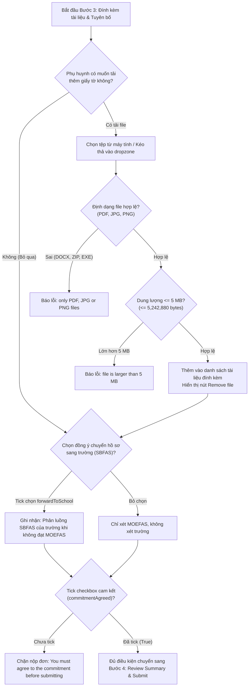

# 📋 BSK Locator & Functional Flow Spec: Step 3 - Supporting Documents & Declaration

| Trường Thông Tin | Chi Tiết |
| :--- | :--- |
| **Portal / Cổng Dịch Vụ** | `localhost:5174` (EduSave E-Service Portal) |
| **Đường Dẫn Thực Tế (URL)** | `http://localhost:5174/fas-application` |
| **Tiêu Đề Trang (Title)** | `EduFAMS | E-Service` |
| **Heading Khối Cam Kết (H3/H4)** | `Commitment and Declarations` |
| **Phân Hệ / Module** | `f10` / `FS-10` / `R10` (Wizard Step 3: Supporting Documents & Declaration) |
| **Thời Điểm Trích Xuất (BSK)** | `Live DOM Verified via Chromium Headless CDP` |

---

## 🔍 1. Bảng Locators Chi Tiết (BSK Verified Live DOM Elements)

### 1.1 Khối Đính Kèm Tài Liệu Hỗ Trợ (Supporting Documents Upload & Dropzone)
> [!NOTE]
> Việc đính kèm tài liệu là **tùy chọn (Optional)** do hệ thống đã tự động tích hợp API CPF/IRAS.
> Phụ huynh có thể nộp bổ sung giấy chứng nhận y tế, trợ cấp xã hội hoặc đơn mất việc.

| Tên Phần Tử / Nhãn | Loại | Cấu Trúc ID / Name | Selector Tối Ưu (Playwright) | Bắt Buộc | Ràng Buộc / Ghi Chú |
| :--- | :--- | :--- | :--- | :--- | :--- |
| **Input Tải File Tài Liệu** | `file` | `input[type="file"]` | `input[type="file"], input[data-testid="input-supporting-doc"]` | Không (Tùy chọn) | Chấp nhận `.pdf, .jpg, .jpeg, .png` |
| **Khu Vực Kéo Thả (Dropzone)**| `div` | `[data-testid="dropzone-documents"]` | `div[class*="dropzone"], div:has(input[type="file"])` | - | Vùng drag & drop file |
| **Hàng File Đã Tải Lên** | `li / div` | `[data-testid^="doc-file-item-"]` | `li:has-text(".pdf"), div[class*="fileItem"]` | - | Hiển thị tên file và dung lượng |
| **Nút Xóa Tài Liệu Đã Chọn** | `button` | `[data-testid^="btn-remove-doc-"]` | `button:has-text("Remove file"), button[aria-label*="Remove"]` | - | Gỡ file khỏi danh sách gửi |

### 1.2 Các Checkbox Cam Kết & Tuyên Bố Pháp Lý (Commitment & Legal Declarations)
| Tên Checkbox / Nhãn | Loại | Cấu Trúc ID / Name | Selector Tối Ưu (Playwright) | Bắt Buộc | Ràng Buộc Nghiệp Vụ |
| :--- | :--- | :--- | :--- | :--- | :--- |
| **Cam Kết Xác Nhận Thông Tin**| `checkbox`| `#applicant-commitmentAgreed` | `input#applicant-commitmentAgreed` | 🔴 **Bắt buộc (`*`)** | `"I agree to the declaration and commitment."` |
| **Đồng Ý Chuyển Tiếp Cho Trường**| `checkbox`| `#applicant-forwardToSchoolAgreed`| `input#applicant-forwardToSchoolAgreed`| Tùy chọn / Khuyến nghị | `"I agree that this application may be forwarded to the school."` (SBFAS consent) |

### 1.3 Khối Hoàn Cảnh & Nguyện Vọng Bổ Sung (Circumstances & Context)
| Tên Trường / Nhãn | Loại | Cấu Trúc ID / Name | Selector Tối Ưu (Playwright) | Bắt Buộc | Ràng Buộc / Ghi Chú |
| :--- | :--- | :--- | :--- | :--- | :--- |
| **Ghi Chú Hoàn Cảnh Gia Đình**| `textarea`| `textarea[name="circumstancesContext"]`| `textarea#applicant-context, textarea[name*="context"]` | Tùy chọn | Tối đa 2000 ký tự |
| **Bộ Đếm Ký Tự Trực Tiếp** | `span` | `[data-testid="counter-context"]` | `span:has-text("/2000")` | - | Cập nhật live số ký tự đã nhập |

### 1.4 Thông Báo Lỗi Trực Quan (Validation Error Elements)
| Trường Kiểm Thử | Selector Lỗi Đi Kèm | Thuộc Tính Cảnh Báo | Nội Dung Thông Báo |
| :--- | :--- | :--- | :--- |
| **Chưa Tick Cam Kết Bắt Buộc** | `label:has(#applicant-commitmentAgreed) ~ p, p[class*="error"]` | `aria-invalid="true"` | `"You must agree to the commitment before submitting."` (`commitmentRequired`) |
| **Dung Lượng File Quá Lớn** | `div[class*="fileError"], p[role="alert"]` | Cảnh báo viền đỏ | `"{file} is larger than 5 MB."` |
| **Sai Định Dạng Tệp** | `div[class*="fileError"]` | Cảnh báo định dạng | `"{file}: only PDF, JPG or PNG files."` |

---

## 🔄 2. Đặc Tả Luồng Nghiệp Vụ (Functional Flow & State Machine)

### 2.1 Sơ Đồ Xử Lý Tài Liệu & Cam Kết (Documents & Declarations Flow)


### 2.2 Quy Chuẩn Kiểm Thử Biên & Ràng Buộc Pháp Lý (BVA & Legal Guards)
1. **Biên Dung Lượng File Upload ($5\text{ MB}$ Limit)**:
   - File $1\text{ byte}$: ✅ **Hợp lệ**.
   - File $5,242,880\text{ bytes}$ ($5.00\text{ MB}$): ✅ **Hợp lệ** (Chạm biên trên an toàn).
   - File $5,242,881\text{ bytes}$ ($5\text{ MB} + 1\text{ byte}$): ❌ **Từ chối ngay lập tức** tại giao diện trước khi tải lên.
   - File $0\text{ byte}$ (File rỗng): ❌ **Từ chối** (`the file is empty`).
2. **Quy Tắc Cam Kết Bắt Buộc (`commitmentRequired`)**:
   - Checkbox `commitmentAgreed` đại diện cho điều khoản tuyên bố pháp lý theo Đạo luật Quản lý Hỗ trợ Tài chính Singapore.
   - Trạng thái mặc định: `Unchecked` (`checked = false`).
   - Nếu `checked = false` tại thời điểm Submit: Hệ thống ngăn chặn nộp đơn, trường checkbox nhận `aria-invalid="true"` kèm viền đỏ và thông báo: `"You must agree to the commitment before submitting."`
3. **Ý Nghĩa Nguyện Vọng Chuyển Tiếp (`forwardToSchoolAgreed` / SBFAS Consideration)**:
   - Đại diện cho việc cho phép MOE chia sẻ dữ liệu đơn với Ban Giám hiệu trường học của con.
   - Nếu được chọn (`true`): Trường hợp con không đạt chuẩn ưu tiên MOEFAS (thu nhập cao hơn ngưỡng hoặc suất MOEFAS đã hết), hồ sơ sẽ tự động chuyển tiếp sang diện SBFAS của trường mà không cần phụ huynh nộp lại đơn giấy.

### 2.3 Ma Trận Kiểm Thử 12 Lớp (12-Layer Field Test Matrix)
| Lớp Kiểm Thử | Tình Huống / Dữ Liệu Đầu Vào | Hành Vi Giao Diện | Phản Hồi Trực Quan & Mã Lỗi |
| :--- | :--- | :--- | :--- |
| **1. Unchecked Commitment Lock**| Để trống checkbox cam kết, bấm Submit | Bị chặn lại lập tức; ô checkbox nhận cảnh báo | `You must agree to the commitment before submitting.` |
| **2. Checked Commitment Pass** | Tick vào ô cam kết xác nhận | Gỡ bỏ toàn bộ lỗi cam kết; form sẵn sàng | Cờ hợp lệ được bật |
| **3. Optional File Submission** | Không đính kèm bất kỳ file nào | Cho phép chuyển tiếp sang bước tiếp theo trơn tru | Không yêu cầu tải file bắt buộc |
| **4. Max File Size Boundary** | Tải file kích thước đúng $5\text{ MB}$ | Thêm file thành công vào danh sách đính kèm | Icon xanh lá, hiển thị dung lượng |
| **5. Oversized File Rejection** | Tải file kích thước $5.1\text{ MB}$ | Chặn tệp ngay tại client, không thêm vào danh sách | `File is larger than 5 MB.` |
| **6. Disallowed Extension** | Tải file `.exe`, `.zip`, `.docx` | Từ chối tệp không thuộc danh sách PDF/Ảnh | `Only PDF, JPG or PNG files.` |
| **7. Multi-File Upload Staging** | Kéo thả cùng lúc 3 file PDF hợp lệ | Cả 3 file hiển thị thành 3 dòng đính kèm | 3 hàng file với nút Remove |
| **8. Remove Uploaded Document** | Bấm nút Remove ở file thứ 2 | File thứ 2 bị xóa khỏi DOM; bộ đếm giảm về 2 | Xóa file mượt mà |
| **9. Context Max Length (2000)** | Nhập văn bản hoàn cảnh 2000 ký tự | Bộ đếm hiển thị `2000/2000`; không cho nhập thêm | Cắt ký tự vượt quá |
| **10. XSS in File Name** | File tên: `.pdf` | Tên file được render bằng text node an toàn | Không kích hoạt XSS |
| **11. Pristine / Dirty Transition**| Thay đổi trạng thái checkbox SBFAS | Form chuyển sang dirty | Bật khả năng lưu nháp |
| **12. UI Health & Accessibility**| Dùng phím Space để kích hoạt Checkbox | Checkbox chuyển trạng thái checked lập tức, 0 console error | Đạt chuẩn Invariant 7 UI Health |

---

## 💻 3. Playwright Page Object Snippet (Zero Assertions)

```python
"""
pages/f10/components/documents_declaration_step.py - Step 3 Component cho FAS Application.
Tuân thủ Invariant 1 (Zero assertions in Page Objects) & Invariant 9 (< 250 dòng).
"""
from typing import List, Optional
from playwright.sync_api import Locator, Page
from pages.base_page import BasePage


class DocumentsDeclarationStep(BasePage):
    """Component phụ trách tài liệu đính kèm và các cam kết pháp lý (Step 3)."""

    # Locators Checkbox Cam Kết
    COMMITMENT_CHECKBOX = "input#applicant-commitmentAgreed"
    FORWARD_TO_SCHOOL_CHECKBOX = "input#applicant-forwardToSchoolAgreed"
    COMMITMENT_ERROR = "label:has(#applicant-commitmentAgreed) ~ p, #applicant-commitmentAgreed-error"

    # Locators Tải Lên Tài Liệu
    FILE_INPUT = "input[type='file'], input[data-testid='input-supporting-doc']"
    DROPZONE = "div[class*='dropzone']"
    FILE_ITEMS = "li[data-testid^='doc-file-item-'], div[class*='fileItem']"
    REMOVE_FILE_BTN = "button:has-text('Remove file'), button[aria-label*='Remove']"
    FILE_ERROR_MSG = "div[class*='fileError'], p[role='alert']"

    # Locators Hoàn Cảnh
    CONTEXT_TEXTAREA = "textarea#applicant-context, textarea[name*='context']"
    CONTEXT_COUNTER = "span[data-testid='counter-context']"

    def __init__(self, page: Page):
        super().__init__(page)

    def check_commitment(self) -> None:
        """Tick vào ô cam kết xác nhận thông tin bắt buộc."""
        self.page.locator(self.COMMITMENT_CHECKBOX).check()

    def uncheck_commitment(self) -> None:
        """Bỏ tick ô cam kết xác nhận."""
        self.page.locator(self.COMMITMENT_CHECKBOX).uncheck()

    def is_commitment_agreed(self) -> bool:
        """Kiểm tra trạng thái của checkbox cam kết."""
        return self.page.locator(self.COMMITMENT_CHECKBOX).is_checked()

    def check_forward_to_school(self) -> None:
        """Tick đồng ý chuyển đơn đến trường (SBFAS consent)."""
        self.page.locator(self.FORWARD_TO_SCHOOL_CHECKBOX).check()

    def uncheck_forward_to_school(self) -> None:
        """Bỏ tick đồng ý chuyển đơn đến trường."""
        self.page.locator(self.FORWARD_TO_SCHOOL_CHECKBOX).uncheck()

    def is_forward_to_school_agreed(self) -> bool:
        """Kiểm tra trạng thái checkbox chuyển tiếp trường."""
        return self.page.locator(self.FORWARD_TO_SCHOOL_CHECKBOX).is_checked()

    def upload_supporting_document(self, file_path: str) -> None:
        """Tải một tài liệu đính kèm lên staging."""
        self.page.set_input_files(self.FILE_INPUT, file_path)

    def upload_multiple_documents(self, file_paths: List[str]) -> None:
        """Tải nhiều tài liệu đính kèm cùng lúc."""
        self.page.set_input_files(self.FILE_INPUT, file_paths)

    def get_uploaded_file_count(self) -> int:
        """Đếm số lượng tài liệu đã tải lên trong danh sách."""
        return self.page.locator(self.FILE_ITEMS).count()

    def remove_file_at_index(self, index: int = 0) -> None:
        """Xóa một file đã tải lên tại vị trí index."""
        buttons = self.page.locator(self.REMOVE_FILE_BTN).all()
        if index < len(buttons):
            buttons[index].click()

    def fill_context_notes(self, notes: str) -> None:
        """Nhập nội dung hoàn cảnh & nguyện vọng bổ sung."""
        self.fill_field(self.CONTEXT_TEXTAREA, notes)

    def get_commitment_error_text(self) -> Optional[str]:
        """Lấy thông báo lỗi khi chưa tick cam kết."""
        err = self.page.locator(self.COMMITMENT_ERROR)
        if err.count() > 0 and err.first.is_visible():
            return err.first.inner_text().strip()
        return None

    def get_file_error_text(self) -> Optional[str]:
        """Lấy thông báo lỗi upload file (vượt dung lượng hoặc sai đuôi)."""
        err = self.page.locator(self.FILE_ERROR_MSG)
        if err.count() > 0 and err.first.is_visible():
            return err.first.inner_text().strip()
        return None
```

---

## 🎯 4. Tiêu Chí Xác Nhận Pass/Fail & Error Handling (Pass/Fail Oracles & Assertions)

### 4.1 Tiêu Chí Xác Nhận Thành Công (Pass Oracles)
| Hành Động / Kịch Bản Kiểm Thử | Loại UI Feedback | Selector Playwright Tối Ưu | Kỳ Vọng Text / Giá Trị | Playwright Assertion Cú Pháp Mẫu (Dành Cho `tests/`) |
| :--- | :--- | :--- | :--- | :--- |
| **Hoàn tất Step 3 và bấm Next** | Chuyển tiếp sang Bước 4 | Tiêu đề hoặc Step Indicator | Hiển thị Step 4: Review & Submission | `page.locator('button:has-text("Next")').click()`<br>`expect(page.locator('h2:has-text("Review"), #review-heading')).to_be_visible()` |
| **Tải lên tệp hợp lệ (PDF/JPG/PNG $\le 5$MB)** | Tên tệp xuất hiện trong danh sách | `ul[aria-label="Uploaded documents"] > li` | Hiển thị tên file và nút xóa | `expect(page.locator('ul[aria-label="Uploaded documents"] > li')).to_contain_text("income_proof.pdf")` |
| **Xóa tệp đính kèm đã tải lên** | Tệp bị gỡ khỏi danh sách | `ul[aria-label="Uploaded documents"] > li` | Số lượng tệp giảm đi 1 | `expect(page.locator('ul[aria-label="Uploaded documents"] > li')).to_have_count(initial_count - 1)` |
| **Tick đồng ý cam kết pháp lý** | Checkbox cam kết được chọn | `input[name="declaration-agree"]` | Trạng thái `checked=True` | `page.locator('input[name="declaration-agree"]').check()`<br>`expect(page.locator('input[name="declaration-agree"]')).to_be_checked()` |

---

### 4.2 Tiêu Chí Bắt Lỗi & Xử Lý Ngoại Lệ (Fail & Error Handling Feedback)
| Tình Huống Lỗi / Trigger | Loại UI Feedback | Selector Playwright Tối Ưu | Mã Lỗi & Text Kỳ Vọng | Playwright Assertion Cú Pháp Mẫu (Dành Cho `tests/`) |
| :--- | :--- | :--- | :--- | :--- |
| **Không tick Checkbox cam kết khi bấm Next** | Inline Error Text dưới Checkbox | `p[class*="error"]:has-text("agree"), #declaration-error` | `"You must agree to the declaration"` | `expect(page.locator('p[class*="error"]:has-text("agree"), #declaration-error')).to_be_visible()` |
| **Tải tệp vượt quá dung lượng ($> 5$MB)** | Thông báo lỗi File | `[role="alert"]:has-text("5MB"), p[class*="error"]` | `"File size exceeds 5MB limit"` | `expect(page.locator('[role="alert"]:has-text("5MB"), p[class*="error"]')).to_contain_text("5MB")` |
| **Tải tệp sai định dạng (.exe, .bat, .zip)** | Thông báo lỗi File | `[role="alert"]:has-text("format"), p[class*="error"]` | `"Only PDF, JPG, and PNG are allowed"` | `expect(page.locator('[role="alert"]:has-text("format"), p[class*="error"]')).to_contain_text("allowed")` |

