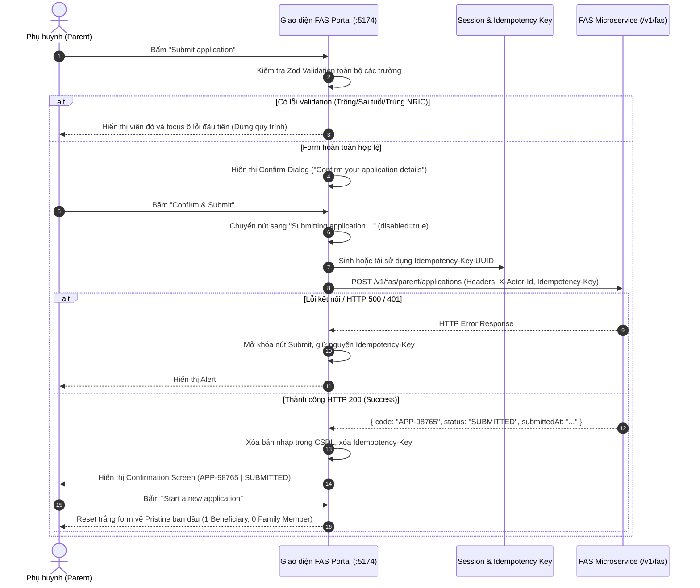

# 📋 BSK Locator & Functional Flow Spec: Step 4 - Review Summary, Confirmation & Submission

| Trường Thông Tin | Chi Tiết |
| :--- | :--- |
| **Portal / Cổng Dịch Vụ** | `localhost:5174` (EduSave E-Service Portal) |
| **Đường Dẫn Thực Tế (URL)** | `http://localhost:5174/fas-application` |
| **Tiêu Đề Trang (Title)** | `EduFAMS | E-Service` |
| **Heading Màn Hình Nộp (H1)** | `Financial Assistance Scheme application` / `Application submitted` (`#fas-confirmation-title`) |
| **Phân Hệ / Module** | `f10` / `FS-10` / `R10` (Wizard Step 4: Review & Submission) |
| **Thời Điểm Trích Xuất (BSK)** | `Live DOM Verified via Chromium Headless CDP` |

---

## 🔍 1. Bảng Locators Chi Tiết (BSK Verified Live DOM Elements)

### 1.1 Khối Nút Thao Tác & Trạng Thái Gửi Đơn (Actions & Submission Controls)
| Tên Thao Tác / Nút | Loại | Cấu Trúc ID / Name | Selector Tối Ưu (Playwright) | Trạng Thái Ban Đầu | Hành Vi Khi Kích Hoạt |
| :--- | :--- | :--- | :--- | :--- | :--- |
| **Nút Nộp Đơn (Submit)** | `submit` | `button[type="submit"]` | `button:has-text("Submit application")` | 🟢 **Enabled** | Bắt đầu đối soát Zod & gửi API |
| **Trạng Thái Đang Gửi (Loading)**| `button` | `button:has-text("Submitting")`| `button:has-text("Submitting application…")` | 🔴 **Disabled** (Đang pending) | Ngăn chặn double-click |
| **Nút Quay Lại Chỉnh Sửa** | `button` | `button[data-testid="btn-back"]`| `button:has-text("Back"), button:has-text("Edit")` | 🟢 Enabled | Quay lại các bước trước để sửa |

### 1.2 Hộp Thoại Xác Nhận Trước Khi Nộp (Pre-Submission Confirm Dialog)
> [!NOTE]
> Khi kích hoạt nộp đơn, modal alertdialog yêu cầu phụ huynh rà soát lại lần cuối trước khi ghi nhận vào CSDL Chính phủ.

| Thành Phần Hộp Thoại | Loại | Selector Tối Ưu (Playwright) | Vai Trò (Role) / Ghi Chú |
| :--- | :--- | :--- | :--- |
| **Hộp Thoại Xác Nhận** | `dialog` | `div[role="alertdialog"], dialog` | `role="alertdialog"`, bẫy focus bàn phím |
| **Tiêu Đề Hộp Thoại** | `h2` | `div[role="alertdialog"] h2` | `"Confirm your application details"` |
| **Nội Dung Nhắc Nhở** | `p` | `div[role="alertdialog"] p` | Cảnh báo thông tin đã nộp sẽ không thể tự ý sửa đổi |
| **Nút Xác Nhận Nộp (Confirm)**| `button` | `div[role="alertdialog"] button:has-text("Confirm & Submit")` | Kích hoạt API call chính thức |
| **Nút Hủy / Giữ Để Sửa (Cancel)**| `button` | `div[role="alertdialog"] button:has-text("Keep editing"), button:has-text("Cancel")` | Đóng hộp thoại, giữ nguyên dữ liệu |

### 1.3 Màn Hình Kết Quả Nộp Thành Công (Confirmation Screen - Live DOM Verified)
> [!IMPORTANT]
> Khi submit thành công, toàn bộ form biến mất và thay thế bằng `section[aria-labelledby="fas-confirmation-title"]`.

| Tên Phần Tử / Nhãn | Loại | Cấu Trúc ID / Tag | Selector Tối Ưu (Playwright) | Nội Dung / Giá Trị Điển Hình |
| :--- | :--- | :--- | :--- | :--- |
| **Tiêu Đề Xác Nhận H1** | `h1` | `#fas-confirmation-title` | `h1#fas-confirmation-title` | `"Application submitted"` |
| **Mô Tả Tiếp Nhận** | `p` | `p:has-text("received")` | `section[aria-labelledby="fas-confirmation-title"] p` | `"Your Financial Assistance Scheme application has been received."` |
| **Khung Dữ Liệu Kết Quả**| `dl` | `dl` | `section[aria-labelledby="fas-confirmation-title"] dl` | Chứa danh sách cặp Term/Definition |
| **Nhãn Mã Tham Chiếu** | `dt` | `dt:has-text("reference")`| `dt:has-text("Application reference")` | Thuật ngữ: `"Application reference"` |
| **Mã Tham Chiếu Đơn** | `dd` | `dd:has-text("APP-")` | `dt:has-text("Application reference") + dd` | Ví dụ: `"APP-98765"` (Regex: `^APP-\d{5}$`) |
| **Nhãn Trạng Thái** | `dt` | `dt:has-text("Status")` | `dt:has-text("Status")` | Thuật ngữ: `"Status"` |
| **Huy Hiệu Trạng Thái** | `dd` | `dd:has-text("SUBMITTED")` | `dt:has-text("Status") + dd` | `"SUBMITTED"` |
| **Nhãn Thời Gian Nộp** | `dt` | `dt:has-text("Submitted at")`| `dt:has-text("Submitted at")` | Thuật ngữ: `"Submitted at"` |
| **Giá Trị Thời Gian Nộp**| `dd` | `dd:has-text("/")` | `dt:has-text("Submitted at") + dd` | Timestamp định dạng ngày giờ địa phương |
| **Nút Bắt Đầu Đơn Mới** | `button` | `button:has-text("Start a new application")` | `button:has-text("Start a new application")` | Reset trắng form về Pristine state |

### 1.4 Thông Báo Lỗi Máy Chủ & Mạng (Server Error Alerts)
| Loại Thông Báo | Selector Tối Ưu | Cấu Trúc HTML | Nội Dung Cảnh Báo |
| :--- | :--- | :--- | :--- |
| **Banner Lỗi Máy Chủ** | `div[role="alert"]#fas-server-error` | `tone="error"`, `id="fas-server-error"` | `"Unable to submit application"` |
| **Chi Tiết Lỗi Backend** | `#fas-server-error p, #fas-server-error div` | Text bên dưới heading lỗi | `"We could not submit your application. Please try again."` hoặc mã lỗi API (`401`, `500`) |

---

## 🔄 2. Đặc Tả Luồng Nghiệp Vụ (Functional Flow & State Machine)

### 2.1 Sơ Đồ Quy Trình Nộp Đơn Toàn Trình (Full End-to-End Submission Lifecycle)


### 2.2 Quy Chuẩn API & Kiểm Soát Idempotency (API Specifications)
- **Endpoint**: `POST /v1/fas/parent/applications` (hoặc `/api/v1/fas/parent/applications`)
- **Headers Bắt Buộc**:
  - `Content-Type`: `application/json; charset=utf-8`
  - `X-Actor-Id`: NRIC của người nộp đơn (Applicant NRIC, ví dụ: `S1234567A`)
  - `X-Actor-Role`: `PARENT`
  - `Idempotency-Key`: Khóa định danh giao dịch duy nhất dạng UUID v4 (ví dụ: `c8a6e9f1-...`)
- **Cơ Chế Tái Sử Dụng Idempotency Key**:
  - Khi một lượt submit thất bại do lỗi mạng hoặc server 500, phụ huynh bấm thử lại $\rightarrow$ Hệ thống **tái sử dụng nguyên vẹn** khóa `idempotencyKey` cũ để đảm bảo không bị trừ tiền hoặc sinh 2 hồ sơ trùng lặp tại backend.
  - Khi phụ huynh chỉnh sửa bất kỳ một trường dữ liệu nào $\rightarrow$ `idempotencyKey` lập tức bị hủy và làm mới ở lần submit kế tiếp.
- **Payload Chuẩn Hóa (`FasApplicationRequest`)**:
```json
{
  "applicant": {
    "fullName": "TAN WEI MING",
    "nric": "S1234567A",
    "dateOfBirth": "1984-05-15",
    "gender": "MALE",
    "nationality": "SC",
    "race": "CHINESE",
    "relationshipToBeneficiary": "FATHER",
    "phoneNumber": "+6591234567",
    "email": "tan.weiming@example.com",
    "address": "Blk 123 Ang Mo Kio Ave 4 #08-12, Singapore 560123",
    "commitmentAgreed": true,
    "forwardToSchoolAgreed": true
  },
  "beneficiaries": [
    {
      "fullName": "TAN JIA WEI",
      "nric": "T0912345B",
      "dateOfBirth": "2015-08-20",
      "gender": "MALE",
      "schoolName": "Ang Mo Kio Primary School",
      "classLevel": "PRIMARY",
      "grade": "Primary 5A"
    }
  ],
  "familyMembers": []
}
```

### 2.3 Ma Trận Kiểm Thử 12 Lớp (12-Layer Field Test Matrix)
| Lớp Kiểm Thử | Tình Huống / Dữ Liệu Đầu Vào | Hành Vi Giao Diện | Phản Hồi Trực Quan & Mã Lỗi |
| :--- | :--- | :--- | :--- |
| **1. Anti-Double Submit Lock** | Bấm đúp chuột cực nhanh vào nút Submit | Nút chuyển sang trạng thái disabled lập tức | Text nút: `"Submitting application…"` |
| **2. Successful Submission** | Nộp form với đầy đủ dữ liệu hợp lệ | Ẩn form, hiển thị màn hình Confirmation | Render `h1#fas-confirmation-title` |
| **3. Application Reference Code**| Submit thành công đơn mới | Hiển thị mã đơn định dạng chuẩn `APP-NNNNN` | `dt:has-text("Application reference") + dd` |
| **4. Status Badge Verification**| Submit thành công đơn mới | Hiển thị trạng thái tiếp nhận | `SUBMITTED` |
| **5. Form Reset Flow** | Bấm nút `"Start a new application"` | Xóa sạch dữ liệu đã điền, trả về form ban đầu | Form trắng, 1 thẻ học sinh, 0 member |
| **6. Server Error 500 Banner** | Giả lập backend sập trả về mã HTTP 500 | Form giữ nguyên toàn bộ dữ liệu, hiện banner lỗi | Alert `#fas-server-error` xuất hiện |
| **7. Idempotency Key Retention** | Retry nộp sau khi bị lỗi mạng | Sử dụng lại chính xác Idempotency-Key cũ | Request header giữ nguyên key |
| **8. Idempotency Key Reset** | Chỉnh sửa email sau khi bị lỗi rồi nộp lại | Sinh Idempotency-Key hoàn toàn mới | Header nhận UUID mới |
| **9. Beneficiary Count Guard** | Cố tình xóa hết toàn bộ học sinh (0 con) | Chặn submit với mã lỗi `minimumBeneficiary` | `"Add at least one beneficiary."` |
| **10. Safe Fallback Error Text**| API trả về lỗi bảo mật nội bộ backend | Giao diện ẩn chi tiết thô, hiện fallback an toàn | `"We could not submit your application."` |
| **11. Pristine After Reset** | Bấm Start a new application rồi kiểm tra | Nút Remove beneficiary của con thứ 1 bị disabled | Khôi phục đúng invariant ban đầu |
| **12. UI Health & Visual Contrast**| Kiểm tra tỷ lệ tương phản chữ trên màn kết quả | Đạt chuẩn WCAG 2.1 AA, bố cục cân đối, 0 console error | Đạt chuẩn Invariant 7 UI Health |

---

## 💻 3. Playwright Page Object Snippet (Zero Assertions)

```python
"""
pages/f10/components/review_submission_step.py - Step 4 Component cho FAS Application.
Tuân thủ Invariant 1 (Zero assertions in Page Objects) & Invariant 9 (< 250 dòng).
"""
import re
from typing import Dict, Optional
from playwright.sync_api import Locator, Page
from pages.base_page import BasePage


class ReviewSubmissionStep(BasePage):
    """Component phụ trách xem lại hồ sơ, thực thi nộp đơn và xử lý kết quả xác nhận (Step 4)."""

    # Locators Thao Tác Submit
    SUBMIT_BTN = "button:has-text('Submit application')"
    SUBMITTING_BTN = "button:has-text('Submitting application…')"
    SERVER_ERROR_ALERT = "div[role='alert']#fas-server-error"

    # Locators Modal Xác Nhận (Confirm Dialog)
    ALERT_DIALOG = "div[role='alertdialog']"
    CONFIRM_SUBMIT_BTN = "div[role='alertdialog'] button:has-text('Confirm & Submit')"
    KEEP_EDITING_BTN = "div[role='alertdialog'] button:has-text('Keep editing'), div[role='alertdialog'] button:has-text('Cancel')"

    # Locators Màn Hình Xác Nhận Thành Công (Confirmation Screen)
    CONFIRMATION_HEADING = "h1#fas-confirmation-title"
    CONFIRMATION_DESCRIPTION = "section[aria-labelledby='fas-confirmation-title'] p"
    APP_REF_CODE = "dt:has-text('Application reference') + dd"
    APP_STATUS = "dt:has-text('Status') + dd"
    SUBMITTED_AT = "dt:has-text('Submitted at') + dd"
    START_NEW_APP_BTN = "button:has-text('Start a new application')"

    def __init__(self, page: Page):
        super().__init__(page)

    def click_submit_application(self) -> None:
        """Bấm nút nộp đơn chính trên form."""
        self.click_element(self.SUBMIT_BTN)

    def is_submitting_state_active(self) -> bool:
        """Kiểm tra trạng thái đang nộp (nút chuyển sang Submitting và disabled)."""
        return self.is_visible(self.SUBMITTING_BTN, timeout=2000)

    def is_confirm_dialog_visible(self) -> bool:
        """Kiểm tra hộp thoại xác nhận trước khi nộp có hiển thị không."""
        return self.is_visible(self.ALERT_DIALOG, timeout=2000)

    def click_confirm_and_submit_in_dialog(self) -> None:
        """Bấm nút xác nhận nộp trong modal dialog."""
        self.click_element(self.CONFIRM_SUBMIT_BTN)

    def click_keep_editing_in_dialog(self) -> None:
        """Bấm nút đóng modal và giữ nguyên để chỉnh sửa thêm."""
        self.click_element(self.KEEP_EDITING_BTN)

    def is_confirmation_screen_rendered(self) -> bool:
        """Kiểm tra màn hình kết quả nộp thành công đã render chưa."""
        return self.is_visible(self.CONFIRMATION_HEADING, timeout=10000)

    def get_application_reference_code(self) -> str:
        """Lấy mã tham chiếu đơn (Reference Code, ví dụ: APP-98765)."""
        return self.get_text(self.APP_REF_CODE)

    def get_application_status(self) -> str:
        """Lấy trạng thái của đơn đã nộp (ví dụ: SUBMITTED)."""
        return self.get_text(self.APP_STATUS)

    def get_submitted_at_timestamp(self) -> str:
        """Lấy thời điểm nộp đơn hiển thị trên màn hình."""
        return self.get_text(self.SUBMITTED_AT)

    def click_start_new_application(self) -> None:
        """Bấm nút bắt đầu một đơn nộp mới (Reset form)."""
        self.click_element(self.START_NEW_APP_BTN)

    def get_server_error_message(self) -> Optional[str]:
        """Lấy thông tin lỗi máy chủ nếu có alert hiển thị."""
        if self.is_visible(self.SERVER_ERROR_ALERT, timeout=2000):
            return self.get_text(self.SERVER_ERROR_ALERT)
        return None
```

---

## 🎯 4. Tiêu Chí Xác Nhận Pass/Fail & Error Handling (Pass/Fail Oracles & Assertions)

### 4.1 Tiêu Chí Xác Nhận Thành Công (Pass Oracles)
| Hành Động / Kịch Bản Kiểm Thử | Loại UI Feedback | Selector Playwright Tối Ưu | Kỳ Vọng Text / Giá Trị | Playwright Assertion Cú Pháp Mẫu (Dành Cho `tests/`) |
| :--- | :--- | :--- | :--- | :--- |
| **Bấm Nộp đơn (Click Submit application)** | Hộp thoại xác nhận xuất hiện | `div[role="alertdialog"]` | Modal hiển thị tiêu đề xác nhận | `expect(page.locator('div[role="alertdialog"]')).to_be_visible()` |
| **Bấm "Keep editing" trong modal** | Đóng Modal, giữ nguyên dữ liệu | `div[role="alertdialog"]` | Modal ẩn, form Step 4 vẫn giữ nguyên | `expect(page.locator('div[role="alertdialog"]')).to_be_hidden()`<br>`expect(page.locator('button:has-text("Submit application")')).to_be_visible()` |
| **Bấm "Confirm & Submit" thành công** | Màn hình xác nhận thành công | `h1#fas-confirmation-title` | Tiêu đề nộp đơn thành công | `expect(page.locator('h1#fas-confirmation-title')).to_be_visible()` |
| **Sinh Mã đơn nộp hợp lệ (Reference Code)** | Mã tham chiếu đơn `APP-XXXXX` | `dt:has-text("Application reference") + dd` | Khớp regex mã đơn (vd: `^APP-\d{5,}$`) | `expect(page.locator('dt:has-text("Application reference") + dd')).to_have_text(re.compile(r"^APP-\w+$"))` |
| **Trạng thái đơn hiển thị đã nộp** | Trạng thái hiển thị | `dt:has-text("Status") + dd` | Trạng thái `"SUBMITTED"` hoặc `"PENDING"` | `expect(page.locator('dt:has-text("Status") + dd')).to_contain_text("SUBMITTED")` |
| **Nút "Start a new application" (Reset)** | Làm mới form về Step 1 Pristine | `button:has-text("Start a new application")` | Chuyển về Step 1 với form sạch | `page.locator('button:has-text("Start a new application")').click()`<br>`expect(page.locator('#applicant-fullName')).to_have_value("")` |

---

### 4.2 Tiêu Chí Bắt Lỗi & Xử Lý Ngoại Lệ (Fail & Error Handling Feedback)
| Tình Huống Lỗi / Trigger | Loại UI Feedback | Selector Playwright Tối Ưu | Mã Lỗi & Text Kỳ Vọng | Playwright Assertion Cú Pháp Mẫu (Dành Cho `tests/`) |
| :--- | :--- | :--- | :--- | :--- |
| **Lỗi Backend API 500 khi nộp đơn** | Banner báo lỗi hệ thống toàn cục | `div[role="alert"]#fas-server-error` | `"We could not submit your application."` (dữ liệu form được bảo toàn) | `expect(page.locator('div[role="alert"]#fas-server-error')).to_be_visible()`<br>`expect(page.locator('div[role="alert"]#fas-server-error')).to_contain_text("could not submit")` |
| **Chống bấm kép khi đang nộp (Double Click)** | Nút chuyển sang trạng thái pending | `button:has-text("Submitting application…")` | Nút bị disabled và hiện text submitting | `expect(page.locator('button:has-text("Submitting application…")')).to_be_disabled()` |

