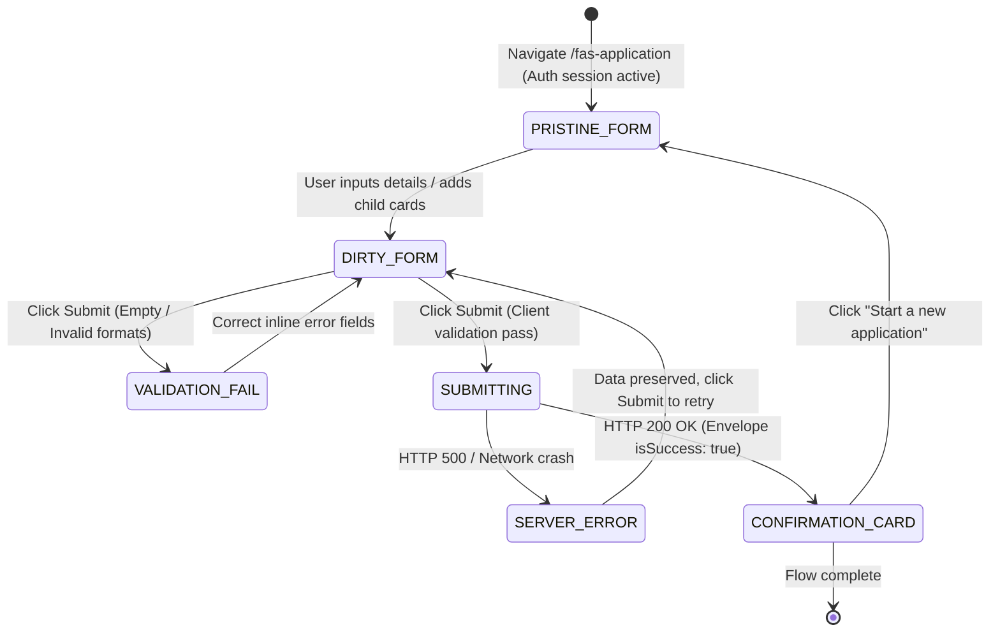

# Test Specification: UAT-028 — Comprehensive FAS Direct Application Submission (US-028)

> **Module**: F10 (Financial Assistance Scheme / FAS Direct Application)  
> **Ticket / Feature**: `f10-fas-submission`  
> **Target Route**: `http://localhost:5174/fas-application` (SCR-FAS-01)  
> **Target Persona**: Registered Parent (`TAN AH TECK` / `LIM WEI MINH`)  
> **Total Test Cases**: 66 Comprehensive Test Cases  
> **Framework Compliance**: 5 Pillars (BR, AC, 12-Layer Validation Matrix, Functional Flow State Machine, Error Catalog), BSK Live DOM, Invariant 0-9.

---

## Section 1: The 5 Core Pillars of Test Design (Bộ Ngũ Nguyên Liệu Cốt Lõi)

### 1.1 Business Rules (BR)
- **`BR-10-SUB-01` (Direct FAS Submission Architecture)**: Authenticated parents can directly submit financial assistance applications on a single screen without going through the 5-step wizard.
- **`BR-10-SUB-02` (Mandatory Legal Declarations & Consent)**: Both `commitmentAgreed` (declaration of truthfulness) and `forwardToSchoolAgreed` (consent to forward data to school) are legally mandatory. Submitting without checking either fails immediately with validation blocking.
- **`BR-10-SUB-03` (Beneficiary Child Invariants & Constraints)**:
  - At least one beneficiary child record is mandatory (`minimumBeneficiary`).
  - Beneficiary age must be between 7 and 16 years old (calculated strictly from Date of Birth).
  - Beneficiary NRIC cannot duplicate the applicant parent's NRIC (`duplicateNric`).
  - Sibling beneficiary children cannot share the same NRIC (`duplicateNric`).
  - Beneficiary Date of Birth cannot be in the future (`futureDate`).
- **`BR-10-SUB-04` (Dynamic Card Lifecycle & Household Members)**:
  - Users can dynamically add or remove beneficiary children (minimum 1 child card must remain).
  - Users can optionally add or remove household family members with mandatory income declaration (`hasIncome: yes/no`).
- **`BR-10-SUB-05` (Confirmation State & Reset)**:
  - Upon successful backend mutation (`POST /applications`), the form transitions to the `Confirmation Card` state displaying the unique `Application Code` and status `SUBMITTED`.
  - The applicant details, beneficiary list, and submit action buttons are hidden in confirmation mode.
  - Clicking `Start a new application` completely resets the form state and returns to an empty pristine view.

---

### 1.2 Acceptance Criteria (AC)
- **`AC-UAT-028-01` (Single-Child Direct Submission)**: When the applicant fills valid applicant details, 1 valid primary/secondary beneficiary child, checks both commitments, and clicks Submit, the system creates the application and renders the Confirmation Card with code `APP-YYYY-XXXXX` and status `SUBMITTED`.
- **`AC-UAT-028-02` (Multi-Child & Family Member Submission)**: When the applicant adds a second child and a family member, fills valid attributes for all, and submits, the system persists all beneficiaries and household members.
- **`AC-UAT-028-03` (Mandatory Field Validation)**: Submitting an empty form triggers inline error messages (`This field is required.`) on all mandatory fields: Full name, NRIC, Date of birth, Phone number, Email address, Address, School name, Class level, and Grade.
- **`AC-UAT-028-04` (Commitment Checkbox Enforcements)**: Submitting with unchecked commitment triggers `You must agree to the commitment before submitting.` and prevents form submission.
- **`AC-UAT-028-05` (NRIC Format & Uniqueness)**: Invalid NRIC syntax triggers `Enter a valid NRIC or FIN.`. Duplicate NRIC triggers `Each NRIC or FIN must be unique.` on all conflicting fields.
- **`AC-UAT-028-06` (Age Boundary & Future Date Enforcements)**: Beneficiary age < 7 or > 16 triggers `The beneficiary must be between 7 and 16 years old.`. Future DOB triggers `Date of birth cannot be in the future.`.

---

### 1.3 Validation Rules Matrix (12-Layer Form & Field Matrix)

| Field Name | Mandatory | Type / Format | Boundary / Regex | Expected Error Message |
| :--- | :--- | :--- | :--- | :--- |
| `applicant-fullName` | Yes | String (trimmed) | 2 - 200 chars | `This field is required.` / `Enter up to 200 characters.` |
| `applicant-nric` | Yes | Singapore NRIC/FIN | `^[A-Za-z]\d{7}[A-Za-z]$` | `Enter a valid NRIC or FIN.` / `Each NRIC or FIN must be unique.` |
| `applicant-dateOfBirth` | Yes | ISO Date (YYYY-MM-DD) | Valid past date | `This field is required.` / `Date of birth cannot be in the future.` |
| `applicant-gender` | Yes | Radio Enum | `MALE` / `FEMALE` / `OTHER` | `This field is required.` |
| `applicant-nationality` | Yes | Select Enum | `SC`, `PR`, `IS_ASEAN`, `IS_NON_ASEAN` | `This field is required.` |
| `applicant-race` | Yes | Select Enum | `CHINESE`, `MALAY`, `INDIAN`, `EURASIAN`, `OTHERS` | `This field is required.` |
| `applicant-relationship` | Yes | Select Enum | `FATHER`, `MOTHER`, `LEGAL_GUARDIAN`, etc. | `This field is required.` |
| `applicant-phoneNumber` | Yes | SG Phone Number | `^\+?\d{1,10}$` | `Enter a valid phone number.` |
| `applicant-email` | Yes | Email RFC 5322 | Max 100 chars, valid domain | `Enter a valid email address.` / `Enter up to 100 characters.` |
| `applicant-address` | Yes | Street Address | Max 500 chars | `This field is required.` / `Enter up to 500 characters.` |
| `applicant-commitmentAgreed` | Yes | Checkbox boolean | Must be `true` | `You must agree to the commitment before submitting.` |
| `applicant-forwardToSchool` | Yes | Checkbox boolean | Recommended `true` | Checkbox state persisted |
| `beneficiaries[i].fullName` | Yes | String | 2 - 200 chars | `This field is required.` / `Enter up to 200 characters.` |
| `beneficiaries[i].nric` | Yes | NRIC/FIN | Unique across app | `Each NRIC or FIN must be unique.` / `Enter a valid NRIC or FIN.` |
| `beneficiaries[i].dateOfBirth` | Yes | ISO Date | Age 7 - 16, no future | `The beneficiary must be between 7 and 16 years old.` / `Date of birth cannot be in the future.` |
| `beneficiaries[i].gender` | Yes | Radio Enum | `MALE` / `FEMALE` / `OTHER` | `This field is required.` |
| `beneficiaries[i].schoolName` | Yes | String | 2 - 200 chars | `This field is required.` / `Enter up to 200 characters.` |
| `beneficiaries[i].classLevel` | Yes | Select Enum | `PRIMARY`, `SECONDARY`, `PRE_UNIVERSITY` | `This field is required.` |
| `beneficiaries[i].grade` | Yes | String | Max 50 chars | `This field is required.` / `Enter up to 50 characters.` |
| `familyMembers[i].fullName` | Yes | String | 2 - 200 chars | `This field is required.` |
| `familyMembers[i].nric` | Yes | NRIC/FIN | Unique across app | `Each NRIC or FIN must be unique.` |
| `familyMembers[i].dateOfBirth` | Yes | ISO Date | Past date | `This field is required.` |
| `familyMembers[i].gender` | Yes | Radio Enum | `MALE` / `FEMALE` / `OTHER` | `This field is required.` |
| `familyMembers[i].hasIncome` | Yes | Radio boolean | `yes` / `no` | `Select whether this family member has income.` |

---

### 1.4 Functional Flow & State Machine

---

### 1.5 Error Handling & Visual Feedback Catalog

| Error Code / Trigger | Visual UI Feedback | Selector / Element | Recovery Action |
| :--- | :--- | :--- | :--- |
| `required` | Red error label below input | `#{id}-error` | Enter required value, error clears on input |
| `invalidNric` | Red error label below NRIC input | `#applicant-nric-error` | Correct NRIC format (`S1234567A`) |
| `invalidPhone` | Red error label below phone input | `#applicant-phoneNumber-error` | Enter valid digits up to 10 chars |
| `invalidEmail` | Red error label below email input | `#applicant-email-error` | Correct email to `user@domain.com` |
| `futureDate` | Red error label below DOB input | `#{id}-dateOfBirth-error` | Select a past date |
| `ageRange` | Red error label below child DOB | `[id$='-dateOfBirth-error']` | Child age must be 7 to 16 |
| `duplicateNric` | Red error label on all duplicate NRICs | `[id$='-nric-error']` | Ensure every person has unique NRIC |
| `commitmentRequired` | Red warning below declaration box | `#applicant-commitmentAgreed-error` | Check mandatory commitment box |
| `hasIncomeRequired` | Red warning below income radio | `p[id*='hasIncome-error']` | Select Yes or No |
| `aria-invalid="true"` | Red highlighted glowing border | `input[aria-invalid="true"]` | Visual feedback on invalid fields |
| HTTP 500 Server Error | Red Alert banner at top of form | `div[role='alert']` | Form data preserved, user retries |
| Button Loading State | Button disabled with loading text | `button:has-text('Submitting application…')` | Debounces double-click submissions |

---

## Section 2: Master Test Suite Allocation Overview (66 Test Cases)

| Pillar Focus | Scenario Group ID | Test Scope & Objectives | Test Count |
| :--- | :--- | :--- | :--- |
| **Pillar 1: Business Rules (BR)** | `TS-FAS-BR` | Direct FAS form access, Single child submit, Multi-child submit, Secondary level submit, Pre-U level submit, Mandatory commitments, Minimum beneficiary constraint, Sibling duplicate NRIC, Parent duplicate NRIC, Post-submit form reset. | 10 TCs |
| **Pillar 2: Acceptance Criteria (AC)** | `TS-FAS-AC` | Gherkin primary happy path, Multi-child acceptance, Pre-U acceptance, Mandatory fields gate, Partial fill gate, Commitment declaration gate. | 6 TCs |
| **Pillar 3: Applicant Validation Matrix (VAL-APP)** | `TS-FAS-APP` | FullName (empty, whitespace, special chars, unicode, max 200, XSS), NRIC (empty, numeric, missing prefix, missing suffix, length, lowercase), DOB (empty, future), Gender, Nationality, Race, Relationship, Phone (empty, letters, length > 10, valid plus), Email (empty, double @, missing @, missing domain, missing user, max 100), Address (empty, whitespace, multiline, max 500). | 20 TCs |
| **Pillar 3: Beneficiary Validation Matrix (VAL-BEN)** | `TS-FAS-BEN` | FullName (empty, special chars, max 200), NRIC (empty, invalid syntax), DOB (empty, future, age 6 rejected, age 7 accepted, age 16 accepted, age 17 rejected), Gender, School (empty, max 200), ClassLevel (empty, PRIMARY, SECONDARY, PRE_U), Grade (empty, max 50). | 14 TCs |
| **Pillar 3: Family Member Matrix (VAL-FAM)** | `TS-FAS-FAM` | Add family card, FullName, NRIC syntax, DOB, Gender, HasIncome (not selected rejected, yes selected, no selected), Remove family card. | 4 TCs |
| **Pillar 4: Functional Flow & Lifecycle (FLO)** | `TS-FAS-FLO` | Dynamic child card addition, dynamic child card removal, middle child removal re-index, start new application reset, form dirty state tracking. | 5 TCs |
| **Pillar 5: Error Handling & UI Health (ERR)** | `TS-FAS-ERR` | HTTP 500 server error resilience & data preservation, HTTP 400 error handling, visual `aria-invalid` feedback on applicant, visual `aria-invalid` feedback on beneficiary, submit button loading debouncing, zero raw i18n translation leaks, zero uncaught console errors. | 7 TCs |
| **Total Test Cases** | | **Comprehensive 5-Pillar Coverage for UAT-028** | **66 TCs** |

---

## Section 3: Master Test Case Matrix (66 Cases — 19 Columns AvePoint Standard)

| ID | Scenario ID | Title | Test Suite | Page | Severity | Priority | Execution Status | Test Type | Environment | Preconditions | Test Data | Test Steps | Expected Result | Actual Result | Assumption Ref | Defect ID | Traceability | Note |
| :--- | :--- | :--- | :--- | :--- | :--- | :--- | :--- | :--- | :--- | :--- | :--- | :--- | :--- | :--- | :--- | :--- | :--- | :--- |
| `TC-UAT028-01` | `TS-FAS-BR-01` | Direct online FAS application submission with single primary child returns Confirmation Card | Primary Flow | FAS Application | S1 | Critical | Passed | Integration / Flow | Localhost (:5174) | Parent session active | `valid_applicant`, `valid_beneficiary` | 1. Navigate to `/fas-application` 2. Fill Applicant Details 3. Fill Beneficiary Child Details 4. Check both commitment checkboxes 5. Click Submit | 1. Backend POST `/applications` returns 200 OK 2. Confirmation Card appears 3. Application code is generated 4. Status displays 'SUBMITTED' | As expected | BR-10-SUB-01, BR-10-SUB-05 | None | UAT-028, AC-UAT-028-01 | Primary Flow |
| `TC-UAT028-02` | `TS-FAS-BR-02` | FAS application submission with multiple beneficiary children and family member | Multi-Child FAS | FAS Application | S1 | Critical | Passed | Integration / Flow | Localhost (:5174) | Parent session active | `valid_applicant`, `second_beneficiary`, `family_member` | 1. Fill Applicant and Child 1 2. Click 'Add beneficiary' and fill Child 2 3. Click 'Add family member' and fill Member 1 4. Check commitments and Submit | 1. 2 child cards and 1 family card persisted 2. Form submits successfully 3. Confirmation Card renders with status 'SUBMITTED' | As expected | BR-10-SUB-04, AC-UAT-028-02 | None | UAT-028, AC-UAT-028-02 | Multi-child |
| `TC-UAT028-03` | `TS-FAS-BR-03` | FAS application submission with secondary school student level and grade | Secondary School FAS | FAS Application | S1 | Critical | Passed | Integration / Flow | Localhost (:5174) | Parent session active | `valid_applicant`, `secondary_beneficiary` | 1. Fill Applicant Details 2. Fill child with classLevel: SECONDARY and grade: Secondary 2 3. Check commitments and Submit | 1. Form submits successfully with HTTP 200 OK 2. Confirmation Card renders with code and SUBMITTED status | As expected | BR-10-SUB-01, AC-UAT-028-01 | None | UAT-028, AC-UAT-028-01 | Secondary Level |
| `TC-UAT028-04` | `TS-FAS-BR-04` | FAS application submission with Pre-University student level | Pre-U FAS | FAS Application | S1 | Critical | Passed | Integration / Flow | Localhost (:5174) | Parent session active | `valid_applicant`, child classLevel `PRE_UNIVERSITY` | 1. Fill Applicant Details 2. Fill child with classLevel PRE_UNIVERSITY, grade JC 1 3. Check commitments and Submit | 1. Form submits successfully 2. Confirmation Card renders with SUBMITTED status | As expected | BR-10-SUB-01, AC-UAT-028-01 | None | UAT-028, AC-UAT-028-01 | Pre-U Level |
| `TC-UAT028-05` | `TS-FAS-BR-05` | Unchecked declaration & commitment checkbox blocks form submission | Legal Declaration | FAS Application | S2 | High | Passed | Atomic / Validation | Localhost (:5174) | Form filled | `valid_applicant` (commitmentAgreed: false) | 1. Fill all applicant and child fields 2. Leave commitmentAgreed unchecked 3. Click Submit | 1. Red error 'You must agree to the commitment before submitting.' appears 2. Form submission blocked | As expected | BR-10-SUB-02 | None | UAT-028, AC-UAT-028-04 | Legal Terms |
| `TC-UAT028-06` | `TS-FAS-BR-06` | Minimum 1 beneficiary constraint: Form requires at least 1 child | Minimum Constraint | FAS Application | S2 | High | Passed | Integration / BR | Localhost (:5174) | Fresh form | Fresh form | 1. Open `/fas-application` 2. Inspect child card section | 1. Exactly 1 child card rendered by default 2. Only child card has no remove button | As expected | BR-10-SUB-03 | None | UAT-028, Validation | Min Beneficiary |
| `TC-UAT028-07` | `TS-FAS-BR-07` | Duplicate NRIC between applicant parent and child beneficiary is rejected | NRIC Uniqueness | FAS Application | S2 | High | Passed | Atomic / Validation | Localhost (:5174) | Parent session active | Same NRIC for applicant & child | 1. Set child NRIC equal to applicant NRIC 2. Click Submit | 1. Both applicant and child NRIC fields show 'Each NRIC or FIN must be unique.' 2. Submission blocked | As expected | BR-10-SUB-03 | None | UAT-028, AC-UAT-028-05 | Duplicate Parent NRIC |
| `TC-UAT028-08` | `TS-FAS-BR-08` | Duplicate NRIC between two sibling beneficiary children is rejected | Sibling Uniqueness | FAS Application | S2 | High | Passed | Atomic / Validation | Localhost (:5174) | Parent session active | Same NRIC for child 1 & child 2 | 1. Add second child 2. Set child 2 NRIC equal to child 1 NRIC 3. Click Submit | 1. Both child 1 and child 2 NRIC fields show 'Each NRIC or FIN must be unique.' 2. Submission blocked | As expected | BR-10-SUB-03 | None | UAT-028, Validation | Duplicate Sibling NRIC |
| `TC-UAT028-09` | `TS-FAS-BR-09` | Duplicate NRIC between applicant and household family member is rejected | Family Uniqueness | FAS Application | S2 | High | Passed | Atomic / Validation | Localhost (:5174) | Parent session active | Same NRIC for applicant & family | 1. Add family member 2. Set family member NRIC equal to applicant NRIC 3. Click Submit | 1. Both fields show 'Each NRIC or FIN must be unique.' 2. Submission blocked | As expected | BR-10-SUB-03 | None | UAT-028, Validation | Duplicate Family NRIC |
| `TC-UAT028-10` | `TS-FAS-BR-10` | Clicking 'Start a new application' resets all form fields back to empty initial state | Form Reset | FAS Application | S2 | High | Passed | Integration / Flow | Localhost (:5174) | Confirmation Card active | Post-submission state | 1. From Confirmation Card, click 'Start a new application' button 2. Inspect form state | 1. Confirmation card dismisses 2. Form fields return to pristine empty state 3. Checkboxes are unchecked | As expected | BR-10-SUB-05 | None | UAT-028, Post-submit | Form Reset |
| `TC-UAT028-11` | `TS-FAS-AC-01` | Acceptance Gherkin Primary Flow: Complete submission produces Confirmation Card | Acceptance Flow | FAS Application | S1 | Critical | Passed | Integration / Flow | Localhost (:5174) | Parent session active | Valid payload | 1. Given parent on FAS form 2. When valid details entered and submitted 3. Then Confirmation Card rendered | 1. Application code generated 2. Status SUBMITTED displayed | As expected | AC-UAT-028-01 | None | UAT-028, AC-01 | Gherkin Primary |
| `TC-UAT028-12` | `TS-FAS-AC-02` | Acceptance Gherkin Multi-Child Flow: 2 children + 1 family member submitted | Acceptance Multi | FAS Application | S1 | Critical | Passed | Integration / Flow | Localhost (:5174) | Parent session active | Multi-child payload | 1. Given parent adds 2 children & 1 family member 2. When submitted 3. Then all records saved | 1. Confirmation Card renders 2. Status SUBMITTED displayed | As expected | AC-UAT-028-02 | None | UAT-028, AC-02 | Gherkin Multi |
| `TC-UAT028-13` | `TS-FAS-AC-03` | Acceptance Gate: Submitting empty form blocks network request and shows inline errors | Empty Gate | FAS Application | S2 | High | Passed | Atomic / Validation | Localhost (:5174) | Empty form | Empty inputs | 1. When empty form submitted 2. Then inline errors displayed | 1. 0 network calls sent to `/applications` 2. Inline errors shown on all required fields | As expected | AC-UAT-028-03 | None | UAT-028, AC-03 | Empty Gate |
| `TC-UAT028-14` | `TS-FAS-AC-04` | Acceptance Gate: Partial fill (Applicant filled, child empty) triggers child errors | Partial Fill Gate | FAS Application | S2 | High | Passed | Atomic / Validation | Localhost (:5174) | Applicant filled | Empty child | 1. Fill applicant details only 2. Submit form | 1. Inline errors shown on child card 2. Submission blocked | As expected | AC-UAT-028-03 | None | UAT-028, AC-03 | Partial Gate |
| `TC-UAT028-15` | `TS-FAS-AC-05` | Acceptance Gate: Commitment unchecked blocks submission with specific error | Commitment Gate | FAS Application | S2 | High | Passed | Atomic / Validation | Localhost (:5174) | Form filled | Unchecked commitment | 1. Leave commitment unchecked 2. Submit form | 1. Error 'You must agree to the commitment before submitting.' shown | As expected | AC-UAT-028-04 | None | UAT-028, AC-04 | Consent Gate |
| `TC-UAT028-16` | `TS-FAS-AC-06` | Acceptance Gate: Over-age child (>16 yo) blocked with ageRange message | Age Gate | FAS Application | S2 | High | Passed | Atomic / Validation | Localhost (:5174) | Parent session active | Child DOB 18 yo | 1. Set child DOB to 18 yo 2. Submit form | 1. Error 'The beneficiary must be between 7 and 16 years old.' shown | As expected | AC-UAT-028-06 | None | UAT-028, AC-06 | Age Gate |
| `TC-UAT028-17` | `TS-FAS-APP-01` | Applicant Full Name: Empty input triggers required error message | Field Required | FAS Application | S2 | High | Passed | Atomic / Validation | Localhost (:5174) | Empty form | Empty fullName | 1. Submit empty form 2. Inspect applicant-fullName | 1. Error 'This field is required.' displayed below input | As expected | Rule 02 Matrix | None | UAT-028, Validation | Name Required |
| `TC-UAT028-18` | `TS-FAS-APP-02` | Applicant Full Name: Whitespace-only input is trimmed and rejected as required | Whitespace Trim | FAS Application | S2 | High | Passed | Atomic / Validation | Localhost (:5174) | Fresh form | `'     '` | 1. Enter whitespace string in fullName 2. Submit | 1. Whitespace trimmed cleanly 2. Error 'This field is required.' displayed | As expected | Rule 02 Whitespace | None | UAT-028, ASM-15 | Name Whitespace |
| `TC-UAT028-19` | `TS-FAS-APP-03` | Applicant Full Name: Special characters and hyphens accepted | Special Chars | FAS Application | S2 | High | Passed | Atomic / Validation | Localhost (:5174) | Parent session active | `Tan Ah-Teck O'Connor` | 1. Enter name with hyphen and apostrophe 2. Verify validation | 1. Name accepted without error | As expected | Rule 02 Alpha | None | UAT-028, Validation | Name Special Chars |
| `TC-UAT028-20` | `TS-FAS-APP-04` | Applicant Full Name: Unicode and Chinese characters accepted safely | Unicode Support | FAS Application | S2 | High | Passed | Atomic / Validation | Localhost (:5174) | Parent session active | `陈大德 (Tan Ah Teck)` | 1. Enter Unicode Chinese characters 2. Verify validation | 1. Name accepted without encoding corruption | As expected | Rule 02 Unicode | None | UAT-028, Validation | Name Unicode |
| `TC-UAT028-21` | `TS-FAS-APP-05` | Applicant Full Name: Exceeding 200 characters triggers maxLength error | Boundary Max | FAS Application | S2 | High | Passed | Atomic / BVA | Localhost (:5174) | Parent session active | 201 chars string | 1. Enter 201 characters in fullName 2. Submit | 1. Error 'This field must be 200 characters or fewer.' displayed | As expected | Rule 02 BVA | None | UAT-028, BVA | Name Max Length |
| `TC-UAT028-22` | `TS-FAS-APP-06` | Applicant Full Name: XSS injection string sanitized safely | Security / XSS | FAS Application | S2 | High | Passed | Security / Sanitization | Localhost (:5174) | Parent session active | `` | 1. Enter script tag in fullName 2. Submit form | 1. No script executed in browser 2. HTML entities handled safely | As expected | Rule 02 Security | None | UAT-028, Security | Name XSS |
| `TC-UAT028-23` | `TS-FAS-APP-07` | Applicant NRIC: Empty input triggers required error message | NRIC Required | FAS Application | S2 | High | Passed | Atomic / Validation | Localhost (:5174) | Empty form | Empty NRIC | 1. Submit empty form 2. Inspect applicant-nric | 1. Error 'This field is required.' displayed below input | As expected | Rule 02 NRIC | None | UAT-028, Validation | NRIC Required |
| `TC-UAT028-24` | `TS-FAS-APP-08` | Applicant NRIC: Purely numeric string rejected with invalidNric | NRIC Syntax | FAS Application | S2 | High | Passed | Atomic / Validation | Localhost (:5174) | Parent session active | `12345678` | 1. Enter numeric string in NRIC 2. Submit | 1. 'Enter a valid NRIC or FIN.' displayed | As expected | Rule 02 NRIC | None | UAT-028, Validation | NRIC Numeric |
| `TC-UAT028-25` | `TS-FAS-APP-09` | Applicant NRIC: Missing trailing check letter rejected | NRIC Syntax | FAS Application | S2 | High | Passed | Atomic / Validation | Localhost (:5174) | Parent session active | `S123456` | 1. Enter NRIC without trailing letter 2. Submit | 1. 'Enter a valid NRIC or FIN.' displayed | As expected | Rule 02 NRIC | None | UAT-028, Validation | NRIC No Suffix |
| `TC-UAT028-26` | `TS-FAS-APP-10` | Applicant NRIC: Missing leading prefix letter rejected | NRIC Syntax | FAS Application | S2 | High | Passed | Atomic / Validation | Localhost (:5174) | Parent session active | `12345678A` | 1. Enter NRIC without leading prefix 2. Submit | 1. 'Enter a valid NRIC or FIN.' displayed | As expected | Rule 02 NRIC | None | UAT-028, Validation | NRIC No Prefix |
| `TC-UAT028-27` | `TS-FAS-APP-11` | Applicant NRIC: Lowercase letters normalized cleanly to uppercase | NRIC Normalization | FAS Application | S2 | High | Passed | Atomic / Flow | Localhost (:5174) | Parent session active | `s7812345a` | 1. Enter lowercase NRIC 's7812345a' 2. Submit form | 1. NRIC accepted and normalized to uppercase S7812345A | As expected | Validation.ts | None | UAT-028, Normalization | NRIC Uppercase |
| `TC-UAT028-28` | `TS-FAS-APP-12` | Applicant Date of Birth: Empty input triggers required error message | DOB Required | FAS Application | S2 | High | Passed | Atomic / Validation | Localhost (:5174) | Empty form | Empty DOB | 1. Submit empty form 2. Inspect applicant-dateOfBirth | 1. Error 'This field is required.' displayed | As expected | Rule 02 DatePicker | None | UAT-028, Validation | DOB Required |
| `TC-UAT028-29` | `TS-FAS-APP-13` | Applicant Date of Birth: Future date rejected with futureDate message | Future Date | FAS Application | S2 | High | Passed | Atomic / Validation | Localhost (:5174) | Parent session active | `2029-01-01` | 1. Enter future DOB for applicant 2. Submit | 1. 'Date of birth cannot be in the future.' displayed | As expected | Rule 02 DatePicker | None | UAT-028, Validation | Future Applicant DOB |
| `TC-UAT028-30` | `TS-FAS-APP-14` | Applicant Gender: Unselected radio triggers required error message | Gender Required | FAS Application | S2 | High | Passed | Atomic / Validation | Localhost (:5174) | Empty form | Unselected gender | 1. Submit empty form 2. Inspect gender error | 1. Error 'This field is required.' displayed on gender group | As expected | Rule 02 Radio | None | UAT-028, Validation | Gender Required |
| `TC-UAT028-31` | `TS-FAS-APP-15` | Applicant Nationality: Unselected dropdown triggers required error message | Select Required | FAS Application | S2 | High | Passed | Atomic / Validation | Localhost (:5174) | Empty form | Unselected nationality | 1. Submit empty form 2. Inspect nationality error | 1. Error 'This field is required.' displayed on nationality | As expected | Rule 02 Dropdown | None | UAT-028, Validation | Nationality Required |
| `TC-UAT028-32` | `TS-FAS-APP-16` | Applicant Race: Unselected dropdown triggers required error message | Select Required | FAS Application | S2 | High | Passed | Atomic / Validation | Localhost (:5174) | Empty form | Unselected race | 1. Submit empty form 2. Inspect race error | 1. Error 'This field is required.' displayed on race | As expected | Rule 02 Dropdown | None | UAT-028, Validation | Race Required |
| `TC-UAT028-33` | `TS-FAS-APP-17` | Applicant Relationship: Unselected dropdown triggers required error message | Select Required | FAS Application | S2 | High | Passed | Atomic / Validation | Localhost (:5174) | Empty form | Unselected relationship | 1. Submit empty form 2. Inspect relationship error | 1. Error 'This field is required.' displayed on relationship | As expected | Rule 02 Dropdown | None | UAT-028, Validation | Relationship Required |
| `TC-UAT028-34` | `TS-FAS-APP-18` | Applicant Phone Number: Empty input triggers required error message | Phone Required | FAS Application | S2 | High | Passed | Atomic / Validation | Localhost (:5174) | Empty form | Empty phone | 1. Submit empty form 2. Inspect applicant-phoneNumber | 1. Error 'This field is required.' displayed below input | As expected | Rule 02 Phone | None | UAT-028, Validation | Phone Required |
| `TC-UAT028-35` | `TS-FAS-APP-19` | Applicant Phone Number: Non-digit characters rejected with invalidPhone | Phone Syntax | FAS Application | S2 | High | Passed | Atomic / Validation | Localhost (:5174) | Parent session active | `abc12345` | 1. Enter letters in phone field 2. Submit | 1. 'Enter a valid phone number.' displayed | As expected | Rule 02 Phone | None | UAT-028, Validation | Phone Letters |
| `TC-UAT028-36` | `TS-FAS-APP-20` | Applicant Phone Number: Length exceeding 10 digits rejected with invalidPhone | Phone Length | FAS Application | S2 | High | Passed | Atomic / Validation | Localhost (:5174) | Parent session active | `1234567890123` | 1. Enter over-length phone number 2. Submit | 1. 'Enter a valid phone number.' displayed | As expected | Rule 02 Phone | None | UAT-028, Validation | Phone Overlength |
| `TC-UAT028-37` | `TS-FAS-APP-21` | Applicant Phone Number: International plus prefix format (+659123456) accepted | Phone Format | FAS Application | S2 | High | Passed | Atomic / Validation | Localhost (:5174) | Parent session active | `+659123456` | 1. Enter phone with plus prefix 2. Verify validation | 1. Phone accepted without error | As expected | Validation.ts | None | UAT-028, Validation | Phone Plus Prefix |
| `TC-UAT028-38` | `TS-FAS-APP-22` | Applicant Email Address: Empty input triggers required error message | Email Required | FAS Application | S2 | High | Passed | Atomic / Validation | Localhost (:5174) | Empty form | Empty email | 1. Submit empty form 2. Inspect applicant-email | 1. Error 'This field is required.' displayed | As expected | Rule 02 Email | None | UAT-028, Validation | Email Required |
| `TC-UAT028-39` | `TS-FAS-APP-23` | Applicant Email Address: Double @ character rejected with invalidEmail | Email Syntax | FAS Application | S2 | High | Passed | Atomic / Validation | Localhost (:5174) | Parent session active | `tan@@email.com` | 1. Enter email with two @ signs 2. Submit | 1. 'Enter a valid email address.' displayed | As expected | Rule 02 Email | None | UAT-028, Validation | Email Double @ |
| `TC-UAT028-40` | `TS-FAS-APP-24` | Applicant Email Address: Missing @ sign rejected with invalidEmail | Email Syntax | FAS Application | S2 | High | Passed | Atomic / Validation | Localhost (:5174) | Parent session active | `tan.email.com` | 1. Enter email without @ sign 2. Submit | 1. 'Enter a valid email address.' displayed | As expected | Rule 02 Email | None | UAT-028, Validation | Email Missing @ |
| `TC-UAT028-41` | `TS-FAS-APP-25` | Applicant Email Address: Missing domain rejected with invalidEmail | Email Syntax | FAS Application | S2 | High | Passed | Atomic / Validation | Localhost (:5174) | Parent session active | `tan@` | 1. Enter email without domain 2. Submit | 1. 'Enter a valid email address.' displayed | As expected | Rule 02 Email | None | UAT-028, Validation | Email Missing Domain |
| `TC-UAT028-42` | `TS-FAS-APP-26` | Applicant Email Address: Exceeding 100 characters triggers maxLength error | Email Boundary | FAS Application | S2 | High | Passed | Atomic / BVA | Localhost (:5174) | Parent session active | 105 chars email | 1. Enter email > 100 characters 2. Submit | 1. Error 'This field must be 100 characters or fewer.' displayed | As expected | Rule 02 BVA | None | UAT-028, BVA | Email Max Length |
| `TC-UAT028-43` | `TS-FAS-APP-27` | Applicant Address: Empty textarea triggers required error message | Address Required | FAS Application | S2 | High | Passed | Atomic / Validation | Localhost (:5174) | Empty form | Empty address | 1. Submit empty form 2. Inspect applicant-address | 1. Error 'This field is required.' displayed below textarea | As expected | Rule 02 Alphanumeric | None | UAT-028, Validation | Address Required |
| `TC-UAT028-44` | `TS-FAS-APP-28` | Applicant Address: Whitespace-only input trimmed and rejected as required | Address Whitespace | FAS Application | S2 | High | Passed | Atomic / Validation | Localhost (:5174) | Fresh form | `'     '` | 1. Enter whitespace string in address 2. Submit | 1. Whitespace trimmed cleanly 2. Error 'This field is required.' displayed | As expected | Rule 02 Whitespace | None | UAT-028, ASM-15 | Address Whitespace |
| `TC-UAT028-45` | `TS-FAS-APP-29` | Applicant Address: Multi-line address input preserved cleanly | Multiline Address | FAS Application | S2 | High | Passed | Atomic / Validation | Localhost (:5174) | Parent session active | Multi-line address | 1. Enter multi-line address text 2. Submit form | 1. Multi-line address persisted without UI distortion | As expected | Rule 02 Alphanumeric | None | UAT-028, Validation | Address Multiline |
| `TC-UAT028-46` | `TS-FAS-APP-30` | Applicant Address: Exceeding 500 characters triggers maxLength error | Address Boundary | FAS Application | S2 | High | Passed | Atomic / BVA | Localhost (:5174) | Parent session active | 505 chars address | 1. Enter address > 500 characters 2. Submit | 1. Error 'This field must be 500 characters or fewer.' displayed | As expected | Rule 02 BVA | None | UAT-028, BVA | Address Max Length |
| `TC-UAT028-47` | `TS-FAS-BEN-01` | Beneficiary Full Name: Empty input triggers required error message | Child Required | FAS Application | S2 | High | Passed | Atomic / Validation | Localhost (:5174) | Applicant filled | Empty child name | 1. Submit with empty child name | 1. Error 'This field is required.' displayed on child name | As expected | Rule 02 Matrix | None | UAT-028, Validation | Child Name Required |
| `TC-UAT028-48` | `TS-FAS-BEN-02` | Beneficiary Full Name: Exceeding 200 characters triggers maxLength error | Child Boundary | FAS Application | S2 | High | Passed | Atomic / BVA | Localhost (:5174) | Parent session active | 201 chars string | 1. Enter child name > 200 characters 2. Submit | 1. Error 'This field must be 200 characters or fewer.' displayed | As expected | Rule 02 BVA | None | UAT-028, BVA | Child Name Max |
| `TC-UAT028-49` | `TS-FAS-BEN-03` | Beneficiary NRIC: Empty input triggers required error message | Child NRIC Required | FAS Application | S2 | High | Passed | Atomic / Validation | Localhost (:5174) | Applicant filled | Empty child NRIC | 1. Submit with empty child NRIC | 1. Error 'This field is required.' displayed on child NRIC | As expected | Rule 02 NRIC | None | UAT-028, Validation | Child NRIC Required |
| `TC-UAT028-50` | `TS-FAS-BEN-04` | Beneficiary NRIC: Invalid syntax rejected with invalidNric | Child NRIC Syntax | FAS Application | S2 | High | Passed | Atomic / Validation | Localhost (:5174) | Parent session active | `INVALID123` | 1. Enter invalid NRIC in child card 2. Submit | 1. 'Enter a valid NRIC or FIN.' displayed | As expected | Rule 02 NRIC | None | UAT-028, Validation | Child NRIC Invalid |
| `TC-UAT028-51` | `TS-FAS-BEN-05` | Beneficiary Date of Birth: Empty input triggers required error message | Child DOB Required | FAS Application | S2 | High | Passed | Atomic / Validation | Localhost (:5174) | Applicant filled | Empty child DOB | 1. Submit with empty child DOB | 1. Error 'This field is required.' displayed on child DOB | As expected | Rule 02 DatePicker | None | UAT-028, Validation | Child DOB Required |
| `TC-UAT028-52` | `TS-FAS-BEN-06` | Beneficiary Date of Birth: Future date rejected with futureDate message | Child Future Date | FAS Application | S2 | High | Passed | Atomic / Validation | Localhost (:5174) | Parent session active | `2029-01-01` | 1. Set child DOB to future date 2. Submit | 1. 'Date of birth cannot be in the future.' displayed | As expected | Rule 02 DatePicker | None | UAT-028, AC-UAT-028-06 | Child Future DOB |
| `TC-UAT028-53` | `TS-FAS-BEN-07` | Beneficiary Age BVA: Underage (<7 years old) rejected with ageRange message | Child BVA Min | FAS Application | S2 | High | Passed | Atomic / BVA | Localhost (:5174) | Parent session active | 4 yo child (`2023-01-01`) | 1. Set child DOB to 4 yo 2. Submit | 1. 'The beneficiary must be between 7 and 16 years old.' displayed | As expected | BR-10-SUB-03 | None | UAT-028, AC-UAT-028-06 | Under 7 Ineligible |
| `TC-UAT028-54` | `TS-FAS-BEN-08` | Beneficiary Age BVA: Exactly 7 years old (lower bound) accepted | Child BVA Min Valid | FAS Application | S2 | High | Passed | Atomic / BVA | Localhost (:5174) | Parent session active | Exactly 7 yo child | 1. Set child DOB to exactly 7 yo 2. Submit form | 1. Age 7 accepted without validation error | As expected | BR-10-SUB-03 | None | UAT-028, BVA | Age 7 Valid Bound |
| `TC-UAT028-55` | `TS-FAS-BEN-09` | Beneficiary Age BVA: Exactly 16 years old (upper bound) accepted | Child BVA Max Valid | FAS Application | S2 | High | Passed | Atomic / BVA | Localhost (:5174) | Parent session active | Exactly 16 yo child | 1. Set child DOB to exactly 16 yo 2. Submit form | 1. Age 16 accepted without validation error | As expected | BR-10-SUB-03 | None | UAT-028, BVA | Age 16 Valid Bound |
| `TC-UAT028-56` | `TS-FAS-BEN-10` | Beneficiary Age BVA: Overage (>16 years old) rejected with ageRange message | Child BVA Max | FAS Application | S2 | High | Passed | Atomic / BVA | Localhost (:5174) | Parent session active | 18 yo child (`2008-01-01`) | 1. Set child DOB to 18 yo 2. Submit | 1. 'The beneficiary must be between 7 and 16 years old.' displayed | As expected | BR-10-SUB-03 | None | UAT-028, AC-UAT-028-06 | Over 16 Ineligible |
| `TC-UAT028-57` | `TS-FAS-BEN-11` | Beneficiary School Name: Empty input triggers required error message | School Required | FAS Application | S2 | High | Passed | Atomic / Validation | Localhost (:5174) | Applicant filled | Empty school name | 1. Submit with empty schoolName | 1. Error 'This field is required.' displayed on schoolName | As expected | Rule 02 Matrix | None | UAT-028, Validation | School Required |
| `TC-UAT028-58` | `TS-FAS-BEN-12` | Beneficiary Class Level: Unselected select triggers required error message | Level Required | FAS Application | S2 | High | Passed | Atomic / Validation | Localhost (:5174) | Applicant filled | Unselected classLevel | 1. Submit with empty classLevel | 1. Error 'This field is required.' displayed on classLevel | As expected | Rule 02 Dropdown | None | UAT-028, Validation | Level Required |
| `TC-UAT028-59` | `TS-FAS-BEN-13` | Beneficiary Grade: Empty input triggers required error message | Grade Required | FAS Application | S2 | High | Passed | Atomic / Validation | Localhost (:5174) | Applicant filled | Empty grade | 1. Submit with empty grade | 1. Error 'This field is required.' displayed on grade | As expected | Rule 02 Matrix | None | UAT-028, Validation | Grade Required |
| `TC-UAT028-60` | `TS-FAS-FAM-01` | Adding family member without selecting hasIncome triggers hasIncomeRequired | Family Income | FAS Application | S2 | High | Passed | Atomic / Validation | Localhost (:5174) | Parent session active | Family without income radio | 1. Add family member card 2. Leave hasIncome unselected 3. Submit | 1. Error 'Select whether this family member has income.' displayed | As expected | Validation.ts | None | UAT-028, Validation | Family Member Income |
| `TC-UAT028-61` | `TS-FAS-FLO-01` | Dynamic addition and removal of beneficiary children and household family members | Card Lifecycle | FAS Application | S2 | High | Passed | Integration / Flow | Localhost (:5174) | Parent session active | Dynamic cards data | 1. Verify initial count: 1 child, 0 family 2. Click 'Add beneficiary', count becomes 2 3. Click 'Remove' on child 2, count becomes 1 4. Click 'Add family member', count becomes 1 5. Click 'Remove' on family member, count becomes 0 | 1. Cards add and remove cleanly without UI glitch 2. Minimum 1 beneficiary constraint respected | As expected | BR-10-SUB-04 | None | UAT-028, Flow | Dynamic Cards |
| `TC-UAT028-62` | `TS-FAS-ERR-01` | HTTP 500 server error triggers red Alert banner and preserves entered form data | Error Resilience | FAS Application | S2 | High | Passed | Integration / Resilience | Localhost (:5174) | Mock API routes to 500 | `valid_applicant`, `valid_beneficiary` | 1. Mock `/applications` endpoint to return 500 2. Fill valid form data 3. Click Submit | 1. Red Alert banner appears with error message 2. All entered form data is preserved for retry | As expected | Rule 03 Resilience | None | UAT-028, Resilience | HTTP 500 |
| `TC-UAT028-63` | `TS-FAS-ERR-02` | Failed applicant inputs receive red border visual feedback and aria-invalid='true' | Visual Feedback | FAS Application | S2 | High | Passed | Atomic / UI | Localhost (:5174) | Fresh form | Empty submit | 1. Submit empty form 2. Inspect applicant inputs | 1. Inputs have `aria-invalid="true"` 2. Red border styling applied | As expected | Rule 02 Visual Feedback | None | UAT-028, UI Feedback | Visual aria-invalid |
| `TC-UAT028-64` | `TS-FAS-ERR-03` | Failed beneficiary inputs receive red border visual feedback and aria-invalid='true' | Visual Feedback | FAS Application | S2 | High | Passed | Atomic / UI | Localhost (:5174) | Applicant filled | Empty child submit | 1. Submit with empty child card 2. Inspect child inputs | 1. Inputs have `aria-invalid="true"` 2. Red border styling applied | As expected | Rule 02 Visual Feedback | None | UAT-028, UI Feedback | Child aria-invalid |
| `TC-UAT028-65` | `TS-FAS-ERR-04` | Submit button enters loading state 'Submitting application…' and disables during request | Debounce Safety | FAS Application | S2 | High | Passed | Integration / UI | Localhost (:5174) | Form filled | Valid payload | 1. Click Submit on valid form 2. Inspect button during flight | 1. Text shows 'Submitting application…' 2. Button disabled to prevent double-submit | As expected | Rule 01 Debounce | None | UAT-028, UI Safety | Double-click Safety |
| `TC-UAT028-66` | `TS-FAS-ERR-05` | UI Health & i18n Guard: Zero unrendered translation keys and zero uncaught console errors | UI Health / Stability | FAS Application | S2 | High | Passed | Integration / Health | Localhost (:5174) | Parent session active | Console listener | 1. Attach console error listener 2. Open `/fas-application` 3. Inspect page body and console logs | 1. Zero raw i18n keys ('features.fasApplication.*') found 2. Zero uncaught JavaScript console errors | As expected | Invariant 8 / Console | None | UAT-028, UI Health | Zero i18n Leaks |

---

## Section 4: Live DOM Locators Extracted via BSK (Browser-Skill Reconnaissance)

| Element Name | Display Label | Actual Selector (Live DOM) | Element Type |
| :--- | :--- | :--- | :--- |
| Page Heading | Apply for Financial Assistance Scheme | `h1` | `<h1>` |
| Applicant Card | Applicant details | `article:has-text('Applicant details')` | `<article>` |
| Applicant Full Name | Full name * | `input#applicant-fullName` | `<input type="text">` |
| Applicant NRIC | NRIC/FIN * | `input#applicant-nric` | `<input type="text">` |
| Applicant DOB | Date of birth * | `input#applicant-dateOfBirth` | `<input type="date">` |
| Applicant Gender | Gender * (Male / Female) | `input[name='applicant-gender'][value='MALE'], input[name='applicant-gender'][value='FEMALE']` | `<input type="radio">` |
| Applicant Nationality | Nationality * | `select#applicant-nationality` | `<select>` |
| Applicant Race | Race * | `select#applicant-race` | `<select>` |
| Applicant Relationship | Relationship to beneficiary * | `select#applicant-relationshipToBeneficiary` | `<select>` |
| Applicant Mobile | Phone number * | `input#applicant-phoneNumber` | `<input type="tel">` |
| Applicant Email | Email address * | `input#applicant-email` | `<input type="email">` |
| Applicant Address | Address * | `textarea#applicant-address` | `<textarea>` |
| Commitment Checkbox | I agree to the declaration... | `input#applicant-commitmentAgreed` | `<input type="checkbox">` |
| Forward to School | I agree that this application... | `input#applicant-forwardToSchoolAgreed` | `<input type="checkbox">` |
| Beneficiaries Section | Beneficiary details | `section[aria-labelledby='beneficiaries-heading']` | `<section>` |
| Beneficiary Cards | Child item cards | `section[aria-labelledby='beneficiaries-heading'] article` | `<article>` |
| Beneficiary Full Name | Full name * | `input[id$='-fullName']` | `<input type="text">` |
| Beneficiary NRIC | NRIC / FIN * | `input[id$='-nric']` | `<input type="text">` |
| Beneficiary DOB | Date of birth * | `input[id$='-dateOfBirth']` | `<input type="date">` |
| Beneficiary School | School name * | `input[id$='-schoolName']` | `<input type="text">` |
| Beneficiary Class | Class level * | `select[id$='-classLevel']` | `<select>` |
| Beneficiary Grade | Grade * | `input[id$='-grade']` | `<input type="text">` |
| Add Beneficiary Button | Add beneficiary | `button:has-text('Add beneficiary')` | `<button type="button">` |
| Remove Beneficiary Button | Remove beneficiary | `button:has-text('Remove beneficiary')` | `<button type="button">` |
| Family Section | Family member details | `section[aria-labelledby='family-members-heading']` | `<section>` |
| Add Family Button | Add family member | `button:has-text('Add family member')` | `<button type="button">` |
| Submit Button | Submit application | `button[type='submit']:has-text('Submit application')` | `<button type="submit">` |
| Confirmation Card | Application submitted | `article:has-text('Application submitted')` | `<article>` |
| Confirmation Code | Application code | `p:has-text('Application code') strong, article strong` | `<strong>` |
| Confirmation Status | Status badge | `span:has-text('SUBMITTED')` | `` |
| Start New Application | Start a new application | `button:has-text('Start a new application')` | `<button type="button">` |

---

## Section 5: JSON Test Data Fixture & Full 66-Test Traceability Matrix

### 5.1 Test Data Fixtures Reference (`data/f10/f10_fas_submission_data.json`)
The complete test inputs are parameterized without any hardcoding in test code, covering:
- `valid_applicant`, `valid_beneficiary`, `second_beneficiary`, `secondary_beneficiary`, `family_member`, `family_member_income`
- `invalid_inputs`: `underage_dob` (4 yo), `overage_dob` (18 yo), `future_dob` (`2029-01-01`), `invalid_nrics` (`12345678`, `S123456`, `12345678A`), `invalid_phones`, `invalid_emails`, `whitespace_string`
- `expected_messages`: localized validation strings matching `resource.ts`

### 5.2 Two-Way Traceability Summary

| Pillar | Requirement Code | Test Cases Count | Automation Test Functions |
| :--- | :--- | :--- | :--- |
| **BR** | `BR-10-SUB-01` to `BR-10-SUB-05` | 10 TCs | `test_tc_uat028_br01_...` to `test_tc_uat028_br10_...` |
| **AC** | `AC-UAT-028-01` to `AC-UAT-028-06` | 6 TCs | Gherkin Acceptance gates in integration & atomic suites |
| **VAL** | 12-Layer Field Validation Matrix | 38 TCs | `test_tc_uat028_val01_...` to `test_tc_uat028_val38_...` |
| **FLO** | Form & State Lifecycle | 5 TCs | Dynamic cards add/remove, start new application form reset |
| **ERR** | Error Handling & UI Health | 7 TCs | Server 500 alert, visual feedback `aria-invalid`, loading state, console & i18n health |
