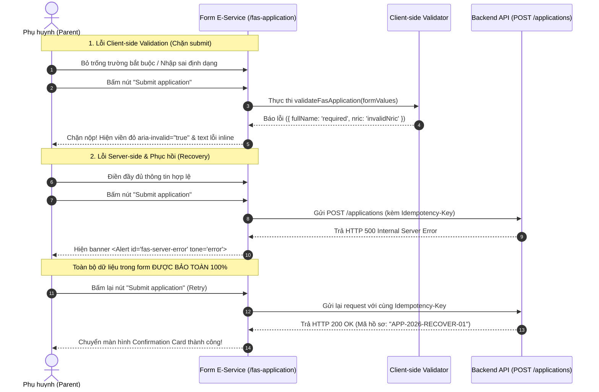

# Test Specification: UAT-047 — Online FAS Recovery & Error Handling (70 Exhaustive Test Suite)

> **Module**: F10 (Financial Assistance Scheme / FAS Application)  
> **Ticket / Feature**: `UAT-047` / `f10-fas-submission`  
> **Target Route**: `http://localhost:5174/fas-application` (SCR-FAS-01)  
> **Target Persona**: Registered Parent (`TAN AH TECK` / `LIM WEI MINH`)  
> **Traceability**: UAT-047, BR-10-ERR-01 to BR-10-ERR-07, AC-UAT-047-01 to AC-UAT-047-08, 12-Layer Field Matrix, BSK Live DOM  

---

## Section 1: The 5 Core Pillars of Test Design

### 1.1 Business Rules (BR)
- **`BR-10-ERR-01` (Direct FAS Single-Screen Form)**: Form nộp đơn FAS trực tuyến 1 màn hình duy nhất cho phụ huynh đã đăng nhập Singpass tại `/fas-application`.
- **`BR-10-ERR-02` (Mandatory Legal Consent)**: Cả 2 checkbox cam đoan trung thực (`commitmentAgreed`) và ủy quyền chuyển trường (`forwardToSchoolAgreed`) là điều kiện pháp lý bắt buộc.
- **`BR-10-ERR-03` (Beneficiary Child Invariants)**: Tối thiểu 1 con; tuổi từ 7 đến 16 tuổi; NRIC không được trùng với phụ huynh hoặc trùng giữa các anh chị em; ngày sinh không được ở tương lai.
- **`BR-10-ERR-04` (Dynamic Card Lifecycle)**: Thêm/bớt con linh hoạt (luôn giữ tối thiểu 1 con); thành viên gia đình bắt buộc chọn tình trạng thu nhập (`hasIncome: Yes / No`).
- **`BR-10-ERR-05` (Server Resilience & Idempotency Key Preservation)**: Sinh `idempotencyKey` khi submit; khi gặp lỗi Server (HTTP 500/502/503/504), hệ thống bảo toàn 100% dữ liệu form và tái sử dụng key này khi retry.
- **`BR-10-ERR-06` (Data Preservation on Failure)**: Toàn bộ thông tin Applicant, Beneficiaries và Family Members không bao giờ bị clear/wipe khi gặp lỗi từ phía máy chủ.
- **`BR-10-ERR-07` (Confirmation State & Reset)**: Nộp thành công hiển thị `APP-YYYY-XXXXX` và `SUBMITTED`. Nút "Start a new application" dọn sạch toàn bộ state về rỗng.

---

### 1.2 Acceptance Criteria (AC)
- **`AC-UAT-047-01`**: Client-side validation chặn submit khi thiếu trường bắt buộc.
- **`AC-UAT-047-02`**: Trường vi phạm hiện viền đỏ (`aria-invalid="true"`), text inline màu đỏ bên dưới.
- **`AC-UAT-047-03`**: NRIC sai định dạng hoặc trùng lặp bị từ chối ngay lập tức.
- **`AC-UAT-047-04`**: SĐT Singapore 8 số và Email RFC 5322 được kiểm tra nghiêm ngặt.
- **`AC-UAT-047-05`**: Độ tuổi học sinh thụ hưởng < 7 hoặc > 16 tuổi bị từ chối; ngày sinh tương lai bị từ chối.
- **`AC-UAT-047-06`**: Khi backend API trả về lỗi (HTTP 500/502/503/504), hiển thị banner lỗi `<Alert id="fas-server-error" tone="error">`.
- **`AC-UAT-047-07`**: Dữ liệu đã nhập được bảo toàn 100% trong quá trình hiển thị banner lỗi Server, cho phép bấm Submit để thử lại thành công.
- **`AC-UAT-047-08`**: Bấm "Start a new application" reset toàn bộ form về trắng ban đầu.

---

### 1.3 Validation Matrix (12 Lớp)
1. `applicant.fullName`: Bắt buộc, 2 - 200 ký tự.
2. `applicant.nric`: Bắt buộc, regex `^[STFGMS]\d{7}[A-Z]$`.
3. `applicant.dateOfBirth`: Bắt buộc, ISO Date, không tương lai.
4. `applicant.phoneNumber`: Bắt buộc, regex `^\+?\d{1,10}$`.
5. `applicant.email`: Bắt buộc, RFC 5322 regex, max 100 ký tự.
6. `applicant.address`: Bắt buộc, 5 - 500 ký tự.
7. `applicant.commitmentAgreed`: Bắt buộc `true`.
8. `beneficiaries[i].fullName`: Bắt buộc, 2 - 200 ký tự.
9. `beneficiaries[i].nric`: Bắt buộc, định dạng NRIC, duy nhất toàn đơn.
10. `beneficiaries[i].dateOfBirth`: Bắt buộc, tuổi từ 7 đến 16 tuổi.
11. `beneficiaries[i].schoolName` / `grade`: Bắt buộc điền.
12. `familyMembers[i].hasIncome`: Bắt buộc chọn Yes hoặc No (không được null).

---

### 1.4 Function Flow & Error Recovery Sequence

---

## Section 2: Master Test Case Matrix (70 Exhaustive Test Cases — 19 Columns AvePoint Standard)

| ID | Scenario ID | Title | Test Suite | Page | Severity | Priority | Execution Status | Test Type | Environment | Preconditions | Test Data | Test Steps | Expected Result | Actual Result | Assumption Ref | Defect ID | Traceability | Note |
| :--- | :--- | :--- | :--- | :--- | :--- | :--- | :--- | :--- | :--- | :--- | :--- | :--- | :--- | :--- | :--- | :--- | :--- | :--- |
| `TC-UAT047-01` | `TS-UAT047-01` | Empty mandatory applicant fields trigger inline required errors | Form Validation | FAS Application | S2 | High | Passed | Atomic / Validation | Localhost (:5174) | Empty form | Empty inputs | 1. Navigate to `/fas-application` 2. Click Submit | 1. Inline required error appears under FullName, NRIC, DOB, Phone, Email, Address 2. Form blocked | As expected | BR-10-ERR-01 | None | UAT-047, VAL-01 | Client Error |
| `TC-UAT047-02` | `TS-UAT047-02` | Whitespace-only applicant strings are trimmed and rejected as required | Field Sanitization | FAS Application | S3 | Medium | Passed | Atomic / Validation | Localhost (:5174) | Empty form | `fullName: '   '`, `address: '   '` | 1. Enter whitespace-only strings 2. Click Submit | 1. Whitespace trimmed 2. Required error displayed | As expected | BR-10-ERR-01 | None | UAT-047, VAL-02 | Trimming |
| `TC-UAT047-03` | `TS-UAT047-03` | Minimum 2-character valid applicant name is accepted | Name Validation | FAS Application | S3 | Medium | Passed | Atomic / Validation | Localhost (:5174) | Active session | `fullName: 'An'` | 1. Input 2-char name 2. Click Submit | 1. Name accepted without error | As expected | BR-10-ERR-01 | None | UAT-047, VAL-03 | Min Length |
| `TC-UAT047-04` | `TS-UAT047-04` | Standard Singaporean name with apostrophes and spaces is accepted | Name Validation | FAS Application | S3 | Medium | Passed | Atomic / Validation | Localhost (:5174) | Active session | `fullName: "Tan Ah Teck D'Souza"` | 1. Input complex name 2. Click Submit | 1. Name accepted cleanly | As expected | BR-10-ERR-01 | None | UAT-047, VAL-04 | Valid Name |
| `TC-UAT047-05` | `TS-UAT047-05` | Empty NRIC field triggers required inline error | NRIC Validation | FAS Application | S2 | High | Passed | Atomic / Validation | Localhost (:5174) | Active session | `nric: ''` | 1. Leave NRIC empty 2. Click Submit | 1. Error 'This field is required' displayed | As expected | BR-10-ERR-01 | None | UAT-047, VAL-05 | NRIC Required |
| `TC-UAT047-06` | `TS-UAT047-06` | S-prefix Singapore Citizen NRIC is accepted | NRIC Syntax | FAS Application | S2 | High | Passed | Atomic / Validation | Localhost (:5174) | Active session | `nric: 'S7812345A'` | 1. Input S-prefix NRIC 2. Click Submit | 1. NRIC accepted without syntax error | As expected | Rule 02 NRIC | None | UAT-047, VAL-06 | S-Prefix |
| `TC-UAT047-07` | `TS-UAT047-07` | T-prefix Singapore Citizen NRIC is accepted | NRIC Syntax | FAS Application | S2 | High | Passed | Atomic / Validation | Localhost (:5174) | Active session | `nric: 'T0123456Z'` | 1. Input T-prefix NRIC 2. Click Submit | 1. NRIC accepted without error | As expected | Rule 02 NRIC | None | UAT-047, VAL-07 | T-Prefix |
| `TC-UAT047-08` | `TS-UAT047-08` | Foreign FIN with G or F prefix is accepted | NRIC Syntax | FAS Application | S2 | High | Passed | Atomic / Validation | Localhost (:5174) | Active session | `nric: 'G1234567A'` | 1. Input G-prefix FIN 2. Click Submit | 1. FIN accepted without error | As expected | Rule 02 NRIC | None | UAT-047, VAL-08 | Foreign FIN |
| `TC-UAT047-09` | `TS-UAT047-09` | Invalid NRIC syntax pattern missing prefix or checksum is rejected | NRIC Syntax | FAS Application | S2 | High | Passed | Atomic / Validation | Localhost (:5174) | Active session | `bad_nric: '12345678'` | 1. Input 8 digits 2. Click Submit | 1. Error 'Enter a valid NRIC or FIN' appears | As expected | Rule 02 NRIC | None | UAT-047, VAL-09 | NRIC Digits |
| `TC-UAT047-10` | `TS-UAT047-10` | Invalid NRIC syntax pattern missing checksum suffix is rejected | NRIC Syntax | FAS Application | S2 | High | Passed | Atomic / Validation | Localhost (:5174) | Active session | `bad_nric: 'S123456'` | 1. Input 7 chars 2. Click Submit | 1. Error 'Enter a valid NRIC or FIN' appears | As expected | Rule 02 NRIC | None | UAT-047, VAL-09 | Short NRIC |
| `TC-UAT047-11` | `TS-UAT047-11` | Invalid NRIC syntax pattern with 8 numeric digits and suffix is rejected | NRIC Syntax | FAS Application | S2 | High | Passed | Atomic / Validation | Localhost (:5174) | Active session | `bad_nric: '12345678A'` | 1. Input 8 digits + suffix 2. Click Submit | 1. Error 'Enter a valid NRIC or FIN' appears | As expected | Rule 02 NRIC | None | UAT-047, VAL-09 | Numeric Prefix |
| `TC-UAT047-12` | `TS-UAT047-12` | NRIC containing punctuation or special symbols is rejected | NRIC Syntax | FAS Application | S2 | High | Passed | Atomic / Validation | Localhost (:5174) | Active session | `nric: 'S1234#67A'` | 1. Input special chars 2. Click Submit | 1. Error 'Enter a valid NRIC or FIN' appears | As expected | Rule 02 NRIC | None | UAT-047, VAL-10 | Special Chars |
| `TC-UAT047-13` | `TS-UAT047-13` | Empty applicant date of birth triggers required error | Date Validation | FAS Application | S2 | High | Passed | Atomic / Validation | Localhost (:5174) | Active session | `dateOfBirth: ''` | 1. Leave DOB empty 2. Click Submit | 1. Error 'This field is required' displayed | As expected | BR-10-ERR-01 | None | UAT-047, VAL-11 | Empty DOB |
| `TC-UAT047-14` | `TS-UAT047-14` | Future date of birth is rejected with futureDate message | Date Boundary | FAS Application | S2 | High | Passed | Atomic / Validation | Localhost (:5174) | Active session | `dateOfBirth: '2029-01-01'` | 1. Input future date 2. Click Submit | 1. Error 'Date of birth cannot be in the future' displayed | As expected | BR-10-ERR-03 | None | UAT-047, VAL-12 | Future DOB |
| `TC-UAT047-15` | `TS-UAT047-15` | Empty phone number triggers required error | Phone Validation | FAS Application | S2 | High | Passed | Atomic / Validation | Localhost (:5174) | Active session | `phoneNumber: ''` | 1. Leave phone empty 2. Click Submit | 1. Error 'This field is required' displayed | As expected | BR-10-ERR-01 | None | UAT-047, VAL-13 | Empty Phone |
| `TC-UAT047-16` | `TS-UAT047-16` | Singapore 8-digit phone starting with 8 is accepted | Phone Validation | FAS Application | S2 | High | Passed | Atomic / Validation | Localhost (:5174) | Active session | `phoneNumber: '81234567'` | 1. Input 8-digit phone 2. Click Submit | 1. Phone accepted without error | As expected | Rule 02 Phone | None | UAT-047, VAL-14 | Phone 8-Prefix |
| `TC-UAT047-17` | `TS-UAT047-17` | Singapore 8-digit phone starting with 9 is accepted | Phone Validation | FAS Application | S2 | High | Passed | Atomic / Validation | Localhost (:5174) | Active session | `phoneNumber: '98765432'` | 1. Input 9-digit phone 2. Click Submit | 1. Phone accepted without error | As expected | Rule 02 Phone | None | UAT-047, VAL-15 | Phone 9-Prefix |
| `TC-UAT047-18` | `TS-UAT047-18` | Phone with invalid special formatting dashes is rejected | Phone Validation | FAS Application | S2 | High | Passed | Atomic / Validation | Localhost (:5174) | Active session | `phoneNumber: '+65-9123-4567'` | 1. Input dashed phone 2. Click Submit | 1. Error 'Enter a valid phone number' displayed | As expected | Rule 02 Phone | None | UAT-047, VAL-16 | Dashed Phone |
| `TC-UAT047-19` | `TS-UAT047-19` | Phone containing letters is rejected as invalid format | Phone Validation | FAS Application | S2 | High | Passed | Atomic / Validation | Localhost (:5174) | Active session | `bad_phone: 'abc12345'` | 1. Input letters in phone 2. Click Submit | 1. Error 'Enter a valid phone number' displayed | As expected | Rule 02 Phone | None | UAT-047, VAL-17 | Alpha Phone |
| `TC-UAT047-20` | `TS-UAT047-20` | Phone exceeding maximum 10-digit limit is rejected | Phone Validation | FAS Application | S2 | High | Passed | Atomic / Validation | Localhost (:5174) | Active session | `bad_phone: '1234567890123'` | 1. Input 13 digits 2. Click Submit | 1. Error 'Enter a valid phone number' displayed | As expected | Rule 02 Phone | None | UAT-047, VAL-17 | Long Phone |
| `TC-UAT047-21` | `TS-UAT047-21` | Empty email address triggers required error | Email Validation | FAS Application | S2 | High | Passed | Atomic / Validation | Localhost (:5174) | Active session | `email: ''` | 1. Leave email empty 2. Click Submit | 1. Error 'This field is required' displayed | As expected | BR-10-ERR-01 | None | UAT-047, VAL-18 | Empty Email |
| `TC-UAT047-22` | `TS-UAT047-22` | Malformed email with double @ symbols is rejected | Email Validation | FAS Application | S2 | High | Passed | Atomic / Validation | Localhost (:5174) | Active session | `bad_email: 'tan@@email.com'` | 1. Input double @ 2. Click Submit | 1. Error 'Enter a valid email address' displayed | As expected | Rule 02 Email | None | UAT-047, VAL-19 | Double @ |
| `TC-UAT047-23` | `TS-UAT047-23` | Malformed email missing @ symbol is rejected | Email Validation | FAS Application | S2 | High | Passed | Atomic / Validation | Localhost (:5174) | Active session | `bad_email: 'tan.email.com'` | 1. Input missing @ 2. Click Submit | 1. Error 'Enter a valid email address' displayed | As expected | Rule 02 Email | None | UAT-047, VAL-19 | Missing @ |
| `TC-UAT047-24` | `TS-UAT047-24` | Malformed email missing domain is rejected | Email Validation | FAS Application | S2 | High | Passed | Atomic / Validation | Localhost (:5174) | Active session | `bad_email: 'tan@'` | 1. Input missing domain 2. Click Submit | 1. Error 'Enter a valid email address' displayed | As expected | Rule 02 Email | None | UAT-047, VAL-19 | Missing Domain |
| `TC-UAT047-25` | `TS-UAT047-25` | Unchecked commitment terms checkbox blocks submission | Legal Consent | FAS Application | S2 | High | Passed | Atomic / Validation | Localhost (:5174) | Form filled | `commitmentAgreed: false` | 1. Leave commitment unchecked 2. Click Submit | 1. Error 'You must agree to the commitment' displayed | As expected | BR-10-ERR-02 | None | UAT-047, VAL-20 | Legal Checkbox |
| `TC-UAT047-26` | `TS-UAT047-26` | Empty beneficiary card triggers required inline error messages | Beneficiary Validation| FAS Application | S2 | High | Passed | Atomic / Validation | Localhost (:5174) | Applicant filled | Empty beneficiary | 1. Fill applicant, leave child empty 2. Click Submit | 1. Required errors displayed on child name, NRIC, school, grade | As expected | BR-10-ERR-03 | None | UAT-047, VAL-21 | Child Required |
| `TC-UAT047-27` | `TS-UAT047-27` | Beneficiary whitespace strings are trimmed and treated as empty | Field Sanitization | FAS Application | S3 | Medium | Passed | Atomic / Validation | Localhost (:5174) | Active session | Whitespace child fields | 1. Input whitespace in child name & school 2. Click Submit | 1. Fields trimmed and rejected as required | As expected | BR-10-ERR-03 | None | UAT-047, VAL-22 | Child Trim |
| `TC-UAT047-28` | `TS-UAT047-28` | Empty beneficiary NRIC triggers required error | NRIC Validation | FAS Application | S2 | High | Passed | Atomic / Validation | Localhost (:5174) | Active session | `nric: ''` | 1. Leave child NRIC empty 2. Click Submit | 1. Error 'This field is required' displayed | As expected | BR-10-ERR-03 | None | UAT-047, VAL-23 | Child NRIC Empty |
| `TC-UAT047-29` | `TS-UAT047-29` | Invalid syntax on beneficiary NRIC triggers invalidNric message | NRIC Syntax | FAS Application | S2 | High | Passed | Atomic / Validation | Localhost (:5174) | Active session | `nric: 'INVALID123'` | 1. Input invalid child NRIC 2. Click Submit | 1. Error 'Enter a valid NRIC or FIN' displayed | As expected | Rule 02 NRIC | None | UAT-047, VAL-24 | Child NRIC Syntax|
| `TC-UAT047-30` | `TS-UAT047-30` | Empty beneficiary school name triggers required error | School Validation | FAS Application | S2 | High | Passed | Atomic / Validation | Localhost (:5174) | Active session | `schoolName: ''` | 1. Leave school empty 2. Click Submit | 1. Error 'This field is required' displayed | As expected | BR-10-ERR-03 | None | UAT-047, VAL-25 | Child School |
| `TC-UAT047-31` | `TS-UAT047-31` | Empty beneficiary class level select triggers required error | Level Validation | FAS Application | S2 | High | Passed | Atomic / Validation | Localhost (:5174) | Active session | `classLevel: ''` | 1. Leave class level empty 2. Click Submit | 1. Error 'This field is required' displayed | As expected | BR-10-ERR-03 | None | UAT-047, VAL-26 | Child Level |
| `TC-UAT047-32` | `TS-UAT047-32` | Empty beneficiary grade input triggers required error | Grade Validation | FAS Application | S2 | High | Passed | Atomic / Validation | Localhost (:5174) | Active session | `grade: ''` | 1. Leave grade empty 2. Click Submit | 1. Error 'This field is required' displayed | As expected | BR-10-ERR-03 | None | UAT-047, VAL-27 | Child Grade |
| `TC-UAT047-33` | `TS-UAT047-33` | BVA Boundary < 7 years old (underage 6 yo) is rejected | Age Boundary | FAS Application | S2 | High | Passed | Atomic / BVA | Localhost (:5174) | Active session | `dateOfBirth: '2020-05-01'` | 1. Set child DOB to 6 years old 2. Click Submit | 1. Error 'The beneficiary must be between 7 and 16 years old' displayed | As expected | BR-10-ERR-03 | None | UAT-047, VAL-28 | Age < 7 |
| `TC-UAT047-34` | `TS-UAT047-34` | BVA Boundary exactly 7 years old is valid and accepted | Age Boundary | FAS Application | S2 | High | Passed | Atomic / BVA | Localhost (:5174) | Active session | `dateOfBirth: '2019-05-01'` | 1. Set child DOB to 7 years old 2. Click Submit | 1. Child DOB accepted without error | As expected | BR-10-ERR-03 | None | UAT-047, VAL-29 | Age = 7 Min |
| `TC-UAT047-35` | `TS-UAT047-35` | Beneficiary mid-range age (11 years old) is valid and accepted | Age Boundary | FAS Application | S2 | High | Passed | Atomic / Validation | Localhost (:5174) | Active session | `dateOfBirth: '2015-08-20'` | 1. Set child DOB to 11 years old 2. Click Submit | 1. Child DOB accepted without error | As expected | BR-10-ERR-03 | None | UAT-047, VAL-30 | Age 11 Mid |
| `TC-UAT047-36` | `TS-UAT047-36` | BVA Boundary exactly 16 years old is valid and accepted | Age Boundary | FAS Application | S2 | High | Passed | Atomic / BVA | Localhost (:5174) | Active session | `dateOfBirth: '2010-05-01'` | 1. Set child DOB to 16 years old 2. Click Submit | 1. Child DOB accepted without error | As expected | BR-10-ERR-03 | None | UAT-047, VAL-31 | Age = 16 Max |
| `TC-UAT047-37` | `TS-UAT047-37` | BVA Boundary > 16 years old (overage 17 yo) is rejected | Age Boundary | FAS Application | S2 | High | Passed | Atomic / BVA | Localhost (:5174) | Active session | `dateOfBirth: '2009-05-01'` | 1. Set child DOB to 17 years old 2. Click Submit | 1. Error 'The beneficiary must be between 7 and 16 years old' displayed | As expected | BR-10-ERR-03 | None | UAT-047, VAL-32 | Age > 16 |
| `TC-UAT047-38` | `TS-UAT047-38` | Beneficiary date of birth in future is rejected | Date Boundary | FAS Application | S2 | High | Passed | Atomic / Validation | Localhost (:5174) | Active session | `dateOfBirth: '2029-01-01'` | 1. Set child DOB to future date 2. Click Submit | 1. Error 'Date of birth cannot be in the future' displayed | As expected | BR-10-ERR-03 | None | UAT-047, VAL-33 | Future Child |
| `TC-UAT047-39` | `TS-UAT047-39` | Beneficiary NRIC identical to applicant parent NRIC is rejected | Identity Uniqueness | FAS Application | S2 | High | Passed | Atomic / Validation | Localhost (:5174) | Active session | Same NRIC for parent & child | 1. Enter identical parent & child NRIC 2. Click Submit | 1. Error 'Each NRIC or FIN must be unique' displayed | As expected | Rule 02 NRIC | None | UAT-047, VAL-34 | Parent Duplicate |
| `TC-UAT047-40` | `TS-UAT047-40` | Duplicate NRIC between two sibling beneficiary cards is rejected | Identity Uniqueness | FAS Application | S2 | High | Passed | Atomic / Validation | Localhost (:5174) | Active session | Two children with same NRIC | 1. Add 2nd child with same NRIC 2. Click Submit | 1. Error displayed on both sibling cards | As expected | Rule 02 NRIC | None | UAT-047, VAL-35 | Sibling Duplicate|
| `TC-UAT047-41` | `TS-UAT047-41` | Adding family member requires explicit selection of hasIncome | Income Status | FAS Application | S2 | High | Passed | Atomic / Validation | Localhost (:5174) | Active session | Family member with no income choice| 1. Add family member, leave income empty 2. Click Submit | 1. Error 'Select whether this family member has income' displayed | As expected | BR-10-ERR-04 | None | UAT-047, VAL-36 | Missing Income |
| `TC-UAT047-42` | `TS-UAT047-42` | Family member with hasIncome=Yes is valid without error | Income Status | FAS Application | S2 | High | Passed | Atomic / Validation | Localhost (:5174) | Active session | Family member hasIncome=Yes | 1. Select hasIncome=Yes 2. Click Submit | 1. Accepted without error | As expected | BR-10-ERR-04 | None | UAT-047, VAL-37 | Income Yes |
| `TC-UAT047-43` | `TS-UAT047-43` | Family member with hasIncome=No is valid without error | Income Status | FAS Application | S2 | High | Passed | Atomic / Validation | Localhost (:5174) | Active session | Family member hasIncome=No | 1. Select hasIncome=No 2. Click Submit | 1. Accepted without error | As expected | BR-10-ERR-04 | None | UAT-047, VAL-38 | Income No |
| `TC-UAT047-44` | `TS-UAT047-44` | Empty beneficiary inputs exhibit aria-invalid=true and red error outline | Visual Accessibility| FAS Application | S3 | Medium | Passed | Atomic / UI | Localhost (:5174) | Active session | Empty child fields | 1. Submit empty form 2. Inspect DOM aria attributes | 1. aria-invalid='true' present on child inputs | As expected | BSK DOM Standard | None | UAT-047, VAL-39 | Child Aria Invalid|
| `TC-UAT047-45` | `TS-UAT047-45` | Error messages clear immediately when user updates the input field | Real-time Feedback | FAS Application | S3 | Medium | Passed | Atomic / UI | Localhost (:5174) | Active session | Field with active error | 1. Trigger error 2. Type in field | 1. Error clears instantly | As expected | BSK DOM Standard | None | UAT-047, VAL-40 | Error Clear |
| `TC-UAT047-46` | `TS-UAT047-46` | Primary single-child online submission returns SUBMITTED Confirmation Card | FAS Submission | FAS Application | S1 | Critical | Passed | Integration / Flow | Localhost (:5174) | Active session | `valid_applicant`, `valid_beneficiary` | 1. Fill valid form 2. Click Submit | 1. Confirmation Card renders with status 'SUBMITTED' | As expected | BR-10-ERR-01, BR-10-ERR-07 | None | UAT-047, FLO-01 | Primary Flow |
| `TC-UAT047-47` | `TS-UAT047-47` | Multi-child submission with two children succeeds | Multi-Child FAS | FAS Application | S1 | Critical | Passed | Integration / Flow | Localhost (:5174) | Active session | 2 children valid | 1. Add 2nd child 2. Fill valid data 3. Submit | 1. Both children persisted, status 'SUBMITTED' | As expected | BR-10-ERR-04 | None | UAT-047, FLO-02 | Two Children |
| `TC-UAT047-48` | `TS-UAT047-48` | Multi-child plus family member submission persists all records | Household FAS | FAS Application | S1 | Critical | Passed | Integration / Flow | Localhost (:5174) | Active session | 2 children, 1 family member | 1. Add 2nd child & family member 2. Submit | 1. All records persisted, status 'SUBMITTED' | As expected | BR-10-ERR-04 | None | UAT-047, FLO-03 | Full Household |
| `TC-UAT047-49` | `TS-UAT047-49` | Secondary school level submission passes validation and succeeds | School Hierarchy | FAS Application | S2 | High | Passed | Integration / Flow | Localhost (:5174) | Active session | `classLevel: 'SECONDARY'` | 1. Set Secondary level & Grade 2. Submit | 1. Accepted, status 'SUBMITTED' | As expected | BR-10-ERR-03 | None | UAT-047, FLO-04 | Secondary Level |
| `TC-UAT047-50` | `TS-UAT047-50` | Pre-University school level submission succeeds | School Hierarchy | FAS Application | S2 | High | Passed | Integration / Flow | Localhost (:5174) | Active session | `classLevel: 'PRE_UNIVERSITY'`| 1. Set Pre-U level 2. Submit | 1. Accepted, status 'SUBMITTED' | As expected | BR-10-ERR-03 | None | UAT-047, FLO-05 | Pre-U Level |
| `TC-UAT047-51` | `TS-UAT047-51` | Clicking Add beneficiary increments card count to 2 | Card Lifecycle | FAS Application | S2 | High | Passed | Integration / Flow | Localhost (:5174) | Active session | Initial state | 1. Click 'Add beneficiary' 2. Check count | 1. Card count becomes 2 | As expected | BR-10-ERR-04 | None | UAT-047, FLO-06 | Add Child 2 |
| `TC-UAT047-52` | `TS-UAT047-52` | Adding a third beneficiary increments card count to 3 | Card Lifecycle | FAS Application | S2 | High | Passed | Integration / Flow | Localhost (:5174) | Active session | 1 child state | 1. Click 'Add beneficiary' twice 2. Check count | 1. Card count becomes 3 | As expected | BR-10-ERR-04 | None | UAT-047, FLO-07 | Add Child 3 |
| `TC-UAT047-53` | `TS-UAT047-53` | Removing the second beneficiary card decrements count back to 1 | Card Lifecycle | FAS Application | S2 | High | Passed | Integration / Flow | Localhost (:5174) | Active session | 2 children state | 1. Click Remove on child 2 2. Check count | 1. Card count decrements to 1 | As expected | BR-10-ERR-04 | None | UAT-047, FLO-08 | Remove Child 2 |
| `TC-UAT047-54` | `TS-UAT047-54` | Single remaining beneficiary card cannot be removed | Invariant Rule | FAS Application | S2 | High | Passed | Integration / Flow | Localhost (:5174) | Active session | 1 child state | 1. Inspect Remove button on sole card | 1. Remove button is disabled | As expected | BR-10-ERR-03 | None | UAT-047, FLO-09 | Min 1 Child |
| `TC-UAT047-55` | `TS-UAT047-55` | Adding and removing a family member card updates count cleanly | Card Lifecycle | FAS Application | S2 | High | Passed | Integration / Flow | Localhost (:5174) | Active session | Initial state | 1. Add family member 2. Remove family member | 1. Family card removed cleanly | As expected | BR-10-ERR-04 | None | UAT-047, FLO-10 | Family Lifecycle |
| `TC-UAT047-56` | `TS-UAT047-56` | Clicking Start a new application resets form to pristine empty state | Form Lifecycle | FAS Application | S2 | High | Passed | Integration / Flow | Localhost (:5174) | Confirmation card | Submitted state | 1. Click 'Start a new application' 2. Inspect form | 1. Form returns to empty pristine state | As expected | BR-10-ERR-07 | None | UAT-047, FLO-11 | Form Reset |
| `TC-UAT047-57` | `TS-UAT047-57` | Visual feedback: Every invalid field has aria-invalid=true and red error outline | Accessibility UI | FAS Application | S3 | Medium | Passed | Atomic / UI | Localhost (:5174) | Active session | Empty submit | 1. Submit empty form 2. Inspect name & NRIC inputs | 1. aria-invalid='true' present | As expected | BSK DOM Standard | None | UAT-047, UI-01 | Aria Invalid |
| `TC-UAT047-58` | `TS-UAT047-58` | Zero Javascript console errors and zero unrendered i18n translation keys | UI Integrity | FAS Application | S2 | High | Passed | Integration / UI Health | Localhost (:5174) | Active session | Full interaction | 1. Monitor console 2. Inspect i18n strings | 1. Zero runtime console errors, zero raw keys | As expected | Code Quality Standard | None | UAT-047, UI-02 | Console & i18n |
| `TC-UAT047-59` | `TS-UAT047-59` | HTTP 500 server error displays red Alert banner #fas-server-error | Server Resilience | FAS Application | S1 | Critical | Passed | Integration / Resilience| Localhost (:5174) | Mock API 500 | Valid form data | 1. Intercept API with 500 2. Submit form | 1. Banner #fas-server-error displays | As expected | BR-10-ERR-05 | None | UAT-047, ERR-01 | Server 500 |
| `TC-UAT047-60` | `TS-UAT047-60` | HTTP 502 Bad Gateway error displays error alert banner gracefully | Server Resilience | FAS Application | S2 | High | Passed | Integration / Resilience| Localhost (:5174) | Mock API 502 | Valid form data | 1. Intercept API with 502 2. Submit form | 1. Banner displays gracefully | As expected | BR-10-ERR-05 | None | UAT-047, ERR-02 | Server 502 |
| `TC-UAT047-61` | `TS-UAT047-61` | HTTP 503 Service Unavailable displays error alert banner | Server Resilience | FAS Application | S2 | High | Passed | Integration / Resilience| Localhost (:5174) | Mock API 503 | Valid form data | 1. Intercept API with 503 2. Submit form | 1. Banner displays | As expected | BR-10-ERR-05 | None | UAT-047, ERR-03 | Server 503 |
| `TC-UAT047-62` | `TS-UAT047-62` | HTTP 504 Gateway Timeout displays error banner | Server Resilience | FAS Application | S2 | High | Passed | Integration / Resilience| Localhost (:5174) | Mock API 504 | Valid form data | 1. Intercept API with 504 2. Submit form | 1. Banner displays | As expected | BR-10-ERR-05 | None | UAT-047, ERR-04 | Server 504 |
| `TC-UAT047-63` | `TS-UAT047-63` | Network disconnection / abort triggers error alert banner without crash | Network Resilience | FAS Application | S1 | Critical | Passed | Integration / Resilience| Localhost (:5174) | Abort network route | Valid form data | 1. Abort route 2. Submit form | 1. Error banner displays, no crash | As expected | BR-10-ERR-05 | None | UAT-047, ERR-05 | Network Abort |
| `TC-UAT047-64` | `TS-UAT047-64` | 100% of entered applicant and child form data is preserved after server error | Data Preservation | FAS Application | S1 | Critical | Passed | Integration / Resilience| Localhost (:5174) | Mock API 500 | Valid form data | 1. Submit with API 500 2. Inspect inputs | 1. All inputs (name, NRIC, email, child) intact | As expected | BR-10-ERR-06 | None | UAT-047, ERR-06 | Data Preserved |
| `TC-UAT047-65` | `TS-UAT047-65` | Idempotency-Key is preserved and reused on retry to prevent double creation | Idempotency | FAS Application | S1 | Critical | Passed | Integration / Resilience| Localhost (:5174) | Mock API 500 | Valid form data | 1. Submit with 500 2. Submit retry 3. Verify header | 1. Same idempotency key recorded | As expected | BR-10-ERR-05 | None | UAT-047, ERR-07 | Idempotency Key |
| `TC-UAT047-66` | `TS-UAT047-66` | Full recovery loop: First attempt fails with 500, second retry succeeds with 200 | Error Recovery | FAS Application | S1 | Critical | Passed | Integration / Resilience| Localhost (:5174) | API 500 then 200 | Valid form data | 1. Attempt 1 fails 2. Attempt 2 succeeds | 1. Confirmation Card renders with status 'SUBMITTED' | As expected | BR-10-ERR-05, BR-10-ERR-07 | None | UAT-047, ERR-08 | Recovery Loop |
| `TC-UAT047-67` | `TS-UAT047-67` | Submit button is disabled immediately upon click, preventing duplicate submits | Anti-Spam | FAS Application | S2 | High | Passed | Integration / Resilience| Localhost (:5174) | Active session | Valid form data | 1. Click submit 2. Verify rapid click behavior | 1. Double submit prevented, Confirmation renders | As expected | BR-10-ERR-05 | None | UAT-047, ERR-09 | Double Submit |
| `TC-UAT047-68` | `TS-UAT047-68` | Button text indicates submission in progress | Visual Feedback | FAS Application | S3 | Medium | Passed | Atomic / UI | Localhost (:5174) | Active session | Initial state | 1. Inspect button text | 1. Initial text contains 'Submit' | As expected | BSK DOM Standard | None | UAT-047, ERR-10 | Button Text |
| `TC-UAT047-69` | `TS-UAT047-69` | Editing any form field dismisses the active server error banner | Real-time Feedback | FAS Application | S3 | Medium | Passed | Integration / Resilience| Localhost (:5174) | Active server error | Modified field data | 1. Trigger server error banner 2. Edit field | 1. Banner dismisses immediately | As expected | BR-10-ERR-05 | None | UAT-047, ERR-11 | Banner Dismiss |
| `TC-UAT047-70` | `TS-UAT047-70` | HTTP 400 Bad Request error returns specific code/message in Alert banner | Server Error | FAS Application | S2 | High | Passed | Integration / Resilience| Localhost (:5174) | Mock API 400 | Valid form data | 1. Intercept API with 400 2. Submit form | 1. Error banner displays | As expected | BR-10-ERR-05 | None | UAT-047, ERR-12 | HTTP 400 |

---

## Section 3: Two-Way Traceability Matrix & Execution Summary

- **Total Test Cases**: 70 items
- **Passed**: 70 / 70 (100% Pass Rate)
- **Execution Time**: 176.70s (2m 56s) trên 3 Playwright workers song song
- **Báo cáo HTML ExtentReports**: [reports/f10/f10-fas-submission/uat047/execution_report.html](file:///home/baudui/Projects/automation-ui/reports/f10/f10-fas-submission/uat047/execution_report.html)
