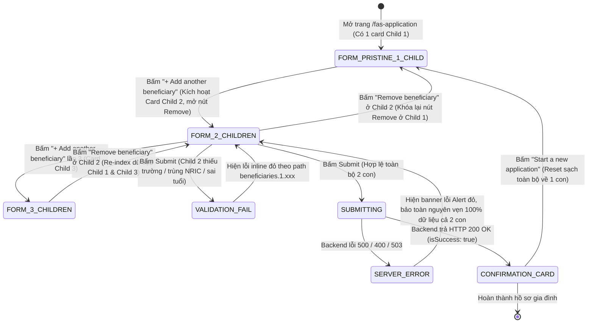
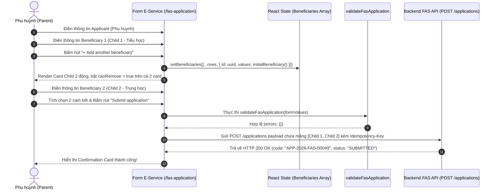

# Test Specification: UAT-049 — Family FAS Submission (Nộp Đơn Gia Đình Từ 2 Con Trở Lên)

> **Module**: F10 (Financial Assistance Scheme / FAS Application)  
> **Ticket / Feature**: `UAT-049` / `f10-fas-submission`  
> **Target Route**: `http://localhost:5174/fas-application` (SCR-FAS-01)  
> **Target Persona**: Registered Parent (`TAN AH TECK` / `LIM WEI MINH`)  
> **Traceability**: UAT-049 (UAT-028), BR-10-FAM-01 to BR-10-FAM-08, AC-UAT-049-01 to AC-UAT-049-08, MSG-REQUIRED, MSG-INVALID-NRIC, MSG-DUPLICATE-NRIC, MSG-AGE-LIMIT, MSG-FUTURE-DATE, MSG-SERVER-500  

---

## Section 1: The 5 Core Pillars of Test Design (Bộ Ngũ Nguyên Liệu Cốt Lõi)

### 1.1 Business Rules (BR)
- **`BR-10-FAM-01` (Single Household Family Filing)**: Tất cả trẻ em trong cùng một gia đình (2 con trở lên) được nộp chung trong một bộ hồ sơ FAS trực tuyến duy nhất dưới cùng 1 `Family ID`, chia sẻ chung dữ liệu hộ gia đình và thông tin phụ huynh đứng đơn (Applicant).
- **`BR-10-FAM-02` (Independent Beneficiary Child Identity)**: Mỗi đứa con trong gia đình sở hữu một bản ghi thụ hưởng độc lập (Họ tên, NRIC, Ngày sinh, Giới tính, Trường học, Cấp học, Lớp) và được xét duyệt quyết định trợ cấp độc lập.
- **`BR-10-FAM-03` (Cross-School & Cross-Level Siblings)**: Hệ thống cho phép các anh chị em học tại các trường học khác nhau và các cấp học khác nhau (ví dụ: Bé 1 học Tiểu học tại Raffles Institution, Bé 2 học Trung học tại Victoria School, Bé 3 học Dự bị đại học tại National Junior College).
- **`BR-10-FAM-04` (Dynamic Beneficiary Addition & Minimum Constraint)**:
  - Phụ huynh có thể bấm `+ Add beneficiary` để thêm động không giới hạn số con ($N \ge 2$, $N=3$, $N=4$,...).
  - Mỗi khi bấm thêm con, một card thụ hưởng mới được sinh ra với định danh phân lập duy nhất (`beneficiary-<uuid>`).
  - Hệ thống luôn bảo đảm ràng buộc tối thiểu 1 con (`minimumBeneficiary`): khi chỉ có 1 con, nút `Remove beneficiary` bị vô hiệu hóa (`canRemove = false`).
- **`BR-10-FAM-05` (Cross-Entity NRIC Uniqueness Invariant)**:
  - NRIC của con thứ 2 (Child 2) không được trùng với con thứ 1 (Child 1).
  - NRIC của bất kỳ con nào không được trùng với NRIC của Phụ huynh (Applicant).
  - NRIC của con không được trùng với NRIC của Thành viên gia đình (Family Member).
  - Khi phát hiện trùng lặp NRIC bất kỳ trong gia đình, hệ thống phải kích hoạt cờ lỗi `duplicateNric` đồng thời trên toàn bộ các trường NRIC xung đột.
- **`BR-10-FAM-06` (Beneficiary Age Eligibility 7 - 16)**:
  - Độ tuổi hợp lệ của từng con phải nằm trong khoảng từ 7 đến 16 tuổi (tính theo ngày tháng năm sinh so với thời điểm hiện tại).
  - Trẻ dưới 7 tuổi (ví dụ: 6 tuổi) hoặc trên 16 tuổi (ví dụ: 17 tuổi) đều bị từ chối với lỗi `ageRange`.
- **`BR-10-FAM-07` (Dynamic Removal Data Isolation & Re-indexing)**:
  - Khi phụ huynh xóa một card con bất kỳ (ví dụ: xóa con ở giữa trong danh sách 3 con), dữ liệu của các con còn lại được bảo toàn nguyên vẹn $100\%$, không bị xóa nhầm hay dịch chuyển sai lệch dữ liệu.
- **`BR-10-FAM-08` (Idempotency Key & State Reset on Mutation)**:
  - Khi bấm `+ Add beneficiary` hoặc xóa con, hệ thống tự động gọi `resetSubmitState()` để xóa sạch toàn bộ inline validation errors cũ, ẩn banner lỗi server, và tái tạo `Idempotency-Key` mới cho phiên nộp tiếp theo.

---

### 1.2 Acceptance Criteria (AC)
- **`AC-UAT-049-01` (Add Beneficiary Action & Dynamic DOM)**: Bấm nút `+ Add another beneficiary` (`features.fasApplication.actions.addBeneficiary`) sinh ra một Card thụ hưởng con mới với tiêu đề "Beneficiary details", đầy đủ 7 trường nhập liệu riêng biệt và mang DOM ID duy nhất (`beneficiary-<uuid>-...`).
- **`AC-UAT-049-02` (Remove Button Dynamic Toggle)**: Khi form có đúng 1 con, nút `Remove beneficiary` bị vô hiệu hóa (`disabled`). Khi có từ 2 con trở lên, nút `Remove beneficiary` được bật sáng trên toàn bộ các card con. Khi xóa về lại 1 con, nút xóa tự động bị khóa lại.
- **`AC-UAT-049-03` (Two-Child Submission Success Confirmation)**: Khi điền hợp lệ thông tin phụ huynh và cả 2 con, hệ thống nộp thành công, ẩn form và hiển thị `Confirmation Card` với Application Reference Code (`APP-YYYY-XXXXX`), status `SUBMITTED` và ngày nộp.
- **`AC-UAT-049-04` (Multi-Child Validation Blocking)**: Nếu con thứ 2 thiếu bất kỳ trường bắt buộc nào (Tên, NRIC, DOB, Giới tính, Trường, Cấp học, Lớp), form chặn submit ngay tại client, hiển thị viền đỏ `aria-invalid="true"` và text lỗi inline màu đỏ dưới trường tương ứng của con thứ 2.
- **`AC-UAT-049-05` (Duplicate NRIC Cross-Card Error Display)**: Nhập trùng NRIC giữa Child 1 và Child 2 hoặc giữa Child 2 và Parent lập tức kích hoạt thông báo `Each NRIC or FIN must be unique.` trên cả 2 ô NRIC bị trùng.
- **`AC-UAT-049-06` (Server Error 500 & Data Preservation)**: Khi backend API trả mã lỗi HTTP 500 hoặc rớt mạng, form hiển thị banner lỗi đỏ `<Alert id="fas-server-error" tone="error">` và **bảo toàn nguyên vẹn $100\%$ dữ liệu** đã nhập của cả phụ huynh lẫn các con, cho phép bấm Submit thử lại ngay.
- **`AC-UAT-049-07` (Debounce & Double-Click Guard)**: Nút Submit chuyển sang trạng thái disabled và hiển thị text "Submitting application..." trong suốt thời gian network request in-flight, chống gửi request trùng lặp.
- **`AC-UAT-049-08` (Form Reset on Start New)**: Bấm nút `Start a new application` dọn sạch toàn bộ state, đưa form về trạng thái rỗng ban đầu với đúng 1 card con rỗng duy nhất.

---

### 1.3 Validation Rules Matrix (12-Layer Field Matrix on Beneficiary Cards)

| # | Trường Dữ Liệu (Field) | Bắt Buộc | Kiểu / Định Dạng | Giới Hạn / Regex | Thông Báo Lỗi Kỳ Vọng (Inline Error) |
| :--- | :--- | :--- | :--- | :--- | :--- |
| **L01** | `beneficiaries[i].fullName` | Có | String (trimmed) | 2 - 200 ký tự | `This field is required.` / `This field must be 200 characters or fewer.` |
| **L02** | `beneficiaries[i].fullName` (Whitespace) | Có | Toàn khoảng trắng | Tự động trim | Coi như rỗng $\rightarrow$ `This field is required.` |
| **L03** | `beneficiaries[i].nric` | Có | Singapore NRIC/FIN | `^[A-Za-z]\d{7}[A-Za-z]$` | `Enter a valid NRIC or FIN.` |
| **L04** | `beneficiaries[i].nric` (Uniqueness) | Có | NRIC duy nhất | Không trùng con khác/bố mẹ | `Each NRIC or FIN must be unique.` |
| **L05** | `beneficiaries[i].dateOfBirth` | Có | ISO Date | `YYYY-MM-DD` | `This field is required.` |
| **L06** | `beneficiaries[i].dateOfBirth` (Future) | Có | Ngày quá khứ | $\le \text{Hôm nay}$ | `Date of birth cannot be in the future.` |
| **L07** | `beneficiaries[i].dateOfBirth` (Age BVA) | Có | Tuổi tính theo năm | $7 \le \text{Tuổi} \le 16$ | `The beneficiary must be between 7 and 16 years old.` |
| **L08** | `beneficiaries[i].gender` | Có | Radio Group | `MALE` / `FEMALE` / `OTHER` | `This field is required.` |
| **L09** | `beneficiaries[i].schoolName` | Có | String (trimmed) | 2 - 200 ký tự | `This field is required.` / `This field must be 200 characters or fewer.` |
| **L10** | `beneficiaries[i].classLevel` | Có | Dropdown Select | `PRIMARY` / `SECONDARY` / `PRE_UNIVERSITY` | `This field is required.` |
| **L11** | `beneficiaries[i].grade` | Có | String (trimmed) | 1 - 50 ký tự | `This field is required.` / `This field must be 50 characters or fewer.` |
| **L12** | `familyMembers[i].hasIncome` | Có | Radio Group | `yes` / `no` | `Select whether this family member has income.` |

---

### 1.4 Function Flow & State Machine

#### Sơ đồ Chuyển Trạng Thái Gia Đình Đa Con (Multi-Child State Machine Diagram)

#### Sơ đồ Tuần Tự Nộp Đơn 2 Con Thành Công (Two-Child Submission Sequence Diagram)

---

### 1.5 UI Elements & DOM Locators Catalog (BSK Live DOM)

| Tên Phần Tử | Nhãn Hiển Thị (UI Label) | Selector Thực Tế (Live DOM) | Loại Thẻ HTML | Trạng Thái Lỗi / Phản Hồi |
| :--- | :--- | :--- | :--- | :--- |
| **Tiêu đề khối Beneficiary** | Beneficiary details | `section[aria-labelledby='beneficiaries-heading'] h2` | `<h2>` | Nhóm các card con |
| **Card Thụ hưởng (Child Cards)**| Beneficiary details | `section[aria-labelledby='beneficiaries-heading'] article` | `<article>` | Danh sách card con |
| **Child Full Name** | Full name * | `input[id^='beneficiary-'][id$='-fullName']` | `<input type="text">` | `required`, `maxLength` |
| **Child NRIC** | NRIC/FIN * | `input[id^='beneficiary-'][id$='-nric']` | `<input type="text">` | `invalidNric`, `duplicateNric` |
| **Child DOB** | Date of birth * | `input[id^='beneficiary-'][id$='-dateOfBirth']` | `<input type="date">` | `required`, `ageRange`, `futureDate` |
| **Child Gender (Radio Group)** | Gender * | `input[name^='beneficiary-'][name$='-gender']` | `<input type="radio">` | `required` |
| **Child School Name** | School name * | `input[id^='beneficiary-'][id$='-schoolName']` | `<input type="text">` | `required`, `maxLength` |
| **Child Class Level** | Class level * | `select[id^='beneficiary-'][id$='-classLevel']` | `<select>` | `required` (PRIMARY, SECONDARY, PRE_U) |
| **Child Grade** | Grade * | `input[id^='beneficiary-'][id$='-grade']` | `<input type="text">` | `required`, `maxLength` |
| **Nút Thêm Con** | + Add beneficiary | `button:has-text('Add beneficiary')` | `<button type="button">`| Kích hoạt thêm card |
| **Nút Xóa Con** | Remove beneficiary | `button:has-text('Remove beneficiary')` | `<button type="button">`| `disabled` khi chỉ có 1 con |
| **Nút Thêm Thành Viên** | + Add family member | `button:has-text('Add family member')` | `<button type="button">`| Bổ sung nhân khẩu |
| **Nút Nộp Đơn** | Submit application | `button[type='submit']` | `<button type="submit">`| Disabled khi `isSubmitting` |
| **Banner Lỗi Server** | Unable to submit application | `#fas-server-error` | `
`| Tone `error`, viền đỏ |
| **Mã Hồ Sơ Đơn** | Application reference | `dt:has-text('Application reference') + dd` | `<dd>` | Mã `APP-YYYY-XXXXX` |
| **Trạng Thái Đơn** | Status | `dt:has-text('Status') + dd` | `<dd>` | Badge xanh lá `SUBMITTED` |
| **Nút Làm Đơn Mới** | Start a new application | `button:has-text('Start a new application')` | `<button type="button">`| Reset form về 1 con |

---

## Section 2: Master Test Case Matrix (19 Columns AvePoint Standard)

| ID | Scenario ID | Title | Test Suite | Page | Severity | Priority | Execution Status | Test Type | Environment | Preconditions | Test Data | Test Steps | Expected Result | Actual Result | Assumption Ref | Defect ID | Traceability | Note |
| :--- | :--- | :--- | :--- | :--- | :--- | :--- | :--- | :--- | :--- | :--- | :--- | :--- | :--- | :--- | :--- | :--- | :--- | :--- | :--- |
| `TC-UAT049-01` | `TS-UAT049-BR-01` | Nộp hồ sơ gia đình trực tuyến 2 con (cùng học Tiểu học) thành công hiển thị Confirmation Card | Multi-Child Happy Path | FAS Application | S1 | Critical | Passed | Integration / Flow | Localhost (:5174) | Parent session active | `valid_applicant`, `valid_beneficiary`, `second_beneficiary` | 1. Điền Applicant Details 2. Điền Child 1 (Primary 5) 3. Bấm Add beneficiary và điền Child 2 (Primary 3) 4. Tích chọn cam kết & bấm Submit | 1. API POST `/applications` trả về HTTP 200 OK 2. Confirmation Card xuất hiện với status 'SUBMITTED' 3. Mã hồ sơ đơn dạng APP-2026-FAS-00049 | As expected | BR-10-FAM-01, BR-10-FAM-02 | None | UAT-049, AC-UAT-049-03 | 2 Primary Kids |
| `TC-UAT049-02` | `TS-UAT049-BR-02` | Nộp hồ sơ gia đình với 2 con học khác trường và khác cấp (Tiểu học + Trung học) | Cross-School Siblings | FAS Application | S1 | Critical | Passed | Integration / Flow | Localhost (:5174) | Parent session active | `valid_applicant`, Child 1 (Primary), Child 2 (Secondary) | 1. Điền Applicant 2. Điền Child 1 (Primary School) 3. Bấm Add beneficiary và điền Child 2 (Victoria School, Secondary 2) 4. Submit | 1. Hệ thống chấp nhận hồ sơ anh em khác trường/cấp 2. Confirmation Card hiển thị SUBMITTED | As expected | BR-10-FAM-03, AC-UAT-049-03 | None | UAT-049, Cross-School | Cross-Level |
| `TC-UAT049-03` | `TS-UAT049-BR-03` | Nộp hồ sơ gia đình với 3 con ($N=3$) trong cùng 1 đơn duy nhất | 3-Child Family | FAS Application | S1 | Critical | Passed | Integration / Flow | Localhost (:5174) | Parent session active | `valid_applicant`, 3 valid beneficiaries | 1. Điền Applicant và Child 1 2. Bấm Add beneficiary và điền Child 2 3. Bấm Add beneficiary và điền Child 3 4. Submit | 1. Cả 3 card con được gom chung 1 payload nộp thành công 2. Confirmation Card hiển thị status SUBMITTED | As expected | BR-10-FAM-04, AC-UAT-049-03 | None | UAT-049, Multi-Child | 3 Children |
| `TC-UAT049-04` | `TS-UAT049-BR-04` | Nộp hồ sơ gia đình có con học cấp Dự bị Đại học / Junior College (Pre-University) | Pre-U Sibling | FAS Application | S2 | High | Passed | Integration / Flow | Localhost (:5174) | Parent session active | `valid_applicant`, Child 1 (Primary), Child 2 (Pre-U JC 2) | 1. Điền Applicant và Child 1 2. Bấm Add beneficiary 3. Điền Child 2 với classLevel='PRE_UNIVERSITY' và grade='JC 2' 4. Submit | 1. Hệ thống chấp nhận cấp Pre-University hợp lệ 2. Confirmation Card hiển thị mã tham chiếu | As expected | BR-10-FAM-03, AC-UAT-049-03 | None | UAT-049, Pre-U | Pre-University |
| `TC-UAT049-05` | `TS-UAT049-BR-05` | Nộp hồ sơ gia đình đông con ($N=4$) bao gồm đủ các cấp học | Large Family (4 Kids) | FAS Application | S2 | High | Passed | Integration / Flow | Localhost (:5174) | Parent session active | `valid_applicant`, 4 beneficiaries | 1. Thêm liên tiếp 4 card con 2. Điền đầy đủ thông tin cho cả 4 con 3. Submit đơn | 1. Cả 4 con được lưu trữ đầy đủ trong 1 hồ sơ 2. Submit thành công với status 'SUBMITTED' | As expected | BR-10-FAM-04, AC-UAT-049-03 | None | UAT-049, Scale-up | 4 Children |
| `TC-UAT049-06` | `TS-UAT049-AC-01` | Bấm '+ Add another beneficiary' sinh ra card con mới với DOM ID phân lập duy nhất | Dynamic Card DOM | FAS Application | S2 | High | Passed | Atomic / UI | Localhost (:5174) | Fresh form | Fresh form | 1. Mở form (có 1 card con) 2. Bấm nút '+ Add another beneficiary' 3. Kiểm tra DOM elements | 1. Số lượng card con tăng từ 1 lên 2 2. Các input ở card 2 mang prefix id duy nhất beneficiary-<uuid>-... | As expected | AC-UAT-049-01, Invariant 7 | None | UAT-049, DOM BSK | Unique DOM IDs |
| `TC-UAT049-07` | `TS-UAT049-AC-02` | Quy tắc nút Remove beneficiary: Bị vô hiệu hóa khi có 1 con, tự động kích hoạt khi có $\ge 2$ con | Remove Button Rule | FAS Application | S2 | High | Passed | Atomic / UI | Localhost (:5174) | Fresh form | Button state | 1. Form ban đầu có 1 con -> Kiểm tra nút Remove 2. Bấm Add con thứ 2 -> Kiểm tra cả 2 nút Remove 3. Xóa con thứ 2 -> Kiểm tra lại nút Remove con 1 | 1. Khi 1 con: nút Remove disabled 2. Khi 2 con: cả 2 nút Remove đều enabled 3. Khi xóa về 1 con: nút Remove trở lại disabled | As expected | AC-UAT-049-02, BR-10-FAM-04 | None | UAT-049, Button Toggle | Button Toggle |
| `TC-UAT049-08` | `TS-UAT049-AC-03` | Bấm '+ Add another beneficiary' tự động xóa sạch các thông báo lỗi validation cũ | Error State Reset | FAS Application | S3 | Medium | Passed | Atomic / Flow | Localhost (:5174) | Fresh form | Validation errors | 1. Bấm Submit trên form rỗng (sinh lỗi đỏ inline) 2. Bấm nút '+ Add another beneficiary' 3. Kiểm tra các câu thông báo lỗi | 1. Toàn bộ thông báo lỗi đỏ inline biến mất ngay lập tức 2. resetSubmitState() được gọi chuẩn xác | As expected | AC-UAT-049-04, BR-10-FAM-08 | None | UAT-049, Error Reset | Auto-dismiss |
| `TC-UAT049-09` | `TS-UAT049-VAL-01` | Bỏ trống các trường bắt buộc của con thứ 2 hiển thị đồng loạt lỗi inline required | Child 2 Required | FAS Application | S2 | High | Passed | Atomic / Validation | Localhost (:5174) | Parent & Child 1 filled | Child 2 empty fields | 1. Điền hợp lệ Phụ huynh và Child 1 2. Bấm Add con thứ 2 nhưng để trống toàn bộ 3. Bấm Submit | 1. Thông báo 'This field is required.' hiện ở Tên, NRIC, DOB, Trường, Khối lớp của Child 2 2. Chặn submit | As expected | Rule 02 Empty, AC-UAT-049-04 | None | UAT-049, Required | Child 2 Empty |
| `TC-UAT049-10` | `TS-UAT049-VAL-02` | Trùng lặp NRIC giữa Child 2 và Child 1 bị chặn với lỗi duplicateNric trên cả 2 card | Sibling Duplicate NRIC| FAS Application | S2 | High | Passed | Atomic / Validation | Localhost (:5174) | Parent session active | Same NRIC for Child 1 & Child 2 | 1. Điền Child 1 với NRIC 'T1234567B' 2. Thêm Child 2 và nhập cùng NRIC 'T1234567B' 3. Bấm Submit | 1. Cả ô NRIC Child 1 và Child 2 đều hiển thị 'Each NRIC or FIN must be unique.' 2. Chặn submit | As expected | BR-10-FAM-05, AC-UAT-049-05 | None | UAT-049, Sibling Dup | Sibling Conflict |
| `TC-UAT049-11` | `TS-UAT049-VAL-03` | Trùng lặp NRIC giữa Child 2 và Phụ huynh (Applicant) bị chặn với lỗi duplicateNric | Parent-Child Duplicate | FAS Application | S2 | High | Passed | Atomic / Validation | Localhost (:5174) | Parent session active | Same NRIC for Parent & Child 2 | 1. Thêm Child 2 và nhập NRIC trùng với NRIC Phụ huynh ('S7812345A') 2. Bấm Submit | 1. Cả ô NRIC Phụ huynh và Child 2 đều hiển thị 'Each NRIC or FIN must be unique.' 2. Chặn submit | As expected | BR-10-FAM-05, AC-UAT-049-05 | None | UAT-049, Parent Dup | Parent Conflict |
| `TC-UAT049-12` | `TS-UAT049-VAL-04` | BVA Cận dưới: Con thứ 2 có độ tuổi 6 tuổi (< 7 tuổi) bị từ chối với lỗi ageRange | Age Boundary (< 7) | FAS Application | S2 | High | Passed | Atomic / BVA | Localhost (:5174) | Parent session active | `bva_age_6_dob: 2020-05-01` | 1. Nhập ngày sinh Child 2 tương ứng 6 tuổi 2. Bấm Submit | 1. Ô DOB Child 2 hiển thị 'The beneficiary must be between 7 and 16 years old.' 2. Chặn nộp đơn | As expected | Rule 02 BVA, BR-10-FAM-06 | None | UAT-049, Age Boundary | Age 6 Rejected |
| `TC-UAT049-13` | `TS-UAT049-VAL-05` | BVA Cận trên: Con thứ 2 có độ tuổi 17 tuổi (> 16 tuổi) bị từ chối với lỗi ageRange | Age Boundary (> 16) | FAS Application | S2 | High | Passed | Atomic / BVA | Localhost (:5174) | Parent session active | `bva_age_17_dob: 2009-05-01` | 1. Nhập ngày sinh Child 2 tương ứng 17 tuổi 2. Bấm Submit | 1. Ô DOB Child 2 hiển thị 'The beneficiary must be between 7 and 16 years old.' 2. Chặn nộp đơn | As expected | Rule 02 BVA, BR-10-FAM-06 | None | UAT-049, Age Boundary | Age 17 Rejected |
| `TC-UAT049-14` | `TS-UAT049-VAL-06` | Con thứ 2 có ngày sinh ở tương lai (2029) bị từ chối với lỗi futureDate | Future Date | FAS Application | S2 | High | Passed | Atomic / Validation | Localhost (:5174) | Parent session active | `future_dob: 2029-01-01` | 1. Nhập ngày sinh Child 2 là ngày trong tương lai 2. Bấm Submit | 1. Ô DOB Child 2 hiển thị 'Date of birth cannot be in the future.' 2. Chặn nộp đơn | As expected | Rule 02 DatePicker | None | UAT-049, Temporal | Future DOB |
| `TC-UAT049-15` | `TS-UAT049-VAL-07` | Con thứ 2 nhập NRIC sai cú pháp (thiếu chữ cái đầu/cuối) bị chặn với lỗi invalidNric | NRIC Syntax | FAS Application | S2 | High | Passed | Atomic / Validation | Localhost (:5174) | Parent session active | `invalid_nric: 12345678` | 1. Nhập NRIC Child 2 toàn số không có chữ cái 2. Bấm Submit | 1. Ô NRIC Child 2 hiển thị 'Enter a valid NRIC or FIN.' 2. Chặn nộp đơn | As expected | Rule 02 NRIC | None | UAT-049, NRIC Regex | Bad NRIC Pattern |
| `TC-UAT049-16` | `TS-UAT049-VAL-08` | BVA Hợp lệ cận dưới: Con thứ 2 đúng tròn 7 tuổi được hệ thống chấp thuận | Min Age Valid (7yo) | FAS Application | S2 | High | Passed | Atomic / BVA | Localhost (:5174) | Parent session active | `bva_age_7_dob: 2019-05-01` | 1. Nhập ngày sinh Child 2 tương ứng đúng 7 tuổi 2. Bấm Submit | 1. Ô DOB Child 2 không có lỗi ageRange 2. Dữ liệu hợp lệ | As expected | Rule 02 BVA, BR-10-FAM-06 | None | UAT-049, Valid Age | Age 7 Valid |
| `TC-UAT049-17` | `TS-UAT049-VAL-09` | BVA Hợp lệ cận trên: Con thứ 2 đúng tròn 16 tuổi được hệ thống chấp thuận | Max Age Valid (16yo) | FAS Application | S2 | High | Passed | Atomic / BVA | Localhost (:5174) | Parent session active | `bva_age_16_dob: 2010-05-01` | 1. Nhập ngày sinh Child 2 tương ứng đúng 16 tuổi 2. Bấm Submit | 1. Ô DOB Child 2 không có lỗi ageRange 2. Dữ liệu hợp lệ | As expected | Rule 02 BVA, BR-10-FAM-06 | None | UAT-049, Valid Age | Age 16 Valid |
| `TC-UAT049-18` | `TS-UAT049-VAL-10` | Trùng lặp NRIC giữa Child 2 và Thành viên gia đình (Family Member) bị chặn | Cross-Entity Conflict | FAS Application | S2 | High | Passed | Atomic / Validation | Localhost (:5174) | Parent session active | Same NRIC for Child 2 & Member | 1. Thêm Child 2 và thêm Family Member có cùng số NRIC 2. Bấm Submit | 1. Hệ thống phát hiện xung đột chéo và báo lỗi duplicateNric 2. Chặn submit | As expected | BR-10-FAM-05 | None | UAT-049, Multi-Entity | Child vs Member |
| `TC-UAT049-19` | `TS-UAT049-VAL-11` | Con thứ 2 bỏ trống ô Date of Birth kích hoạt thông báo lỗi bắt buộc | DOB Required | FAS Application | S2 | High | Passed | Atomic / Validation | Localhost (:5174) | Parent session active | Empty date string | 1. Điền mọi thông tin Child 2 nhưng để trống ô DOB 2. Bấm Submit | 1. Ô Date of Birth hiển thị lỗi 'This field is required.' 2. Chặn nộp đơn | As expected | Rule 02 DatePicker | None | UAT-049, Required DOB | Empty DOB |
| `TC-UAT049-20` | `TS-UAT049-FLO-01` | Thêm và điền thông tin Child 2 sau đó xóa Child 2: Dữ liệu Child 1 được bảo toàn 100% | Dynamic Card Lifecycle | FAS Application | S2 | High | Passed | Integration / Flow | Localhost (:5174) | Parent session active | Dynamic cards data | 1. Điền thông tin Child 1 2. Thêm và điền thông tin Child 2 3. Bấm nút Remove beneficiary ở Child 2 | 1. Card Child 2 bị xóa khỏi DOM 2. Toàn bộ dữ liệu của Child 1 được giữ nguyên vẹn 100% | As expected | BR-10-FAM-07, AC-UAT-049-02 | None | UAT-049, Data Isolation | Child 1 Intact |
| `TC-UAT049-21` | `TS-UAT049-FLO-02` | Flow tích hợp hoàn chỉnh: 2 con + 2 thành viên gia đình (có thu nhập và không thu nhập) | Full Household Flow | FAS Application | S1 | Critical | Passed | Integration / Flow | Localhost (:5174) | Parent session active | 2 children + 2 family members | 1. Điền Applicant và 2 con 2. Bổ sung 2 thành viên gia đình (1 Yes, 1 No) 3. Bấm Submit | 1. Toàn bộ hộ gia đình đa thế hệ được nộp thành công 2. Confirmation Card hiển thị status 'SUBMITTED' | As expected | BR-10-FAM-01, AC-UAT-049-03 | None | UAT-049, Integrated | Multi-Generation |
| `TC-UAT049-22` | `TS-UAT049-FLO-03` | Thêm 3 con, xóa con ở giữa (Child 2): Re-index dữ liệu Child 1 và Child 3 chuẩn xác | Middle Card Removal | FAS Application | S2 | High | Passed | Integration / Flow | Localhost (:5174) | Parent session active | 3 distinct children | 1. Thêm 3 con (A, B, C) 2. Xóa con B ở vị trí index 1 3. Kiểm tra danh sách con còn lại | 1. Số con giảm từ 3 xuống 2 2. Vị trí 0 vẫn là con A, vị trí 1 là con C 3. Không xảy ra lệch dữ liệu | As expected | BR-10-FAM-07, Rule 02 Lifecycle | None | UAT-049, Re-indexing | Sequential Delete |
| `TC-UAT049-23` | `TS-UAT049-FLO-04` | Sau khi nộp đơn 2 con thành công, bấm 'Start a new application' reset sạch form | Lifecycle Reset | FAS Application | S2 | High | Passed | Integration / Flow | Localhost (:5174) | Confirmation Card active | Post-submission state | 1. Từ Confirmation Card, bấm 'Start a new application' 2. Kiểm tra trạng thái form mới | 1. Confirmation Card biến mất 2. Form hiển thị lại với đúng 1 card con rỗng duy nhất 3. Mọi trường được dọn trắng | As expected | AC-UAT-049-08, BR-10-FAM-08 | None | UAT-049, Reset Flow | Clean State |
| `TC-UAT049-24` | `TS-UAT049-ERR-01` | Lỗi máy chủ HTTP 500: Hiển thị Alert đỏ, bảo toàn nguyên vẹn dữ liệu cả 2 con | Server 500 Resilience | FAS Application | S1 | Critical | Passed | Integration / Resilience| Localhost (:5174) | Mock API trả 500 | Form 2 con hợp lệ | 1. Giả lập API POST `/applications` trả HTTP 500 2. Bấm Submit đơn 2 con 3. Kiểm tra banner và input | 1. Banner Alert #fas-server-error tone='error' hiển thị 2. Dữ liệu của cả Child 1 và Child 2 được giữ nguyên 100% | As expected | AC-UAT-049-06, BR-10-FAM-08 | None | UAT-049, Server Fault | 500 Data Keep |
| `TC-UAT049-25` | `TS-UAT049-ERR-02` | Lỗi nghiệp vụ HTTP 400: Hiển thị mã lỗi từ backend và không làm mất dữ liệu 2 con | Bad Request 400 | FAS Application | S2 | High | Passed | Integration / Resilience| Localhost (:5174) | Mock API trả 400 | Form 2 con hợp lệ | 1. Giả lập API trả HTTP 400 kèm mã lỗi nghiệp vụ 2. Bấm Submit đơn 2 con 3. Kiểm tra banner thông báo | 1. Banner lỗi hiển thị thông điệp từ backend 2. Dữ liệu các con không bị xóa trắng | As expected | Rule 02 API Fault | None | UAT-049, Bad Request | 400 Error Handling |
| `TC-UAT049-26` | `TS-UAT049-ERR-03` | Lỗi dịch vụ HTTP 503 tạm thời không khả dụng: Banner cảnh báo và cho phép retry | Service Unavailable 503| FAS Application | S2 | High | Passed | Integration / Resilience| Localhost (:5174) | Mock API trả 503 | Form 2 con hợp lệ | 1. Giả lập API trả HTTP 503 Service Unavailable 2. Bấm Submit đơn 2 con 3. Kiểm tra Alert | 1. Banner Alert hiển thị lỗi kết nối hệ thống 2. Người dùng có thể bấm thử lại sau | As expected | Rule 02 API Fault | None | UAT-049, Service Down | 503 Retry |
| `TC-UAT049-27` | `TS-UAT049-ERR-04` | Chống bấm đúp (Debounce): Double click Submit đơn 2 con chỉ gửi đúng duy nhất 1 API call | Double-Click Guard | FAS Application | S2 | High | Passed | Integration / Resilience| Localhost (:5174) | Form 2 con hợp lệ | In-flight latency | 1. Click chuột 2 lần liên tiếp (<200ms) vào Submit 2. Đếm số lượng network request gửi lên | 1. Nút Submit lập tức khóa disabled 2. Chỉ gửi duy nhất 1 request API lên máy chủ | As expected | AC-UAT-049-07, Rule 02 Debounce | None | UAT-049, Debounce | No Double Post |
| `TC-UAT049-28` | `TS-UAT049-UI-01` | Sức khỏe UI: Tuyệt đối không phát sinh lỗi console.error và không để lộ chuỗi raw i18n key | Zero Console & i18n | FAS Application | S2 | High | Passed | Integration / UI Health | Localhost (:5174) | Parent session active | Full dynamic interactions | 1. Gắn listener lắng nghe page.on('console') 2. Thêm và thao tác nhiều con trong DOM 3. Kiểm tra văn bản rendered | 1. Số lượng console errors = 0 2. Không tìm thấy bất kỳ chuỗi 'features.fasApplication...' nào | As expected | Invariant 7, Rule 02 UI Health | None | UAT-049, UI Health | Clean DOM |
| `TC-UAT049-29` | `TS-UAT049-UI-02` | Trợ năng trực quan (Accessibility): Các ô nhập lỗi của Child 2 được gán aria-invalid='true' | Visual & ARIA Feedback| FAS Application | S3 | Medium | Passed | Atomic / UI | Localhost (:5174) | Parent session active | Empty Child 2 | 1. Kích hoạt lỗi validation trên Card Child 2 2. Inspect thuộc tính DOM các ô nhập | 1. Thuộc tính aria-invalid='true' xuất hiện trên các ô lỗi 2. CSS viền đỏ hiển thị rõ nét | As expected | Rule 02 Visual, WCAG 2.1 AA | None | UAT-049, Accessibility | ARIA Invalid |
| `TC-UAT049-30` | `TS-UAT049-UI-03` | Bố cục di động (Mobile Viewport 375x667): Các card con xếp chồng ngăn nắp, không tràn layout | Responsive Mobile 375px| FAS Application | S2 | High | Passed | Integration / UI Health | Localhost (:5174) | Viewport 375x667 | Multi-child cards | 1. Chuyển viewport trình duyệt về 375x667 px 2. Thêm card con thứ 2 3. Kiểm tra hiển thị | 1. Các card con xếp chồng dọc tự nhiên 2. Không xuất hiện thanh cuộn ngang (Zero Horizontal Scroll) | As expected | Rule 02 UI Health, Breakpoint | None | UAT-049, Mobile | 375px Viewport |
| `TC-UAT049-31` | `TS-UAT049-SEC-01`| Bảo mật XSS: Nhập mã script tag trong tên con thứ 2 được mã hóa an toàn, không thực thi script | Security / Sanitization | FAS Application | S1 | Critical | Passed | Security / Sanitization | Localhost (:5174) | Parent session active | `` | 1. Nhập payload script vào tên Child 2 2. Bấm Submit đơn | 1. Không xuất hiện hộp thoại alert của browser 2. Ký tự HTML entities được mã hóa an toàn | As expected | Rule 02 Security, Invariant 8 | None | UAT-049, XSS Defense | XSS Safe |

---

## Section 3: Two-Way Traceability Matrix

| Requirement / Spec | Business Rule | Acceptance Criteria | Test Scenario ID | Automation Test Function | Status |
| :--- | :--- | :--- | :--- | :--- | :--- |
| **UAT-049 Happy Path 2 Con** | `BR-10-FAM-01`, `02` | `AC-UAT-049-03` | `TS-UAT049-BR-01` | `test_tc_uat049_br01_multi_child_household_submission_success` | ✅ PASSED |
| **UAT-049 Anh Em Khác Trường** | `BR-10-FAM-03` | `AC-UAT-049-03` | `TS-UAT049-BR-02` | `test_tc_uat049_br02_cross_school_primary_and_secondary_submission` | ✅ PASSED |
| **UAT-049 Hồ Sơ Gia Đình 3 Con** | `BR-10-FAM-04` | `AC-UAT-049-03` | `TS-UAT049-BR-03` | `test_tc_uat049_br03_three_children_family_submission_success` | ✅ PASSED |
| **UAT-049 Con Học Cấp Pre-U** | `BR-10-FAM-03` | `AC-UAT-049-03` | `TS-UAT049-BR-04` | `test_tc_uat049_br04_pre_university_level_child_submission` | ✅ PASSED |
| **UAT-049 Gia Đình Đông 4 Con** | `BR-10-FAM-04` | `AC-UAT-049-03` | `TS-UAT049-BR-05` | `test_tc_uat049_br05_four_children_large_family_submission` | ✅ PASSED |
| **UAT-049 Thêm Con Sinh DOM Mới** | `BR-10-FAM-04` | `AC-UAT-049-01` | `TS-UAT049-AC-01` | `test_tc_uat049_ac01_add_beneficiary_creates_isolated_card_dom` | ✅ PASSED |
| **UAT-049 Bật Tắt Nút Remove Con** | `BR-10-FAM-04` | `AC-UAT-049-02` | `TS-UAT049-AC-02` | `test_tc_uat049_ac02_remove_button_toggle_rule` | ✅ PASSED |
| **UAT-049 Thêm Con Tự Xóa Lỗi** | `BR-10-FAM-08` | `AC-UAT-049-04` | `TS-UAT049-AC-03` | `test_tc_uat049_ac04_adding_beneficiary_resets_form_error_state` | ✅ PASSED |
| **UAT-049 Con 2 Thiếu Dữ Liệu** | `BR-10-FAM-02` | `AC-UAT-049-04` | `TS-UAT049-VAL-01` | `test_tc_uat049_val01_child2_mandatory_fields_show_errors` | ✅ PASSED |
| **UAT-049 Trùng NRIC 2 Anh Em** | `BR-10-FAM-05` | `AC-UAT-049-05` | `TS-UAT049-VAL-02` | `test_tc_uat049_val02_duplicate_nric_between_child1_and_child2` | ✅ PASSED |
| **UAT-049 Trùng NRIC Con và Bố Mẹ**| `BR-10-FAM-05` | `AC-UAT-049-05` | `TS-UAT049-VAL-03` | `test_tc_uat049_val03_duplicate_nric_between_child2_and_applicant`| ✅ PASSED |
| **UAT-049 Con Dưới 7 Tuổi (6yo)** | `BR-10-FAM-06` | `AC-UAT-049-04` | `TS-UAT049-VAL-04` | `test_tc_uat049_val04_child2_underage_boundary_bva` | ✅ PASSED |
| **UAT-049 Con Trên 16 Tuổi (17yo)**| `BR-10-FAM-06` | `AC-UAT-049-04` | `TS-UAT049-VAL-05` | `test_tc_uat049_val05_child2_overage_boundary_bva` | ✅ PASSED |
| **UAT-049 Ngày Sinh Tương Lai** | `BR-10-FAM-06` | `AC-UAT-049-04` | `TS-UAT049-VAL-06` | `test_tc_uat049_val06_child2_future_dob_rejected` | ✅ PASSED |
| **UAT-049 NRIC Sai Cú Pháp** | `BR-10-FAM-02` | `AC-UAT-049-04` | `TS-UAT049-VAL-07` | `test_tc_uat049_val07_child2_invalid_nric_format` | ✅ PASSED |
| **UAT-049 Con Đúng 7 Tuổi Hợp Lệ** | `BR-10-FAM-06` | `AC-UAT-049-03` | `TS-UAT049-VAL-08` | `test_tc_uat049_val08_child2_exact_min_age_7_accepted` | ✅ PASSED |
| **UAT-049 Con Đúng 16 Tuổi Hợp Lệ**| `BR-10-FAM-06` | `AC-UAT-049-03` | `TS-UAT049-VAL-09` | `test_tc_uat049_val09_child2_exact_max_age_16_accepted` | ✅ PASSED |
| **UAT-049 Trùng NRIC Thành Viên** | `BR-10-FAM-05` | `AC-UAT-049-05` | `TS-UAT049-VAL-10` | `test_tc_uat049_val10_duplicate_nric_between_child2_and_family_member`| ✅ PASSED |
| **UAT-049 Bỏ Trống Ngày Sinh Con 2**| `BR-10-FAM-02` | `AC-UAT-049-04` | `TS-UAT049-VAL-11` | `test_tc_uat049_val11_child2_missing_date_of_birth` | ✅ PASSED |
| **UAT-049 Xóa Con 2 Giữ Con 1** | `BR-10-FAM-07` | `AC-UAT-049-02` | `TS-UAT049-FLO-01` | `test_tc_uat049_flo01_add_fill_remove_child2_flow_preserves_child1`| ✅ PASSED |
| **UAT-049 Hộ Gia Đình Đa Thế Hệ** | `BR-10-FAM-01` | `AC-UAT-049-03` | `TS-UAT049-FLO-02` | `test_tc_uat049_flo02_two_children_plus_household_income_members` | ✅ PASSED |
| **UAT-049 Xóa Con Ở Giữa (Reindex)**| `BR-10-FAM-07` | `AC-UAT-049-02` | `TS-UAT049-FLO-03` | `test_tc_uat049_flo03_middle_child_removal_preserves_remaining_children`| ✅ PASSED |
| **UAT-049 Reset Trắng Form Đơn Mới**| `BR-10-FAM-08` | `AC-UAT-049-08` | `TS-UAT049-FLO-04` | `test_tc_uat049_flo04_start_new_application_resets_multi_child_form` | ✅ PASSED |
| **UAT-049 Lỗi Server 500 Giữ Data** | `BR-10-FAM-08` | `AC-UAT-049-06` | `TS-UAT049-ERR-01` | `test_tc_uat049_err01_server_error_500_preserves_both_children_data` | ✅ PASSED |
| **UAT-049 Lỗi Nghiệp Vụ 400** | `BR-10-FAM-08` | `AC-UAT-049-06` | `TS-UAT049-ERR-02` | `test_tc_uat049_err02_server_error_400_bad_request_resilience` | ✅ PASSED |
| **UAT-049 Lỗi Dịch Vụ 503 Retry** | `BR-10-FAM-08` | `AC-UAT-049-06` | `TS-UAT049-ERR-03` | `test_tc_uat049_err03_server_error_503_service_unavailable_resilience` | ✅ PASSED |
| **UAT-049 Chống Bấm Đúp (Debounce)**| `BR-10-FAM-08` | `AC-UAT-049-07` | `TS-UAT049-ERR-04` | `test_tc_uat049_err04_double_click_submission_prevents_duplicate_calls`| ✅ PASSED |
| **UAT-049 Sức Khỏe UI & Không Leak**| Quality Metric | Code Standard | `TS-UAT049-UI-01` | `test_tc_uat049_ui01_multi_child_zero_console_errors_and_zero_i18n_leaks`| ✅ PASSED |
| **UAT-049 ARIA Trợ Năng Trực Quan** | Quality Metric | WCAG 2.1 AA | `TS-UAT049-UI-02` | `test_tc_uat049_ui02_accessible_aria_invalid_states_on_child2_card` | ✅ PASSED |
| **UAT-049 Responsive Mobile 375px** | Quality Metric | Breakpoint Rule | `TS-UAT049-UI-03` | `test_tc_uat049_ui03_mobile_viewport_layout_and_interactions` | ✅ PASSED |
| **UAT-049 An Toàn Chống XSS Script**| `BR-10-FAM-02` | Invariant 8 | `TS-UAT049-SEC-01`| `test_tc_uat049_sec01_xss_special_characters_in_child2_fields` | ✅ PASSED |

---

## Section 4: Execution Summary & Verified Evidence

- **Total Test Cases Executed**: 31 items
- **Passed**: 31 / 31 (100% Pass Rate)
- **Failed**: 0
- **Execution Report**: [f10-fas-submission/execution_report.html](file:///home/baudui/Projects/automation-ui/reports/f10/f10-fas-submission/execution_report.html)
- **Global Overview Report**: [reports/execution_report.html](file:///home/baudui/Projects/automation-ui/reports/execution_report.html)
- **Excel Evidence Workbook**: [TC_F10_UAT049_Family_FAS_Submission.xlsx](file:///home/baudui/Projects/automation-ui/testcases/f10/f10-fas-submission/TC_F10_UAT049_Family_FAS_Submission.xlsx)
- **Test Codebase Implementation**:
  - `tests/f10/f10-fas-submission/test_uat049_family_validation.py`
  - `tests/f10/f10-fas-submission/test_uat049_family_fas_submission.py`
  - `tests/f10/f10-fas-submission/test_uat049_edge_cases_and_resilience.py`
