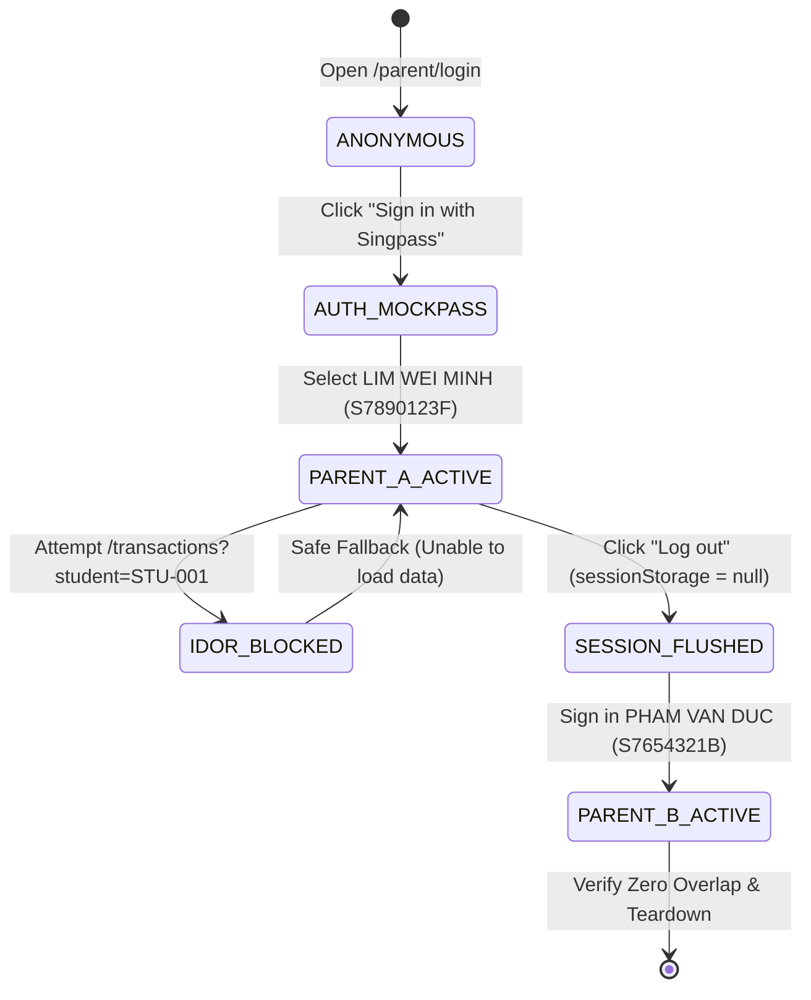

# Test Specification: UAT-005 — SingPass Authentication & Child Profile Authorization (US-005)

> **Module**: FS08 (Parent Portal)  
> **Ticket / Feature**: `fs08-parent-child-auth`  
> **Target Route**: `http://localhost:5174/` & `/parent/login`  
> **Target Persona**: Parent A (`LIM WEI MINH`), Parent B (`PHAM VAN DUC`), Persona No Child (`LIM SHU XIN`)  
> **Traceability**: US-005, PB-06, PB-07, BR-08-01, BR-08-03, BR-08-04, BR-08-10, D-19, R8-AC01, R8-AC03, R8-AC05, R8-AC06, R8-AC13, R8-AC28  

---

## Section 1: The 5 Core Pillars of Test Design

### 1.1 Business Rules (BR)
- **`BR-08-01` (SingPass Immutable Identity Source)**: SingPass serves as the Single Source of Truth for parent identity verification. Mock session must reflect the exact NRIC and identity labels (`S7890123F` for Parent A, `S7654321B` for Parent B).
- **`BR-08-03` (Legal Guardianship Scope)**: Parents are strictly authorized to view only their legally verified children registered in the official MOE database.
- **`BR-08-04` / `D-19` (Dual-Parent Equality & IDOR/BOLA Protection)**: Parental accounts operate independently. Cross-family child profile access via URL parameter manipulation or direct API request is strictly prohibited.
- **`BR-08-10` (Session Lifecycle & Complete Teardown)**: Clicking Log out terminates the authentication session, clears `edusave.parent-auth.user` in `sessionStorage`, and redirects to the sign-in landing page.

### 1.2 Acceptance Criteria (AC)
- **`US-005 / R8-AC01`**: Parent logs in via SingPass successfully, lands on Home Portal, and views verified legal child cards.
- **`US-005 / R8-AC03`**: Parents without linked children in MOE records are refused access with system error alert `MSG-0801`.
- **`US-005 / R8-AC05`**: Invalid or expired SingPass callback authorization codes trigger error alert `MSG-0802`.
- **`US-005 / R8-AC06`**: Identity source and mock session render valid labels; child cards render student name and masked NRIC format (`*****...`).
- **`US-005 / R8-AC13`**: URL parameter tampering with an unauthorized student ID (`?student=STU-001`) is safely blocked.
- **`US-005 / R8-AC28`**: Logging out flushes session storage and cache; Parent B login exhibits 0% data overlap with Parent A.

### 1.3 Validation Rules
- **URL Parameter Verification**: `student_id` parameter must belong strictly to the authenticated parent's child set; foreign IDs fall back to safe error containers.
- **Client Storage Integrity**: `window.sessionStorage.getItem('edusave.parent-auth.user')` must maintain valid JSON, correct NRIC, and null upon logout.
- **PII Security**: Unmasked 9-character NRIC must never appear in URL query strings or page link hrefs.
- **UI Localization Integrity**: Zero raw i18n translation keys (e.g. `features.*`, `common.*`, `*.undefined`) permitted on user interface.

### 1.4 Functional Flow & State Machine


### 1.5 Error Handling & Visual Feedback
- **Backend Rejection**: HTTP `400 Bad Request` / `403 Forbidden` (`isSuccess: false`) on unauthorized student access.
- **UI Error Boundary**: Render warning panel `"Unable to load data - EduAccountService returned an invalid response."` with `"Try again"` button. Student dropdown remains strictly isolated.
- **Route Guard**: Direct access to protected routes without session redirects to `/parent/login`.

---

## Section 2: Test Suite Allocation Overview (3 Pillars)

| Test Suite ID | Pillar / Focus | Test Objective | Total TCs | Severity |
| :--- | :--- | :--- | :--- | :--- |
| `TS-UAT005-01` | **Pillar 1: Business Rules (BR)** | SingPass Parent A login, verified children scope, dual-parent equality (D-19), returning parent profile. | 4 | S1 (Critical) |
| `TS-UAT005-02` | **Pillar 1: IDOR & Security (BR/Sec)** | IDOR cross-family access via URL query param and Direct API request, protecting child privacy. | 2 | S1 (Critical) |
| `TS-UAT005-03` | **Pillar 2: Acceptance Criteria (AC)** | Parent B login, family separation (Zero Overlap), landing CTA, child card details. | 3 | S1 (Critical) |
| `TS-UAT005-04` | **Pillar 2: Error Handling (AC/Err)** | SingPass invalid callback (`MSG-0802`), Parent without linked children (`MSG-0801`). | 2 | S2 (High) |
| `TS-UAT005-05` | **Pillar 3: Tech & UI Integrity** | Auth Guard (unauthenticated redirect), PII NRIC leak check, i18n key leak check, console UI health. | 4 | S2 (High) |
| `TS-UAT005-E2E` | **Full End-to-End Workflow** | Seamless 3-step UAT-005 acceptance execution in a single continuous session. | 1 | S1 (Critical) |

---

## Section 3: Master Test Case Matrix (100% English AvePoint Format)

| ID | Scenario ID | Title | Test Suite | Page | Severity | Priority | Execution Status | Test Type | Environment | Preconditions | Test Data | Test Steps | Expected Result | Actual Result | Assumption Ref | Defect ID | Traceability | Note |
| :--- | :--- | :--- | :--- | :--- | :--- | :--- | :--- | :--- | :--- | :--- | :--- | :--- | :--- | :--- | :--- | :--- | :--- | :--- |
| `TC-UAT005-01` | `TS-UAT005-01` | Verify Parent A Singpass login displays only verified children | SingPass Auth | Landing > Home | S1 | Critical | Ready | Functional | Localhost (:5174) & MockPass (:5156) | Clean unauthenticated session | `data/fs08/fs08_data.json` (`uat_005.parent_a`) | 1. Navigate to `/parent/login`<br>2. Click 'Sign in with Singpass'<br>3. Select persona 'LIM WEI MINH' (S7890123F)<br>4. Submit login and wait for Home Portal redirect | 1. Header renders 'EduSave E-Service Portal'<br>2. Exactly 3 verified children displayed: Tan Wei Ming, Lucas Lim, Nathan Lim<br>3. Mock session retains username S7890123F with role PARENT | As expected | BR-08-01, BR-08-03 | None | US-005, PB-06, PB-07 | Step 1 UAT |
| `TC-UAT005-02` | `TS-UAT005-02` | Verify IDOR cross-family child access tampering via URL is rejected | IDOR Protection | Transactions | S1 | Critical | Ready | Security | Localhost (:5174) | Authenticated session as Parent A | `data/fs08/fs08_data.json` (`uat_005.idor_test`) | 1. Maintain active session for Parent A<br>2. Navigate directly to `/transactions?student=STU-001` (child of Parent B)<br>3. Wait for UI response | 1. UI renders 'Unable to load data' error container<br>2. Student dropdown only displays Parent A children<br>3. Zero data leakage of Liam Pham | As expected | BR-08-04, D-19 | None | US-005, R8-AC13, MSG-0003 | Step 2 UAT (UI) |
| `TC-UAT005-03` | `TS-UAT005-02` | Verify IDOR cross-family child access tampering via direct API is rejected | IDOR Protection | Backend API | S1 | Critical | Ready | Security | Localhost (:5174) | Authenticated session as Parent A | `data/fs08/fs08_data.json` (`uat_005.idor_test`) | 1. Maintain active session for Parent A<br>2. Send direct GET request to `/api/iam/v1/edu-account/students/STU-001/wallet` | 1. API rejects request with HTTP 400 or 403<br>2. Response body contains isSuccess: false | As expected | BR-08-04, D-19 | None | US-005, R8-AC13 | Step 2 UAT (API) |
| `TC-UAT005-04` | `TS-UAT005-01` | Verify logout flushes session and cleans sessionStorage completely | Session Teardown | Header > Landing | S1 | Critical | Ready | Security | Localhost (:5174) | Authenticated session as Parent A | `data/fs08/fs08_data.json` (`uat_005.parent_a`) | 1. Log in as Parent A<br>2. Click 'Log out' button on navigation header<br>3. Inspect sessionStorage | 1. Redirected to `/parent/login`<br>2. 'edusave.parent-auth.user' in sessionStorage is null<br>3. Session completely terminated | As expected | BR-08-10 | None | US-005, R8-AC28, PB-06 | Step 3 UAT (Teardown) |
| `TC-UAT005-05` | `TS-UAT005-01` | Verify returning parent re-login reuses existing profile cleanly | Profile Lifecycle | Login > Home | S2 | High | Ready | Functional | Localhost (:5174) & MockPass (:5156) | Parent account established | `data/fs08/fs08_data.json` (`uat_005.parent_a`) | 1. Log in as Parent A and open Home Portal<br>2. Log out via header<br>3. Re-login immediately as Parent A | 1. Re-login succeeds seamlessly<br>2. All 3 child cards intact without duplicate records | As expected | BR-08-03.2 | None | US-005, R8-AC02 | Returning Parent |
| `TC-UAT005-06` | `TS-UAT005-01` | Verify dual-parent equality (D-19) with independent logins and access rights | Parental Independence | Login > Home | S2 | High | Ready | Functional | Localhost (:5174) & MockPass (:5156) | Dual parents exist | `data/fs08/fs08_data.json` (`personas`) | 1. Log in as Parent 1 (TAN WEI MING) and verify child cards<br>2. Log out cleanly<br>3. Log in as Parent 2 (NGUYEN VAN MINH) and verify child cards independently | 1. Both parents access linked children with equal rights<br>2. Zero session collision or profile overwrite | As expected | D-19, BR-08-04.1 | None | US-005, R8-AC04 | D-19 Rule |
| `TC-UAT005-07` | `TS-UAT005-03` | Verify Landing page renders 'Sign in with Singpass' CTA and navigates to MockPass | Auth Entry | Landing | S2 | High | Ready | UI / Functional | Localhost (:5174) | Clean browser session | `data/fs08/fs08_data.json` (`base_url`) | 1. Open `/parent/login` in unauthenticated browser<br>2. Verify prominent Singpass CTA button<br>3. Click 'Sign in with Singpass' | 1. CTA button rendered prominently<br>2. Redirected to MockPass simulator on port 5156 | As expected | BR-08-01.1 | None | US-005, R8-AC01 | Landing CTA |
| `TC-UAT005-08` | `TS-UAT005-03` | Verify Parent B login displays only verified children with Zero Overlap | Session Isolation | Home Portal | S1 | Critical | Ready | Security / Functional | Localhost (:5174) & MockPass (:5156) | Post Parent A logout | `data/fs08/fs08_data.json` (`uat_005.parent_b`) | 1. Log in to MockPass as Parent B (PHAM VAN DUC)<br>2. Navigate to Home Portal<br>3. Inspect rendered child cards and cross-check against Parent A | 1. Exactly 3 children displayed: Chloe Chan, Liam Pham, Grace Pham<br>2. Zero overlap (0%) with Parent A children | As expected | BR-08-03, D-19 | None | US-005, R8-AC28 | Step 3 UAT (Parent B) |
| `TC-UAT005-09` | `TS-UAT005-03` | Verify child card UI renders full name, masked NRIC, and account links | UI Integrity | Home Portal | S2 | High | Ready | UI / Visual | Localhost (:5174) | Authenticated session as Parent A | `data/fs08/fs08_data.json` (`uat_005.parent_a`) | 1. Log in as Parent A<br>2. Inspect rendered child cards on Home Portal<br>3. Verify student full name, masked NRIC format, and navigation links | 1. Full student name visible on card<br>2. Masked NRIC rendered (containing '*')<br>3. Navigation link to account details active | As expected | R8-AC06, BR-08-03 | None | US-005, R8-AC06 | Card Details |
| `TC-UAT005-10` | `TS-UAT005-04` | Verify invalid or expired SingPass auth code callback displays error alert MSG-0802 | Error Handling | Callback | S2 | High | Ready | Negative / Error | Localhost (:5174) | Unauthenticated | Auth Code `INVALID_CODE_999` | 1. Navigate directly to `/parent/callback?code=INVALID_CODE_999&state=mock_state`<br>2. Wait for callback error alert to appear | 1. Error alert container rendered<br>2. Text contains login failure notice (MSG-0802)<br>3. Zero blank screen crashes | As expected | BR-08-01.3 | None | US-005, R8-AC05, MSG-0802 | Invalid Auth Code |
| `TC-UAT005-11` | `TS-UAT005-04` | Verify login is refused for parent with no linked children displaying MSG-0801 | Error Handling | Login > Callback | S2 | High | Ready | Negative / Error | Localhost (:5174) & MockPass (:5156) | Clean session | `data/fs08/fs08_data.json` (`personas.PAR-NO-CHILD`) | 1. Mock auth endpoint with MSG-0801<br>2. Click 'Sign in with Singpass' and submit MockPass login<br>3. Inspect error alert on callback page | 1. Access to Home Portal blocked<br>2. Error alert displays 'No Edu Account linked with for this parent' (MSG-0801) | As expected | BR-08-02.3 | None | US-005, R8-AC03, MSG-0801 | No Linked Child |
| `TC-UAT005-12` | `TS-UAT005-05` | Verify protected route auth guards redirect unauthenticated requests to login | Security Guard | Route Guards | S2 | High | Ready | Security | Localhost (:5174) | Clean session without login | Protected routes: `/`, `/transactions` | 1. Clear browser session storage<br>2. Navigate directly to protected route '/'<br>3. Navigate directly to protected route '/transactions' | 1. Both requests automatically redirected to `/parent/login`<br>2. Protected content completely inaccessible without session | As expected | Auth Guard Rule | None | US-005, Security Guard | Auth Guard |
| `TC-UAT005-13` | `TS-UAT005-05` | Verify PII protection: Full 9-character NRIC never appears in URLs or link hrefs | Security / PII | Portal URLs & DOM | S1 | Critical | Ready | Security / PII | Localhost (:5174) | Authenticated session as Parent A | Parent A NRIC `S7890123F` | 1. Log in as Parent A (S7890123F)<br>2. Inspect current page URL<br>3. Inspect all 'a[href]' attributes across DOM | 1. Zero page URLs contain unmasked 9-char NRIC<br>2. Zero link hrefs expose unmasked NRIC | As expected | BR-08-01.4, Rule 02 | None | US-005, PII Protection | PII Protection |
| `TC-UAT005-14` | `TS-UAT005-05` | Verify UI translation integrity: Zero raw i18n keys leaked in portal interface | UI Integrity | Home & Landing | S2 | High | Ready | UI / Quality | Localhost (:5174) | Authenticated session as Parent A | i18n regex patterns `features.*`, `common.*` | 1. Log in as Parent A and render Home Portal<br>2. Scan entire body innerText against raw i18n regex patterns | 1. All visible UI text consists of complete, localized sentences<br>2. Zero raw translation keys leaked on interface | As expected | Rule 02 Layer 11 | None | US-005, i18n Cleanliness | i18n Leak Guard |
| `TC-UAT005-15` | `TS-UAT005-05` | Verify UI health: Zero uncaught JS errors and zero severe console exceptions | UI Health | Browser Console | S2 | High | Ready | UI / Stability | Localhost (:5174) | Authenticated session as Parent A | Console error listener | 1. Attach pageerror and console listeners<br>2. Execute complete login and Home Portal rendering<br>3. Inspect captured error collection | 1. Zero uncaught JavaScript TypeErrors or ReferenceErrors<br>2. Portal executes cleanly without severe exceptions | As expected | Rule 02 UI Health | None | US-005, Console Health | Console Health |
| `TC-UAT005-16` | `TS-UAT005-E2E` | Verify complete UAT-005 3-step workflow in seamless execution | E2E Acceptance | Portal End-to-End | S1 | Critical | Ready | E2E Acceptance | Localhost (:5174) & MockPass (:5156) | Standard unauthenticated browser | `data/fs08/fs08_data.json` (`uat_005`) | 1. Step 1: Sign in as Parent A and verify 3 verified children<br>2. Step 2: Tamper URL with STU-001 and verify safe blocking<br>3. Step 3: Log out, flush session, and sign in as Parent B with zero overlap | 1. All 3 UAT acceptance criteria verified seamlessly in single session<br>2. Zero data leakage across families | As expected | US-005 Master Spec | None | US-005 Full UAT | Single E2E Flow |

---

## Section 4: Live DOM Locators Extracted via BSK (Browser-Skill Reconnaissance)

Locators extracted via `tools/recon_bsk.py` and saved to `specs/component_specs/fs08/assets/`:
- [`bsk_login_locators.md`](file:///home/baudui/automation-ui/specs/component_specs/fs08/assets/bsk_login_locators.md)
- [`bsk_home_portal_locators.md`](file:///home/baudui/automation-ui/specs/component_specs/fs08/assets/bsk_home_portal_locators.md)
- [`bsk_transactions_locators.md`](file:///home/baudui/automation-ui/specs/component_specs/fs08/assets/bsk_transactions_locators.md)

| Element Name | Display Label | Live DOM Selector | Element Tag | BSK Asset Reference |
| :--- | :--- | :--- | :--- | :--- |
| **Login with Singpass** | Sign in with Singpass | `button:has-text("Sign in with Singpass")` | `<button type="button">` | `bsk_login_locators.md` |
| **MockPass Citizen Select**| Select citizen persona | `select` | `<select>` | `bsk_login_locators.md` |
| **MockPass Submit Button** | Log in with Singpass | `button:has-text("Log in with Singpass")` | `<button type="button">` | `bsk_login_locators.md` |
| **Portal Main Heading** | EduSave E-Service Portal| `h1:has-text("EduSave E-Service Portal")` | `<h1>` | `bsk_home_portal_locators.md` |
| **Child Cards Container** | Education accounts | `ul[aria-label="Education accounts"] article, article` | `<article>` | `bsk_home_portal_locators.md` |
| **Child Card Link** | Student full name | `article a[class*="_cardLink_"], article a` | `<a>` | `bsk_home_portal_locators.md` |
| **Header Log out Button** | Log out | `button:has-text("Log out")` | `<button type="button">` | `bsk_home_portal_locators.md` |
| **Student Filter Select** | Student | `._select_dwhpe_15, select[name="student"]` | `<select>` | `bsk_transactions_locators.md` |
| **Unable to Load Data** | Unable to load data | `._root_j2y6e_1._error_j2y6e_42, div:has-text("Unable to load data")` | `<div>` | `bsk_transactions_locators.md` |
| **Try Again Button** | Try again | `button:has-text("Try again")` | `<button type="button">` | `bsk_transactions_locators.md` |

---

## Section 5: Test Data Fixtures (JSON Fixtures)

```json
{
  "uat_005": {
    "parent_a": {
      "persona_name": "LIM WEI MINH",
      "nric": "S7890123F",
      "expected_children": [
        "Tan Wei Ming",
        "Lucas Lim",
        "Nathan Lim"
      ]
    },
    "parent_b": {
      "persona_name": "PHAM VAN DUC",
      "nric": "S7654321B",
      "expected_children": [
        "Chloe Chan",
        "Liam Pham",
        "Grace Pham"
      ]
    },
    "idor_test": {
      "unauthorized_student_id": "STU-001",
      "unauthorized_student_name": "Liam Pham"
    }
  }
}
```
