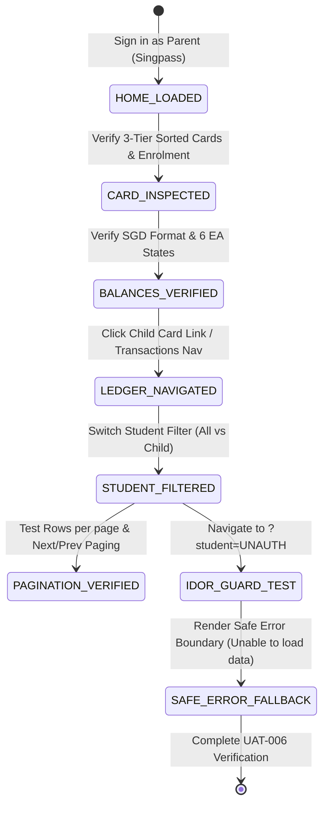

# Test Specification: UAT-006 — Parent Reads Correct Balances, Enrolment and Filtered History (US-006, US-007, US-008)

> **Module**: FS08 (Parent Portal & SingPass Profile)  
> **Ticket / Feature**: `fs08-parent-ea-overview`  
> **Target Routes**: `http://localhost:5174/` & `http://localhost:5174/transactions`  
> **Target Persona**: Howard / Parent B (`PHAM VAN DUC` / `S7654321B`), Parent A (`LIM WEI MINH` / `S7890123F`), Boundary 16yo (`Lee Bee Wah`), Non-Citizen (`K. Shanmugam`)  
> **Traceability**: US-006, US-007, US-008, PB-08, BR-08-04, BR-08-05, BR-08-06, BR-08-07, BR-08-08, D-21, R8-AC06, R8-AC10, R8-AC11, R8-AC12, R8-AC19, R8-AC25, R8-AC26, MSG-0803, MSG-0804, MSG-0003, MSG-0809  

---

## Section 1: The 5 Core Pillars of Test Design

### 1.1 Business Rules (BR)
- **`BR-08-05.1` (Child Card 3-Tier Sorting Order)**:
  - *Tier 1 (Status)*: Active EA cards appear first; age 16+ cards (`Due for closure` / `Closed`) appear last.
  - *Tier 2 (Age)*: Within the same status group, older children (earlier date of birth) sort before younger children.
  - *Tier 3 (FAS status)*: When age is identical, children without FAS sort before children with granted/pending FAS.
- **`BR-08-05.3` & `BR-08-07` (EA Balance Overview & SGD Currency)**: Active cards must render account code, student name, and available balance in standard Singapore Dollar format (`SGD xxx.xx`).
- **`BR-08-06.2` & `BR-08-06.3` (Age 16 Boundary & Lifecycle Closure)**: A child reaching 16 years of age transitions to `Due for closure` or `Closed`. Their account switches to Read-Only mode: balances and history remain visible, but mutation actions (`Pay Fees`, `Apply FAS`) are locked/disabled.
- **`BR-08-04.2` (Citizenship Invariant)**: Non-Singapore citizen children (PR or Foreigner) are not eligible for Education Accounts. EA balance is hidden (`Balance unavailable`) with statutory notice `"Education Accounts are for Singapore Citizens"`, while student record and enrolment remain viewable.
- **`BR-08-04.3` (Under 7yo & Uninitialized EA)**: Children under 7 years old display scheduled opening date notice (`opened on [7th birthday]`); uninitialized EAs display `MSG-0804`.
- **`BR-08-08` (Ledger Integrity & Pending Handling)**: Pending transactions are rendered in a separate yellow warning panel, are **not deducted** from Available Balance, and display no `Balance after` value in the table.

### 1.2 Acceptance Criteria (AC)
- **`US-006 / R8-AC06`**: Parent views linked children cards with EA balances, account numbers, and active status indicators.
- **`US-007 / R8-AC06 & R3-F10`**: Parent views linked child enrolment details including School, Level, Class, Age, DOB, Gender, and masked NRIC (`*****...`).
- **`US-008 / R8-AC06 & AC28`**: Parent navigates to `/transactions`, views summary balance and transaction ledger (Date, Description, Amount, Status), ordered with newest first.
- **`US-008 / R8-AC11`**: Parent filters transactions by Student (All vs individual child), updating URL query parameters (`?student=...`).
- **`US-008 / AC11 (MSG-0803)`**: Filtering with no matching transaction rows renders clean empty state alert `"No transactions found."`.

### 1.3 Validation Rules
- **Currency & Formatting**: All active balances must include currency code `SGD` and 2 decimal places.
- **NRIC Masking**: Unmasked 9-character NRIC must never appear on cards or in URLs.
- **Pagination Boundary**: Table supports 10, 25, 50, 100 rows per page; Previous button disabled on page 1; Next button disabled on terminal page.
- **Clean UI Integrity**: Zero raw i18n translation strings (e.g. `features.*`, `common.*`) and zero unhandled console errors.

### 1.4 Functional Flow & State Machine


### 1.5 Error Handling & Visual Feedback
- **`MSG-0803`**: Empty filter results display container `"No transactions found."`.
- **`MSG-0804`**: Uninitialized EA displays notice `"This student does not have an Education Account."`.
- **`MSG-0003 / BOLA Guard`**: Unauthorized student ID tampering in URL query string is safely blocked with error panel `"Unable to load data - EduAccountService returned an invalid response."` without data leakage.
- **`MSG-0809`**: Ledger service timeout (> 10s) or 500 error triggers retry banner `"We could not retrieve your information. Please try again later."`.

---

## Section 2: Test Suite Allocation Overview (3 Pillars)

| Test Suite ID | Pillar / Focus | Test Objective | Total TCs | Severity |
| :--- | :--- | :--- | :--- | :--- |
| `TS-UAT006-01` | **Pillar 1: Business Rules (BR - Sorting & Balances)** | 3-tier child card sorting order, Active EA balances, and SGD currency format. | 2 | S1 / S2 |
| `TS-UAT006-02` | **Pillar 1: Business Rules (BR - Lifecycle & Boundaries)**| Age 16 read-only mode, Non-citizen notice, Under-7 opening date, and MSG-0804 uninitialized. | 3 | S1 / S2 |
| `TS-UAT006-03` | **Pillar 1: Business Rules (BR - Ledger & Pending)** | Pending transaction yellow warning box, available balance isolation, and ledger balance after. | 1 | S2 |
| `TS-UAT006-04` | **Pillar 2: Acceptance Criteria (AC - Enrolment & Preview)** | Linked child school/level/class enrolment verification and max-3 fee preview item limit. | 2 | S2 |
| `TS-UAT006-05` | **Pillar 2: Acceptance Criteria (AC - Transactions Ledger)**| Transactions page navigation, table structure (Date, Description, Amount), newest-first sorting, pagination controls. | 3 | S1 / S2 |
| `TS-UAT006-06` | **Pillar 2: Acceptance Criteria (AC - Student Filter & MSG-0803)**| Student dropdown filtering, URL query parameter sync, and empty filter result MSG-0803. | 2 | S2 |
| `TS-UAT006-07` | **Pillar 3: Security & Error Handling (Sec/Err)** | IDOR / BOLA URL tampering protection (MSG-0003) and API 500 / timeout fallback (MSG-0809). | 2 | S1 / S2 |
| `TS-UAT006-08` | **Pillar 3: UI Health & PII Guard (Tech/NFR)** | Zero console errors, zero raw translation key leaks (`features.*`), and strict PII NRIC masking. | 1 | S2 |
| `TS-UAT006-E2E` | **Full End-to-End Workflow** | Seamless end-to-end acceptance verification of balances, enrolment, and transaction filtering. | 1 | S1 |

---

## Section 3: Master Test Case Matrix (100% English AvePoint Format)

| ID | Scenario ID | Title | Test Suite | Page | Severity | Priority | Execution Status | Test Type | Environment | Preconditions | Test Data | Test Steps | Expected Result | Actual Result | Assumption Ref | Defect ID | Traceability | Note |
| :--- | :--- | :--- | :--- | :--- | :--- | :--- | :--- | :--- | :--- | :--- | :--- | :--- | :--- | :--- | :--- | :--- | :--- | :--- | :--- |
| `TC-UAT006-01` | `TS-UAT006-01` | Verify 3-tier child card sorting order on Home Portal | Card Sorting | Home Portal | S2 | High | Ready | Functional | Localhost (:5174) & MockPass (:5156) | Authenticated parent with multiple linked children | `data/fs08/fs08_data.json` (`uat_006.persona_howard`) | 1. Sign in as Parent Howard (PHAM VAN DUC)<br>2. Navigate to Home Portal<br>3. Inspect child cards rendering order across status, age and FAS | 1. Active status cards appear before any age 16+ or closed cards<br>2. Older children sort before younger within same status<br>3. Non-FAS children sort before FAS granted | As expected | BR-08-05.1 | None | US-006, AC #12, BR-08-05.1 | Tier Sorting |
| `TC-UAT006-02` | `TS-UAT006-01` | Verify Active child card renders SGD balance format, Active status badge, and masked NRIC | EA Balances | Home Portal | S1 | Critical | Ready | Functional | Localhost (:5174) & MockPass (:5156) | Authenticated parent with active student | `data/fs08/fs08_data.json` (`uat_006.persona_howard`) | 1. Sign in as Parent Howard<br>2. Inspect active child card (Liam Pham / Chloe Chan)<br>3. Verify balance format and status | 1. Active badge visible<br>2. Balance formatted with SGD prefix and two decimal places (e.g. SGD 500.00)<br>3. Masked NRIC displayed | As expected | BR-08-05.3, BR-08-07 | None | US-006, R8-AC06, PB-08 | EA Balance |
| `TC-UAT006-03` | `TS-UAT006-02` | Verify child reaching 16yo displays Due for closure and operates in Read-Only mode | Age 16 Rules | Home Portal | S1 | Critical | Ready | Functional / Security | Localhost (:5174) & MockPass (:5156) | Authenticated persona with child reaching 16yo | `data/fs08/fs08_data.json` (`personas.PAR-BOUNDARY-16`) | 1. Sign in as persona with 16yo child (Lee Bee Wah)<br>2. Inspect status badge and action buttons on 16yo card | 1. Status displays Due for closure or Closed<br>2. Pay Fees and Apply FAS mutation buttons are disabled or absent | As expected | BR-08-06.2, BR-08-06.3 | None | US-006, AC #7, AC #26 | Age 16 Lockout |
| `TC-UAT006-04` | `TS-UAT006-02` | Verify Non-Singapore Citizen child card hides EA balance and renders citizenship notice | Citizenship Rules | Home Portal | S2 | High | Ready | Functional | Localhost (:5174) & MockPass (:5156) | Authenticated parent with non-citizen student | `data/fs08/fs08_data.json` (`personas.PAR-NON-CITIZEN`) | 1. Sign in as parent with non-citizen child (K. Shanmugam)<br>2. Inspect child card balance container | 1. Active EA balance is hidden<br>2. Notice 'Education Accounts are for Singapore Citizens' is visible<br>3. Enrolment info remains viewable | As expected | BR-08-04.2 | None | US-006, AC #10, BR-08-04.2 | Non-Citizen Rule |
| `TC-UAT006-05` | `TS-UAT006-02` | Verify child under 7yo displays expected EA opening date or uninitialized EA displays MSG-0804 | Under 7 Lifecycle | Home Portal | S2 | High | Ready | Functional | Localhost (:5174) & MockPass (:5156) | Parent with under-7 child or uninitialized EA | `data/fs08/fs08_data.json` (`messages.MSG-0804`) | 1. Sign in as parent with student under 7yo<br>2. Verify scheduled opening date notice on card<br>3. Test uninitialized EA response | 1. Under-7 card shows opening date on 7th birthday<br>2. Uninitialized EA renders MSG-0804 alert | As expected | BR-08-04.3 | None | US-006, MSG-0804, BR-08-04.3 | Under 7 / MSG-0804 |
| `TC-UAT006-06` | `TS-UAT006-03` | Verify pending transaction displays in yellow alert box and does not deduct Available Balance | Pending Ledger | Transactions | S2 | High | Ready | Functional | Localhost (:5174) | Authenticated parent on /transactions | `data/fs08/fs08_data.json` (`uat_006.persona_howard`) | 1. Open transactions page with pending transactions<br>2. Inspect yellow alert banner and summary balance | 1. Pending amount rendered in distinct yellow warning box<br>2. Available Balance does not deduct pending amount<br>3. Pending row has no Balance after | As expected | BR-08-08, AC #25 | None | US-006, US-008, AC #25 | Pending Handling |
| `TC-UAT006-07` | `TS-UAT006-04` | Verify linked child enrolment view renders student name, ID, age, school and class details | Enrolment View | Home Portal | S2 | High | Ready | Functional | Localhost (:5174) & MockPass (:5156) | Authenticated parent on Home Portal | `data/fs08/fs08_data.json` (`uat_006.persona_howard`) | 1. Sign in as Parent Howard<br>2. Inspect rendered enrolment attributes across child cards | 1. Student full name rendered<br>2. Student ID (e.g. EDU-00002) and age visible<br>3. Enrolment status, gender, and masked NRIC displayed accurately | As expected | US-007, R3-F10 | None | US-007, R8-AC06, R3-F10 | Enrolment Details |
| `TC-UAT006-08` | `TS-UAT006-04` | Verify fee preview on child card shows maximum 3 fees and more link if applicable | Fee Preview | Home Portal | S2 | Medium | Ready | UI / Functional | Localhost (:5174) & MockPass (:5156) | Authenticated parent with pending fees | `data/fs08/fs08_data.json` (`uat_006.persona_howard`) | 1. Sign in as Parent Howard<br>2. Count preview fee items rendered inside child cards | 1. At most 3 preview fee items displayed per card<br>2. '+N more' link appears if total pending fees exceed 3 | As expected | BR-08-05.3 | None | US-006, AC #19, BR-08-05.3 | Fee Limit |
| `TC-UAT006-09` | `TS-UAT006-05` | Verify clicking child card link opens Transactions ledger with required table headers | Ledger Navigation | Home > Transactions | S1 | Critical | Ready | Functional | Localhost (:5174) & MockPass (:5156) | Authenticated parent on Home Portal | `data/fs08/fs08_data.json` (`uat_006.persona_howard`) | 1. Sign in as Parent Howard<br>2. Click on child card link (Chloe Chan)<br>3. Verify redirection to /transactions and inspect table structure | 1. Navigates to `/transactions?student=...`<br>2. Summary box renders A/C code and Available Balance<br>3. Table headers contain Date, Description, Amount | As expected | BR-08-08.6, R8-AC06 | None | US-008, R8-AC06, PB-08 | Ledger Headers |
| `TC-UAT006-10` | `TS-UAT006-05` | Verify Transactions ledger displays newest transaction first | Ledger Sorting | Transactions | S2 | High | Ready | Functional | Localhost (:5174) | Authenticated parent on /transactions | `data/fs08/fs08_data.json` (`uat_006.persona_howard`) | 1. Navigate to /transactions for active student<br>2. Inspect transaction dates in table rows | 1. Rows sorted in descending chronological order (newest date and time appears first) | As expected | FR-08.2, TC-071 | None | US-008, TC-071 | Newest First |
| `TC-UAT006-11` | `TS-UAT006-05` | Verify Transactions pagination controls, rows per page options and page navigation | Ledger Pagination | Transactions | S2 | High | Ready | Functional | Localhost (:5174) | Authenticated parent on /transactions | `data/fs08/fs08_data.json` (`uat_006.ledger_table`) | 1. Open /transactions with multiple pages of records<br>2. Inspect Rows per page selector (10, 25, 50, 100)<br>3. Click Next button and verify page updates | 1. Previous button disabled on page 1<br>2. Clicking Next increments page and updates records<br>3. Rows per page updates table density cleanly | As expected | FR-08.2, TC-072, TC-073 | None | US-008, TC-072, TC-073 | Pagination Controls |
| `TC-UAT006-12` | `TS-UAT006-06` | Verify switching student in dropdown updates URL query parameter and ledger view | Student Filter | Transactions | S2 | High | Ready | Functional | Localhost (:5174) | Authenticated parent on /transactions | `data/fs08/fs08_data.json` (`uat_006.persona_howard`) | 1. Open /transactions<br>2. Select specific child from Student dropdown<br>3. Switch back to All students | 1. URL query parameter updates to ?student=...<br>2. Student summary box renders matching child info<br>3. Switching to All clears student parameter | As expected | FR-08.2, TC-076, TC-077 | None | US-008, TC-076, TC-077 | Student Filtering |
| `TC-UAT006-13` | `TS-UAT006-06` | Verify empty filter result displays MSG-0803 'No transactions found.' cleanly | Empty State | Transactions | S2 | High | Ready | Functional / UI | Localhost (:5174) | Authenticated parent on /transactions | `data/fs08/fs08_data.json` (`uat_006.empty_filter`) | 1. Mock empty transaction response or apply non-matching filter<br>2. Inspect table container on /transactions | 1. Table hidden or replaced with empty alert<br>2. Message renders 'No transactions found.' (MSG-0803)<br>3. Zero layout breakage | As expected | MSG-0803, AC #11 | None | US-008, MSG-0803, AC #11 | Empty State MSG-0803 |
| `TC-UAT006-14` | `TS-UAT006-07` | Verify IDOR protection: unauthorized student ID in URL falls back safely without data leakage | IDOR Guard | Transactions | S1 | Critical | Ready | Security | Localhost (:5174) | Authenticated session as Parent Howard | `data/fs08/fs08_data.json` (`uat_006.idor_test`) | 1. Maintain active session as Parent Howard<br>2. Navigate directly to `/transactions?student=STU-9999-UNAUTH`<br>3. Inspect UI response | 1. Rejects access with 'Unable to load data' error boundary or falls back safely<br>2. Student dropdown retains only Howard's children<br>3. Zero foreign data leakage | As expected | MSG-0003, BR-08-04 | None | US-008, MSG-0003, TC-078 | IDOR Protection |
| `TC-UAT006-15` | `TS-UAT006-07` | Verify ledger service API timeout or 500 error triggers MSG-0809 retry banner | API Resilience | Transactions | S2 | High | Ready | Error Handling | Localhost (:5174) | Authenticated parent on /transactions | `data/fs08/fs08_data.json` (`messages.MSG-0809`) | 1. Intercept wallet/ledger API and simulate 500 or timeout (> 10s)<br>2. Navigate to /transactions | 1. Error panel renders 'Unable to load data'<br>2. 'Try again' button is visible and active<br>3. Zero white-screen crash | As expected | MSG-0809, FR-08.2 | None | US-008, MSG-0809 | API Resilience |
| `TC-UAT006-16` | `TS-UAT006-08` | Verify UI health: Zero console errors, zero raw translation keys and strict PII masking | UI Health & PII | Home & Transactions | S2 | High | Ready | UI / Quality | Localhost (:5174) & MockPass (:5156) | Authenticated parent | Console & i18n listeners | 1. Attach pageerror and console listeners<br>2. Traverse Home and Transactions pages<br>3. Inspect page text for raw translation keys and unmasked NRIC | 1. Zero severe console exceptions<br>2. Zero translation leaks (features.*)<br>3. All NRIC values masked with asterisks | As expected | Rule 02 UI Health, PII Guard | None | US-006, US-008, UI Health | Quality Guard |
| `TC-UAT006-17` | `TS-UAT006-E2E` | Verify complete UAT-006 workflow: balances, enrolment, card navigation and filtered history | Full E2E Flow | End-to-End | S1 | Critical | Ready | E2E Acceptance | Localhost (:5174) & MockPass (:5156) | Standard unauthenticated session | `data/fs08/fs08_data.json` (`uat_006`) | 1. Step 1: Sign in as Parent Howard and verify 3 child cards, balances and enrolment<br>2. Step 2: Click Chloe Chan link to open transactions ledger<br>3. Step 3: Verify summary balance, table headers, sorting and pagination<br>4. Step 4: Test IDOR resistance via URL tampering | 1. All 3 User Stories (US-006, US-007, US-008) verified seamlessly in a single continuous flow<br>2. Balance and enrolment data accurate with zero security leaks | As expected | Master UAT-006 Spec | None | US-006, US-007, US-008 | E2E Acceptance |

---

## Section 4: Live DOM Locators Extracted via BSK (Browser-Skill Reconnaissance)

Locators extracted via `tools/recon_bsk.py` and live DOM inspection:

| Element Name | Display Label | Live DOM Selector | Element Tag | BSK Asset Reference |
| :--- | :--- | :--- | :--- | :--- |
| **Portal Main Heading** | EduSave E-Service Portal | `h1:has-text("EduSave E-Service Portal")` | `<h1>` | `bsk_home_portal_locators.md` |
| **Child Cards Container** | Education accounts | `ul[aria-label="Education accounts"] article, article` | `<article>` | `bsk_home_portal_locators.md` |
| **Child Card Link** | Student full name | `article a[class*="_cardLink_"], article a` | `<a>` | `bsk_home_portal_locators.md` |
| **EA Balance Display** | EA BALANCE | `article dt:has-text("EA BALANCE") + dd, article button:has-text("EA balance")` | `<dd>` / `<button>` | `bsk_home_portal_locators.md` |
| **Balance Unavailable** | Balance unavailable | `span:has-text("Balance unavailable")` | `<span>` | `bsk_home_portal_locators.md` |
| **Transactions Nav Link** | Transactions | `nav a[href="/transactions"]` | `<a>` | `bsk_home_portal_locators.md` |
| **Student Filter Select** | Student | `main select, div[class*="toolbar"] select, select:not([aria-label="Language"])` | `<select>` | `bsk_transactions_locators.md` |
| **Transactions Heading** | Transactions manage | `h1:has-text("Transactions manage")` | `<h1>` | `bsk_transactions_locators.md` |
| **Summary Box Balance** | AVAILABLE BALANCE | `section strong:has-text("SGD"), dt:has-text("AVAILABLE BALANCE") + dd` | `<strong>` / `<dd>` | `bsk_transactions_locators.md` |
| **Summary Box Account** | A/C: WA-xxxxx | `p:has-text("A/C:"), dt:has-text("A/C") + dd` | `<p>` / `<dd>` | `bsk_transactions_locators.md` |
| **Transactions Table** | Transaction history | `table[aria-label="Transaction history"], table` | `<table>` | `bsk_transactions_locators.md` |
| **Table Headers** | Date, Description, Amount | `table th` | `<th>` | `bsk_transactions_locators.md` |
| **Table Rows** | Data rows | `table tbody tr` | `<tr>` | `bsk_transactions_locators.md` |
| **Pagination Nav** | Previous, 1, 2, ..., Next | `nav button:has-text("Next"), nav button:has-text("Previous")` | `<button>` | `bsk_transactions_locators.md` |
| **Rows per page Select** | 10 / 25 / 50 / 100 | `div[class*="pagination"] select, label:has-text("Rows per page") ~ select` | `<select>` | `bsk_transactions_locators.md` |
| **Unable to Load Data** | Unable to load data | `div:has-text("Unable to load data"), h3:has-text("Unable to load data")` | `<div>` | `bsk_transactions_locators.md` |
| **Try Again Button** | Try again | `button:has-text("Try again")` | `<button type="button">` | `bsk_transactions_locators.md` |

---

## Section 5: Test Data Fixtures (JSON Fixtures)

```json
{
  "uat_006": {
    "persona_howard": {
      "name": "PHAM VAN DUC",
      "display_name": "Howard (PHAM VAN DUC)",
      "nric": "S7654321B",
      "expected_children": ["Chloe Chan", "Liam Pham", "Grace Pham"],
      "active_child": {
        "name": "Chloe Chan",
        "student_id": "EDU-00002",
        "uuid": "01a15a22-dddf-750e-ac12-6d155e779d11",
        "masked_nric": "*****784X",
        "expected_balance": "SGD 500.00",
        "expected_account": "WA-00002"
      }
    },
    "ledger_table": {
      "expected_headers": ["Date", "Description", "Amount"],
      "rows_per_page_options": ["10", "25", "50", "100"]
    },
    "idor_test": {
      "unauthorized_student_id": "STU-9999-UNAUTH",
      "expected_error": "Unable to load data"
    },
    "empty_filter": {
      "expected_message": "No transactions found."
    }
  }
}
```

---

## Section 6: Traceability Matrix (FSD, AC, BR, Decisions, Error Codes)

| Test Case ID | User Story ID | Business Rule (BR) | Acceptance Criteria (AC) | Client Decision | Error Code | Test File |
| :--- | :--- | :--- | :--- | :--- | :--- | :--- |
| `TC-UAT006-01` | US-006 | `BR-08-05.1` | Table 122 AC #12 | D-21 | N/A | `test_integration_uat_006_flow.py` |
| `TC-UAT006-02` | US-006 | `BR-08-05.3`, `BR-08-07` | R8-AC06, PB-08 | D-21 | N/A | `test_atomic_ea_balances_and_enrolment.py` |
| `TC-UAT006-03` | US-006 | `BR-08-06.2`, `BR-08-06.3`| AC #7, AC #26 | D-21 | N/A | `test_integration_uat_006_flow.py` |
| `TC-UAT006-04` | US-006 | `BR-08-04.2` | Table 122 AC #10 | D-21 | N/A | `test_atomic_ea_balances_and_enrolment.py` |
| `TC-UAT006-05` | US-006 | `BR-08-04.3` | Table 124 MSG-0804 | D-21 | `MSG-0804` | `test_atomic_ea_balances_and_enrolment.py` |
| `TC-UAT006-06` | US-006, US-008 | `BR-08-08` | Table 122 AC #25 | D-21 | N/A | `test_integration_uat_006_flow.py` |
| `TC-UAT006-07` | US-007 | `BR-08-05.3` | R8-AC06, R3-F10 | D-21 | N/A | `test_atomic_ea_balances_and_enrolment.py` |
| `TC-UAT006-08` | US-006 | `BR-08-05.3` | Table 122 AC #19 | D-21 | N/A | `test_atomic_ea_balances_and_enrolment.py` |
| `TC-UAT006-09` | US-008 | `BR-08-08.6` | R8-AC06, PB-08 | D-21 | N/A | `test_atomic_transactions_ledger_filter.py` |
| `TC-UAT006-10` | US-008 | FR-08.2 | TC-071 | D-21 | N/A | `test_atomic_transactions_ledger_filter.py` |
| `TC-UAT006-11` | US-008 | FR-08.2 | TC-072, TC-073 | D-21 | N/A | `test_atomic_transactions_ledger_filter.py` |
| `TC-UAT006-12` | US-008 | FR-08.2 | TC-076, TC-077 | D-21 | N/A | `test_atomic_transactions_ledger_filter.py` |
| `TC-UAT006-13` | US-008 | `BR-08-08.5` | AC #11, MSG-0803 | D-21 | `MSG-0803` | `test_atomic_transactions_ledger_filter.py` |
| `TC-UAT006-14` | US-008 | `BR-08-04`, `D-19` | MSG-0003, TC-078 | D-19 | `MSG-0003` | `test_integration_uat_006_flow.py` |
| `TC-UAT006-15` | US-008 | FR-08.2 | MSG-0809 | D-21 | `MSG-0809` | `test_integration_uat_006_flow.py` |
| `TC-UAT006-16` | US-006, US-008 | Rule 02 NFR | UI Health & PII | D-20 | N/A | `test_integration_uat_006_flow.py` |
| `TC-UAT006-17` | US-006, US-007, US-008 | Master UAT-006 Spec | E2E Acceptance | D-19, D-21 | N/A | `test_integration_uat_006_flow.py` |
