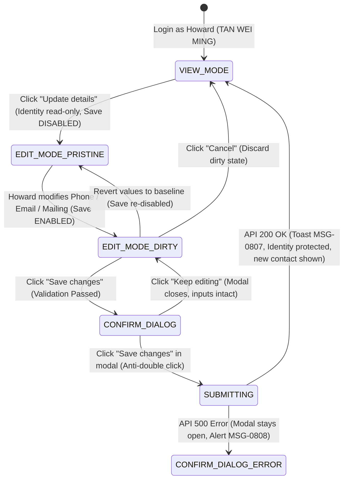

# Test Specification: UAT-007 — Parent Updates Permitted Contact Fields Without Changing Identity (US-009)

> **Module**: FS08 (Parent Portal)  
> **Ticket / Feature**: `fs08-uat007-contact-update`  
> **Target Route**: `http://localhost:5174/profile`  
> **Target Persona**: Howard / Parent (`TAN WEI MING`, NRIC `S7654321B`)  
> **Traceability**: US-009, R8, BR-08-01, BR-08-02, BR-08-03, BR-08-04, D-20, D-28, R8-AC01, R8-AC05, R8-AC06, R8-AC11, R8-AC12, R8-AC13, R8-AC14, R8-AC15, R8-AC25, R8-AC26, MSG-0001, MSG-0805, MSG-0806, MSG-0807, MSG-0808  

---

## Section 1: The 5 Core Pillars of Test Design

### 1.1 Business Rules (BR)
- **`BR-08-03` / `D-20` (SingPass Immutability Single Source of Truth)**: Government identity fields (Full Name, NRIC/FIN, and Residential Address) are authoritative from Singpass (MyInfo) and **STRICTLY IMMUTABLE** (read-only). They must never render as editable `<input>` elements. Parents cannot change them via portal.
- **`BR-08-02` (Permitted Contact & Mailing Customization)**: Parents are permitted to edit their own contact details (Mobile number, Email) and alternative Mailing Address (Block, Street, Unit, Postal Code, Country) independently of other parents/guardians.
- **`BR-08-01` (Child Age Access Control)**: Edit access is granted because the parent has at least one active linked child under 16 years old.
- **`BR-08-04` / `D-28` (Zero Notification Spam)**: No email notifications are triggered when contact details or mailing addresses are updated.

### 1.2 Acceptance Criteria (AC)
- **`US-009 / R8-AC01`**: Parent authenticates via Singpass and accesses `/profile` in View Mode.
- **`US-009 / R8-AC05 & AC06`**: Identity fields (Full Name, NRIC, Residential Address) are static definition terms (`<dd>`); NRIC is masked by default (`*****123F`) with toggle `Show NRIC` / `Hide NRIC`.
- **`US-009 / R8-AC11`**: Clicking `Update details` transitions to Edit Mode; Mobile, Email, Street, Postal Code, Country, Block, Unit become editable inputs.
- **`US-009 / R8-AC12`**: Mobile number must be validated: exactly 8 digits, starts with 6, 8, or 9; invalid format raises `MSG-0805`.
- **`US-009 / R8-AC13`**: Email must be validated: RFC 5322 compliant, max 150 chars; invalid format raises `MSG-0806`.
- **`US-009 / R8-AC15`**: Mailing Street, Postal Code (6 digits), and Country are required; Block and Unit are optional; blank required field raises `MSG-0001`.
- **`US-009 / R8-AC25`**: Form maintains Pristine state (Save disabled, helper text visible) until input changes; modifying values activates Dirty state (Save enabled).
- **`US-009 / R8-AC26`**: Clicking `Save changes` opens confirmation modal `alertdialog` (*"Save your changes?"*); `Keep editing` preserves form; confirming triggers API mutation, displays Toast `MSG-0807` (*"Your details have been updated."*), and returns to View Mode with updated data while identity remains intact.

### 1.3 Validation Rules
- **12-Layer Field Test Matrix**:
  - `Empty Required`: Emptying Phone, Email, Street, Postal Code triggers `MSG-0001` with `aria-invalid="true"`.
  - `Whitespace Normalization (ASM-15)`: All-whitespace strings are trimmed and treated as empty (`MSG-0001`). Leading/trailing spaces are auto-trimmed.
  - `Boundary Value Analysis (BVA)`: Phone (7/8/9 digits), Postal Code (5/6/7 digits), Email (149/150/151 chars), Street (100/101 chars).
  - `Focus Management`: Form auto-scrolls and focuses the first invalid field upon submit.

### 1.4 Functional Flow & State Machine


### 1.5 Error Handling & Visual Feedback
- **Field Level**: `MSG-0001` (*"Enter your <field>"*), `MSG-0805` (*"Enter a mobile number in the correct format, like 9123 4567"*), `MSG-0806` (*"Enter an email address in the correct format, like name@example.com"*). Inputs highlighted with red border and `aria-invalid="true"`.
- **System Level**: `MSG-0808` (*"We could not update your details. Please try again."*) rendered inside modal upon HTTP 500 error without closing modal or losing user inputs.
- **Security Guard**: SingPass identity fields are completely un-editable; backend mutation ignores/rejects any identity override tampering.

---

## Section 2: Test Suite Allocation Overview (3 Pillars)

| Test Suite ID | Pillar / Focus | Test Objective | Total TCs | Severity |
| :--- | :--- | :--- | :--- | :--- |
| `TS-UAT007-01` | **Pillar 1: Business Rules (BR)** | SingPass government identity immutability (Full Name, NRIC masking, Residential Address read-only) & Zero notification. | 2 | S1 (Critical) |
| `TS-UAT007-02` | **Pillar 2: Acceptance Criteria (AC)** | Permitted contact fields (Mobile, Email, Mailing Address) validation, required vs optional checks, BVA boundaries. | 3 | S1 (Critical) |
| `TS-UAT007-03` | **Pillar 2: Flow & Lifecycle (AC/Flow)**| Pristine/Dirty state management, Cancel discard, and Modal dialog `Keep editing` vs confirm submission. | 2 | S1 (Critical) |
| `TS-UAT007-04` | **Pillar 3: Error Handling & Resilience**| System API 500 fault injection (`MSG-0808`) in confirmation dialog and auto-retry capability. | 1 | S2 (High) |
| `TS-UAT007-E2E` | **Full End-to-End Workflow** | Complete UAT-007 acceptance flow: login, contact update, confirmation, toast verification, and identity immutability check. | 1 | S1 (Critical) |

---

## Section 3: Master Test Case Matrix (19 Columns Standard AvePoint Format)

| ID | Scenario ID | Title | Test Suite | Page | Severity | Priority | Execution Status | Test Type | Environment | Preconditions | Test Data | Test Steps | Expected Result | Actual Result | Assumption Ref | Defect ID | Traceability | Note |
| :--- | :--- | :--- | :--- | :--- | :--- | :--- | :--- | :--- | :--- | :--- | :--- | :--- | :--- | :--- | :--- | :--- | :--- | :--- |
| `TC-UAT007-01` | `TS-UAT007-01` | Verify SingPass government identity fields remain immutable in both View and Edit modes | SingPass Identity | Profile | S1 | Critical | Ready | Security / Functional | Localhost (:5174) | Authenticated as Howard | `data/fs08/fs08_data.json` (`uat_007.persona`) | 1. Open `/profile`<br>2. Inspect Full Name, NRIC, Residential Address elements<br>3. Click 'Update details' to enter Edit mode<br>4. Re-inspect identity elements for input tags | 1. Full Name, NRIC, Residential Address render as `<dd>` text terms<br>2. Zero `<input>` or `<textarea>` tags exist for identity<br>3. Identity remains strictly immutable | As expected | BR-08-03, D-20 | None | US-009, R8-AC05 | Identity Immutability |
| `TC-UAT007-02` | `TS-UAT007-01` | Verify NRIC masking toggle Show and Hide does not trigger dirty form state | NRIC Masking | Profile | S2 | High | Ready | UI / Functional | Localhost (:5174) | Edit mode on `/profile` | NRIC `S7654321B` | 1. Enter Edit mode via 'Update details'<br>2. Verify NRIC masked format `*****321B`<br>3. Click 'Show NRIC' then 'Hide NRIC'<br>4. Inspect 'Save changes' button | 1. NRIC unmasks to full NRIC and re-masks to `*****321B`<br>2. NRIC toggle does NOT make form dirty<br>3. 'Save changes' button remains disabled | As expected | BR-08-03, R8-AC06, R8-AC14 | None | US-009, R8-AC06 | Masking Clean State |
| `TC-UAT007-03` | `TS-UAT007-02` | Verify permitted Mobile field validation: empty required, whitespace, and 8-digit Singapore format | Mobile Input | Profile Edit | S1 | Critical | Ready | Validation / Functional | Localhost (:5174) | Edit mode on `/profile` | `invalid_phone_short`, `invalid_phone_prefix`, `invalid_phone_whitespace` | 1. Clear Mobile field and click Save<br>2. Input 8 spaces and click Save<br>3. Input 7 digits '9123456' and click Save<br>4. Input starting with 5 '51234567' and click Save | 1. Empty & whitespace trigger `MSG-0001` with `aria-invalid="true"`<br>2. 7 digits and prefix 5 trigger `MSG-0805`<br>3. Save blocked; modal does not open | As expected | BR-08-02, R8-AC12 | None | US-009, MSG-0001, MSG-0805 | Mobile Validation |
| `TC-UAT007-04` | `TS-UAT007-02` | Verify permitted Email field validation: empty required, whitespace, RFC 5322 format | Email Input | Profile Edit | S1 | Critical | Ready | Validation / Functional | Localhost (:5174) | Edit mode on `/profile` | `invalid_email_format`, `invalid_email_whitespace` | 1. Clear Email field and click Save<br>2. Input whitespace string and click Save<br>3. Input invalid syntax 'howard.invalid.email' and click Save | 1. Empty & whitespace trigger `MSG-0001` with `aria-invalid="true"`<br>2. Invalid syntax triggers `MSG-0806`<br>3. Save blocked; modal does not open | As expected | BR-08-02, R8-AC13 | None | US-009, MSG-0001, MSG-0806 | Email Validation |
| `TC-UAT007-05` | `TS-UAT007-02` | Verify Mailing Address validation: Street/Postal/Country mandatory, Block/Unit optional | Mailing Address | Profile Edit | S1 | Critical | Ready | Validation / Functional | Localhost (:5174) | Edit mode on `/profile` | `invalid_postal_short`, optional Block/Unit | 1. Clear Street, Postal, Country fields<br>2. Verify error alerts for mandatory fields<br>3. Input 5-digit postal code<br>4. Leave Block and Unit empty | 1. Mandatory fields trigger `MSG-0001`<br>2. 5-digit postal triggers validation error<br>3. Block and Unit remain valid when blank | As expected | BR-08-02, R8-AC15, D-20 | None | US-009, R8-AC15 | Mailing Validation |
| `TC-UAT007-06` | `TS-UAT007-03` | Verify Pristine and Dirty state transitions and Cancel discard functionality | Form State | Profile Edit | S1 | Critical | Ready | Functional / UI | Localhost (:5174) | Edit mode on `/profile` | Mobile edit `'91234567'` | 1. Enter Edit mode<br>2. Check initial Save button state and hint<br>3. Modify Mobile number<br>4. Revert back to original<br>5. Modify Mobile again and click 'Cancel' | 1. Initial form is pristine: Save disabled, hint visible<br>2. Modifying input enables Save button and hides hint<br>3. Reverting re-disables Save button<br>4. Cancel discards changes and returns to View Mode | As expected | R8-AC25 | None | US-009, R8-AC25 | Pristine/Dirty State |
| `TC-UAT007-07` | `TS-UAT007-03` | Verify Confirm Dialog alertdialog opens, traps focus, and Keep editing preserves inputs | Confirm Dialog | Profile Modal | S1 | Critical | Ready | Functional / UI | Localhost (:5174) | Form in dirty state | Modified contact fields | 1. Modify contact info with valid values<br>2. Click 'Save changes'<br>3. Verify confirmation dialog appears<br>4. Click 'Keep editing' inside dialog | 1. Modal `<div role='alertdialog'>` opens with title 'Save your changes?'<br>2. Clicking 'Keep editing' closes dialog<br>3. Form remains in Edit Mode with modified inputs intact | As expected | R8-AC26 | None | US-009, R8-AC26 | Dialog Keep Editing |
| `TC-UAT007-08` | `TS-UAT007-04` | Verify system API 500 error handling keeps dialog open displaying MSG-0808 | Error Handling | Profile Modal | S2 | High | Ready | Negative / Error | Localhost (:5174) | Confirm dialog open | Mocked HTTP 500 mutation route | 1. Intercept `/iam/v1/parent/update/profile` with HTTP 500<br>2. Click 'Save changes' inside modal dialog<br>3. Inspect modal dialog state and error message | 1. Modal dialog remains open (does NOT close abruptly)<br>2. Error alert `MSG-0808` is displayed inside modal<br>3. User inputs are preserved; Save button re-enables for retry | As expected | MSG-0808 | None | US-009, MSG-0808 | System Error Fault |
| `TC-UAT007-09` | `TS-UAT007-E2E` | Verify complete UAT-007 end-to-end acceptance: update permitted contact fields while identity remains protected | Full E2E Flow | Profile End-to-End | S1 | Critical | Ready | E2E Acceptance | Localhost (:5174) & MockPass (:5156) | Authenticated Howard session | `data/fs08/fs08_data.json` (`uat_007`) | 1. Sign in as Howard and open `/profile`<br>2. Click 'Update details'<br>3. Update Phone, Email, Mailing Address<br>4. Click 'Save changes' and confirm dialog<br>5. Inspect View Mode and identity fields | 1. Toast `MSG-0807` (*"Your details have been updated."*) appears<br>2. View Mode reflects updated phone, email, and mailing address<br>3. Singpass Full Name and NRIC remain 100% unchanged | As expected | US-009 Master Spec | None | US-009 Full UAT-007 | Full UAT Acceptance |

---

## Section 4: Live DOM Locators Extracted via BSK

```python
# Extracted from pages/fs08/parent_profile_page.py
PROFILE_HEADING = "h1:has-text('My Profile'), h2:has-text('My Profile')"
FULL_NAME_VAL = "dt:has-text('Full Name') + dd"
NRIC_VAL = "dt:has-text('NRIC') + dd"
RESIDENTIAL_ADDRESS_VAL = "dt:has-text('Residential') + dd"
SHOW_NRIC_BTN = "button:has-text('Show NRIC')"
HIDE_NRIC_BTN = "button:has-text('Hide NRIC')"
UPDATE_DETAILS_BTN = "button:has-text('Update details')"

# Edit Mode Locators
INPUT_PHONE = "input[name='phoneNumber']"
INPUT_EMAIL = "input[name='email']"
INPUT_BLOCK = "input[name='mailingBlock']"
INPUT_STREET = "input[name='mailingStreet']"
INPUT_UNIT = "input[name='mailingUnit']"
INPUT_POSTAL = "input[name='mailingPostalCode']"
INPUT_COUNTRY = "input[name='mailingCountry']"
DIRTY_STATE_HINT = "p:has-text('Make a change to enable saving.')"
SAVE_CHANGES_BTN = "button:has-text('Save changes')"
CANCEL_BTN = "button:has-text('Cancel')"

# Modal Dialog Locators
CONFIRM_ALERTDIALOG = "div[role='alertdialog']"
DIALOG_KEEP_EDITING_BTN = "div[role='alertdialog'] button:has-text('Keep editing')"
DIALOG_CONFIRM_SAVE_BTN = "div[role='alertdialog'] button:has-text('Save changes')"
DIALOG_ERROR_MSG = "div[role='alertdialog'] p[role='alert'], div[role='alertdialog'] p[class*='error']"
SUCCESS_TOAST = "p[role='status']:has-text('Your details have been updated.')"
```

---

## Section 5: Test Data Fixtures (JSON Fixtures)

```json
{
  "uat_007": {
    "persona": {
      "name": "TAN WEI MING",
      "display_name": "Howard (TAN WEI MING)",
      "nric_masked": "*****321B",
      "nric_unmasked": "S7654321B",
      "residential_address": "BLK 210 JURONG EAST STREET 21 #05-12 SINGAPORE 600210"
    },
    "permitted_contact_valid": {
      "phoneNumber": "91234567",
      "email": "howard.tan.updated@example.com",
      "mailingBlock": "123",
      "mailingStreet": "Orchard Boulevard",
      "mailingUnit": "#08-16",
      "mailingPostalCode": "237973",
      "mailingCountry": "Singapore"
    },
    "permitted_contact_restore": {
      "phoneNumber": "92345678",
      "email": "wei.ming.s2345678b@example.com",
      "mailingBlock": "12",
      "mailingStreet": "Science Park Drive",
      "mailingUnit": "#01-01",
      "mailingPostalCode": "118225",
      "mailingCountry": "Singapore"
    },
    "validation_test_vectors": {
      "invalid_phone_short": "9123456",
      "invalid_phone_prefix": "51234567",
      "invalid_phone_whitespace": "        ",
      "invalid_email_format": "howard.invalid.email",
      "invalid_email_whitespace": "               ",
      "invalid_postal_short": "12345",
      "expected_msg_0001": "Enter your",
      "expected_msg_0805": "Enter a mobile number in the correct format, like 9123 4567",
      "expected_msg_0806": "Enter an email address in the correct format, like name@example.com",
      "expected_msg_0807": "Your details have been updated.",
      "expected_msg_0808": "We could not update your details. Please try again."
    }
  }
}
```
