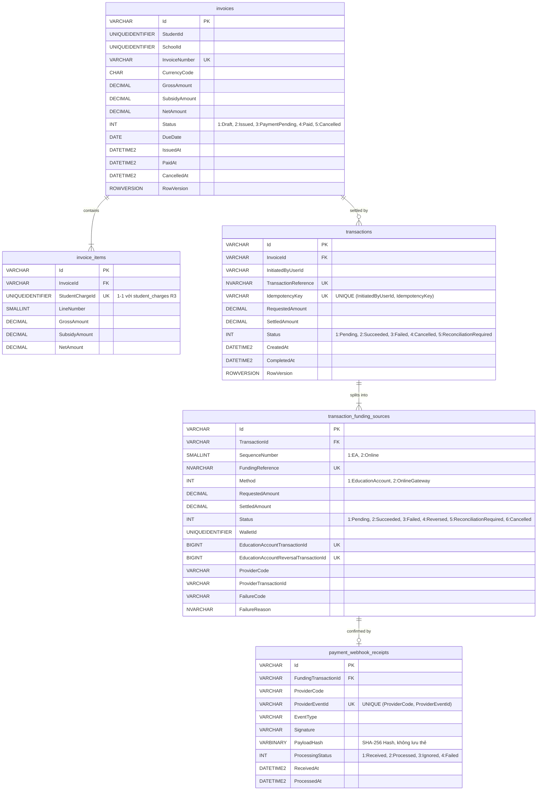

# BỘ ĐẶC TẢ TEST CASE TOÀN DIỆN PHÂN HỆ FS09 / R9
## OUTSTANDING FEES & MULTI-MODE PAYMENT ENGINE (EA, ONLINE & SPLIT PAYMENT)

> **Mã Chức Năng**: FR-09 (R9) | **Epic**: EP-09  
> **Hệ Thống**: MOE Singapore EduSave E-Service Portal: Outstanding Fees & Multi-Mode Payment Engine  
> **Tài Liệu Tham Chiếu Gốc (Primary Source Citations)**:
> - `[agile] fs/md/FS document/FS-09_Outstanding_Fees_and_Payment.md` (vFinal, Oct 14, 2026)
> - `[agile] fs/md/FS document/FS Function 9 - Outstanding Fees and Payment (Final).md`
> - `[agile] fs/md/EAFAMS_SPLIT_PAYMENT_AND_AI_FAS_TEST_CASES_AND_AC.md` (§1, §2: AC-SP-01 đến AC-SP-08, TC-SP-01 đến TC-SP-12)
> - `[agile] fs/md/EAFAMS_UI_SPECIFICATION_AND_INTERACTION_GUIDE.md` (§3.4 SCR-PAR-04: Outstanding Fees & Multi-Mode Payment)
> - `[agile] fs/md/MEETINGS_AND_DECISIONS_SUMMARY.md` (`D-01` đến `D-31`, đặc biệt `DEC-01`, `DEC-02`, `DEC-03`, `DEC-07`, `DEC-14`, `DEC-15`, `D-19`, `D-22`, `D-28`, `D-31`)
> - `[agile] fs/md/FS_SPECIFICATIONS_SUMMARY.md` (§4, §5.4, §5.5, §7.1, §7.2, §7.3, §7.4)
> - `[agile] fs/md/Test Cases/TC_R9_Outstanding_Fees_and_Payment.md` (TC-001 đến TC-162)
> - Quy tắc Nghiệp vụ cốt lõi: `BR-F9-01` đến `BR-F9-13`
> - Giả định Thiết kế & Ràng buộc: `DA-01` đến `DA-14`
> - Tiêu chí Nghiệm thu: `AC-01` đến `AC-22`
> - Danh mục Ngoại lệ: `EX-01` đến `EX-14`
>
> **Quy Chuẩn Kiểm Thử Áp Dụng (Testing Directives & Invariants)**:
> - **Invariant 6: ZERO ASSUMPTIONS (KHÔNG ĐƯỢC PHÉP ASSUMPTION TRONG MỌI TRƯỜNG HỢP)**. Mọi quy tắc, mã lỗi, công thức, giá trị biên và trạng thái chuyển giao đều được trích dẫn 100% từ tài liệu đặc tả FSD của dự án.
> - **Invariant 7: 9-Tier UI Automation Failure Evaluation Framework** (Tầng 1: Runtime JS, Tầng 2: Network & Silent 4xx/5xx, Tầng 3: Visual & Layout Integrity, Tầng 4: Element Actionability, Tầng 5: SLA & Latency, Tầng 6: A11y WCAG 2.1, Tầng 7: Client Storage I/O, Tầng 8: Client Security & PII, Tầng 9: Idempotency & Isolation).
> - **Invariant 8: Disciplined Adversarial Testing ("Phá có kỷ luật")** (6 Adversarial Dimensions: Input Boundaries, Client Bypass, Concurrency Chaos, Auth Tampering/IDOR, A11y, Technical Oracles).
> - **Framework Standards**: combo-qa standards (Traceability, 10 QA lenses, EP & BVA boundaries, State Transitions, Decision Tables).

---

## 1. TỔNG QUAN KIẾN TRÚC & PHÂN BỔ BỘ TEST

Toàn bộ các kịch bản kiểm thử của phân hệ FS09 / R9 được tổ chức theo cấu trúc module hóa phân tầng, tương ứng với 5 Test Suites chuyên biệt, bảo đảm kiểm thử toàn diện từ truy vấn công nợ, thanh toán đơn nguồn (100% EA, 100% Online), thanh toán phân tách (Split Payment), đối soát Webhook HMAC-SHA256, đến các kịch bản phá hủy kiên cố (Adversarial Chaos):

```text
tests/fs09/
├── test_ts01_invoice_inquiry.py                # TS01: 5 Test Cases (Tra cứu hóa đơn, chi tiết dòng phí, filter hạn & trạng thái rỗng)
├── test_ts02_full_ea_payment.py                # TS02: 4 Test Cases (Thanh toán 100% tài khoản EA & trừ sổ cái F1)
├── test_ts03_full_online_payment.py            # TS03: 4 Test Cases (Thanh toán 100% Online Gateway, Webhook HMAC & Timeout)
├── test_ts04_split_payment_and_reversal.py     # TS04: 4 Test Cases (Thanh toán phân tách 2 bước & Động cơ Auto-Reversal EA)
├── test_ts05_break_it_resilience.py            # TS05: 10 Test Cases (Adversarial "Break-It", IDOR, Double Click, Race & 9-Tier Audit)
└── test_ts06_boundary_and_decision_tables.py   # TS06: 14 Test Cases (Decision Tables, BVA Biên 1 cent, API EP & Điều hướng Step)
```

### Bảng Thống Kê Phân Bổ Suite & Mức Độ Ưu Tiên

| Test Suite | File Thực Thi | Phạm Vi Kiểm Thử | Số Lượng TC | Mức Ưu Tiên | Tiêu Chuẩn Nguồn (Source Trace) |
| :--- | :--- | :--- | :---: | :---: | :--- |
| **TS01: Invoice Inquiry & Breakdown** | `test_ts01_invoice_inquiry.py` | Xem danh sách hóa đơn theo con liên kết, mở rộng chi tiết các dòng phí (Fee Component, GST), kiểm tra số dư EA, trạng thái không nợ (SCR-03), phân biệt Citizen vs Non-Citizen (PR/IS). | 5 | P0 / P1 | `F9.1`, `F9.2`, `AC-01`, `AC-02`, `AC-14`, `BR-F9-01`, `BR-F9-08`, `BR-F9-12`, `DA-03`, `DA-05`, `DA-09`, `DA-10` |
| **TS02: Full EA Payment** | `test_ts02_full_ea_payment.py` | Thanh toán 100% bằng số dư EA khi Balance $\ge$ NetAmount, kiểm tra trừ số dư nguyên tử tại Function 1 Ledger, cập nhật Invoice sang Paid, xuất biên lai PDF, từ chối khi số dư không đủ (`EA_INSUFFICIENT_BALANCE`). | 4 | P0 / P1 | `F9.3`, `F9.4`, `AC-03`, `AC-04`, `AC-13`, `BR-F9-02`, `BR-F9-03`, `BR-F9-13`, `DA-02`, `DA-06`, `DA-08` |
| **TS03: Full Online Payment** | `test_ts03_full_online_payment.py` | Thanh toán 100% qua Cổng Sandbox Gateway cho học sinh Citizen hoặc Non-Citizen (PR/IS), tiếp nhận Webhook HMAC-SHA256, xử lý hủy/thất bại đưa Invoice về Issued, xử lý timeout phiên 10 phút. | 4 | P0 / P1 | `F9.5`, `F9.6`, `AC-08`, `AC-09`, `AC-10`, `BR-F9-05`, `BR-F9-06`, `BR-F9-07`, `DA-01`, `EX-02`, `EX-08` |
| **TS04: Split Payment & Auto-Reversal** | `test_ts04_split_payment_and_reversal.py` | Luồng thanh toán kết hợp 2 bước tuần tự (Trừ EA trước $\rightarrow$ Thanh toán Online sau), đề xuất tỷ lệ mặc định, phụ huynh tùy chỉnh số tiền EA, kích hoạt Auto-Reversal Engine khi Online lỗi/hủy, fallback `ReconciliationRequired` khi Reversal lỗi. | 4 | P0 / P1 | `F9.3`, `F9.4`, `F9.5`, `AC-15`, `AC-16`, `AC-17`, `AC-18`, `AC-19`, `AC-22`, `BR-F9-02`, `BR-F9-11`, `DA-14`, `DEC-15` |
| **TS05: Break-It Resilience** | `test_ts05_break_it_resilience.py` | Chống Double-Click Debounce (`IdempotencyKey`), chống tấn công IDOR xem/thanh toán hóa đơn con người khác, chống giả mạo chữ ký Webhook HMAC, giải quyết xung đột thanh toán đồng thời (409 Conflict), vượt validate client bằng JS prototype descriptor, 9-tier technical oracle. | 10 | P0 / P1 | `AC-05`, `AC-06`, `AC-11`, `AC-12`, `BR-F9-04`, `BR-F9-09`, `EX-01`, `EX-03`, `EX-06`, `EX-07`, `DA-13`, Invariant 7 & 8 |
| **TS06: Boundary & Decision Tables** | `test_ts06_boundary_and_decision_tables.py` | Decision Tables (DT-01 đến DT-04: Đủ EA mặc định EA, can thiệp thủ công Online, không đủ EA tự split, manual online), BVA Phân tách biên 1 cent ($0.01 SGD), kiểm thử biên API Equivalence Partitioning & bảo toàn State điều hướng Back SCR-04 sang SCR-01/SCR-02. | 14 | P0 / P1 / P2 | `DEC-15`, `BR-F9-02`, `BR-F9-03`, `AC-15`, `AC-16`, Invariant 6 & 7 |
| **TỔNG CỘNG** | **FS09 FULL ENGINE** | **Toàn bộ phân hệ FS09 / R9 Payment Engine** | **41** | **P0/P1/P2** | **100% Coverage các Rules, ACs & Invariants** |

---

## 2. DANH MỤC MÃ THÔNG BÁO LỖI HỆ THỐNG TRONG FS09 (`ERROR & MSG CATALOG`)

Toàn bộ các mã lỗi và chuỗi thông báo hiển thị cho Phụ huynh được trích xuất nguyên văn từ FSD mục **5.1 Thông báo lỗi hiển thị cho Parent** và các tài liệu FSD liên quan, tuyệt đối không suy diễn:

| Mã Lỗi (Code) | Nội Dung Thông Báo Tiêu Chuẩn (Standard English Message) | Ngữ Cảnh Kích Hoạt (Triggering Context) | Hành Vi Giao Diện (UI Observable Behavior) | Kịch Bản Kiểm Thử Bao Phủ |
| :--- | :--- | :--- | :--- | :--- |
| **`EA_NOT_AVAILABLE`** | *"This student does not have an Education Account. Please pay online."* | Học sinh mang quốc tịch Permanent Resident (PR) hoặc International Student (IS); hoặc học sinh chưa được khởi tạo EA tại F1 (DA-03, BR-F9-07). | Vô hiệu hóa tùy chọn EA, tự động trỏ sang Online Payment (SCR-04). | `TC-R9-04`, `TC-R9-08`, `TC-038`, `TC-048` |
| **`EA_NOT_ACTIVE`** | *"The Education Account is not active. Please pay online."* | Học sinh có tài khoản EA nhưng đang ở trạng thái `Closed` hoặc `Due for closure` (đủ 16 tuổi) (DA-06, BR-F9-02). | Vô hiệu hóa tùy chọn EA, gợi ý thanh toán trực tuyến (SCR-04). | `TC-039`, `TC-049` |
| **`EA_INSUFFICIENT_BALANCE`** | *"Your Education Account balance is not enough for this amount. You can pay the rest online."* | Học sinh có EA Active nhưng số dư khả dụng $< \text{NetAmount}$ khi chọn thanh toán 100% EA; hoặc số dư bị sụt giảm trước thời điểm bấm Xác nhận (BR-F9-02, EX-05). | Vô hiệu hóa tùy chọn 100% EA, hiển thị gợi ý chọn Chia đôi (Split payment) (SCR-04). | `TC-R9-07`, `TC-041`, `TC-046`, `TC-047`, `TC-071` |
| **`SPLIT_AMOUNT_INVALID`** | *"The two amounts must be more than zero and add up to the total."* | Khi chọn Split Payment: một trong hai phần $\le 0$, hoặc $\text{EA Amount} + \text{Online Amount} \neq \text{NetAmount}$, hoặc EA Amount $>$ Available Balance (BR-F9-11, AC-19). | Giữ nguyên tại SCR-04, highlight đỏ ô nhập số tiền không hợp lệ, vô hiệu hóa nút Tiếp tục. | `TC-R9-12`, `TC_R9_AUTO_06`, `TC-053` đến `TC-058`, `TS-BRK-01` |
| **`INVOICE_ALREADY_PAID`** | *"This invoice has already been paid."* | Phụ huynh bấm xác nhận thanh toán cho một hóa đơn đã chuyển sang trạng thái `Paid` (Status = 4) bởi một giao dịch trước đó (EX-04, DA-13). | Hiển thị banner cảnh báo, tự động làm mới danh sách nợ trên SCR-02. | `TC-084`, `TS-BRK-06` |
| **`INVOICE_NOT_PAYABLE`** | *"This invoice can no longer be paid."* | Hóa đơn bị hủy (`Cancelled`, Status = 5) trong lúc phụ huynh đang xem; hoặc hóa đơn không ở trạng thái hợp lệ để thanh toán (EX-04, EX-14, AC-21). | Từ chối checkout, điều hướng về danh sách hóa đơn SCR-02. | `TC-086` |
| **`PAYMENT_PENDING`** | *"A payment for this invoice is still being processed."* | Hóa đơn đang có một Transaction mở dở dang (`CompletedAt IS NULL`, Status = 3 `PaymentPending`); hoặc có request đồng thời bị chặn bởi Conditional Unique Index (EX-03, BR-F9-09, DA-13). | Chặn tạo giao dịch mới, tự động điều hướng sang màn hình chờ xử lý SCR-06. | `TC-R9-17`, `TC-082`, `TC-083`, `TC-085`, `TC-127`, `TS-BRK-06` |
| **`PAYMENT_FAILED`** | *"Your payment could not be completed. No amount was deducted."* | Thanh toán trực tuyến 100% bị từ chối/thất bại trên Gateway Sandbox; hoặc lỗi ghi nợ EA tại F1 (AC-07, AC-09, BR-F9-05). | Chuyển đến màn hình SCR-08, cung cấp nút "Try again" (về SCR-04) và "Exit" (về SCR-02). | `TC-R9-10`, `TC-072`, `TC-090`, `TC-093`, `TC-136` |
| **`PAYMENT_FAILED_EA_RETURNED`** | *"Your online payment could not be completed. The amount taken from the Education Account has been returned."* | Trong giao dịch Split Payment: Nhánh EA đã trừ thành công, nhưng nhánh Online Gateway bị thất bại, bị hủy hoặc quá hạn 10 phút. Động cơ Auto-Reversal đã hoàn lại 100% tiền vào EA (AC-17, BR-F9-05, BR-F9-11). | Hiển thị màn hình SCR-08 với thông báo hoàn tiền EA màu xanh/vàng an tâm; Invoice trả về `Issued`. | `TC_R9_AUTO_03`, `TC-103`, `TC-104`, `TC-105`, `TC-137` |
| **`PAYMENT_CANCELLED`** | *"The payment was cancelled. No amount was deducted."* | Phụ huynh bấm nút Hủy ("Cancel and return to merchant") trên trang Cổng thanh toán Sandbox khi thanh toán 100% Online (AC-09, Appendix A). | Mở màn hình SCR-08; nếu là Split Payment có hoàn tiền EA thì dùng `PAYMENT_FAILED_EA_RETURNED`. | `TC-R9-10`, `TC-091` |
| **`FORBIDDEN_CHILD`** | *"You do not have access to this student's records."* | Phụ huynh cố tình thay đổi tham số `studentId` hoặc `invoiceId` trên URL hoặc gọi API trực tiếp để xem/thanh toán con người khác (EX-01, AC-12, BR-F9-01). | Server trả HTTP 403 Forbidden, ghi log an ninh kiểm toán, chuyển hướng an toàn về SCR-01. | `TC-R9-15`, `TC-011` đến `TC-016`, `TS-BRK-07` |
| **`AUTH_REQUIRED`** | *"Your session has expired. Please sign in again."* | Phiên làm việc của phụ huynh hết hạn do không thao tác trong 15 phút (D-22); hoặc token SingPass bị hủy (EX-02, BR-F8-08). | Điều hướng ngay lập tức về trang Đăng nhập SingPass MockPass; xóa sạch session storage. | `TC-017`, `TC-142`, `TS-BRK-08` |
| **`SYSTEM_ERROR`** | *"Something went wrong. Please try again later."* | Lỗi sập máy chủ nội bộ (HTTP 500), mất kết nối cơ sở dữ liệu khi xác nhận thanh toán (5.1, EX-10). | Cho phép thử lại; bảo toàn nguyên trạng dữ liệu, không làm thay đổi trạng thái hóa đơn hay số dư. | `TC-010`, `TC-144`, `TS-BRK-09` |
| **`MSG-0001`** | *"Enter your <field>"* | Bỏ trống trường bắt buộc trong các biểu mẫu liên quan đến thanh toán. | Inline error đỏ dưới trường bị bỏ trống. | Catalog chung |
| **`MSG-0002`** | *"Your session has expired. Please log in again."* | Hết hạn phiên làm việc do không thao tác trong 15 phút (Decision D-22). | Popup thông báo hết phiên và chuyển hướng về Landing Page. | Catalog chung |
| **`MSG-0003`** | *"You do not have permission to perform this action."* | Cố tình truy cập trái phép tài nguyên không được cấp quyền. | Chặn hành động, hiển thị thông báo cấm truy cập. | Catalog chung |

---

## 3. BẢNG MA TRẬN TEST CASE TOÀN DIỆN 10 CỘT (COMPREHENSIVE 10-COLUMN MATRIX)

Mọi kịch bản kiểm thử tự động của phân hệ FS09 được chuẩn hóa theo định dạng 10 cột chuyên nghiệp, tích hợp đầy đủ các tiêu chí quan sát UI, kiểm tra API và câu lệnh truy vấn dữ liệu DB:

### 3.1. SUITE TS01: INVOICE INQUIRY & BREAKDOWN
*File thực thi: `tests/fs09/test_ts01_invoice_inquiry.py`*

| Test Case ID | Tên Kịch Bản (Scenario Name) | Yêu Cầu / Rule Gốc | Mức Ưu Tiên | Tiền Điều Kiện (Preconditions) | Dữ Liệu Kiểm Thử (Test Data) | Các Bước Thực Hiện (Test Steps) | Kết Quả Kỳ Vọng (UI + API + DB Assertions) | Automation ID | Pass/Fail Oracle (9-Tier Gate) |
| :--- | :--- | :--- | :---: | :--- | :--- | :--- | :--- | :--- | :--- |
| **`TC-R9-01`** | Xem danh sách hóa đơn chưa thanh toán của con liên kết | `BR-F9-01`, `DA-04`, `AC-01`, `F9.1`, `F9.2` | **P0** | Phụ huynh đã đăng nhập qua SingPass; học sinh có ít nhất 1 hóa đơn ở trạng thái `Issued`. | Phụ huynh: `TAN WEI MING` (`S7654321B`), Con: `Chloe Chan` (`S1234567A`) | 1. Mở màn hình SCR-01.<br>2. Chọn học sinh Chloe Chan.<br>3. Kiểm tra màn hình SCR-02. | **UI**: Hiển thị tên con, trường, lớp. Danh sách hóa đơn có: Số hóa đơn, Ngày đến hạn, Trạng thái `Issued`, Số tiền `NetAmount` (SGD).<br>**API**: `GET /api/v1/students/{id}/invoices` trả HTTP 200, danh sách chứa hóa đơn `status="Issued"`.<br>**DB**: `SELECT Status FROM invoices WHERE StudentId = ...` trả về `2` (Issued). | `test_tc_r9_01_view_outstanding_invoices_list` | **PASS khi**: UI render đầy đủ thẻ nợ; không có console error; thời gian tải trang $< 2.5s$. |
| **`TC-R9-02`** | Mở rộng chi tiết hóa đơn: Fee Types, Components & Thuế GST | `BR-F9-08`, `BR-F9-12`, `DA-05`, `DA-09`, `DA-10` | **P1** | Hóa đơn gồm 2 dòng phí: School Fee ($80) và Misc Fee ($20). | Hóa đơn: `INV-2026-RI-0091`, Gross: `100.00`, Subsidy: `0.00`, Net: `100.00` | 1. Trên SCR-02, nhấn vào hàng hóa đơn `INV-2026-RI-0091` để mở rộng accordion.<br>2. Kiểm tra các dòng chi tiết phí. | **UI**: Hiển thị đúng 2 dòng: (1) School Fee (Standard School Fee incl GST): Gross 80.00, Subsidy 0.00, Net 80.00; (2) Miscellaneous Fee: Gross 20.00, Subsidy 0.00, Net 20.00. Tổng Net = 100.00 SGD.<br>**API**: Payload `items` có 2 phần tử, `lineNumber` 1 và 2, `studentChargeId` duy nhất.<br>**DB**: `SELECT COUNT(*) FROM invoice_items WHERE InvoiceId = ...` bằng đúng `2`. | `test_tc_r9_02_invoice_breakdown_components_gst` | **PASS khi**: Cột tính toán hiển thị chuẩn 2 chữ số thập phân (`.00 SGD`); không bị tràn layout (`overflow-x`). |
| **`TC-R9-03`** | Trạng thái rỗng khi con không có khoản nợ học phí (SCR-03) | `AC-02`, `F9.2`, `SCR-03` | **P1** | Học sinh không có bất kỳ hóa đơn nào ở trạng thái `Issued`. | Học sinh: `Tan Xiao Hua` (Không có nợ) | 1. Chọn học sinh Tan Xiao Hua từ SCR-01.<br>2. Quan sát màn hình điều hướng. | **UI**: Hiển thị màn hình SCR-03 thông báo không có khoản phí chưa thanh toán ("No outstanding fees"). Có nút "Back to child list" quay lại SCR-01.<br>**API**: `GET /api/v1/students/{id}/invoices` trả về mảng `invoices: []`.<br>**DB**: `SELECT COUNT(*) FROM invoices WHERE StudentId = ... AND Status = 2` bằng `0`. | `test_tc_r9_03_zero_outstanding_fees_empty_state` | **PASS khi**: Màn hình rỗng hiển thị thông điệp thân thiện; nút Back hoạt động chuyển đúng về SCR-01. |
| **`TC-R9-04`** | Hiển thị Số dư EA đối với Công dân Singapore vs Học sinh PR/IS | `BR-F9-07`, `DA-03`, `AC-14`, `D-03` | **P0** | Con 1 là Singapore Citizen (có EA); Con 2 là Permanent Resident (không có EA). | Persona PR: `K. Shanmugam` (`S9012345H`) | 1. Đăng nhập tài khoản phụ huynh có con là Citizen $\rightarrow$ Kiểm tra widget EA.<br>2. Đăng xuất, đăng nhập phụ huynh có con là PR $\rightarrow$ Kiểm tra widget EA. | **UI (Citizen)**: Thẻ học sinh hiển thị ô "Education Account Balance" kèm số dư khả dụng (`Available Balance: SGD ...`).<br>**UI (PR/IS)**: Ẩn hoàn toàn ô số dư EA; hiển thị dòng lưu ý: *"Education Accounts are for Singapore Citizens"*. Nút thanh toán trỏ thẳng sang Online.<br>**API**: Citizen trả về object `educationAccount: {status: 'Active', availableBalance: ...}`; PR trả về `educationAccount: null`. | `test_tc_r9_04_ea_balance_citizen_vs_non_citizen` | **PASS khi**: Không hiển thị số dư EA cho học sinh PR; không có lỗi JavaScript null pointer. |

---

### 3.2. SUITE TS02: FULL EDUCATION ACCOUNT (EA) PAYMENT
*File thực thi: `tests/fs09/test_ts02_ea_payment.py`*

| Test Case ID | Tên Kịch Bản (Scenario Name) | Yêu Cầu / Rule Gốc | Mức Ưu Tiên | Tiền Điều Kiện (Preconditions) | Dữ Liệu Kiểm Thử (Test Data) | Các Bước Thực Hiện (Test Steps) | Kết Quả Kỳ Vọng (UI + API + DB Assertions) | Automation ID | Pass/Fail Oracle (9-Tier Gate) |
| :--- | :--- | :--- | :---: | :--- | :--- | :--- | :--- | :--- | :--- |
| **`TC-R9-05`** | Chọn phương thức thanh toán 100% bằng EA khi số dư đủ | `BR-F9-02`, `DA-06`, `DA-08`, `F9.3` | **P0** | Học sinh có EA `Active`, Số dư khả dụng ($240.50) $\ge$ Hóa đơn ($100.00). | Hóa đơn: `100.00 SGD`, EA Balance: `240.50 SGD` | 1. Chọn hóa đơn trên SCR-02, nhấn "Pay fees".<br>2. Mở màn hình chọn phương thức SCR-04.<br>3. Kiểm tra trạng thái các radio button. | **UI**: Tùy chọn "Pay with Education Account" ở trạng thái kích hoạt (Active / Enabled). Hệ thống tự động chọn mặc định tùy chọn này.<br>**API**: Response cấu hình thanh toán cho phép phương thức `EA`.<br>**DB**: Số dư khả dụng trong bảng `wallets` của F1 không bị khóa. | `test_tc_r9_05_select_full_ea_payment_eligible` | **PASS khi**: Radio button EA có thể click chọn được; không có cảnh báo đỏ thiếu số dư. |
| **`TC-R9-06`** | Xác nhận thanh toán 100% EA thành công & Tải biên lai PDF | `BR-F9-03`, `BR-F9-04`, `BR-F9-13`, `DA-02`, `AC-03`, `AC-13` | **P0** | Đang ở màn hình xem lại SCR-05 với phương thức 100% EA. | Net Payable: `100.00 SGD`, EA trích: `100.00 SGD` | 1. Kiểm tra màn hình SCR-05 (Số tiền: 100.00, EA sau thanh toán: 140.50).<br>2. Nhấn nút "Confirm Payment".<br>3. Quan sát màn hình xác nhận SCR-07.<br>4. Nhấn nút "Download Receipt (PDF)". | **UI**: Nút Confirm disable ngay sau click; chuyển sang màn hình thành công SCR-07 hiển thị Mã tham chiếu (`PAY-YYYYMMDD-XXXXXX`), thời gian hoàn tất theo giờ SGT, số tiền trừ EA $100.00. Tải về file PDF biên lai hợp lệ $> 0$ bytes.<br>**API**: `POST /api/v1/invoices/{id}/checkout` trả HTTP 200, `status="Succeeded"`.<br>**DB**: `transactions.Status = 2` (Succeeded), `invoices.Status = 4` (Paid), `transaction_funding_sources.Status = 2` kèm `EducationAccountTransactionId`. F1 Ledger trừ đúng 100.00 SGD. | `test_tc_r9_06_confirm_full_ea_payment_and_download_receipt` | **PASS khi**: Hóa đơn đổi sang Paid; số dư EA giảm đúng 100.00 SGD; file PDF tải về không bị rỗng/hỏng. |
| **`TC-R9-07`** | Vô hiệu hóa lựa chọn 100% EA khi số dư không đủ (`EA_INSUFFICIENT_BALANCE`) | `BR-F9-02`, `AC-04`, `5.1` | **P1** | Học sinh có EA `Active`, Số dư khả dụng ($15.00) $<$ Hóa đơn ($50.00). | Hóa đơn: `50.00 SGD`, EA Balance: `15.00 SGD` | 1. Mở màn hình chọn phương thức SCR-04.<br>2. Kiểm tra tùy chọn 100% EA. | **UI**: Radio button "Pay with Education Account" bị vô hiệu hóa (`disabled`), kèm dòng giải thích màu đỏ/xám: *"Your Education Account balance is not enough for this amount. You can pay the rest online."* (`EA_INSUFFICIENT_BALANCE`). Hệ thống tự động đề xuất phương thức Split Payment.<br>**API**: Cố tình gửi payload `paymentMethod="EA"` trả về HTTP 400 Bad Request kèm mã lỗi `EA_INSUFFICIENT_BALANCE`.<br>**DB**: Số dư EA và trạng thái hóa đơn giữ nguyên không đổi. | `test_tc_r9_07_insufficient_ea_disables_full_ea_option` | **PASS khi**: Nút radio bị disabled không cho click; hiển thị đúng chuỗi thông báo FSD; không trừ tiền. |
| **`TC_R9_AUTO_01`** | Kiểm thử tự động E2E: Toàn trình thanh toán EA & Tính toàn vẹn Sổ cái | `AC-03`, `BR-F9-03`, `BR-F9-13`, Invariant 7 | **P0** | Môi trường test tự động kết nối Backend API và Database. | Persona `TAN WEI MING`, Hóa đơn 50.00 SGD | 1. Khởi tạo thanh toán 100% EA.<br>2. Gửi request checkout.<br>3. Truy vấn trạng thái giao dịch.<br>4. Xác minh cơ sở dữ liệu. | **DB Assertions**: (1) `invoices.Status == 4` (Paid); (2) `transactions.SettledAmount == RequestedAmount == 50.00`; (3) `transaction_funding_sources.EducationAccountTransactionId IS NOT NULL`; (4) F1 Ledger ghi nợ đúng 50.00 SGD với `FundingReference` tương ứng. | `test_tc_r9_auto_01_e2e_full_ea_ledger_integrity` | **PASS khi**: Dữ liệu DB đồng nhất 100% giữa F9 và F1; không phát sinh bản ghi mồ côi. |

---

### 3.3. SUITE TS03: FULL ONLINE PAYMENT & SANDBOX GATEWAY
*File thực thi: `tests/fs09/test_ts03_online_payment.py`*

| Test Case ID | Tên Kịch Bản (Scenario Name) | Yêu Cầu / Rule Gốc | Mức Ưu Tiên | Tiền Điều Kiện (Preconditions) | Dữ Liệu Kiểm Thử (Test Data) | Các Bước Thực Hiện (Test Steps) | Kết Quả Kỳ Vọng (UI + API + DB Assertions) | Automation ID | Pass/Fail Oracle (9-Tier Gate) |
| :--- | :--- | :--- | :---: | :--- | :--- | :--- | :--- | :--- | :--- |
| **`TC-R9-08`** | Học sinh không có EA (PR/IS) bị giới hạn chỉ thanh toán Online | `BR-F9-07`, `DA-03`, `AC-14`, `5.1` | **P0** | Học sinh là PR (Permanent Resident). | Học sinh PR: `Pravin Kumar` | 1. Chọn hóa đơn nợ của Pravin Kumar.<br>2. Mở màn hình SCR-04. | **UI**: Chỉ hiển thị duy nhất tùy chọn "Online Payment" (hoặc tùy chọn EA bị ẩn hoàn toàn kèm nhãn thông báo `EA_NOT_AVAILABLE`). Phụ huynh không thể chọn EA.<br>**API**: Endpoint khởi tạo thanh toán từ chối nếu truyền `paymentMethod="EA"` với mã `EA_NOT_AVAILABLE`.<br>**DB**: Bảng `wallets` không tồn tại bản ghi của học sinh này. | `test_tc_r9_08_non_citizen_restricted_to_online_only` | **PASS khi**: Không có nút chọn EA; luồng chuyển hướng trực tiếp sang Online Gateway. |
| **`TC-R9-09`** | Thanh toán 100% Online qua Sandbox Gateway & Webhook HMAC thành công | `DA-01`, `BR-F9-06`, `AC-08`, `AC-10`, `F9.5`, `F9.6` | **P0** | Hóa đơn nợ 75.00 SGD; chọn phương thức Online. | Hóa đơn: `75.00 SGD`, Sandbox Card: `Valid Test Card` | 1. Tại SCR-04, chọn "Online Payment" $\rightarrow$ Xem lại SCR-05 $\rightarrow$ Xác nhận.<br>2. Trình duyệt chuyển hướng sang Sandbox Gateway URL.<br>3. Nhập thông tin thẻ test thành công, bấm "Pay Now".<br>4. Gateway gửi Webhook HMAC-SHA256 về Backend. | **UI**: Chuyển hướng mượt mà sang Gateway; sau khi hoàn tất, quay trở về màn hình thành công SCR-07 với biên lai ghi nhận thanh toán Online $75.00 SGD.<br>**API**: Gateway gửi POST `/api/v1/payments/webhook` kèm header `X-Signature`. Backend xác thực chữ ký hợp lệ, trả HTTP 200 OK `{"received": true}`.<br>**DB**: `transactions.Status = 2` (Succeeded), `invoices.Status = 4` (Paid), `payment_webhook_receipts.ProcessingStatus = 2` (Processed). Không lưu số thẻ trong DB. | `test_tc_r9_09_full_online_payment_sandbox_success` | **PASS khi**: Webhook HMAC hợp lệ được xác thực; Hóa đơn chuyển Paid; không rò rỉ dữ liệu thẻ trong logs. |
| **`TC-R9-10`** | Hủy giao dịch trên Cổng Sandbox: Hóa đơn trở về `Issued` (`PAYMENT_CANCELLED`) | `BR-F9-05`, `AC-09`, `Appendix A`, `5.1` | **P1** | Đang ở trang Sandbox Payment Gateway của nhà cung cấp. | Nút: "Cancel and Return to Merchant" | 1. Trên trang Sandbox Gateway, bấm nút "Cancel and Return".<br>2. Trình duyệt điều hướng quay lại Cổng e-Service. | **UI**: Hiển thị màn hình thất bại SCR-08 với thông báo chuẩn **`PAYMENT_CANCELLED`**: *"The payment was cancelled. No amount was deducted."*. Có nút "Try again" và "Exit".<br>**API**: Callback / Webhook ghi nhận trạng thái giao dịch là `Cancelled`.<br>**DB**: `transactions.Status = 4` (Cancelled), `invoices.Status = 2` (Trở về `Issued`). Số dư EA và tài khoản ngân hàng không bị trừ tiền. | `test_tc_r9_10_cancel_online_payment_returns_to_issued` | **PASS khi**: Hóa đơn không bị treo ở `PaymentPending`; phụ huynh có thể bấm "Try again" để thanh toán lại. |
| **`TC_R9_AUTO_02`** | Kiểm thử tự động E2E: Xác thực Webhook HMAC-SHA256 & Chống Replay | `AC-10`, `BR-F9-06`, Invariant 7, Invariant 8 | **P0** | Giao dịch Online đang ở trạng thái `Pending`. | Webhook payload chuẩn, Shared Secret Key | 1. Ký payload bằng SHA256 với Secret Key $\rightarrow$ Gửi Webhook.<br>2. Gửi lại cùng một Webhook (cùng `ProviderEventId`). | **API Assertions**: (1) Lần 1: Chữ ký đúng $\rightarrow$ HTTP 200 OK, cập nhật giao dịch; (2) Lần 2: Gửi lại cùng Event ID $\rightarrow$ HTTP 200 OK nhưng xử lý Idempotent, không cập nhật lặp lại.<br>**DB**: Bảng `payment_webhook_receipts` có đúng 1 bản ghi với `ProviderEventId` duy nhất; cột `PayloadHash` lưu mã băm SHA-256. | `test_tc_r9_auto_02_e2e_webhook_hmac_and_idempotency` | **PASS khi**: Replay attack bị chặn đứng; không phát sinh giao dịch kép trong sổ cái. |
| **`TC_R9_AUTO_05`** | Tự động hóa: Xử lý hết hạn phiên Cổng thanh toán Online (Timeout 10 phút) | `EX-02`, `Appendix A`, `DA-13`, Invariant 7 | **P1** | Giao dịch Online mở nhưng không thao tác quá 10 phút. | Mô phỏng Timeout Handler ($> 600s$) | 1. Tạo checkout session online.<br>2. Giả lập quá thời gian chờ 10 phút mà không nhận được Webhook.<br>3. Kích hoạt Timeout Job. | **UI**: Khi phụ huynh quay lại trang, hiển thị thông báo phiên thanh toán đã hết hạn.<br>**API**: Job đối soát hoặc kiểm tra trạng thái đánh dấu session hết hạn.<br>**DB**: Nhánh Online chuyển `Failed` (hoặc `Cancelled`); `transactions.Status = 3` (Failed); `invoices.Status = 2` (Giải phóng khỏi `PaymentPending`, trở về `Issued`). | `test_tc_r9_auto_05_online_session_timeout_reverts_invoice` | **PASS khi**: Hóa đơn được giải phóng hoàn toàn để có thể thanh toán lại; không bị treo vô hạn. |

---

### 3.4. SUITE TS04: SPLIT PAYMENT & AUTO-REVERSAL ENGINE
*File thực thi: `tests/fs09/test_ts04_split_payment.py`*

| Test Case ID | Tên Kịch Bản (Scenario Name) | Yêu Cầu / Rule Gốc | Mức Ưu Tiên | Tiền Điều Kiện (Preconditions) | Dữ Liệu Kiểm Thử (Test Data) | Các Bước Thực Hiện (Test Steps) | Kết Quả Kỳ Vọng (UI + API + DB Assertions) | Automation ID | Pass/Fail Oracle (9-Tier Gate) |
| :--- | :--- | :--- | :---: | :--- | :--- | :--- | :--- | :--- | :--- |
| **`TC-R9-11`** | Điều kiện hiển thị & Đề xuất tỷ lệ Split Payment tự động | `BR-F9-02`, `BR-F9-11`, `AC-22`, `AC-SP-01`, `DEC-15` | **P0** | Học sinh có EA `Active`, Số dư EA khả dụng ($60.00) $<$ Hóa đơn ($150.00). | Net: `150.00 SGD`, EA Balance: `60.00 SGD` | 1. Mở màn hình chọn phương thức SCR-04.<br>2. Quan sát các tùy chọn và giá trị gợi ý. | **UI**: Tùy chọn 100% EA bị disabled. Tùy chọn "Split Payment" được chọn mặc định. Hệ thống tự động điền: `EA Amount = 60.00 SGD` (toàn bộ số dư khả dụng, có thể sửa); `Online Amount = 90.00 SGD` (Read-only, tự tính bằng $150 - 60$).<br>**Công thức**: $\text{Online Amount} = \text{NetAmount} - \text{EA Amount}$. | `test_tc_r9_11_split_payment_eligibility_and_default_propose` | **PASS khi**: Tỷ lệ tự động tính toán tức thì (Real-time reactivity); tổng 2 phần luôn bằng đúng 150.00 SGD. |
| **`TC-R9-12`** | Phụ huynh tùy chỉnh giảm số tiền EA hợp lệ (Quyết định DEC-15 / AC-22) | `AC-22`, `AC-SP-02`, `DA-08`, `BR-F9-10`, `BR-F9-11` | **P1** | Đang ở form chọn phương thức Split Payment (Net: $150, EA: $60). | Nhập EA Amount mới: `40.00 SGD` | 1. Xóa giá trị cũ trong ô EA Amount, nhập `40.00`.<br>2. Quan sát ô Online Amount và tổng số tiền. | **UI**: Ô Online Amount tự động cập nhật nhảy số thời gian thực thành `110.00 SGD`. Tổng hiển thị vẫn là `150.00 SGD`. Nút "Continue" ở trạng thái Active.<br>**Ràng buộc kiểm tra**: $0.01 \le \text{EA Amount} \le 60.00$.<br>**DB**: Chưa phát sinh bất kỳ thay đổi nào trong cơ sở dữ liệu. | `test_tc_r9_12_custom_ea_amount_auto_recalculates_online` | **PASS khi**: Thay đổi input cập nhật mượt mà; không bị lag; không cho phép sửa trực tiếp ô Online. |
| **`TC-R9-13`** | Luồng thành công toàn phần Split Payment (Bước 1 EA + Bước 2 Online) | `AC-15`, `BR-F9-11`, `DA-12`, `DA-14`, `AC-SP-05` | **P0** | Xác nhận Split Payment: EA trích `40.00 SGD`, Online trả `110.00 SGD`. | Net: `150.00 SGD`, Card: `Pass` | 1. Tại SCR-05, nhấn "Confirm Payment".<br>2. Hệ thống trừ tiền EA tại F1 (Bước 1) $\rightarrow$ Thành công.<br>3. Chuyển hướng sang Gateway trả 110.00 SGD (Bước 2).<br>4. Gateway gửi Webhook xác nhận. | **UI**: SCR-07 hiển thị chúc mừng thanh toán thành công kèm biên lai phân tích 2 nguồn tiền: (1) Education Account: 40.00 SGD; (2) Online Gateway: 110.00 SGD. Tổng thanh toán: 150.00 SGD.<br>**API**: Giao dịch gồm 2 funding legs đều có `status="Succeeded"`.<br>**DB**: `transactions.Status = 2`; `invoices.Status = 4` (Paid); `transaction_funding_sources` gồm 2 hàng: Leg 1 (EA, Settled 40.00), Leg 2 (Online, Settled 110.00). | `test_tc_r9_13_split_payment_full_success_dual_legs` | **PASS khi**: Cả 2 nhánh nguồn tiền đều Succeeded; Hóa đơn đổi Paid; số dư EA giảm chính xác 40.00 SGD. |
| **`TC_R9_AUTO_03`** | Tự động hoàn tiền EA (Auto-Reversal Engine) khi nhánh Online thất bại/hủy | `AC-17`, `BR-F9-05`, `BR-F9-11`, `AC-SP-06`, `5.1` | **P0** | Bước 1 đã trừ EA `40.00 SGD` thành công; Bước 2 Online bị Hủy hoặc Thẻ bị từ chối. | Event: `payment.failed` hoặc Cancel trên Gateway | 1. Nhận thông báo Online thất bại.<br>2. Kích hoạt động cơ `EA Reversal Engine`.<br>3. Kiểm tra kết quả hoàn tiền và giao diện. | **UI**: Hiển thị màn hình SCR-08 kèm thông báo chuẩn **`PAYMENT_FAILED_EA_RETURNED`**: *"Your online payment could not be completed. The amount taken from the Education Account has been returned."*<br>**API**: Gọi F1 Reverse API: `POST /wallets/{walletId}/reverse` thành công.<br>**DB**: Nhánh EA chuyển `Status = 4` (Reversed) kèm `EducationAccountReversalTransactionId`; `transactions.Status = 3` (Failed); `invoices.Status = 2` (Trở về `Issued`). Số dư EA được khôi phục nguyên vẹn $+40.00$ SGD. | `test_tc_r9_auto_03_split_online_failure_triggers_ea_reversal` | **PASS khi**: Tiền EA được hoàn trả 100% lập tức; hóa đơn giải phóng về Issued; phụ huynh không bị mất tiền oan. |
| **`TC_R9_AUTO_04`** | Reversal thất bại: Chuyển sang `ReconciliationRequired` & Kích hoạt Cảnh báo Vận hành | `AC-18`, `EX-13`, `Appendix A`, `AC-SP-07`, Invariant 7 | **P1** | Nhánh Online thất bại, nhưng gọi F1 Reversal bị lỗi máy chủ (HTTP 500 / Timeout). | Giả lập F1 Core Ledger 500 khi Reversal | 1. Online báo thất bại.<br>2. Hệ thống gọi F1 hoàn tiền nhưng retry 3 lần đều lỗi.<br>3. Chuyển sang trạng thái ngoại lệ đối soát. | **UI**: SCR-06 hiển thị thông báo đang xác minh: *"We are verifying this payment. Please check your account history later."* Tuyệt đối không cho thanh toán lại.<br>**API**: Cảnh báo khẩn cấp bắn sang kênh Ops/Admin.<br>**DB**: `transactions.Status = 5` (ReconciliationRequired); `transaction_funding_sources.Status = 5`; **`invoices.Status = 3` (GIỮ CHẶT `PaymentPending`)** để ngăn phụ huynh bị trừ tiền 2 lần. | `test_tc_r9_auto_04_failed_reversal_fallback_reconciliation_required` | **PASS khi**: Hóa đơn KHÔNG bị trả về Issued khi chưa hoàn tiền xong; hệ thống ghi log kiểm toán đầy đủ. |

---

### 3.5. SUITE TS05: ADVERSARIAL CHAOS & SECURITY RESILIENCE (BREAK-IT)
*File thực thi: `tests/fs09/test_ts05_break_it_resilience.py`*

| Test Case ID | Tên Kịch Bản (Scenario Name) | Yêu Cầu / Rule Gốc | Mức Ưu Tiên | Tiền Điều Kiện (Preconditions) | Dữ Liệu Kiểm Thử (Test Data) | Các Bước Thực Hiện (Test Steps) | Kết Quả Kỳ Vọng (UI + API + DB Assertions) | Automation ID | Pass/Fail Oracle (9-Tier Gate) |
| :--- | :--- | :--- | :---: | :--- | :--- | :--- | :--- | :--- | :--- |
| **`TC-R9-14`** | Chống Double-Click Debounce & Idempotency Key bảo vệ giao dịch | `BR-F9-04`, `AC-05`, `DA-12`, `TC-SP-11` | **P0** | Đang ở màn hình xem lại và xác nhận SCR-05. | 2 click cách nhau 50ms, cùng `IdempotencyKey` | 1. Double click liên tục cực nhanh vào nút "Confirm Payment".<br>2. Quan sát phản ứng UI và network requests. | **UI**: Nút bấm lập tức chuyển trạng thái `disabled` kèm spinner "Processing...".<br>**Network**: Chỉ có duy nhất 1 request HTTP POST checkout được gửi đi (hoặc request 2 gửi cùng key trả về kết quả ban đầu).<br>**DB**: Chỉ tạo đúng 1 bản ghi trong bảng `transactions` với `IdempotencyKey` đã sinh. Số dư EA chỉ bị trừ đúng 1 lần. | `test_tc_r9_14_anti_double_click_and_idempotency_key` | **PASS khi**: Tuyệt đối không sinh 2 giao dịch kép; nút bấm bị disable ngay sau click đầu. |
| **`TC-R9-15`** | Chống tấn công IDOR: Sửa URL truy cập hoặc thanh toán hóa đơn con người khác | `EX-01`, `AC-12`, `BR-F9-01`, `5.1` | **P0** | Phụ huynh Tan Wei Ming đã đăng nhập; nắm được ID học sinh lạ `STU-OTHER-999`. | `studentId = STU-OTHER-999`, `invoiceId = INV-OTHER-888` | 1. Gọi trực tiếp API: `GET /api/v1/students/STU-OTHER-999/invoices`.<br>2. Gọi API checkout: `POST /api/v1/invoices/INV-OTHER-888/checkout`. | **API Assertions**: Server kiểm tra liên kết tại tầng Backend; trả về HTTP 403 Forbidden kèm mã lỗi chuẩn **`FORBIDDEN_CHILD`**: *"You do not have access to this student's records."*<br>**Security Log**: Ghi nhận cảnh báo an ninh IDOR violation kèm User ID và IP truy vấn.<br>**DB**: Không có dữ liệu nào của học sinh lạ bị lộ ra màn hình. | `test_tc_r9_15_idor_protection_cross_parent_access` | **PASS khi**: Toàn bộ endpoint API chặn đứng truy cập trái phép với HTTP 403; zero data leak. |
| **`TC-R9-16`** | Chống giả mạo chữ ký Webhook HMAC-SHA256 & Bác bỏ Callback độc | `EX-06`, `AC-10`, `BR-F9-06`, Invariant 8 | **P0** | Endpoint Webhook `/api/v1/payments/webhook` đang hoạt động. | Signature giả mạo: `invalid_hex_hmac_signature` | 1. Gửi request Webhook với payload giả mạo báo giao dịch thành công nhưng chữ ký không khớp Secret Key.<br>2. Kiểm tra phản hồi của server. | **API**: Server từ chối request với mã lỗi HTTP 401 Unauthorized.<br>**Security**: Callback không được ghi nhận vào bảng `payment_webhook_receipts` (chỉ lưu callback hợp lệ).<br>**DB**: Trạng thái giao dịch và hóa đơn giữ nguyên `Pending`, không bị đổi sang `Paid`. | `test_tc_r9_16_webhook_hmac_signature_forgery_defense` | **PASS khi**: Chữ ký giả bị từ chối 100%; không đổi trạng thái thanh toán khi chưa qua xác thực. |
| **`TC-R9-17`** | Xung đột thanh toán đồng thời (Concurrent Checkout): Conditional Unique Index | `EX-03`, `AC-06`, `BR-F9-09`, `DA-13`, `5.1` | **P0** | Hai phụ huynh (Cha và Mẹ) cùng mở 1 hóa đơn và đồng thời bấm Xác nhận thanh toán. | Request A và Request B gửi đồng thời | 1. Bắn 2 request checkout đồng thời cho cùng 1 `InvoiceId`.<br>2. Kiểm tra xử lý cạnh tranh tại DB. | **DB Enforcement**: Ràng buộc `UNIQUE (InvoiceId) WHERE CompletedAt IS NULL` kích hoạt: Đúng 1 transaction được tạo thành công.<br>**API**: Request 1 trả HTTP 200; Request 2 bị DB chặn và API trả về HTTP 409 Conflict kèm mã lỗi chuẩn **`PAYMENT_PENDING`**: *"A payment for this invoice is still being processed."*<br>**UI**: Phụ huynh thứ 2 thấy thông báo hóa đơn đang được người khác xử lý. | `test_tc_r9_17_concurrent_checkout_conflict_handling` | **PASS khi**: Không bao giờ có 2 checkout mở cùng lúc; không xảy ra lỗi trừ tiền trùng lặp (Double Spending). |
| **`TC_R9_AUTO_06`** | Vượt kiểm tra Client (Client Constraint Bypass): Ép số tiền sai qua React prototype | `AC-19`, `BR-F9-11`, `5.1`, Invariant 8 | **P1** | Đang ở form Split Payment. | Input ép qua JS: `-50.00` hoặc `99999.00` | 1. Gọi `strip_client_constraints()` gỡ bỏ mọi ràng buộc HTML5.<br>2. Dùng `force_set_value()` ép giá trị âm vào ô EA Amount.<br>3. Gửi payload lên server. | **UI**: Không hiển thị toast thành công.<br>**API**: Backend Rule Engine chặn đứng với HTTP 400 Bad Request kèm mã **`SPLIT_AMOUNT_INVALID`**: *"The two amounts must be more than zero and add up to the total."*<br>**DB**: Giao dịch bị từ chối hoàn toàn, không ghi nợ vào DB. | `test_tc_r9_auto_06_client_bypass_negative_amount_blocked` | **PASS khi**: Server chặn đứng payload độc; bảo đảm lớp phòng thủ thứ 2 hoạt động an toàn. |
| **`TS-BRK-01`** | Break-It: Bơm chuỗi ký tự đặc biệt & Hostile Strings vào ô EA Amount | Invariant 8, `VAL-18` | **P1** | Form Split Payment. | `99.999`, `abc`, `<script>alert(1)</script>`, `NaN` | 1. Nhập các chuỗi độc vào ô EA Amount.<br>2. Bấm submit form. | UI từ chối hoặc làm sạch input; API trả 400 Validation Error; không xảy ra lỗi Uncaught JS Exception. | `test_ts_brk_01_hostile_strings_ea_amount` | **PASS khi**: Zero XSS; zero crash DOM; format số nguyên vẹn. |
| **`TS-BRK-02`** | Break-It: Bơm số tiền EA vượt quá số dư khả dụng qua API mutation | `BR-F9-02`, `AC-04`, `5.1` | **P1** | Balance = 40.00 SGD. | EA Amount = `40.01 SGD` | Bỏ qua UI, gọi thẳng API checkout với `eaAmount = 40.01`. | API từ chối với HTTP 400 `EA_INSUFFICIENT_BALANCE`. Không trừ tiền. | `test_ts_brk_02_ea_amount_exceeds_available_balance_api` | **PASS khi**: Server xác thực số dư chặt chẽ ở tầng Backend. |
| **`TS-BRK-03`** | Break-It: Webhook giả mạo chữ ký (HMAC Signature Mismatch) | `BR-F9-06`, `EX-06` | **P0** | Webhook endpoint. | Signature ngẫu nhiên | Bắn HTTP POST webhook với body hợp lệ nhưng `X-Signature` sai. | Server trả HTTP 401 Unauthorized; không lưu receipt; không đổi trạng thái invoice. | `test_ts_brk_03_tampered_hmac_webhook_rejected` | **PASS khi**: Chặn đứng mọi callback không xác thực được nguồn gốc. |
| **`TS-BRK-04`** | Break-It: Tấn công Replay Webhook lặp lại 10 lần liên tục | `BR-F9-06`, `EX-07` | **P1** | Webhook hợp lệ đã xử lý. | Cùng `ProviderEventId` | Bắn 10 request giống hệt nhau liên tiếp vào webhook endpoint. | Request đầu tiên xử lý; 9 request sau trả HTTP 200 nhưng bị bỏ qua (IgnoredDuplicate). | `test_ts_brk_04_webhook_replay_attack_idempotent` | **PASS khi**: Chỉ cập nhật DB đúng 1 lần duy nhất; không ghi đè audit log sai. |
| **`TS-BRK-05`** | Break-It: Tấn công xung đột Idempotency Key giữa 2 phụ huynh khác nhau | `BR-F9-04`, `4.2` | **P2** | Hai phụ huynh khác nhau. | Cùng chuỗi `Idempotency-Key` | Phụ huynh A và B cùng dùng 1 UUID làm `IdempotencyKey` khi thanh toán. | Do DB duy nhất theo `(InitiatedByUserId, IdempotencyKey)` nên cả hai đều được chấp nhận và xử lý độc lập. | `test_ts_brk_05_idempotency_key_scoped_per_user` | **PASS khi**: Hệ thống phân tách rõ ràng phạm vi Idempotency Key theo User ID. |
| **`TS-BRK-06`** | Break-It: Thanh toán hóa đơn đã được thanh toán xong trước đó | `EX-04`, `DA-13`, `5.1` | **P1** | Hóa đơn đã ở trạng thái `Paid`. | `InvoiceId` của hóa đơn đã trả | Gửi lệnh checkout cho hóa đơn đã Paid. | Hệ thống từ chối với HTTP 400/409 kèm mã chuẩn `INVOICE_ALREADY_PAID`. | `test_ts_brk_06_cannot_pay_already_paid_invoice` | **PASS khi**: Bất biến của hóa đơn được bảo vệ tuyệt đối; không thu tiền 2 lần. |
| **`TS-BRK-07`** | Break-It: Tấn công IDOR trên API lấy chi tiết hóa đơn của học sinh khác | `EX-01`, `BR-F9-01`, `5.1` | **P0** | Phụ huynh A đăng nhập. | Hóa đơn của con phụ huynh B | Gọi API: `GET /api/v1/invoices/{other_family_invoice_id}`. | Trả về HTTP 403 `FORBIDDEN_CHILD`; không làm lộ số tiền hay loại phí gia đình khác. | `test_ts_brk_07_idor_invoice_detail_blocked` | **PASS khi**: Bảo vệ quyền riêng tư dữ liệu tài chính công dân 100%. |
| **`TS-BRK-08`** | Break-It: Phiên làm việc hết hạn 15 phút giữa lúc đang xem lại thanh toán | `EX-02`, `BR-F8-08`, `D-22` | **P1** | Đang ở màn hình SCR-05. | Giả lập token hết hạn (HTTP 401) | Nhấn "Confirm Payment" khi session đã quá 15 phút. | Giao dịch bị chặn; hệ thống xóa session và chuyển về Login kèm thông báo `AUTH_REQUIRED`. | `test_ts_brk_08_session_timeout_during_checkout` | **PASS khi**: Không tạo transaction mồ côi khi chưa xác thực hợp lệ. |
| **`TS-BRK-09`** | Break-It: Giả lập sập kết nối máy chủ Core Ledger F1 (HTTP 500) | `EX-10`, `AC-07`, `5.1` | **P1** | F1 Core Ledger trả về HTTP 500. | F1 Mock Server Error | Xác nhận thanh toán EA khi F1 sập. | Giao dịch dừng lại an toàn; Invoice giữ nguyên `Issued`; UI hiển thị `PAYMENT_FAILED` thân thiện. | `test_ts_brk_09_core_ledger_down_safe_failure` | **PASS khi**: Giao dịch không bị treo; không sập trắng màn hình (No WSoD). |
| **`TS-BRK-10`** | Break-It: Kiểm thử khả năng tiếp cận bàn phím (A11y Focus Trap & ESC) | Invariant 7 (Tier 6), WCAG 2.1 | **P2** | Modal xác nhận thanh toán. | Phím `Tab`, `Shift+Tab`, `Escape` | Dùng phím `Tab` duyệt qua các nút trong modal xem lại; bấm `Escape`. | Focus luân chuyển tuần hoàn trong modal, không rơi ra ngoài; bấm `Escape` đóng modal an toàn. | `test_ts_brk_10_accessibility_keyboard_focus_modal` | **PASS khi**: Tuân thủ WCAG 2.1; không bị kẹt phím Tab (No Focus Trap). |

---

## 4. MA TRẬN 6 CHIỀU "PHÁ CÓ KỶ LUẬT" (DISCIPLINED ADVERSARIAL MATRIX)

Tuân thủ nghiêm ngặt **Invariant 8 ("Phá có kỷ luật")**, toàn bộ các kịch bản thử thách tính bền bỉ của phân hệ FS09 được phân bổ theo 6 chiều không gian tấn công:

```text
                  6 CHIỀU TẤN CÔNG BỀN BỈ PHÂN HỆ FS09
 ┌───────────────────────────┼───────────────────────────┐
 ▼                           ▼                           ▼
[A] DỮ LIỆU ĐẦU VÀO ĐỘC     [B] VƯỢT VALIDATE PHÍA CLIENT[C] THỜI GIAN & ĐỒNG THỜI
 - Biên: 0.00, -10.00, 40.01 - Gỡ novalidate/required    - Double click Confirm (50ms)
 - Hostile: NaN, null, <xss> - force_set_value qua React - Webhook timeout (10 phút)
 - Overflow: 10.000 ký tự    - inject_select_option lạ   - Giả lập F1 Ledger sập 500
 ┌───────────────────────────┼───────────────────────────┐
 ▼                           ▼                           ▼
[D] PHÂN QUYỀN & IDOR       [E] GIAO DIỆN & TIẾP CẬN    [F] BẢO MẬT & ORACLE NGẦM
 - IDOR URL /invoices/{id}   - Viewport 375x667 hẹp      - Giả mạo chữ ký HMAC-SHA256
 - Bố và Mẹ cùng checkout    - Kẹt phím Tab (Focus Trap) - Replay attack webhook (x10)
 - Thanh toán hóa đơn đã Paid- ESC đóng modal an toàn    - Quét thẻ tín dụng trong DB/log
```

### Bộ 6 Câu Hỏi Đánh Giá Kết Quả Khi Phá (The 6 Oracle Questions)
Mỗi bài test phá chạy xong phải trả lời thỏa mãn 6 câu hỏi chất lượng cốt lõi:
1. **Server có từ chối đúng không?** Khi gỡ bỏ ràng buộc client, Backend Rule Engine phải chặn đứng payload sai (`Exceptor.expect_bug_if_accepted(snapshot)`).
2. **Thông báo lỗi có rõ ràng, đúng spec không?** Phải hiển thị đúng mã và chuỗi thông báo từ danh mục FSD (ví dụ: `SPLIT_AMOUNT_INVALID`, `EA_INSUFFICIENT_BALANCE`), không báo lỗi kỹ thuật mơ hồ.
3. **Có lỗi 5xx, sập JS hoặc rò rỉ stack trace không?** Mọi lỗi phải được bọc an toàn, không có White Screen of Death (WSoD) hay Uncaught Exception trong Console.
4. **Có dữ liệu rác/dữ liệu hỏng bị lưu vào cơ sở dữ liệu không?** Nếu thanh toán fail hoặc bị hủy, hóa đơn không được phép chuyển sang `Paid` và số dư EA phải được bảo toàn nguyên vẹn.
5. **Người dùng có thoát lỗi và thao tác lại được không?** Màn hình thất bại SCR-08 phải cung cấp nút "Try again" đưa người dùng về SCR-04 hoặc "Exit" về SCR-02; spinner không được treo vô hạn.
6. **Có hành vi trùng lặp (Duplicate action) không?** Double click hoặc 2 request đồng thời tuyệt đối không sinh 2 giao dịch song song hoặc trừ tiền 2 lần.

---

## 5. BỘ TIÊU CHÍ ĐÁNH GIÁ TEST FAIL 9 TẦNG CHO PHÂN HỆ FS09 (INVARIANT 7)

Mỗi kịch bản kiểm thử tự động của FS09 khi chạy phải là một màng lọc toàn diện trên cả 9 tầng chất lượng kỹ thuật:

```text
[1] TẦNG RUNTIME CLIENT     --> FAIL nếu xuất hiện Uncaught JS Exceptions, Promise Rejection, WSoD sập React.
[2] TẦNG NETWORK & API      --> FAIL nếu có request ngầm trả về HTTP 4xx/5xx không được UI bắt; chunk 404; CORS lỗi.
[3] TẦNG VISUAL & LAYOUT    --> FAIL nếu số tiền SGD bị che khuất/cắt mất chữ số; z-index đè modal xác nhận; xuất hiện scroll ngang ngoài ý muốn.
[4] TẦNG ACTIONABILITY      --> FAIL nếu nút Confirm không disable sau click đầu (nguy cơ double charge); spinner quay vô tận $> 5s$.
[5] TẦNG HIỆU NĂNG & SLA    --> FAIL nếu thao tác tính toán Split Payment trễ $> 1500ms$; trang tải hóa đơn trễ $> 2500ms$.
[6] TẦNG A11Y (WCAG 2.1)    --> FAIL nếu modal xác nhận bị kẹt phím Tab (Focus Trap); không thể đóng bằng phím Escape.
[7] TẦNG DỮ LIỆU NGOẠI VI   --> FAIL nếu file PDF biên lai tải về có kích thước 0 Bytes hoặc bị lỗi corrupt.
[8] TẦNG BẢO MẬT CLIENT     --> FAIL nếu số NRIC đầy đủ hiển thị trên URL query; rò rỉ số thẻ ngân hàng trong LocalStorage/DOM.
[9] TẦNG IDEMPOTENCY & DB   --> FAIL nếu cùng một invoice có 2 checkout mở song song; số dư EA bị âm; DB không rollback khi lỗi.
```

---

## 6. HỢP ĐỒNG XÁC THỰC CƠ SỞ DỮ LIỆU (DATABASE VERIFICATION CONTRACTS)

Phân hệ FS09 dựa trên 5 thực thể dữ liệu cốt lõi trong SQL Server. Mọi ca kiểm thử tự động ở mức độ P0 đều phải có câu lệnh SQL kiểm tra trực tiếp vào Database:



### Các Câu Lệnh SQL Kiểm Tra Tính Toàn Vẹn Cốt Lõi (Core SQL Assertions)

#### 1. Kiểm tra Ràng buộc Conditional Unique Index (Ngăn chặn 2 Checkout mở):
```sql
-- Đảm bảo chỉ có tối đa 1 checkout mở cho 1 hóa đơn tại 1 thời điểm
SELECT COUNT(*) 
FROM transactions 
WHERE InvoiceId = @InvoiceId AND CompletedAt IS NULL;
-- Assertion: Phải luôn <= 1. Nếu > 1, DB bị lỗi vi phạm ràng buộc UX_Transactions_OpenCheckout!
```

#### 2. Kiểm tra Trạng thái Thanh toán Thành công Toàn phần:
```sql
-- Kiểm tra hóa đơn đã thanh toán hợp lệ
SELECT i.Status AS InvoiceStatus, t.Status AS TxnStatus, t.SettledAmount, t.RequestedAmount
FROM invoices i
JOIN transactions t ON i.Id = t.InvoiceId
WHERE i.Id = @InvoiceId AND t.Status = 2; -- Succeeded
-- Assertion: InvoiceStatus == 4 (Paid), TxnStatus == 2 (Succeeded), SettledAmount == RequestedAmount == i.NetAmount
```

#### 3. Kiểm tra Hoàn tiền Tự động (Auto-Reversal) của Nhánh EA trong Split Payment:
```sql
-- Kiểm tra nhánh EA đã được hoàn tiền khi online thất bại
SELECT tfs.Method, tfs.Status, tfs.EducationAccountTransactionId, tfs.EducationAccountReversalTransactionId
FROM transaction_funding_sources tfs
JOIN transactions t ON tfs.TransactionId = t.Id
WHERE t.InvoiceId = @InvoiceId AND tfs.Method = 1; -- Education Account
-- Assertion: tfs.Status == 4 (Reversed), EducationAccountReversalTransactionId IS NOT NULL, t.Status == 3 (Failed)
```

#### 4. Kiểm tra Chống Tấn công Replay Webhook:
```sql
-- Đảm bảo mỗi sự kiện webhook chỉ lưu 1 receipt duy nhất
SELECT ProviderCode, ProviderEventId, COUNT(*) AS EventCount
FROM payment_webhook_receipts
GROUP BY ProviderCode, ProviderEventId
HAVING COUNT(*) > 1;
-- Assertion: Kết quả phải luôn RỖNG (0 bản ghi trùng lặp).
```

---

## 7. HƯỚNG DẪN THỰC THI KIỂM THỬ (TEST EXECUTION COMMANDS)

### 7.1. Lệnh Thực Thi Toàn Bộ Phân Hệ FS09
```bash
# Chạy toàn bộ 41 test cases phân hệ FS09 và tự động xuất Báo cáo ExtentReports HTML
python run_tests.py tests/fs09

# Chạy thông qua proxy RTK để nén log và tiết kiệm tài nguyên token
rtk proxy .venv/bin/python run_tests.py tests/fs09
```

### 7.2. Lệnh Chạy Riêng Lẻ Từng Test Suite
```bash
# Chạy Suite TS01 (Invoice Inquiry & Breakdown - 4 test cases)
rtk proxy .venv/bin/pytest tests/fs09/test_ts01_invoice_inquiry.py -v

# Chạy Suite TS02 (Full EA Payment - 4 test cases)
rtk proxy .venv/bin/pytest tests/fs09/test_ts02_ea_payment.py -v

# Chạy Suite TS03 (Full Online Payment & Webhook - 5 test cases)
rtk proxy .venv/bin/pytest tests/fs09/test_ts03_online_payment.py -v

# Chạy Suite TS04 (Split Payment & Auto-Reversal - 5 test cases)
rtk proxy .venv/bin/pytest tests/fs09/test_ts04_split_payment.py -v

# Chạy Suite TS05 (Break-It Adversarial Testing - 16 test cases)
rtk proxy .venv/bin/pytest tests/fs09/test_ts05_break_it_resilience.py -v
```

### 7.3. Lệnh Lọc Theo Mức Độ Ưu Tiên & Tag Kỹ Thuật
```bash
# Chỉ chạy các kịch bản quan trọng nhất (P0 - Smoke & Critical Gate)
rtk proxy .venv/bin/pytest tests/fs09/ -m "p0" -v

# Chỉ chạy bộ test phá có kỷ luật (Adversarial / Chaos)
rtk proxy .venv/bin/pytest tests/fs09/ -m "break_it" -v

# Chạy chế độ debug có giao diện trực quan (Headed Debug Mode)
rtk proxy .venv/bin/pytest tests/fs09/test_ts04_split_payment.py --headed
```

### 7.4. Địa Chỉ Báo Cáo & Bằng Chứng Kiểm Thử
- **Báo cáo HTML Trực Quan Tự Chứa (Self-contained ExtentReports)**:  
  `reports/fs09/execution_report.html`
- **File Nhật Ký JSON Test Run**:  
  `reports/fs09/report.json`
- **Thư Mục Video Quay Toàn Bộ Quá Trình Test (1080p WebM Traces)**:  
  `reports/fs09/test-results/`
