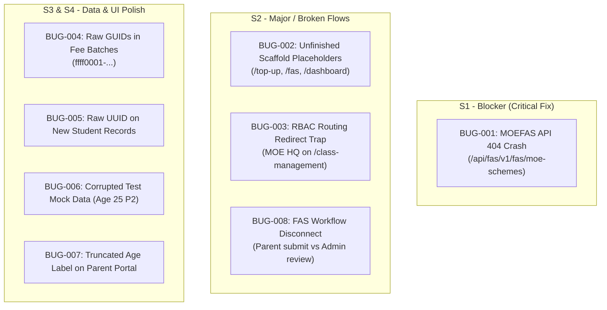

# QA DEFECT AUDIT REPORT: EDUFAMS R3 & ASSOCIATED MODULES
**Prepared for Development Team & Technical Leads**  
**Date:** October 23, 2026  
**Environment:** Localhost Integration Staging (`localhost:5173` Admin Portal / `localhost:5174` Parent Portal)  
**Scope:** R3 (School, Student & Fee Management), R4 (FAS Integration), R9 (Parent Portal E-Service)  
**Severity Scale:** S1 (Blocker) > S2 (Critical / Major) > S3 (Moderate / Minor) > S4 (Cosmetic / Low)  
**Report Version:** 1.0.0-PROD-READINESS  

---

## 1. Executive Summary & Defect Triage Matrix

During end-to-end autonomous and exploratory verification of the EduFAMS platform using the Browser Automation Agent (`bsk`), eight (8) defects were identified across functional routing, API integration, data sanitation, and UX presentation. 

Several defects pose immediate presentation risks during upcoming client demonstrations (MOE Singapore stakeholders) and require immediate hotfixes or clear demo avoidance procedures.

| Bug ID | Severity | Priority | Module / Area | Summary | Demo Impact |
| :--- | :--- | :--- | :--- | :--- | :--- |
| **BUG-EDUFAMS-001** | **S1 - Blocker** | P1 - High | Admin / MOEFAS | `GET /api/fas/v1/fas/moe-schemes` returns HTTP 404, causing red error banner | **Fatal** (Broken API on click) |
| **BUG-EDUFAMS-002** | **S2 - Major** | P2 - Medium | Admin / Top-Up & FAS | Navigation sidebar exposes unbuilt scaffold placeholder pages (`/top-up`, `/fas`) | **High** (Exposes unfinished work) |
| **BUG-EDUFAMS-003** | **S2 - Major** | P2 - Medium | Admin / RBAC Routing | MOE HQ accessing `/class-management` redirected to empty root dashboard with error toast | **Medium** (Confusing role boundary) |
| **BUG-EDUFAMS-004** | **S3 - Moderate** | P2 - Medium | Admin / Fee Batches | Raw Technical GUIDs (`ffff0001-...`) rendered instead of human-readable component/user names | **High** (Unprofessional UI appearance) |
| **BUG-EDUFAMS-005** | **S3 - Moderate** | P3 - Low | Admin / Students | Newly created student displays raw UUID instead of standard sequential ID (`STU-xxx`) | **Medium** (Visual inconsistency) |
| **BUG-EDUFAMS-006** | **S3 - Moderate** | P3 - Low | Database / Seed Data | Corrupted test record (`Trần Tuấn Kiệt`, Age 25 in Primary 2) visible in Rosyth Primary table | **High** (Embarrassing mock data) |
| **BUG-EDUFAMS-007** | **S4 - Minor** | P3 - Low | Parent Portal / E-Service | Child profile card renders truncated text `EDU-00172 · Age Active` (Missing age integer) | **Low** (Minor visual defect) |
| **BUG-EDUFAMS-008** | **S2 - Major** | P2 - Medium | FAS End-to-End Flow | Disconnect: Parent submits FAS form (`/fas/apply`), but Admin Portal lacks review queue | **High** (Broken business workflow) |

---

## 2. Detailed Defect Reports



---

### BUG-EDUFAMS-001: MOEFAS Scheme Management API Returns HTTP 404 & Displays Unhandled Error Banner

- **Severity:** S1 - Blocker
- **Priority:** P1 - Immediate Hotfix
- **Component:** `apps/admin-portal` / `FasService` (.NET Backend)
- **URL:** `http://localhost:5173/moefas`
- **User Persona:** MOE HQ Administrator (`admin@IAM.edu.vn`)

#### Description
When an MOE HQ Administrator clicks on the **MOEFAS** link under the **FINANCIAL** menu in the sidebar, the frontend requests schemes from the backend. The API endpoint returns an HTTP 404 Not Found, causing an unhandled error state with a high-visibility red alert banner.

#### Steps to Reproduce
1. Log in to Admin Portal (`http://localhost:5173/login`) as MOE HQ Admin (`admin@IAM.edu.vn`).
2. Navigate to the left navigation sidebar.
3. Under the **FINANCIAL** section, click on **MOEFAS** (`/moefas`).
4. Observe the page render and check DevTools Console & Network tabs.

#### Expected Behavior
The page should load existing MOEFAS schemes from the backend service or, if empty, render a clean empty state with a "New scheme" call-to-action button, returning HTTP 200 OK.

#### Actual Behavior
1. API call `GET http://localhost:5173/api/fas/v1/fas/moe-schemes?PageNumber=1&PageSize=100` fails with **HTTP 404 (Not Found)**.
2. The UI renders a prominent red alert card:
   > **Unable to load data**  
   > *The MOEFAS schemes could not be loaded. Please try again.*
3. Summary status counters all display `0` (`0 Draft`, `0 Published`, `0 Effective`, `0 Closed`).

#### Console Log Evidence
```text
[vite] connected.
error log http://localhost:5173/api/fas/v1/fas/moe-schemes?PageNumber=1&PageSize=100 
Failed to load resource: the server responded with a status of 404 (Not Found)
```

#### Visual Evidence
- Screenshot: `docs/screenshots/defect_01_moefas_api_404_error.png`

#### Suggested Remediation
- Verify controller routing in `FasService`. Ensure `[Route("api/fas/v1/fas/moe-schemes")]` is mapped and reverse proxy (Vite proxy or YARP/Envoy) forwards requests from `/api/fas/` to the active FasService port (`:5105` or configured Docker port).
- If the endpoint is unreleased in this sprint, remove the `MOEFAS` item from the sidebar manifest (`apps/admin-portal/src/features/moefas/manifest.ts`) to prevent accidental clicks during presentations.

---

### BUG-EDUFAMS-002: Navigation Sidebar Exposes Unbuilt Scaffold Placeholder Pages (`/top-up`, `/fas`) & Typo on Main Dashboard

- **Severity:** S2 - Major
- **Priority:** P2 - High
- **Component:** `apps/admin-portal` (`layout`, `dashboard`, `top-up`, `fas`)
- **URLs:**
  - `http://localhost:5173/` (Root Dashboard)
  - `http://localhost:5173/top-up` (EDUSAVE Top-up)
  - `http://localhost:5173/fas` (Financial FAS)

#### Description
Multiple prominent menu items in the main navigation sidebar lead to unfinished scaffold screens containing placeholder developer text. Furthermore, the root landing dashboard displays an embarrassing typographical error in the primary header.

#### Steps to Reproduce
1. Log in to the Admin Portal as either MOE HQ Admin or School User.
2. Observe the main heading on `http://localhost:5173/`.
3. In the sidebar, click on **EDUSAVE** $\rightarrow$ **Top-up** (`/top-up`).
4. In the sidebar, click on **FINANCIAL** $\rightarrow$ **FAS** (`/fas`).

#### Expected Behavior
- The main dashboard should display production-ready summary metrics, widgets, or quick links without typographical errors.
- Menu items for unreleased features should be conditionally hidden via feature flags or omitted from navigation until functional.

#### Actual Behavior
1. **Typo on Root Dashboard:**
   - Heading text reads: `"Education Fanancial Account Management System"` (**"Fanancial"** misspelled instead of **"Financial"**).
   - Body text: *"This feature is scaffolded and ready for its business workflow."*
2. **Top-up Scaffold:** Displays empty card with: *"This feature is scaffolded and ready for its business workflow."*
3. **FAS Scaffold:** Displays empty card with: *"This feature is scaffolded and ready for its business workflow."*

#### Visual Evidence
- Screenshot: `docs/screenshots/defect_02_topup_empty_scaffold.png`

#### Suggested Remediation
- Correct `"Fanancial"` $\rightarrow$ `"Financial"` across all locale files (`locales/en-US/translation.json`).
- In `manifest.ts` for `top-up` and `fas`, add `visible: false` or disable them in the sidebar navigation until their business workflows are connected.

---

### BUG-EDUFAMS-003: MOE HQ Role Bounced with Red Error Toast Upon Accessing `/class-management`

- **Severity:** S2 - Major (UX / Routing Boundary)
- **Priority:** P2 - Medium
- **Component:** `apps/admin-portal/src/features/class-management/manifest.ts`
- **URL:** `http://localhost:5173/class-management`
- **User Persona:** MOE HQ Administrator (`admin@IAM.edu.vn`)

#### Description
When an MOE HQ Administrator attempts to access class management (either by direct link, history navigation, or bookmark), the router guard denies access and redirects them to the root dashboard, flashing a red error alert: *"Access restricted: Your account does not have permission to view this area of the admin portal."*

#### Technical Root Cause
In `apps/admin-portal/src/features/class-management/manifest.ts`:
```typescript
allowedRoles: ["SCHOOL"]
```
Because MOE HQ only has role `MOEHQ`, the authorization guard blocks access. However, MOE HQ *does* have permission to view classes inside `School management` (`/schools/SCH-003`), creating a confusing user experience where classes can be seen in one view but accessing the class table directly throws an authorization fault.

#### Visual Evidence
- Screenshot: `docs/screenshots/defect_03_moehq_access_restricted_class_mgmt.png`

#### Suggested Remediation
- If MOE HQ is permitted to inspect or audit classes centrally, update `allowedRoles: ["SCHOOL", "MOEHQ"]` with read-only permissions for MOE HQ (disabling the "Create class" button).
- If strictly restricted to school personnel, provide a clean "Role Switch" helper or clear 403 screen explaining that class management must be performed under the designated School User account.

---

### BUG-EDUFAMS-004: Raw Technical GUIDs Rendered in Fee Publication Batches Table and Batch Details

- **Severity:** S3 - Moderate (Data Presentation Defect)
- **Priority:** P2 - High (Prior to Client Demo)
- **Component:** `apps/admin-portal/src/features/fee-publication`
- **URL:** `http://localhost:5173/fee-batches`, `http://localhost:5173/fee-batches/:id`

#### Description
In the **Fee publication batches** overview table and the **Batch details** page, foreign key identifiers are displayed directly as raw GUID strings instead of resolving the corresponding human-readable entities.

#### Specific Occurrences
1. **Fee Component Column / Field:**
   - Displays: `ffff0001-0000-0000-0000-000000000002`
   - Expected: `Standard Miscellaneous Fee (COMP_MISC_STD)`
2. **Created By Field (Detail View):**
   - Displays: `01A159A5-0F27-7718-82E1-695C2F4642AA`
   - Expected: `System Administrator (admin@IAM.edu.vn)`
3. **Missing Charge Itemization:**
   - The Batch Details page states `Created charges: 3`, but provides no table or modal to view the individual student charges generated.

#### Visual Evidence
- Screenshots: 
  - `docs/screenshots/flow_10_f12_f13_create_draft_ready.png`
  - `docs/screenshots/flow_12_f12_f15_fee_batch_completed_charges_generated.png`

#### Suggested Remediation
- In the batch list and detail loaders, perform a lookup/join against `FeeComponents` and `Users` cache to render `{component.name} ({component.code})` and `{user.displayName}` instead of raw GUID keys.

---

### BUG-EDUFAMS-005: Newly Created Students Display Raw UUID String Instead of Standard ID Format (`STU-xxx`)

- **Severity:** S3 - Moderate
- **Priority:** P3 - Low
- **Component:** `apps/admin-portal/src/features/student-management`
- **URL:** `http://localhost:5173/student-management`, `http://localhost:5173/students/:id`

#### Description
When a new student is enrolled through the UI form (e.g., *Lucas Tan Wei Jie*), the table displays the backend database UUID (`f73e9aa4-0143-4826-9e48-93e184200d07`) in the Student column and page header. In contrast, seeded baseline students display clean format codes (`STU-001`, `STU-003`).

#### Visual Evidence
- Table view: `Lucas Tan Wei Jie f73e9aa4-0143-4826-9e48-93e184200d07`
- Header view: `SC · F73E9AA4-0143-4826-9E48-93E184200D07`
- Screenshot: `docs/screenshots/happycase_02_student_created_in_table.png`

#### Suggested Remediation
- Implement sequential student code generation (`STU-xxxxx`) in `StudentSchoolService` on record insertion, and display this business identifier rather than exposing the internal primary key GUID.

---

### BUG-EDUFAMS-006: Corrupted / Invalid Test Mock Data Persisted in Database (Age 25 in Primary School)

- **Severity:** S3 - Moderate (Data Sanitation)
- **Priority:** P3 - Low (Clean up before client demo)
- **Component:** `StudentSchoolDatabase.dbo.students`
- **URL:** `http://localhost:5173/student-management`

#### Description
In the student management table for Rosyth Primary School, an invalid mock record exists:
- **Name:** `Trần Tuấn Kiệt`
- **ID:** `ce169581-8e09-4255-8377-131718749154`
- **DOB:** `May 18, 2001` (Age 25 in Primary 2!)
- **Category:** `IS_NON_ASEAN`
- **Class:** `111111111111111111 · P2-X` (Corrupted test string)

#### Impact
If presented to Singapore Ministry of Education stakeholders, displaying an adult in a primary school class with junk code `111111111111111111` damages perceived system maturity.

#### Suggested Remediation
- Execute a database cleanup script to remove this record:
  ```sql
  DELETE FROM StudentSchoolDatabase.dbo.school_class_assignments WHERE student_id = 'ce169581-8e09-4255-8377-131718749154';
  DELETE FROM StudentSchoolDatabase.dbo.school_enrollments WHERE student_id = 'ce169581-8e09-4255-8377-131718749154';
  DELETE FROM StudentSchoolDatabase.dbo.students WHERE id = 'ce169581-8e09-4255-8377-131718749154';
  ```
- Add age-validation rules in `StudentSchoolService` preventing students over 14 years old from being enrolled into Primary stages (`PRI-1` to `PRI-6`).

---

### BUG-EDUFAMS-007: Parent Portal Child Profile Card Renders Truncated Age Label (`EDU-00172 · Age Active`)

- **Severity:** S4 - Minor
- **Priority:** P3 - Low
- **Component:** `apps/parent-portal` (`E-Service Dashboard`)
- **URL:** `http://localhost:5174/`
- **User Persona:** Parent (`S7890123F - NGUYEN VAN MINH`)

#### Description
On the Parent Portal home dashboard, the summary pill for the child's Education Account card displays the literal text:  
`EDU-00172 · Age Active`

The calculated numerical age (e.g., `Age 11`) is missing, resulting in an awkward concatenated label.

#### Suggested Remediation
- In the React card component rendering the child profile header, inspect the age calculation helper:
  ```typescript
  // Potential bug: missing age variable or null fallback
  <p>{account.code} · {account.age ? `Age ${account.age}` : ''} {account.status}</p>
  ```
- Ensure date of birth is parsed correctly to derive age integer, or display status cleanly as a separate badge.

---

### BUG-EDUFAMS-008: End-to-End Workflow Disconnect: FAS Application Submitted by Parent Has No Review Queue in Admin Portal

- **Severity:** S2 - Major (Architectural Workflow Gap)
- **Priority:** P2 - High
- **Components:** `apps/parent-portal` (`/fas/apply`) $\leftrightarrow$ `apps/admin-portal` (`/fas`)

#### Description
The Parent Portal features a comprehensive, multi-section online application form for the Financial Assistance Scheme (`http://localhost:5174/fas/apply`), including beneficiary details, income declarations, and family member declarations.

However, in the Admin Portal:
1. `/fas` is a blank placeholder page.
2. `/moefas` fails with an HTTP 404 error.
3. School clerks and MOE officers have no user interface to query, review, approve, or reject submitted applications.

#### Impact
The feature cannot be demonstrated as a complete end-to-end user story. Once a parent submits the form, the data disappears into the database with no administrative lifecycle UI.

#### Suggested Remediation
- Connect the `FasService` application queue API to the Admin Portal `fas` feature module.
- Provide a minimum viable "FAS Application Review" table allowing school clerks to view applicant name, child NRIC, submission date, and action buttons (`Approve` / `Reject`).

---

## 3. Pre-Demo Workaround & Risk Mitigation Strategy

For presenting teams conducting demonstrations prior to the resolution of the above bugs, observe the following protocol:

1. **Do NOT click:**
   - `MOEFAS` (`/moefas`) under Financial menu.
   - `Top-up` (`/top-up`) under Edusave menu.
   - `FAS` (`/fas`) under Financial menu.
2. **Avoid `/class-management` while logged in as MOE HQ:**
   - Always demonstrate Class Creation under the `staff1@IAM.edu.vn` (School Clerk) account.
3. **Use Parent Persona `S7654321B` (Tan Wei Ming / Chloe Chan) for Payment Demo:**
   - Parent `S7890123F` has an outstanding balance of `$0.00` (disabling payment controls).
   - Parent `S7654321B` has active unpaid charges totaling `$1,550.00`, enabling live demonstration of the Split Payment workflow.
4. **Table Scrolling Caution:**
   - In the Student Management table, avoid scrolling to the bottom row containing the corrupted mock record `Trần Tuấn Kiệt`. Focus demonstration on `Lucas Tan Wei Jie` or `Tan Jun Wei`.
