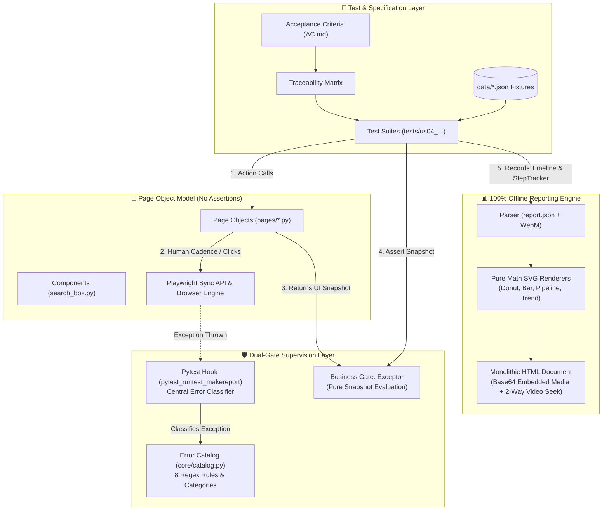

# AI_SYSTEM_HANDBOOK.md — Complete Codebase & Architectural Specification

> **Target Audience:** AI Coding Assistants (LLMs, Cursor, Claude, Antigravity, Copilot) & Automation Engineers  
> **Repository:** `kiet-w/qa-automation-ui`  
> **Framework:** Python 3.10+ • Playwright (Sync API) • Pytest • pytest-xdist • pytest-json-report  
> **Reporting Engine:** 100% Offline ExtentReports Engine (Zero External CDN, Pure SVG Math, Base64 Media)  
> **Specification Standard:** `/combo-summary` 3-Tier Cognitive Pyramid  

---

# Tier 1: Executive Brief (TL;DR)

### 1. What is this project?
An enterprise-grade UI test automation framework built in Python using **Playwright (synchronous API)** and **Pytest**. It provides dual-gate error supervision, ticket-isolated test runs, and a 100% self-contained offline HTML reporting engine. The framework validates two core operational targets:
1. **User Story 1 (`us01_bing_search`)**: Multi-step external web navigation (Bing Search -> Facebook -> YouTube -> Channel Navigation -> Earliest Video Playback & High-Res Screenshot capture) with anti-bot evasion and typing emulation.
2. **User Story 2 & 4 (`us04_curricula_trainer`)**: Comprehensive functional verification of the **Curricula Trainer Account Creation** system (`curricula_trainer_account.html`), featuring 68 Test Cases mapped 1:1 against formal Acceptance Criteria across 7 distinct test suites.

### 2. Why does it matter?
Traditional UI automation suffers from two fatal flaws: **flaky test triage** (inability to distinguish technical network/browser blips from genuine application bugs) and **leaky abstractions** (assertions scattered across Page Objects, raw `time.sleep`, hardcoded test values).  
This framework solves both with:
- **Dual-Gate Error Supervision**: Business checks (`Exceptor`) evaluate static UI snapshots; infrastructure operations (`Interceptor` & `conftest.py` hook) catch and classify technical exceptions into an Error Catalog.
- **AST-Enforced Architectural Invariants**: Static AST unit tests block violations (`assert` in POMs, `time.sleep`, external CDN links) at compile time.
- **100% Offline Monolithic Reporting**: Generates a single standalone HTML report with embedded Base64 WebM videos, PNG screenshots, pure Python SVG charts, and interactive two-way diagram-to-video timestamp seeking.

### 3. What is the bottom line?
- **Total Test Inventory**: 95 Automated Tests (26 Framework Unit Tests + 1 E2E Web Flow + 68 FSD Form Test Cases).
- **Bug Discovery**: 10 Known System Defects (BUG-001 to BUG-010) cataloged and asserted using strict expected-failure gates (`@pytest.mark.xfail(strict=True)` and `Exceptor` bug hunters).
- **Execution Performance**: Fully parallelized via `pytest-xdist` (`-n 4`), supporting Chromium, Chrome, Edge, Brave, Firefox, and WebKit with zero flakiness.

---

# Tier 2: Key Pillars, Technical Matrices & Deep Architecture

## 2.1 Architectural Blueprint & Execution Flow

<!-- [COMBO-DIAGRAM-SPEC]
id: "qa-automation-ui-architecture"
type: "architecture"
title: "Enterprise UI Automation Dual-Gate Architecture"
eyebrow: "ARCHITECTURE TOPOLOGY"
container: "#diagram-inline-qa-architecture"
direction: "TB"
budget:
  max_nodes: 8
  max_connectors: 10
  focal_nodes: 2
zones:
  - id: "test-layer"
    label: "TEST & SPECIFICATION LAYER"
  - id: "supervision-layer"
    label: "DUAL-GATE SUPERVISION LAYER"
  - id: "ui-layer"
    label: "PAGE OBJECTS & BROWSER INTERACTION"
  - id: "reporting-layer"
    label: "100% OFFLINE REPORTING ENGINE"
connectors:
  - from: "TestSuite"
    to: "PageObject"
    label: "Invokes Actions"
    type: "link"
  - from: "PageObject"
    to: "Browser"
    label: "Playwright Sync API"
    type: "link"
  - from: "PageObject"
    to: "Exceptor"
    label: "Returns UI Snapshot"
    type: "link"
  - from: "TestSuite"
    to: "Exceptor"
    label: "Adjudicates Business Gate"
    type: "link"
  - from: "Browser"
    to: "PytestHook"
    label: "Catches Technical Error"
    type: "link"
  - from: "PytestHook"
    to: "ErrorCatalog"
    label: "Regex Classify"
    type: "link"
  - from: "TestSuite"
    to: "ReportGenerator"
    label: "JSON Metadata + WebM Video"
    type: "link"
export:
  target_file: "html/diagrams/qa_architecture.svg"
[/COMBO-DIAGRAM-SPEC] -->



---

## 2.2 The Five Core Invariants & AST Static Verification

Every engineer and AI model must adhere to 5 non-negotiable architectural invariants. These are verified automatically via Python AST analysis in `tests/unit/test_architecture_invariants.py`:

| Invariant | Rule Summary | Enforced Location | AST Verification Mechanism | Failure Consequence |
| :--- | :--- | :--- | :--- | :--- |
| **Invariant 1** | **Zero Assertions in Page Objects** | `pages/`, `components/` | AST visitor checks for `isinstance(node, ast.Assert)` in all files under `pages/` and `components/`. | Fails unit test immediately. Page objects must only query state and return snapshots. |
| **Invariant 2** | **Zero `time.sleep()`** | `pages/`, `components/`, `tests/`, `core/` | AST visitor inspects all `ast.Call` nodes for `time.sleep` or `from time import sleep`. | Fails unit test. Must use Playwright auto-waiting or `page.wait_for_selector()`. |
| **Invariant 3** | **Zero Hardcoded Test Data** | `tests/` | All form payloads, boundaries, and URLs must load from `data/*.json` with `copy.deepcopy()`. | Fails code review & prevents dirty state leakage across parallel tests. |
| **Invariant 4** | **Step Traceability & Evidence** | `tests/` | All test steps must be wrapped with `with self.step("Step Name", expected="...", actual="..."):`. | Test timeline will be empty; report will fail to generate pipeline and video sync. |
| **Invariant 5** | **Zero External CDN Dependencies** | `reporting/`, `reporting/assets/` | Regex scan verifies no `http://`, `https://`, CDN CSS, or JS in reporting modules. | Guarantees reports open in offline, air-gapped, or intranet environments. |
| **Code Hygiene** | **Zero Leftover Debug Prints** | `pages/`, `components/` | AST checks for `ast.Call` targeting `print()`. | Ensures clean terminal outputs during test runs. |

---

## 2.3 Dual-Gate Error Supervision Layer (`core/`)

The framework splits all failures into two strictly separated categories:

```text
                                  ┌────────────────────────┐
                                  │      Test Failure      │
                                  └───────────┬────────────┘
                                              │
                      ┌───────────────────────┴───────────────────────┐
                      ▼                                               ▼
         ┌─────────────────────────┐                     ┌─────────────────────────┐
         │ BusinessAssertionError  │                     │   InfrastructureError   │
         │   (Application Defect)  │                     │   (Technical / System)  │
         ├─────────────────────────┤                     ├─────────────────────────┤
         │ • Subclasses:           │                     │ • Subclasses:           │
         │   AssertionError        │                     │   Exception (NOT Assert)│
         │ • Source: Exceptor      │                     │ • Source: Catalog/Hook  │
         │ • Cause: Bad validation,│                     │ • Cause: Timeout, Crash,│
         │   wrong error message,  │                     │   stale DOM, network,   │
         │   validation bypass     │                     │   unhandled dialog      │
         └─────────────────────────┘                     └─────────────────────────┘
```

### Exceptor API Methods (`core/exceptor.py`)
`Exceptor` acts on **static UI snapshots** (`dict` or object) containing:
```json
{
  "success_visible": true,
  "visible_errors": {
    "fieldName": "Exact inline error text"
  },
  "js_exceptions": [],
  "console_errors": []
}
```

1. **`Exceptor.expect_success(snapshot, context="", step=None)`**:
   - Asserts `success_visible is True` AND `len(visible_errors) == 0`.
   - Used for Happy Path (valid form submission).
2. **`Exceptor.expect_rejection(snapshot, field, message_contains, context="", step=None)`**:
   - Asserts `success_visible is False`, `field in visible_errors`, and `message_contains in visible_errors[field]`.
   - Used for Unhappy Path (invalid input correctly blocked by application).
3. **`Exceptor.expect_bug_if_rejected(snapshot, field="", context="")`**:
   - Asserts that legal/valid business input was NOT rejected. If rejected, raises `[BUG DETECTED]`.
4. **`Exceptor.expect_bug_if_accepted(snapshot, context="")`**:
   - Asserts that illegal/invalid business input was NOT accepted. If `success_visible is True`, raises `[BUG DETECTED] (Validation Bypass)`.
5. **`Exceptor.expect_zero_js_errors(snapshot, context="", check_console=False)`**:
   - Verifies zero uncaught browser JS exceptions or console errors. Raises `InfrastructureError(category="JS_RUNTIME_ERROR")` if found.
6. **`Exceptor.expect_accessible(a11y_snapshot, context="")`**:
   - Evaluates WCAG/ARIA violations from `axe-core`. Raises `BusinessAssertionError` on violations.

---

## 2.4 Error Catalog & Automatic Classification Matrix (`core/catalog.py`)

Infrastructure errors are automatically classified via the `classify(exception)` function:

| Error Category | Diagnostic Hint | Match Strategy (Exception Types / Regex) |
| :--- | :--- | :--- |
| **`TIMEOUT`** | Element did not appear/become ready in time; check selector or increase timeout. | `playwright.sync_api.TimeoutError`, `TimeoutError`, Regex: `(?i)Timeout \d+ms exceeded\|timed out` |
| **`BROWSER_CRASH`** | Browser or target page closed unexpectedly during execution. | Regex: `(?i)Target closed\|Target page, context or browser has been closed\|Browser closed` |
| **`STALE_ELEMENT`** | DOM changed (re-rendered); locator reference is detached from DOM. | Regex: `(?i)Element is not attached to the DOM\|stale element reference\|is detached from the DOM` |
| **`NETWORK`** | Network connection failure occurred while requesting resource. | Regex: `(?i)net::ERR_\|NS_ERROR_CONNECTION_REFUSED` |
| **`JS_RUNTIME_ERROR`** | Uncaught JavaScript exception or critical console error in browser runtime. | Regex: `(?i)TypeError:\|ReferenceError:\|SyntaxError:\|Uncaught (?:in promise )?\|JS RUNTIME ERROR` |
| **`DIALOG_UNHANDLED`** | Native browser dialog (alert/confirm/prompt) opened but not handled. | Regex: `(?i)dialog\|alert\|confirm\|prompt was not handled\|Cannot navigate when dialog is open` |
| **`FILE_NOT_FOUND`** | Upload fixture file missing on disk; verify `data/fixtures/`. | `FileNotFoundError`, Regex: `(?i)No such file or directory\|File not found` |
| **`NAVIGATION_ERROR`** | Navigation to target URL failed or connection refused by host. | Regex: `(?i)Navigation failed\|ERR_NAME_NOT_RESOLVED\|ERR_CONNECTION_REFUSED\|Cannot navigate` |
| **`UNKNOWN`** | Unclassified infrastructure error — add to catalog once diagnosed. | Fallback when no other rules match. |

---

## 2.5 Page Object Model & Component Design System

### 1. `BasePage` (`pages/base_page.py`)
Common web primitives encapsulating safe interactions:
- `navigate(url, wait_until="domcontentloaded")`
- `wait_for_visible(selector_or_locator, timeout=10000)`
- `click_element(selector_or_locator, timeout=10000)`
- `fill_text(selector_or_locator, text, timeout=10000)`
- `handle_next_dialog(accept=True, prompt_text=None)`: Configures a one-shot handler for native `window.alert()` / `window.confirm()` before clicking dialog-triggering buttons.
- `take_screenshot(filepath, full_page=False)`
- `get_js_errors()` / `get_console_errors()` / `get_technical_snapshot()`

### 2. `CurriculaTrainerPage` (`pages/curricula_trainer_page.py`)
High-level interactions for `curricula_trainer_account.html`:
- `open()`: Navigates to local HTML application.
- `type_field(selector, text, delay=20)`: Human typing emulation (`press_sequentially`).
- `fill_personal_info(data)` / `fill_contact_info(data)` / `fill_emergency_contact(data)` / `fill_singapore_address(data)` / `fill_non_singapore_address(data)`.
- `fill_full_form(data)`.
- `save()`: Clicks submit button `#saveBtn`.
- `cancel()`: Clicks cancel button `#cancelBtn`.
- `get_state_snapshot() -> Dict[str, Any]`: Gathers complete UI state without asserting.
- `get_success_text() -> str`: Reads success banner text (`#successBanner`).

### 3. `SearchBoxComponent` (`components/search_box.py`)
Encapsulates search input widgets with anti-bot emulation:
- `search(query: str, submit_key="Enter", delay_range=(30, 80))`: Human-like variable typing latency.

---

## 2.6 The 10 Known System Defects (Bug Matrix)

The mock application under test (`curricula_trainer_account.html`) contains 10 deliberate defects. The test suite asserts these using `@pytest.mark.xfail(strict=True)` (Strict XFAIL: fails the run if the bug is unexpectedly fixed without updating the test) or `Exceptor` bug hunters:

| Bug ID | Module | Defect Description | Asserted In | Gate / Assertion Method | Expected FSD Behavior |
| :--- | :--- | :--- | :--- | :--- | :--- |
| **BUG-001** | Save Action | Duplicate email is accepted without error | `TC_SAV_003`, `TC_SAV_004` | `@pytest.mark.xfail(strict=True)` / `expect_bug_if_accepted` | System must reject duplicate email with: *"An account with this email address already exists."* |
| **BUG-002** | Save Action | Duplicate ID number is accepted | `TC_SAV_005` | `@pytest.mark.xfail(strict=True)` / `expect_bug_if_accepted` | System must reject duplicate NRIC/Passport. |
| **BUG-003** | Non-SG Address | Country dropdown includes "Singapore" | `TC_NSG_002` | `@pytest.mark.xfail(strict=True)` / `expect_bug_if_rejected` | "Singapore" must be excluded from Non-SG Country dropdown. |
| **BUG-004** | Save Action | Double-clicking Save triggers duplicate processing | `TC_SAV_006` | `@pytest.mark.xfail(strict=True)` / `expect_bug_if_accepted` | Save button must be disabled immediately after first click to prevent race conditions. |
| **BUG-005** | Emergency Contact | Relationship enum uses Father/Mother instead of Parent | `TC_EC_003` | `@pytest.mark.xfail(strict=True)` / `expect_bug_if_rejected` | Dropdown must strictly match FSD: `Parent`, `Spouse`, `Sibling`, `Child`, `Friend`, `Other`. |
| **BUG-006** | Cancel Action | Cancel ignores dirty state on radio buttons and dropdowns | `TC_CAN_004` | `@pytest.mark.xfail(strict=True)` / `expect_bug_if_accepted` | Changing any radio/select makes form dirty; Cancel must prompt `confirm()` dialog. |
| **BUG-007** | Text Inputs | Max length validation missing on 5 text fields | `TC_PI_003`, `TC_SG_007` | `@pytest.mark.xfail(strict=True)` / `expect_bug_if_accepted` | Fields must block input beyond character limits (e.g. 100 chars). |
| **BUG-008** | Validation | Error message phrasing deviates from FSD verbatim | `TC_PI_019`, `TC_CI_009` | `expect_rejection` / `strict=True` | System must display exact FSD error strings verbatim. |
| **BUG-009** | Personal Info | ID Type dropdown contains undocumented "S-Pass" | `TC_PI_006` | `@pytest.mark.xfail(strict=True)` / `expect_bug_if_rejected` | ID Type must only allow `NRIC`, `FIN`, `Passport`. |
| **BUG-010** | Personal Info | Missing NRIC/FIN algorithm checksum check | `TC_PI_008` | `@pytest.mark.xfail(strict=True)` / `expect_bug_if_accepted` | Algorithm must validate NRIC/FIN checksum letter (e.g. `S1234567D`). |

---

## 2.7 100% Offline ExtentReports HTML Engine (`reporting/`)

The reporting subsystem compiles a single self-contained `.html` document without external internet dependencies:

```text
reporting/
├── charts/
│   ├── donut.py      # Circle math (2 * π * r * percentage) for Pass/Fail/XFail rates
│   ├── bar.py        # SVG timeline bar chart rendering execution durations per step
│   ├── pipeline.py   # SVG step pipeline (Step 1 -> N) with status pills and timestamps
│   ├── diagram.py    # Architecture topology rendered directly in vector SVG
│   └── trend.py      # Multi-run historical pass rate and duration SVG trendlines
├── core/
│   ├── parser.py     # Ingests report.json, computes step offsets from test start time
│   ├── media.py      # Converts .webm videos and .png screenshots to Base64 Data URIs
│   ├── generator.py  # Orchestrates parsing, SVG chart generation, and file output
│   ├── document.py   # Assembles monolithic HTML with embedded CSS, JS, and charts
│   ├── views_dashboard.py # KPI summary metric cards
│   └── views_tests.py     # Detailed test execution cards with step timelines & video
└── assets/
    ├── report.css    # Responsive dark-theme styling, 16:9 video container
    └── report.js     # 2-way Video Seek Sync (Click SVG Step -> Video jumps to timestamp) & EN/VI toggle
```

### Video-to-Step Synchronization Mechanism
1. During execution, `StepTracker` records the exact elapsed timestamp (`t_offset = step_time - test_start_time`).
2. Playwright records test execution as a high-definition 1080p/720p `.webm` video.
3. In `report.js`, each step element in the SVG pipeline and timeline card includes a `data-video-seek="<seconds>"` attribute.
4. Clicking any step in the report triggers:
   ```javascript
   const video = document.getElementById(`video-${testId}`);
   video.currentTime = parseFloat(targetTime);
   video.play();
   video.scrollIntoView({ behavior: 'smooth', block: 'center' });
   ```

---

## 2.8 Repository Structure & Component Responsibilities

```text
automation-ui/
├── AGENTS.md                                # Developer & AI Agent Contract (5 Invariants)
├── AI_SYSTEM_HANDBOOK.md                    # [THIS MASTER SPECIFICATION]
├── CODEBASE_CONTEXT.md                      # Detailed context reference
├── GLOSSARY.md                              # Normalized domain terminology
├── README.md                                # Human-facing documentation & quickstart
├── curricula_trainer_account.html           # Target web application under test (US02/US04)
├── requirements.txt                         # Dependencies: playwright, pytest, pytest-xdist, pytest-json-report
├── pytest.ini                               # Pytest default CLI flags, markers, and paths
├── conftest.py                              # Master Pytest entrypoint (delegates to core.pytest_plugins)
├── run_tests.py                             # 3-Phase orchestrator (Pytest -> HTML Report -> Terminal Summary)
├── generate_report.py                       # Standalone CLI report compiler
│
├── core/                                    # 🛡️ Dual-Gate Supervision & Plugins
│   ├── catalog.py                           # Error catalog (8 regex classification rules)
│   ├── exceptions.py                        # BusinessAssertionError vs InfrastructureError
│   ├── exceptor.py                          # Sole business assertion gatekeeper (6 methods)
│   ├── interceptor.py                       # Playwright interaction supervisor
│   └── pytest_plugins/                      # Modular Pytest Architecture
│       ├── browser_engine.py                # Multi-browser setup, stealth args, video config
│       ├── ticket_isolation.py              # Automatic isolation under reports/<ticket>/test-results/<run_id>/
│       └── step_and_video_hook.py           # StepTracker & pytest_runtest_makereport classifier
│
├── pages/                                   # 📄 Page Objects (ZERO ASSERTIONS ALLOWED)
│   ├── base_page.py                         # Primitives: navigate, wait, click, dialogs, a11y, JS error collection
│   ├── bing_home_page.py                    # Bing search engine landing page
│   ├── bing_results_page.py                 # Bing search results and redirect handling
│   ├── curricula_trainer_page.py            # Comprehensive Curricula form actions & snapshot extractor
│   └── youtube_page.py                      # YouTube search, channel navigation, sorting, and video playback
│
├── components/                              # 🧩 Modular UI Components
│   └── search_box.py                        # Anti-bot search bar typing with variable cadence
│
├── data/                                    # 🗄️ Parameterized Fixtures & Datasets (Zero Hardcoding)
│   ├── curricula_trainer_data.json          # Predefined payloads (valid SG resident, invalid, boundary cases)
│   ├── search_data.json                     # Search keywords, targets, and expected title fragments
│   └── fixtures/                            # Upload files: valid_id.pdf, oversized_11mb.pdf, malicious.exe, etc.
│
├── tests/                                   # 🧪 Automated Test Suites (95 Tests)
│   ├── base_test.py                         # Base test class: autouse setup, Page Object injection, StepTracker
│   ├── unit/                                # Internal Framework Reliability (26 unit tests)
│   │   ├── test_architecture_invariants.py  # AST guards checking invariants (zero asserts, zero sleep, zero CDN)
│   │   ├── test_catalog.py                  # Validates error catalog regex classification
│   │   ├── test_exceptor.py                 # Validates Exceptor 6 assertion gates
│   │   └── test_interceptor.py              # Validates Interceptor exception handling
│   ├── us01_bing_search/                    # User Story 1: E2E Bing to YouTube Video Navigation
│   │   └── test_bing_search.py              # 5-step sequential flow with bot evasion
│   └── us04_curricula_trainer/              # User Story 4: 68 Test Cases across 7 Suites
│       ├── requirements/                    # Acceptance Criteria (AC.md) & Traceability Matrix
│       ├── test_ts01_personal_info.py       # 19 tests (TC_PI_001 to 019)
│       ├── test_ts02_contact_info.py        # 9 tests (TC_CI_001 to 009)
│       ├── test_ts03_emergency_contact.py   # 6 tests (TC_EC_001 to 006)
│       ├── test_ts04_singapore_address.py   # 10 tests (TC_SG_001 to 010)
│       ├── test_ts05_non_singapore_address.py# 7 tests (TC_NSG_001 to 007)
│       ├── test_ts06_save_action.py         # 7 tests (TC_SAV_001 to 007)
│       └── test_ts07_cancel_action.py       # 5 tests (TC_CAN_001 to 005)
│
├── reporting/                               # 📊 100% Offline ExtentReports HTML Engine
│   ├── assets/ (report.css, report.js)
│   ├── charts/ (donut.py, bar.py, pipeline.py, diagram.py, trend.py)
│   └── core/   (parser.py, media.py, generator.py, document.py, views_*.py)
│
└── reports/                                 # 📂 Artifacts Output (Isolated per Ticket)
    ├── us01_bing_search/
    ├── us04_curricula_trainer/              # report.json, execution_report.html, history/, test-results/
    └── unit/
```

---

# Tier 3: The AI Developer Playbook & Operational Standards

## 3.1 Step-by-Step AI Implementation Protocols

### Protocol 1: How to Author a New Test Suite
When asked to automate a new User Story or test case:
1. **Inherit from `BaseTest`**: Subclasses automatically receive `self.page`, `self.step`, `self.curricula`, `self.get_page(Cls)`, and `self.get_fixture_file(path)`.
2. **Deep-Copy Test Data**: Never modify fixture dictionaries directly.
3. **Structure Steps with `self.step`**: Define `expected` verbatim from Acceptance Criteria.
4. **Use Dual-Gate Assertions**: Query snapshot via Page Object, then assert with `Exceptor`.
5. **Handle Known Bugs with `strict=True`**: Mark expected bug failures with `@pytest.mark.xfail(strict=True, reason="BUG-xxx: ...")`.

```python
import copy
import json
import pytest
from tests.base_test import BaseTest
from pages.curricula_trainer_page import CurriculaTrainerPage
from core import Exceptor

@pytest.mark.curricula
class TestTS08Example(BaseTest):
    """
    TC_EX_001 — Example Test Case
    Test Data: valid_singapore_resident
    Expected: Form is successfully submitted with active status.
    """

    def test_tc_ex_001_submit_valid_trainer(self):
        curricula = self.curricula  # Or self.get_page(CurriculaTrainerPage)
        data = copy.deepcopy(self.load_json_data("data/curricula_trainer_data.json")["valid_singapore_resident"])

        with self.step(
            "Step 1: Open form and enter valid profile data",
            expected="Form fields are populated with valid resident data",
        ):
            curricula.open()
            curricula.fill_full_form(data)

        with self.step(
            "Step 2: Submit form and verify success",
            expected="Trainer Account created successfully with Active status",
        ):
            curricula.save()
            snapshot = curricula.get_state_snapshot()
            Exceptor.expect_success(snapshot, context="TC_EX_001", step=self.step)
```

### Protocol 2: How to Add a Method to a Page Object
1. Locate elements using stable attributes (`id`, `data-testid`, semantic labels).
2. Use `self.fill_text`, `self.click_element`, or `self.type_field` (with typing delay).
3. **NEVER** write `assert` inside the method.
4. Update `get_state_snapshot()` if the field displays validation error text.

```python
# In pages/curricula_trainer_page.py:
def fill_custom_field(self, value: str) -> None:
    """Fills the custom field without asserting."""
    self.type_field("#customFieldInput", value, delay=20)
```

### Protocol 3: How to Handle Native Browser Dialogs
For buttons that trigger browser alerts or confirms (like `#cancelBtn`):
```python
with self.step("Step 1: Click Cancel and accept browser confirmation dialog"):
    # Must register listener BEFORE triggering the action
    self.curricula.handle_next_dialog(accept=True)
    self.curricula.cancel()
```

---

## 3.2 CLI Command Matrix & Flags

Run all commands from the repository root:

| Purpose / Execution Mode | Exact Command | Flags Explained |
| :--- | :--- | :--- |
| **Run Entire Ticket Suite (Headed)** | `python3 run_tests.py tests/us04_curricula_trainer/` | Runs all 68 tests with visible browser; generates `reports/us04_curricula_trainer/execution_report.html`. |
| **High-Speed Parallel Execution** | `python3 run_tests.py tests/us04_curricula_trainer/ -n 4` | Spawns 4 worker processes via `pytest-xdist`; auto-switches to headless mode for stability. |
| **Run US01 (Bing Search E2E)** | `python3 run_tests.py tests/us01_bing_search/` | Runs 5-step search & YouTube video navigation flow. |
| **Run Framework Unit Tests** | `python3 run_tests.py tests/unit/` | Runs all 26 unit tests & AST invariant checkers in < 3s. |
| **Cross-Browser Selection** | `python3 run_tests.py tests/us04_curricula_trainer/ --target-browser brave` | Target options: `chromium`, `chrome`, `edge`, `brave`, `firefox`, `webkit`. |
| **Custom Browser Executable** | `python3 run_tests.py tests/us04_curricula_trainer/ --browser-path /usr/bin/google-chrome-stable` | Direct binary path injection. |
| **Headless Execution** | `python3 run_tests.py tests/us04_curricula_trainer/ --headless` | Run in headless mode without UI windows (ideal for CI/CD). |
| **Filter by Specific Test Case** | `pytest tests/us04_curricula_trainer/ -k "test_tc_sav_001"` | Pytest substring match filter. |
| **Regenerate HTML Report Only** | `python3 generate_report.py reports/us04_curricula_trainer/report.json reports/us04_curricula_trainer/execution_report.html` | Compiles HTML report offline from existing JSON and WebM files without re-running tests. |

---

## 3.3 Domain Glossary & Standard Terminology

| Term | Technical Definition in this Repository |
| :--- | :--- |
| **Dual-Gate Architecture** | Testing paradigm where all UI interactions pass through `Interceptor`/Pytest hooks (infrastructure protection) and all assertions pass through `Exceptor` (business adjudication). |
| **UI State Snapshot** | A plain dictionary (`{"success_visible": bool, "visible_errors": dict}`) representing DOM state at a single moment. Decouples Playwright from assertion logic. |
| **AST Invariant Guard** | Static tests in `tests/unit/test_architecture_invariants.py` that parse Python Abstract Syntax Trees to guarantee zero asserts in POMs, zero `time.sleep()`, and zero CDNs. |
| **Strict XFAIL** | Pytest marker `@pytest.mark.xfail(strict=True, reason="BUG-xxx")`. Documents known bugs while enforcing that if the bug is fixed, the test fails, demanding an update to test documentation. |
| **Ticket Isolation** | Dynamic discovery of ticket name (`us01_bing_search`, `us04_curricula_trainer`) redirecting all videos, screenshots, JSON logs, and HTML reports into `reports/<ticket>/`. |
| **Human Typing Cadence** | Using Playwright's `press_sequentially(text, delay=20)` to mimic realistic keystrokes and avoid triggering anti-bot or debounce validation glitches. |

---

## 3.4 Strict Anti-Patterns & AI Hallucination Guardrails

Any AI agent generating code for this repository must **NEVER**:
1. ❌ **NEVER** use `time.sleep()`. Use Playwright auto-wait, `page.wait_for_selector()`, or `expect(locator)`.
2. ❌ **NEVER** write `assert` inside any class in `pages/` or `components/`. (Instant AST test failure).
3. ❌ **NEVER** hardcode test input strings directly in test methods. Always reference `data/*.json`.
4. ❌ **NEVER** modify fixture dictionaries in-place without `copy.deepcopy()`.
5. ❌ **NEVER** swallow exceptions in empty `try...except` blocks in test methods.
6. ❌ **NEVER** introduce external `<script src="...">` or `<link href="...">` CDN links in the reporting engine.
7. ❌ **NEVER** click buttons that trigger native dialogs without calling `self.curricula.handle_next_dialog()` first.
