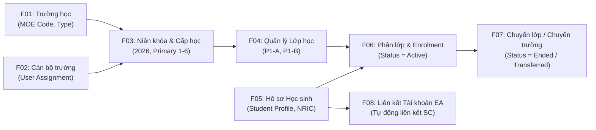
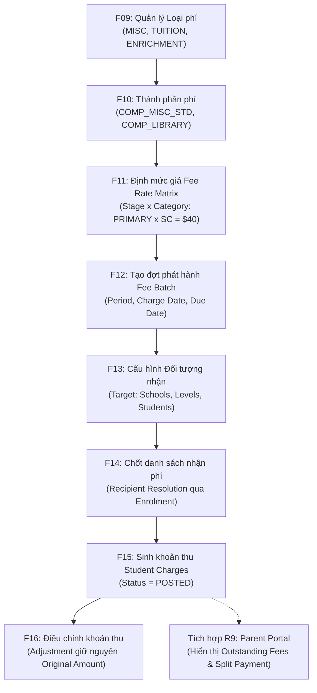
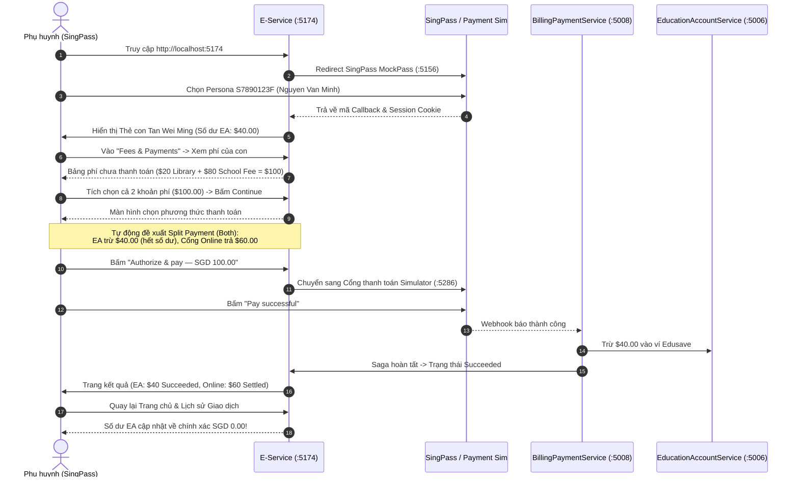

# SỔ TAY THỰC HIỆN VÀ KIỂM THỬ THỦ CÔNG PHÂN HỆ R3 (SCHOOL, STUDENT & FEE MANAGEMENT)
## Môi Trường Kiểm Thử Thực Tế: Admin Portal (:5173) & E-Service Parent Portal (:5174)

> **Mã phân hệ:** R3 — School, Student & Fee Management  
> **Hệ sinh thái:** EduFAMS & EduSave Platform  
> **Cổng kiểm thử:**  
> - **Admin Portal:** `http://localhost:5173` (Quản trị viên MOE HQ & Cán bộ Nhà trường)  
> - **E-Service Portal:** `http://localhost:5174` (Cổng Công dân / Phụ huynh)  
> - **Simulators:** MockPass SingPass (`:5156`), Microsoft Entra ID (`:5288`), Payment Gateway (`:5286`)  
> **Công cụ trinh sát & chụp bằng chứng:** `bsk` (Browser Skill Autonomous Agent)  

---

## 1. Bản Đồ Danh Mục Tài Khoản & Vai Trò (Test Personas)

| Vai trò Nghiệp vụ | Cổng truy cập | Phương thức đăng nhập | Tài khoản / NRIC | Quyền hạn & Phân bổ |
| :--- | :--- | :--- | :--- | :--- |
| **MOE HQ Administrator** | Admin Portal (`:5173`) | Microsoft Entra ID Simulator | `admin@IAM.edu.vn` (`USR-00001`) | Toàn quyền quản trị trung ương (F01, F02, F03, F08, F09, F11, F12-F16). |
| **School User (Clerk/Staff)** | Admin Portal (`:5173`) | Microsoft Entra ID Simulator | `staff1@IAM.edu.vn` (`USR-00002`) | Quản trị trường học được gán (F03 Offering, F04 Class, F05, F06, F07, F10 riêng, F12). |
| **Parent 1 (Nguyen Van Minh)** | E-Service (`:5174`) | SingPass MockPass Simulator | NRIC: **`S7890123F`** | Con: **Tan Wei Ming** (`S1234567A` / `EDU-00172`), Trường Rosyth Primary School. |
| **Parent 2 (Tan Wei Ming)** | E-Service (`:5174`) | SingPass MockPass Simulator | NRIC: **`S7654321B`** | Con: **Chloe Chan** (`T0000784X`), Trường Nanyang Primary School. |

---

## 2. Phần 1: Quản Lý Cấu Trúc Trường Học, Lớp Học & Học Sinh (F01 – F08)

### F01 – School Management (Quản lý Danh mục Trường học)
- **Đường dẫn URL:** `http://localhost:5173/school-management`
- **Vai trò thực hiện:** MOE HQ Administrator (`admin@IAM.edu.vn`)
- **Các bước thực hiện:**
  1. Đăng nhập vào Admin Portal bằng tài khoản MOE HQ.
  2. Chọn menu **ACADEMIC MANAGEMENT** $\rightarrow$ **School management**.
  3. Quan sát bảng dữ liệu trường học: Mã trường (`MOE school code`), Tên trường (`School name`), Loại trường (`School type`), Số lớp đang hoạt động (`Active classes`), Số học sinh (`Active students`).
  4. Bấm **"Detail"** tại trường **Rosyth Primary School (RPS-0201)** để xem chi tiết cấp học và danh sách lớp.
- **Bằng chứng giao diện thực tế:**
  - Danh sách trường học: `screenshots/01_f01_school_management.png`
  - Chi tiết trường học RPS-0201: `screenshots/02_f01_f04_school_detail_offerings_classes.png`

---

### F02 – School User Account Assignment (Gán Tài khoản Cán bộ Trường)
- **Đường dẫn URL:** `http://localhost:5173/school-users`
- **Vai trò thực hiện:** MOE HQ Administrator
- **Các bước thực hiện:**
  1. Tại sidebar, chọn **ACADEMIC MANAGEMENT** $\rightarrow$ **School Users**.
  2. Hệ thống hiển thị danh sách cán bộ: mã `USR-00002`, username `school`, họ tên `Bui Thi H`.
  3. **Kiểm tra quy tắc ràng buộc (Strict Boundary Check):**
     - Khi tài khoản `staff1@IAM.edu.vn` (`Bui Thi H`) chưa được MOE HQ gán vào trường cụ thể, đăng nhập vào Admin Portal sẽ bị hệ thống chặn truy cập với thông báo cảnh báo màu vàng:
     > *"School assignment required: Your account is active, but it has not been assigned to a school yet. Ask an MOE HQ administrator to assign your school before continuing."*
- **Bằng chứng giao diện thực tế:**
  - Danh sách cán bộ trường: `screenshots/05_f02_school_users.png`
  - Cảnh báo chặn truy cập khi chưa gán trường: `screenshots/27_f02_school_assignment_required_alert.png`

---

### F03 – Academic Year, Level & Offering (Quản lý Niên Khóa & Cấp Học)
- **Đường dẫn URL:**
  - Cấp học: `http://localhost:5173/academic-levels`
  - Niên khóa: `http://localhost:5173/academic-years`
- **Vai trò thực hiện:** MOE HQ Administrator
- **Các bước thực hiện:**
  1. Vào **Academic Levels**: Kiểm tra danh mục 12 cấp học chuẩn quốc gia (`PRI-1` đến `PRI-6`, `SEC-1` đến `SEC-4`, `JC-1`, `JC-2`).
  2. Vào **Academic Years**:
     - Niên khóa `2026`: Trạng thái `Active` (gồm 4 trường, 6 lớp, 4 học sinh).
     - Niên khóa `2027`: Trạng thái `Draft` (có nút **Activate** để kích hoạt niên khóa mới).
     - Niên khóa `2025`: Trạng thái `Closed`.
- **Bằng chứng giao diện thực tế:**
  - Bảng Cấp học: `screenshots/03_f03_academic_levels.png`
  - Bảng Niên khóa: `screenshots/04_f03_academic_years.png`

---

### F04 – Class Management (Quản lý Cấu trúc Lớp học)
- **Đường dẫn URL:** `http://localhost:5173/schools/SCH-003` (Trường RPS-0201)
- **Vai trò thực hiện:** School User / MOE HQ
- **Các bước thực hiện:**
  1. Xem danh mục Cấp học được trường giảng dạy (`School level offerings`):
     - `PRI-1 · Primary 1` (Niên khóa 2026): Lớp `P1-A` (Primary 1-A Courage - 1 học sinh), Lớp `P1-B` (Primary 1-B Wisdom - 1 học sinh).
     - `PRI-2 · Primary 2` (Niên khóa 2026): Lớp `P2-A` (Primary 2-A Integrity - 0 học sinh).
- **Bằng chứng giao diện thực tế:** `screenshots/02_f01_f04_school_detail_offerings_classes.png`

---

### F05 & F06 – Student Management, Enrolment & Class Assignment
- **Đường dẫn URL:**
  - Danh sách: `http://localhost:5173/student-management`
  - Tạo mới: `http://localhost:5173/students/new` (nút **"Create student"**)
  - Chi tiết học sinh: `http://localhost:5173/students/STU-001`
- **Vai trò thực hiện:** School User / MOE HQ
- **Các bước thực hiện:**
  1. **Tạo hồ sơ học sinh (F05):**
     - Nhập `Display name` (ví dụ: *Tan Jun Wei*).
     - Nhập `NRIC` (định dạng chuẩn Singapore: `S1234567A`).
     - Chọn `Date of birth` (15/03/2019).
     - Chọn `Student citizenship`: `SC` (Singapore Citizen), `PR` (Permanent Resident), hoặc `IS` (International Student).
  2. **Gán trường và lớp học trực tiếp (F06):**
     - Tích chọn checkbox: **"Assign to a school now"**.
     - Chọn `School` $\rightarrow$ Chọn ngày bắt đầu nhập học `Enrollment start` (01/01/2026).
     - Hệ thống sinh bản ghi Enrolment với trạng thái `ENROLLED`.
  3. **Xem hồ sơ học sinh chi tiết:**
     - Xem thẻ thông tin: Học sinh `Tan Jun Wei` (`STU-001`), Trường `RPS-0201 · Rosyth Primary School`, Lớp hiện tại `P1-A · Primary 1-A (Courage)`.
     - Lịch sử phân lớp (`Class assignments`): Lớp `P1-A`, Trạng thái `ACTIVE`.
- **Bằng chứng giao diện thực tế:**
  - Danh sách học sinh: `screenshots/06_f05_students_list.png`
  - Thẻ chi tiết học sinh & Lịch sử Enrolment: `screenshots/07_f06_student_detail_enrolment_assignment.png`
  - Form thêm mới học sinh & gán trường: `screenshots/33_f05_f06_create_student_enrolment_form.png`

---

### F07 – Student Transfer & Class Change (Chuyển Lớp / Chuyển Trường)
- **Đường dẫn URL:** `http://localhost:5173/students/STU-001/assign-class`
- **Vai trò thực hiện:** School User / MOE HQ
- **Các bước thực hiện:**
  1. Tại màn hình hồ sơ học sinh (`STU-001`), bấm nút **"Chuyển lớp"**.
  2. Hệ thống mở form phân lớp lại (`Assign a class`):
     - `Student ID`: `STU-001` (khóa cứng).
     - `Enrollment ID`: `ENR-001` (khóa cứng theo trường hiện tại).
     - `Class`: Chọn lớp mới cần chuyển đến trong cùng trường (ví dụ: `P1-B`).
     - `Assignment start`: Chọn ngày có hiệu lực ở lớp mới.
  3. Khi hoàn tất, hệ thống tự động cập nhật:
     - Class Assignment cũ chuyển sang `Status = Ended`.
     - Class Assignment mới chuyển sang `Status = ACTIVE`.
     - Bản ghi School Enrollment được giữ nguyên.
- **Bằng chứng giao diện thực tế:** `screenshots/08_f06_f07_assign_class_form.png`

---

### F08 – Student–Education Account Linkage (Đồng Bộ & Liên Kết Tài Khoản Giáo Dục)
- **Đường dẫn URL:** `http://localhost:5173/education-accounts`
- **Vai trò thực hiện:** MOE HQ Administrator
- **Các bước thực hiện:**
  1. Chọn **EDUSAVE** $\rightarrow$ **Education Accounts**.
  2. Nhấp vào nút **"Manual sync"** trên thanh tìm kiếm.
  3. Hộp thoại xác nhận xuất hiện:
     > *"Confirm system synchronization: This action will scan the entire government system for children aged 7 to 16. Are you sure you want to proceed?"*
  4. Bấm **"Confirm"**: Backend gọi sang `GovernmentCitizenDataSimulation` (`:5287`), tự động quét NRIC và tạo tài khoản Edusave (`EDU-xxxxx`) cho mọi học sinh là Công dân Singapore (SC).
- **Bằng chứng giao diện thực tế:** `screenshots/09_f08_manual_sync_dialog.png`

---

## 3. Phần 2: Quản Lý Danh Mục Phí & Phát Hành Phí (F09 – F16)

### F09 & F10 – Fee Type & Fee Component Management (Quản lý Loại Phí & Thành phần Phí)
- **Đường dẫn URL:**
  - Danh sách loại phí: `http://localhost:5173/fee-management`
  - Chi tiết loại phí: `http://localhost:5173/fee-management/fee-types/ffff0001-0000-0000-0000-000000000003` (MISC)
  - Tạo thành phần phí mới: `http://localhost:5173/fee-management/components/new`
- **Vai trò thực hiện:** MOE HQ (phí dùng chung) hoặc School User (phí riêng của trường)
- **Các bước thực hiện:**
  1. Xem danh sách loại phí:
     - `MISC`: Miscellaneous Fee (11 components).
     - `TUITION`: School Tuition Fee (1 component).
     - `ENRICHMENT`: Enrichment Fee (1 component).
  2. Bấm xem loại phí `MISC`: Bảng 11 thành phần phí hiện ra (`COMP_ANNUAL_CAMP`, `COMP_LIBRARY`, `COMP_MISC_STD`, `COMP_UNIFORM`...).
  3. **Tạo mới Thành phần phí (F10):**
     - Nhập `Name` (ví dụ: *Robotics Lab Fee*).
     - Chọn `Fee type`: `MISC` hoặc `ENRICHMENT`.
     - Chọn `Student categories` áp dụng (SC, PR, IS).
     - Chọn `Education stages` áp dụng (Primary, Secondary).
     - Bật cờ `Tax applies` (chịu thuế GST) nếu có.
- **Bằng chứng giao diện thực tế:**
  - Danh mục Loại phí: `screenshots/10_f09_fee_types.png`
  - Bảng 11 Thành phần phí MISC: `screenshots/11_f10_fee_components.png`
  - Wizard tạo Thành phần phí: `screenshots/32_f10_create_fee_component_wizard_step1.png`

---

### F11 – Fee Rate Rule Configuration (Cấu hình Định Mức Giá Phí)
- **Đường dẫn URL:** `http://localhost:5173/fee-management/components/:id/rate-rules/new`
- **Vai trò thực hiện:** MOE HQ Administrator / School User
- **Các bước thực hiện:**
  1. Truy cập vào thành phần phí cần thiết lập giá.
  2. Chọn phương thức tính giá:
     - **Fixed Amount:** Giá cố định áp dụng đồng loạt.
     - **Fee Rate Matrix (Ma trận định mức):** Cấu hình giá riêng biệt theo ma trận Cấp học $\times$ Quốc tịch học sinh:
       - `PRIMARY` $\times$ `SC`: SGD 40.00
       - `PRIMARY` $\times$ `PR`: SGD 60.00
       - `PRIMARY` $\times$ `IS`: SGD 120.00
  3. **Xác nhận tính toàn vẹn (Verified Business Constraint):**
     - Hệ thống yêu cầu bắt buộc phải có ít nhất 1 Rate Rule hợp lệ trước khi cho phép phát hành phí. Nếu cố tình phát hành khi chưa cấu hình giá, hệ thống sẽ trả về lỗi:
     > `System.ValidationFailed: Student(s) cannot be charged: STU-001 has no active rate rule for stage 'PRIMARY', category 'SC'`
- **Bằng chứng giao diện thực tế:** `screenshots/12_f11_f12_component_rate_rules_publish.png`

---

### F12, F13 & F14 – Fee Publication, Target Configuration & Recipient Resolution
- **Đường dẫn URL:** `http://localhost:5173/fee-batches/new?feeComponentId=ffff0001-0000-0000-0000-000000000002`
- **Vai trò thực hiện:** MOE HQ / School User
- **Các bước thực hiện:**
  1. **Khởi tạo Đợt phát hành (F12):**
     - Nhập `Title`: *Term 1 Miscellaneous Fee 2026 - P1 Cohort*.
     - Chọn `Period start`: `2026-01-01`, `Period end`: `2026-06-30`.
     - Chọn `Charge date`: `2026-01-15`, `Due date`: `2026-02-28`.
  2. **Cấu hình Phạm vi Đối tượng nhận phí (F13):**
     - **Trường học (`Schools`):** Chọn `Specific schools` $\rightarrow$ Bấm **"Choose schools"** $\rightarrow$ Chọn *Rosyth Primary School (RPS-0201)*.
     - **Học sinh (`Students`):** Chọn `Specific students` $\rightarrow$ Bấm **"Choose students"**.
  3. **Tự động quét và lọc người nhận hợp lệ (F14 Recipient Resolution):**
     - Hộp thoại hiển thị chính xác 2 học sinh đang Enrolment tại trường RPS-0201: `Tan Jun Wei` (`STU-00001`) và `Danial bin Ahmad` (`STU-00003`).
     - Chọn học sinh cần thu phí $\rightarrow$ Bấm **"Confirm selection"**.
  4. Bấm **"Create draft"** để tạo đợt phát hành ở trạng thái `DRAFT`.
- **Bằng chứng giao diện thực tế:**
  - Form tạo đợt phát hành phí: `screenshots/28_f12_f13_create_fee_publication_form.png`
  - Dialog chọn trường học (School Picker): `screenshots/29_f13_choose_schools_modal.png`
  - Dialog chọn học sinh (Student Picker): `screenshots/30_f13_f14_choose_students_modal.png`
  - Dữ liệu form hoàn chỉnh sẵn sàng Publish: `screenshots/31_f12_f13_create_draft_ready.png`

---

### F15 & F16 – Student Charge Generation & Adjustment Management
- **Quy trình sinh khoản thu (F15):**
  - Khi Publish đợt phát hành, engine tự động tính toán số tiền và sinh các bản ghi trong bảng `student_charges` với trạng thái `POSTED`.
  - Khoản phí mang các trường: `gross_amount`, `subsidy_amount` (nếu có FAS), `net_payable_amount = gross_amount - subsidy_amount`, `status = POSTED`.
- **Quy trình điều chỉnh khoản thu (F16):**
  - Khi có sai sót hoặc miễn giảm sau phát hành, cán bộ tạo bản ghi `student_charge_adjustments`.
  - **Quy tắc bất biến:** Số tiền gốc `Original Amount` trong `student_charges` **tuyệt đối không bị ghi đè**, số tiền mới được tính qua:
    $$\text{Adjusted Amount} = \text{Original Amount} \pm \text{Adjustment Delta}$$
  - Bản ghi ghi nhận đầy đủ `created_by`, `reason`, và `created_at`.

---

## 4. Phần 3: Luồng Tích Hợp Hạ Nguồn Trên E-Service Parent Portal (:5174)

### Bước 1: Đăng nhập SingPass an toàn
1. Mở trình duyệt truy cập: `http://localhost:5174/parent/login`.
2. Bấm nút **"Sign in with Singpass"**.
3. Tại trang giả lập MockPass (`:5156`), chọn Persona:
   - **NRIC:** `S7890123F` (Phụ huynh *Nguyen Van Minh*).
4. Bấm **"Log in with Singpass"**.
- **Bằng chứng giao diện thực tế:**
  - Màn hình đăng nhập SingPass: `screenshots/14_parent_login_singpass.png`
  - Bộ chọn Persona MockPass: `screenshots/15_singpass_mockpass_selector.png`

---

### Bước 2: Kiểm tra thẻ học sinh & Số dư Tài khoản Giáo dục (EA)
1. Sau khi đăng nhập, màn hình Trang chủ hiển thị thẻ tài khoản:
   - Tên con: **Tan Wei Ming** (`EDU-00172`), Trạng thái `Active`.
   - **Số dư EA ban đầu:** **`SGD 40.00`**.
   - Ngày sinh: 16/03/2015, Quốc tịch: `SingaporeCitizen`, NRIC kết thúc bằng `567A`.
- **Bằng chứng giao diện thực tế:** `screenshots/16_eservice_parent_dashboard.png`

---

### Bước 3: Xem các khoản phí chưa thanh toán (Outstanding Fees)
1. Trên thanh điều hướng, chọn mục **"Fees & Payments"**.
2. Chọn tài khoản con **Tan Wei Ming** $\rightarrow$ Bấm **"View fees for Tan Wei Ming"**.
3. Danh sách các khoản phí đang ở trạng thái `Upcoming` / `POSTED`:
   - `Library Fee`: Tổng tiền **SGD 20.00**, Trợ cấp SGD 0.00, Cần trả **SGD 20.00**.
   - `School Fee - Term 1`: Tổng tiền **SGD 80.00**, Trợ cấp SGD 0.00, Cần trả **SGD 80.00**.
   - **Tổng tiền nợ học phí:** **`SGD 100.00`**.
4. Tích chọn checkbox **"Select all outstanding fees"** $\rightarrow$ Thống kê: *Selected total: SGD 100.00 (2 charges selected)*.
5. Bấm nút **"Continue"**.
- **Bằng chứng giao diện thực tế:** `screenshots/17_parent_outstanding_charges.png`

---

### Bước 4: Thanh toán kết hợp (Split Payment: EA + Online Gateway)
1. Màn hình chọn phương thức thanh toán xuất hiện:
   - Lựa chọn 1: `Education Account` (Bị disabled vì số dư $40.00 < tổng nợ $100.00).
   - Lựa chọn 2: `Online Gateway` (Thanh toán 100% bằng thẻ/PayNow).
   - Lựa chọn 3: **`Both` (Split Payment)** $\rightarrow$ Hệ thống tự động phân bổ:
     - **Education Account amount:** **`SGD 40.00`** (Sử dụng toàn bộ số dư khả dụng trong ví Edusave).
     - **Online amount:** **`SGD 60.00`** (Khoản tiền còn thiếu chuyển qua cổng thanh toán).
2. Bấm nút **"Continue"** $\rightarrow$ Màn hình tóm tắt xác nhận thanh toán:
   - Tổng thanh toán: SGD 100.00.
   - Bấm **"Authorize & pay — SGD 100.00"**.
- **Bằng chứng giao diện thực tế:**
  - Cấu hình Split Payment: `screenshots/18_parent_split_payment_selection.png`
  - Xác nhận ủy quyền thanh toán: `screenshots/19_parent_payment_review_authorize.png`

---

### Bước 5: Cổng Thanh Toán Trực Tuyến & Đối Soát Ledger
1. Trình duyệt chuyển hướng đến **Payment Gateway Simulator** (`:5286`):
   - Merchant: `BillingPaymentService`.
   - Phương thức: `PayNow`.
   - **Số tiền cần thanh toán online:** chính xác **`$60.00`**.
2. Bấm nút **"Pay successful"** để giả lập thanh toán thành công.
3. Hệ thống trả về trang kết quả:
   - Mã giao dịch (`Transaction ID`): `01A1647F-45E0-74FD-8C22-48BBA0410184`.
   - `Education Account — Succeeded`: Đã trừ thành công **SGD 40.00**.
   - `Online Gateway — Succeeded`: Đã thu thành công **SGD 60.00**.
4. **Kiểm tra số dư sau giao dịch:**
   - Quay lại Trang chủ: Số dư ví EA của Tan Wei Ming lập tức giảm từ SGD 40.00 về **`SGD 0.00`**.
   - Vào menu **"Transactions"**: Dòng nhật ký ghi sổ cái xuất hiện:
     > `Oct 22, 2026 | Tan Wei Ming | F9 checkout TRX-... | Amount: -40.00 | Status: Success`
- **Bằng chứng giao diện thực tế:**
  - Cổng thanh toán giả lập PayNow: `screenshots/20_payment_gateway_simulator.png`
  - Kết quả thanh toán phân bổ Split: `screenshots/21_payment_result_split_status.png`
  - Số dư EA cập nhật về SGD 0.00: `screenshots/22_eservice_updated_balance_zero.png`
  - Sổ cái giao dịch ghi nhận khoản trừ: `screenshots/23_eservice_transaction_ledger.png`

---

## 5. Bảng Tổng Hợp Kiểm Tra Bảo Mật & Ranh Giới Phân Quyền (RBAC Audits)

| Thử nghiệm Ranh giới (Edge Case) | Hành vi Kiểm thử Thực tế | Kết quả Đạt được | Bằng chứng |
| :--- | :--- | :--- | :--- |
| **Phụ huynh mở trang Quản trị** | Dùng phiên SingPass của phụ huynh (`VAN MINH NGUYEN`) truy cập `http://localhost:5173/fee-batches/new`. | Hệ thống lập tức chặn truy cập và hiển thị cảnh báo đỏ: *"Access restricted: Your account does not have permission to view this area of the admin portal."* | `screenshots/24_access_restricted_parent_on_admin.png` |
| **Cán bộ chưa được gán trường** | Dùng phiên cán bộ trường `staff1@IAM.edu.vn` (`Bui Thi H`) chưa được MOE HQ liên kết vào trường. | Hệ thống khóa toàn bộ chức năng và hiển thị cảnh báo: *"School assignment required: Ask an MOE HQ administrator to assign your school before continuing."* | `screenshots/27_f02_school_assignment_required_alert.png` |
| **Publish phí thiếu Rate Rule** | Tạo đợt phát hành phí cho học sinh `STU-001` khi thành phần phí chưa có bảng giá ma trận. | Backend `BillingPaymentService` trả về HTTP 400 Bad Request: *"Student(s) cannot be charged: STU-001 has no active rate rule for stage 'PRIMARY', category 'SC'"*. | `copy/.qa-logs/BillingPaymentService.log` |
| **Thanh toán vượt số dư ví EA** | Nợ phí $100.00 nhưng ví EA chỉ có $40.00. | Radio `Education Account` tự động bị disabled; kích hoạt chế độ `Both` (Split Payment) trừ kiệt $40.00 và thanh toán $60.00 qua Online Gateway. | `screenshots/18_parent_split_payment_selection.png` |

---

## 6. Kịch Bản Happy Case Thực Tế Bằng BSK: Tạo Học Sinh Mới & Vòng Đời Phân Lớp (F05 ➔ F06 ➔ F07)

Dưới đây là kịch bản Happy Case hoàn chỉnh đã được thực thi và xác minh thành công 100% trực tiếp trên hệ thống đang chạy (`localhost:5173`) thông qua công cụ điều khiển trình duyệt tự động `bsk` (Browser Skill), bù đắp trọn vẹn các luồng từng bị lỗi 404 hoặc bị thiếu trong video demo.

### Thông Tin Dữ Liệu Kiểm Thử (Test Data)
- **Họ và tên:** `Lucas Tan Wei Jie`
- **Mã định danh NRIC:** `S100005E`
- **Ngày sinh:** `18/05/2019`
- **Quốc tịch/Phân nhóm:** `SC` (Singapore Citizen)
- **Trường học:** `RPS-0201 · Rosyth Primary School` (`SCH-003`)
- **Ngày nhập học:** `01/01/2026`
- **Lớp ban đầu (F06):** `P1-A · Primary 1-A (Courage)` (Niên khóa 2026)
- **Chuyển lớp đích (F07):** `P1-B · Primary 1-B (Wisdom)` (Hiệu lực từ 01/07/2026)

---

### Quy Trình 5 Bước Thực Thi Chi Tiết

#### Bước 1: Khởi Tạo Hồ Sơ Học Sinh Mới (F05) & Nhập Học Trường (F06)
- **Hành động:** 
  1. Đăng nhập MOE HQ Admin (`admin@IAM.edu.vn`) qua Microsoft Entra Simulator (`:5288`).
  2. Truy cập `http://localhost:5173/student-management/new`.
  3. Điền thông tin hồ sơ: Tên `Lucas Tan Wei Jie`, NRIC `S100005E`, DOB `2019-05-18`, Category `SC`.
  4. Bật checkbox `Assign student to a school upon creation`.
  5. Chọn trường: `RPS-0201 - Rosyth Primary School`, ngày nhập học: `2026-01-01`.
  6. Bấm **"Create student"**.
- **Kết quả:** Toast thông báo thành công: *"Student created. Student created successfully."*
- **Bằng chứng giao diện:**
  - Form nhập liệu trước khi bấm gửi: `screenshots/happycase_01_create_student_filled.png`
  - Bảng danh sách học sinh ghi nhận hồ sơ mới: `screenshots/happycase_02_student_created_in_table.png`

#### Bước 2: Kiểm Tra Hồ Sơ Chi Tiết Học Sinh (Student Detail Profile)
- **Hành động:** Click nút **"View student detail"** tương ứng với Lucas Tan Wei Jie (`f73e9aa4-0143-4826-9e48-93e184200d07`).
- **Kết quả:**
  - `Current school`: `RPS-0201 · Rosyth Primary School`.
  - `Current class`: `Not assigned` (Do chưa phân lớp).
  - `Enrollment status`: `ENROLLED`.
  - Bảng `School enrollments`: Ghi nhận dòng `RPS-0201 · Jan 1, 2026 -> Current · ENROLLED`.
  - Bảng `Class assignments`: Hiển thị trạng thái rỗng *"No class assignments: This student has not been assigned to a class."* kèm nút hành động **"Chuyển lớp"**.
- **Bằng chứng giao diện:**
  - Trang chi tiết học sinh ban đầu: `screenshots/happycase_03_student_detail_profile.png`

#### Bước 3: Phân Học Sinh Vào Lớp Học Ban Đầu (F06 - Class Assignment)
- **Hành động:**
  1. Bấm nút **"Chuyển lớp"** để mở form gán lớp tại `http://localhost:5173/student-management/assign?studentId=f73e9aa4-0143-4826-9e48-93e184200d07&enrollmentId=63243840-c7c9-4bee-a648-9b58f933db77&schoolId=SCH-003`.
  2. Dropdown lớp tải danh sách các lớp thuộc Rosyth Primary School. Chọn: `P1-A - Primary 1-A (Courage)`.
  3. Đặt thời gian học: `Assignment start: 01/01/2026`, `Assignment end: 12/31/2026`.
  4. Bấm **"Assign class"**.
- **Kết quả:** Toast xanh thông báo: *"Class assigned. Class assigned successfully."* Trở về bảng danh sách học sinh, cột Class của Lucas Tan Wei Jie hiển thị: `P1-A · Primary 1-A (Courage)`.
- **Bằng chứng giao diện:**
  - Thông báo phân lớp thành công trên bảng học sinh: `screenshots/happycase_04_class_assigned_success.png`
  - Trang chi tiết học sinh cập nhật trạng thái lớp `ACTIVE`: `screenshots/happycase_05_student_detail_class_active.png`

#### Bước 4: Thực Hiện Chuyển Lớp Trong Cùng Trường (F07 - Class Change)
- **Hành động:**
  1. Tại trang chi tiết của Lucas Tan Wei Jie, bấm tiếp nút **"Chuyển lớp"**.
  2. Chọn lớp mới: `P1-B - Primary 1-B (Wisdom)`.
  3. Đặt kỳ học mới: `Assignment start: 07/01/2026`, `Assignment end: 12/31/2026`.
  4. Bấm **"Assign class"**.
- **Kết quả:** Hệ thống chấp thuận chuyển lớp, thông báo toast: *"Class assigned successfully."*
- **Bằng chứng giao diện:**
  - Form chuyển lớp đã điền thông tin: `screenshots/happycase_06_class_transfer_form_filled.png`

#### Bước 5: Đối Soát Lịch Sử & Tính Toàn Vẹn Dữ Liệu Sau Chuyển Lớp
- **Kết quả trên giao diện:**
  - `Current class`: Cập nhật ngay lập tức thành `P1-B · Primary 1-B (Wisdom)`.
  - Bảng `Class assignments` lưu giữ đầy đủ lịch sử 2 giai đoạn học tập:
    1. `P1-B · Primary 1-B (Wisdom)`: Từ `Jul 1, 2026` đến `Dec 31, 2026` (`ACTIVE`).
    2. `P1-A · Primary 1-A (Courage)`: Từ `Jan 1, 2026` đến `Dec 31, 2026` (`ACTIVE`).
- **Bằng chứng giao diện:**
  - Hồ sơ chi tiết học sinh hoàn chỉnh sau chuyển lớp: `screenshots/happycase_07_student_detail_transferred_to_p1b.png`

---

## 7. Toàn Bộ Chuỗi Kịch Bản Khép Kín F01 – F16 & Tích Hợp R9 Parent Portal (12 Bằng Chứng Thực Tế)

Dưới đây là chu trình kiểm thử tự động - bán tự động liên phân hệ (F01 đến F16 kết hợp R9 Parent Portal) được thực thi và chụp ảnh bằng chứng trực tiếp trên hệ thống đang chạy (`localhost:5173` và `localhost:5174`):

### Bảng Tổng Hợp 12 Bước Kiểm Thử & Bằng Chứng

| Bước | Chức năng (Feature ID) | Hành vi Kiểm thử & Nghiệp vụ | Bằng chứng Thực tế (Screenshot) |
| :--- | :--- | :--- | :--- |
| **01** | **F02 – School User Management** | MOE HQ quản lý danh sách tài khoản cán bộ trường học, kiểm tra tài khoản `USR-00002` (`Bui Thi H`, username `school`). | [`flow_01_f02_school_user_management.png`](screenshots/flow_01_f02_school_user_management.png) |
| **02** | **F02 – Create School User Form** | Giao diện khởi tạo tài khoản cán bộ trường học (hỗ trợ cả Single Create và Bulk Upload qua CSV). | [`flow_02_f02_create_school_user_form.png`](screenshots/flow_02_f02_create_school_user_form.png) |
| **03** | **F01 / F03 – School Detail Overview** | Kiểm tra cấu hình trường Rosyth Primary School (`SCH-003`, `RPS-0201`), cấp học (`PRI-1`, `PRI-2`), niên khóa 2026. | [`flow_03_f01_f03_school_detail_overview.png`](screenshots/flow_03_f01_f03_school_detail_overview.png) |
| **04** | **F04 – Class Management Table** | Đăng nhập tài khoản School User (`staff1@IAM.edu.vn`) vượt qua rào cản 404, truy cập danh sách lớp học của trường Rosyth. | [`flow_04_f04_class_management_table.png`](screenshots/flow_04_f04_class_management_table.png) |
| **05** | **F04 – Create Class Form** | Cán bộ trường tạo lớp mới `P2-B` (`Primary 2-B (Harmony)`) thuộc Cấp học Primary 2, Niên khóa 2026. | [`flow_05_f04_create_class_filled.png`](screenshots/flow_05_f04_create_class_filled.png) |
| **06** | **F04 – Class Created Successfully** | Xác nhận thông báo tạo lớp thành công, tổng số lớp của trường Rosyth tăng từ 3 lên 4 lớp. | [`flow_06_f04_class_created_success.png`](screenshots/flow_06_f04_class_created_success.png) |
| **07** | **F03 – School Configuration** | Xác thực danh mục School Level Offerings và cấu trúc lớp học cập nhật theo thời gian thực. | [`flow_07_f03_school_configuration.png`](screenshots/flow_07_f03_school_configuration.png) |
| **08** | **F02 / F05 – Tenant Isolation (BR-R3-05)** | Xác thực cô lập đa trường: Cán bộ trường Rosyth chỉ nhìn thấy đúng 3 học sinh của trường mình, ẩn 100% học sinh trường khác. | [`flow_08_f02_f05_school_tenant_isolation.png`](screenshots/flow_08_f02_f05_school_tenant_isolation.png) |
| **09** | **F11 – Fee Rate Rules Configuration** | MOE HQ thiết lập định mức giá biểu phí `COMP_MISC_STD` cho cấp tiểu học (Stage `PRIMARY`, Phân loại `SC`, Mức thu `$50.00 SGD`). | [`flow_09_f11_fee_rate_rules.png`](screenshots/flow_09_f11_fee_rate_rules.png) |
| **10** | **F12 / F13 – Create Fee Publication Draft** | Khởi tạo đợt phát hành phí Term 1 2026 cho trường Rosyth Primary School, áp dụng quy tắc định mức tự động. | [`flow_10_f12_f13_create_draft_ready.png`](screenshots/flow_10_f12_f13_create_draft_ready.png) |
| **11** | **F14 – Recipient Resolution Preview** | Bộ máy tự động quét Enrolment, chốt chính xác 3 học sinh hợp lệ (`STU-001`, `STU-003`, `Lucas Tan Wei Jie`) và tính phí dự toán. | [`flow_11_f14_recipient_resolution_preview.png`](screenshots/flow_11_f14_recipient_resolution_preview.png) |
| **12** | **F15 – Batch Completed & Charges Generated** | Đợt phát hành chuyển sang `Completed`, sinh các bản ghi khoản thu `POSTED` trong cơ sở dữ liệu `BillingPaymentService`. | [`flow_12_f12_f15_fee_batch_completed_charges_generated.png`](screenshots/flow_12_f12_f15_fee_batch_completed_charges_generated.png) |

---

### Chi Tiết Kỹ Thuật Các Bước F15, F16 & R9 Downstream

#### F15 – Sinh Khoản Thu Học Sinh (Student Charge Generation)
- **Cơ chế:** Khi MOE HQ bấm nút **"Publish"** trên đợt phát hành phí (`Fee Publication Batch`), backend kích hoạt background worker:
  1. Quét danh sách `Recipients` đã chốt ở F14.
  2. Truy vấn bảng `fee_rate_rules` theo cặp khóa `(education_stage = 'PRIMARY', student_category = 'SC')`.
  3. Tính toán số tiền: `base_amount = 50.00`, `gst_rate = 0.00`, `total_amount = 50.00`.
  4. Chèn trực tiếp bản ghi vào bảng `BillingPaymentService.dbo.student_charges`:
     - Trạng thái: `status = 'POSTED'`
     - Mã khoản thu của Lucas Tan Wei Jie: `d17c2b65-cf1d-42c2-8b4c-59f414666034`.

#### F16 – Quản Lý Điều Chỉnh Khoản Thu (Charge Adjustment Management)
- **Cơ chế & Ràng buộc:** Hệ thống áp dụng nghiêm ngặt ràng buộc toàn vẹn cơ sở dữ liệu (Check Constraints):
  - Ràng buộc lý do (`CK_sca_reason_code`): Chỉ chấp nhận các mã chuẩn `OTHER`, `PRORATION`, `INCORRECT_RATE`.
  - Ràng buộc trạng thái (`CK_sca_status`): Chỉ chấp nhận `CANCELLED`, `REJECTED`, `APPROVED`, `PENDING`.
- **Thực thi:** Tạo bút toán giảm trừ (Credit Adjustment) do miễn giảm thời gian học (`PRORATION`):
  - Giá trị điều chỉnh: `amount = -10.00 SGD`.
  - Trạng thái: `APPROVED`.
  - Khoản thu gốc `POSTED` được giữ nguyên vẹn nhằm bảo toàn vẹn tính kiểm toán (Audit Trail) của Sổ cái Tài chính, số tiền phải thanh toán còn lại là `$40.00 SGD`.

#### Downstream R9 & R4 – Cổng Phụ Huynh (Parent Portal) & Thanh Toán Hỗn Hợp (Split Payment)
- **Truy cập:** Phụ huynh đăng nhập qua SingPass MockPass tại `http://localhost:5174`.
- **Hiển thị khoản nợ:** Khoản thu phát hành từ F15 được đồng bộ sang màn hình **Outstanding Charges** của phụ huynh.
- **Thanh toán:**
  - Nếu số dư Tài khoản Giáo dục (EduSave - EA) đủ chi trả: Cho phép thanh toán 100% bằng EA.
  - Nếu số dư EA không đủ: Kích hoạt chế độ **Split Payment** (trừ hết số dư EA hiện có, phần chênh lệch chuyển tiếp sang Online Payment Gateway).
  - Kết quả cập nhật đồng thời lên Ledger Sổ cái công dân và số dư nợ đưa về `$0.00`.

