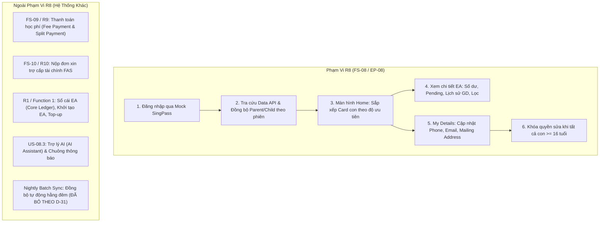
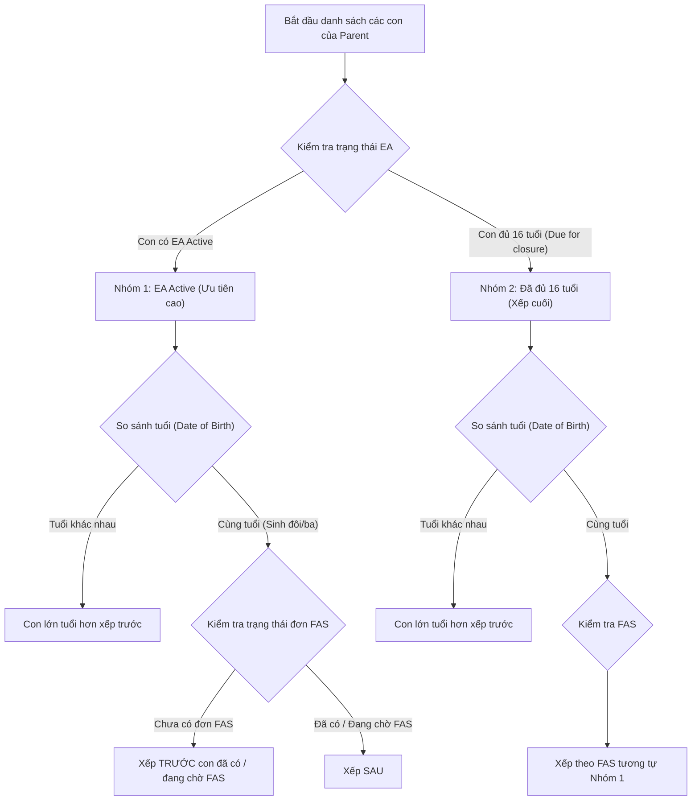

# R8: Parent Portal – SingPass, Education Account & Profile Management
## Phân Tích Nghiệp Vụ Chuyên Sâu & Ma Trận Kiểm Thử Toàn Diện (FS-08 / Epic EP-08)

> **Mã Chức Năng**: FR-08 (R8) | **Epic**: EP-08 (US-08.1, US-08.2)  
> **Dự Án**: Education Account & Financial Assistance Scheme (MOE Singapore)  
> **Tài Liệu Tham Chiếu**: FS-08 v0.4 (14/10/2026), Decision Log (D-03, D-19, D-20, D-21, D-22, D-28, D-31), Bảng `Parent_Profile`  
> **Phương Pháp Luận Áp Dụng**:  
> - `/combo-docs`: Deep Document Extraction, Source Integrity, Boundary Classification & Data Architecture  
> - `/combo-qa`: Disciplined QA Engineering, 10 QA Thinking Lenses, Black-box Rigor (EP/BVA/Decision Tables/State Transitions), Fluff Elimination & RTM

---

## MỤC LỤC
1. [Tổng Quan Kiến Trúc & Biên Phạm Vi (Scope & Architecture)](#1-tổng-quan-kiến-trúc--biên-phạm-vi)
2. [Bóc Tách Chi Tiết 3 Phân Hệ Chức Năng (FR-08.1, FR-08.2, FR-08.3)](#2-bóc-tách-chi-tiết-3-phân-hệ-chức-năng)
3. [Mô Hình Dữ Liệu & Quy Tắc Đồng Bộ (Data Flow & Sync Rules)](#3-mô-hình-dữ-liệu--quy-tắc-đồng-bộ)
4. [Bảng Quyết Định & Sơ Đồ Chuyển Trạng Thái (Decision Tables & State Transitions)](#4-bảng-quyết-định--sơ-đồ-chuyển-trạng-thái)
5. [Phân Tích Giá Trị Biên & Phân Vùng Tương Đương (BVA & EP Matrix)](#5-phân-tích-giá-trị-biên--phân-vùng-tương-đương)
6. [Danh Mục Mã Lỗi & Thông Báo Hệ Thống (Message Catalog)](#6-danh-mục-mã-lỗi--thông-báo-hệ-thống)
7. [Đánh Giá 10 Thấu Kính QA & Phát Hiện Rủi Ro (10 QA Thinking Lenses)](#7-đánh-giá-10-thấu-kính-qa--phát-hiện-rủi-ro)
8. [Ma Trận Kiểm Thử Chi Tiết (Deterministic Test Case Matrix)](#8-ma-trận-kiểm-thử-chi-tiết)
9. [Ma Trận Truy Vết Yêu Cầu (Requirements Traceability Matrix - RTM)](#9-ma-trận-truy-vết-yêu-cầu)

---

## 1. TỔNG QUAN KIẾN TRÚC & BIÊN PHẠM VI

### 1.1 Mục Đích Chức Năng
FR-08 (R8) là cổng thông tin dành cho Phụ huynh (Parent Portal) thuộc hệ thống e-Service của Bộ Giáo dục Singapore (MOE), cho phép Phụ huynh:
1. Đăng nhập an toàn qua SingPass (xác thực danh tính quốc gia).
2. Tra cứu danh sách các con liên kết và xem chi tiết Tài khoản Giáo dục (Education Account - EA), số dư khả dụng, giao dịch, và gói hỗ trợ tài chính (FAS).
3. Cập nhật thông tin liên lạc cá nhân (Số điện thoại, Email, Địa chỉ nhận thư) phục vụ việc liên lạc của nhà trường và MOE.

### 1.2 Phân Định Biên Phạm Vi (In-Scope vs. Out-of-Scope)



### 1.3 Bảng Quyết Định Thiết Kế (Decision Log Traces)
- **`D-03`**: SingPass và Data API tích hợp thông qua Mock/Sandbox trong giai đoạn Sprint 1 MVP.
- **`D-19`**: **Bình đẳng quyền hạn Phụ huynh**: Cả Cha (Father) và Mẹ (Mother) đều có quyền bình đẳng tuyệt đối. Ai đăng nhập SingPass đều thấy tất cả các con liên kết qua NRIC của mình (`FatherNric` hoặc `MotherNric`).
- **`D-20`**: **Địa chỉ cư trú bất biến**: `Residential address` chỉ đọc (read-only), được trích xuất trực tiếp từ SingPass và không cho phép người dùng tự sửa đổi.
- **`D-21`**: `Last updated` hiển thị thời điểm hệ thống đồng bộ dữ liệu Parent và con ở lần đăng nhập gần nhất (`DD/MM/YYYY HH:mm`).
- **`D-22`**: **Thời hạn phiên làm việc**: Phiên tự động hết hạn sau **15 phút không thao tác** (Inactivity Timeout), điều hướng về trang đăng nhập kèm lỗi `MSG-0002`.
- **`D-28`**: Không gửi email thông báo khi Phụ huynh cập nhật thông tin cá nhân (Email thông báo chỉ áp dụng cho giao dịch tài chính, top-up, và kết quả FAS).
- **`D-31`**: **Loại bỏ Job quét đồng bộ hằng đêm (Nightly Sync)**. Dữ liệu chỉ được làm mới On-Demand khi Parent đăng nhập thành công. Data API có timeout cứng **10 giây**. Nếu API lỗi hoặc quá 10s: trả `MSG-0809` và hủy phiên đăng nhập, giữ nguyên dữ liệu cũ.

---

## 2. BÓC TÁCH CHI TIẾT 3 PHÂN HỆ CHỨC NĂNG

### 2.1 FR-08.1: Đăng Nhập SingPass & Đồng Bộ Dữ Liệu Tức Thời (On-Demand Sync)
- **Trigger**: Phụ huynh nhấn nút `Log in with SingPass` tại Landing Page.
- **Preconditions**: Mock SingPass và Mock Data API sẵn sàng.
- **Trình tự xử lý**:
  1. SingPass xác thực người dùng, trả về: `NRIC`, `FullName`, `Residential Address`.
     - *Ngoại lệ 1*: Nếu người dùng hủy đăng nhập hoặc SingPass trả lỗi $\rightarrow$ Hiển thị `MSG-0802`, quay lại Landing Page.
  2. Hệ thống dùng `NRIC` gọi Data API với timeout 10 giây:
     - *Ngoại lệ 2*: Nếu Data API timeout (> 10s) hoặc trả lỗi 5xx $\rightarrow$ Hiển thị `MSG-0809`, ngắt đăng nhập, rollback dữ liệu.
     - *Ngoại lệ 3*: Nếu Data API không tìm thấy Parent hoặc Parent không có bất kỳ người con nào $\rightarrow$ Hiển thị `MSG-0801`, từ chối truy cập.
  3. Quản lý vòng đời tài khoản Phụ huynh:
     - **Lần đầu đăng nhập**: Tạo mới bản ghi tài khoản `UserId`, gán `IsActivate = true`, thiết lập liên kết con.
     - **Lần đăng nhập sau**: Sử dụng lại tài khoản đã có, không sinh thêm `UserId`.
  4. Quy tắc đồng bộ (Sync Rules):
     - **Đối với Phụ huynh**: Cập nhật `FullName`, `Residential Address` từ SingPass. Với `PhoneNumber`, `Email`, `Mailing Address`: chỉ lấy giá trị mặc định ở lần đầu tiên; các lần đăng nhập tiếp theo **tuyệt đối không ghi đè** dữ liệu mà Phụ huynh đã tự cập nhật trong My Details.
     - **Đối với Con**: Cập nhật `FullName`, `School`, `Class`, `DateOfBirth`, `Citizenship`. Nếu một con không còn liên kết với NRIC này trên Data API $\rightarrow$ Gỡ bỏ liên kết (unlink).
     - Ghi Audit Log cho mỗi lần đồng bộ dữ liệu.
  5. Thiết lập Session (15 phút timeout), chuyển hướng vào màn hình Home.

---

### 2.2 FR-08.2: Xem Thông Tin Tài Khoản Giáo Dục (Education Account - EA)
- **Trigger**: Phụ huynh chọn card của một người con tại Home hoặc chọn từ thanh chuyển đổi con.
- **Preconditions**: Đã đăng nhập hợp lệ, học sinh thuộc quyền giám hộ của Phụ huynh.
- **Quy tắc phân loại trạng thái học sinh & hiển thị EA**:

| Trạng Thái EA | Điều Kiện Học Sinh | Hiển Thị Giao Diện | Quyền Hạn Thao Tác |
| :--- | :--- | :--- | :--- |
| **`Active`** | Là Singapore Citizen, từ đủ 7 tuổi đến dưới 16 tuổi, đã mở EA. | Hiển thị đầy đủ Số dư khả dụng, Số tiền Pending, Khối FAS, Bảng giao dịch. | Đầy đủ quyền xem, thanh toán học phí (FS-09) và nộp đơn FAS (FS-10). |
| **`Due for closure`** | Đã **đủ 16 tuổi** (tính chính xác đến ngày sinh nhật thứ 16), EA chưa đóng. | Hiển thị số dư khả dụng, ngày đủ 16 tuổi, ngày dự kiến đóng EA, lịch sử giao dịch. | **CHỈ XEM (Read-only)**. Khóa nút thanh toán phí và khóa nộp đơn FAS. |
| **`Closed`** | Đã hoàn tất đóng tài khoản, chuyển số dư sang CPF. | Hiển thị lịch sử giao dịch lưu trữ. | Chỉ xem. |
| **`To be created`** | Là Singapore Citizen, đủ 7 tuổi nhưng hệ thống R1 chưa tạo EA. | Hiển thị thông điệp thay thế: *"Education Account not active yet."* | Không có số dư EA. |
| **`Not yet 7`** | Là Singapore Citizen, **dưới 7 tuổi**. | Hiển thị thông điệp ngày dự kiến mở EA: *"Education Account will be opened on [Child's 7th Birthday]"*. | Chưa có EA. |
| **`Not eligible`** | Không phải Singapore Citizen (Permanent Resident hoặc Foreigner). | Hiển thị câu thay thế: *"Education Accounts are for Singapore Citizens"*. | Vẫn xem được phí phát sinh và nộp đơn FAS (FS-09, FS-10). |

- **Quy tắc tính toán tài chính**:
  - **Số dư khả dụng (Available Balance)**: Chỉ tính tổng các giao dịch có trạng thái `Completed`.
  - **Số tiền chờ xử lý (Pending Amount)**: Hiển thị riêng biệt trong khung cảnh báo màu vàng; **chưa trừ** vào Available Balance.
  - **Dòng tiền trong năm (Money In / Money Out)**: Chỉ tính các giao dịch `Completed` phát sinh trong năm dương lịch hiện tại.
  - **Khối FAS (Financial Assistance Scheme)**:
    - Nếu được duyệt: Khối màu xanh hiển thị tên chương trình (ví dụ: `MOEFAS Tier 2`), mức hỗ trợ.
    - Nếu đang xét: Gắn nhãn `Under review`.
    - Nếu không có: Ẩn hoàn toàn khối này.
- **Bảng giao dịch & Bộ lọc**:
  - Cột hiển thị: Ngày giờ (`DD/MM/YYYY HH:mm`), Con (chỉ hiện khi xem chế độ All), Loại giao dịch, Mô tả (kèm mã `TXN-xxxxxx`), Số tiền (+ màu xanh cho tiền vào, - màu đen cho tiền ra), Số dư sau giao dịch (giao dịch Pending để trống), Trạng thái (`Completed`, `Pending`, `Failed`).
  - Phân trang: 20 dòng/trang, có nút Previous, Next và tổng số giao dịch.
  - Bộ lọc: Khoảng ngày (Từ ngày - Đến ngày), Loại giao dịch (`All`, `Top-up`, `Fee payment`, `Refund`, `Closure transfer`), Chiều dòng tiền (`All`, `Money in`, `Money out`).
  - Nếu kết quả lọc trống $\rightarrow$ Hiển thị `MSG-0803`.
  - Cố tình truy cập con không thuộc quyền sở hữu $\rightarrow$ Chặn và báo lỗi `MSG-0003`.

---

### 2.3 FR-08.3: Cập Nhật Thông Tin Cá Nhân (My Details)
- **Quy Tắc Khóa Quyền Tối Thượng (Age Cutoff Gate)**:
  - Phụ huynh **chỉ được phép sửa** thông tin cá nhân nếu còn **ít nhất một người con dưới 16 tuổi**.
  - Khi **tất cả các con đều đã đủ từ 16 tuổi trở lên**, màn hình My Details tự động chuyển sang chế độ **Chỉ xem (Read-only)**, ẩn nút Save.
- **Quy cách các trường dữ liệu**:

```text
┌─────────────────────────────────────────────────────────────────────────────────┐
│ FORM MY DETAILS VALIDATION SPECIFICATION                                       │
├────────────────────────┬──────────┬──────────┬─────────────┬────────────────────┤
│ Trường Thông Tin       │ Bắt Buộc │ Cho Sửa? │ Kiểu Dữ Liệu│ Quy Tắc Kiểm Tra   │
├────────────────────────┼──────────┼──────────┼─────────────┼────────────────────┤
│ Full Name              │ N/A      │ KHÔNG    │ Text        │ Nguồn từ SingPass  │
│ NRIC                   │ N/A      │ KHÔNG    │ Text        │ Nguồn từ SingPass  │
│ Residential Address    │ N/A      │ KHÔNG    │ Text        │ Nguồn từ SingPass  │
│ Mobile Number          │ CÓ       │ CÓ       │ Text        │ Đúng 8 chữ số,     │
│                        │          │          │             │ bắt đầu bằng 6,8,9 │
│ Email                  │ CÓ       │ CÓ       │ Text        │ Regex email chuẩn, │
│                        │          │          │             │ tối đa 150 ký tự   │
│ Mailing Block, Unit    │ KHÔNG    │ CÓ       │ Text        │ Tối đa 20 ký tự    │
│ Mailing Street         │ CÓ       │ CÓ       │ Text        │ Tối đa 100 ký tự   │
│ Mailing Postal Code    │ CÓ       │ CÓ       │ Text        │ Đúng 6 chữ số      │
│ Mailing Country        │ CÓ       │ CÓ       │ Text        │ Tối đa 100 ký tự   │
└────────────────────────┴──────────┴──────────┴─────────────┴────────────────────┘
```
- **Xử lý phản hồi**:
  - Bỏ trống trường bắt buộc: Hiển thị `MSG-0001` (`Enter your <field>`) dưới từng trường vi phạm.
  - Sai định dạng Mobile: Báo lỗi `MSG-0805`.
  - Sai định dạng Email: Báo lỗi `MSG-0806`.
  - Lưu thành công: Báo `MSG-0807`, ghi Audit Log (Trường, Giá trị cũ, Giá trị mới, Người sửa, Thời điểm). **Không gửi email** thông báo (D-28).
  - Lỗi hệ thống khi lưu: Báo `MSG-0808`, giữ nguyên dữ liệu cũ.

---

### 2.4 Thuật Toán Sắp Xếp Card Học Sinh Tại Màn Hình Home (Mục 6.1)



---

## 3. MÔ HÌNH DỮ LIỆU & QUY TẮC ĐỒNG BỘ

### 3.1 Cấu Trúc Bảng `Parent_Profile` (Database Schema)
Bảng trung tâm lưu trữ thông tin Phụ huynh và liên kết với học sinh qua `Student_Profile.FatherNric` hoặc `Student_Profile.MotherNric`:

| Tên Cột | Kiểu Dữ Liệu | Quyền Sửa | Nguồn Gốc Dữ Liệu | Diễn Giải Nghiệp Vụ |
| :--- | :--- | :--- | :--- | :--- |
| `Id` | `UUID` | Không | Hệ thống sinh | Khóa chính duy nhất |
| `Code` | `NVARCHAR(50)` | Không | Hệ thống sinh | Mã hồ sơ nghiệp vụ |
| `UserId` | `VARCHAR(50)` | Không | Hệ thống sinh | Định danh tài khoản đăng nhập |
| `Nric` | `VARCHAR(9)` | Không | SingPass | Số định danh công dân của Parent |
| `FullName` | `NVARCHAR(150)` | Không | SingPass | Họ và tên đầy đủ |
| `PhoneNumber` | `VARCHAR(20)` | **Có** | Người dùng nhập | Số điện thoại di động liên lạc |
| `Email` | `NVARCHAR(150)` | **Có** | Người dùng nhập | Địa chỉ hòm thư điện tử liên lạc |
| `ResidentialBlock` | `NVARCHAR(20)` | Không | SingPass | Block địa chỉ cư trú (Read-only) |
| `ResidentialStreet` | `NVARCHAR(100)` | Không | SingPass | Đường cư trú (Read-only) |
| `ResidentialUnit` | `NVARCHAR(20)` | Không | SingPass | Căn hộ cư trú (Read-only) |
| `ResidentialPostalCode`| `VARCHAR(10)` | Không | SingPass | Mã bưu chính cư trú (Read-only) |
| `ResidentialCountry` | `NVARCHAR(100)` | Không | SingPass | Quốc gia cư trú (Read-only) |
| `MailingBlock` | `NVARCHAR(20)` | **Có** | Người dùng nhập | Block địa chỉ nhận thư |
| `MailingStreet` | `NVARCHAR(100)` | **Có** | Người dùng nhập | Đường nhận thư |
| `MailingUnit` | `NVARCHAR(20)` | **Có** | Người dùng nhập | Căn hộ nhận thư |
| `MailingPostalCode` | `VARCHAR(10)` | **Có** | Người dùng nhập | Mã bưu chính nhận thư |
| `MailingCountry` | `NVARCHAR(100)` | **Có** | Người dùng nhập | Quốc gia nhận thư |
| `IsActivate` | `BOOLEAN` | Không | Hệ thống | Trạng thái kích hoạt (luôn true sau login 1st) |
| `CreatedAt` / `UpdatedAt` | `TIMESTAMP` | Không | Hệ thống | Dấu thời gian tạo và cập nhật |
| `CreatedBy` / `UpdatedBy` | `VARCHAR(50)` | Không | Hệ thống | Người tạo / sửa bản ghi |

---

## 4. BẢNG QUYẾT ĐỊNH & SƠ ĐỒ CHUYỂN TRẠNG THÁI

### 4.1 Bảng Quyết Định 1: Đăng Nhập & Đồng Bộ Dữ Liệu (Login & Sync Decision Table)

| Điều Kiện / Yếu Tố Đầu Vào | R1 | R2 | R3 | R4 | R5 | R6 |
| :--- | :---: | :---: | :---: | :---: | :---: | :---: |
| Trạng thái SingPass Auth | Thành công | Hủy/Lỗi | Thành công | Thành công | Thành công | Thành công |
| Trạng thái Mock Data API | Thành công | Bất kỳ | Timeout >10s | Lỗi 500 | Thành công | Thành công |
| Tìm thấy Parent trên Data API? | Có | N/A | N/A | N/A | Không | Có |
| Số lượng con liên kết tìm thấy | $\ge 1$ | N/A | N/A | N/A | 0 | 0 |
| Trạng thái tài khoản hệ thống | Lần đầu / Đã có | Bất kỳ | Bất kỳ | Bất kỳ | Bất kỳ | Bất kỳ |
| **KẾT QUẢ / HÀNH ĐỘNG HỆ THỐNG** | | | | | | |
| Tạo mới `UserId` (nếu lần đầu) | **X** | - | - | - | - | - |
| Dùng lại `UserId` (nếu lần 2+) | **X** | - | - | - | - | - |
| Cập nhật FullName & Residential | **X** | - | - | - | - | - |
| Giữ nguyên Phone/Email đã sửa | **X** | - | - | - | - | - |
| Cập nhật thông tin con (lớp/trường)| **X** | - | - | - | - | - |
| Chuyển hướng vào màn hình Home | **X** | - | - | - | - | - |
| Báo lỗi `MSG-0802` | - | **X** | - | - | - | - |
| Báo lỗi `MSG-0809` (Giữ nguyên DB)| - | - | **X** | **X** | - | - |
| Báo lỗi `MSG-0801` (Từ chối truy cập)| - | - | - | - | **X** | **X** |

---

### 4.2 Bảng Quyết Định 2: Quyền Hạn Thao Tác Theo Tuổi & Quốc Tịch Của Con

| Điều Kiện Học Sinh | R1: Con < 7 tuổi | R2: Con 7-15 tuổi | R3: Đúng 16 tuổi | R4: > 16 tuổi | R5: Con Non-Citizen |
| :--- | :---: | :---: | :---: | :---: | :---: |
| Quốc tịch Singapore Citizen? | Có | Có | Có | Có | **Không** |
| Tuổi thực tế tại thời điểm xem | Tuổi < 7 | $7 \le \text{Tuổi} < 16$ | Đúng sinh nhật 16 | Tuổi > 16 | Bất kỳ ($<16$ hoặc $\ge 16$) |
| Trạng thái hiển thị EA | `Not yet 7` | `Active` | `Due for closure` | `Due for closure`/`Closed` | `Not eligible` |
| Xem Số Dư & Chi Tiết Giao Dịch | Ẩn số dư | **Hiển thị đầy đủ** | **Hiển thị đầy đủ** | **Hiển thị đầy đủ** | Ẩn số dư (câu thay thế) |
| Thanh Toán Học Phí (FS-09) | Khóa | **Cho phép** | **KHÓA (Chỉ xem)** | **KHÓA (Chỉ xem)** | Cho phép qua Online |
| Nộp Đơn Trợ Cấp FAS (FS-10) | Khóa | **Cho phép** | **KHÓA** | **KHÓA** | Cho phép nếu đủ ĐK |
| Cho Phép Parent Sửa My Details | **Cho phép** | **Cho phép** | Chỉ khi còn con khác <16 | Chỉ khi còn con khác <16 | Cho phép nếu tuổi <16 |

---

## 5. PHÂN TÍCH GIÁ TRỊ BIÊN & PHÂN VÙNG TƯƠNG ĐƯƠNG (BVA & EP MATRIX)

### 5.1 Trường Số Điện Thoại (`Mobile Number`)
- **Quy tắc**: Chuỗi ký tự số, đúng 8 chữ số, bắt đầu bằng 6, 8 hoặc 9.

| Kỹ Thuật | Giá Trị Kiểm Thử | Phân Loại | Kết Quả Mong Đợi |
| :--- | :--- | :--- | :--- |
| **BVA (Độ dài)** | `""` (Rỗng / 0 ký tự) | Invalid | Báo lỗi `MSG-0001` (Bắt buộc nhập) |
| **BVA (Độ dài)** | `"9123456"` (7 ký tự số) | Invalid | Báo lỗi `MSG-0805` (Sai định dạng) |
| **BVA (Độ dài)** | `"91234567"` (8 ký tự số) | **Valid** | Hợp lệ, cho phép lưu |
| **BVA (Độ dài)** | `"912345678"` (9 ký tự số) | Invalid | Báo lỗi `MSG-0805` (Sai định dạng) |
| **EP (Ký tự đầu)**| `"61234567"` (Bắt đầu bằng 6)| **Valid** | Hợp lệ, cho phép lưu |
| **EP (Ký tự đầu)**| `"81234567"` (Bắt đầu bằng 8)| **Valid** | Hợp lệ, cho phép lưu |
| **EP (Ký tự đầu)**| `"91234567"` (Bắt đầu bằng 9)| **Valid** | Hợp lệ, cho phép lưu |
| **EP (Ký tự đầu)**| `"51234567"` (Bắt đầu bằng 5)| Invalid | Báo lỗi `MSG-0805` |
| **EP (Ký tự đầu)**| `"71234567"` (Bắt đầu bằng 7)| Invalid | Báo lỗi `MSG-0805` |
| **EP (Chứa chữ)** | `"9123456a"` | Invalid | Báo lỗi `MSG-0805` |

---

### 5.2 Trường Email (`Email Address`)
- **Quy tắc**: Định dạng chuẩn `name@example.com`, độ dài tối đa 150 ký tự.

| Kỹ Thuật | Giá Trị Kiểm Thử | Phân Loại | Kết Quả Mong Đợi |
| :--- | :--- | :--- | :--- |
| **BVA (Rỗng)** | `""` | Invalid | Báo lỗi `MSG-0001` |
| **BVA (Độ dài)** | Chuỗi 149 ký tự hợp lệ (`a...a@moe.gov.sg`) | **Valid** | Hợp lệ |
| **BVA (Độ dài)** | Chuỗi đúng 150 ký tự hợp lệ | **Valid** | Hợp lệ |
| **BVA (Độ dài)** | Chuỗi 151 ký tự | Invalid | Hệ thống chặn nhập hoặc báo lỗi `MSG-0806` |
| **EP (Format)** | `"parent@example.com"` | **Valid** | Hợp lệ |
| **EP (Format)** | `"parent.test+1@domain.com.sg"` | **Valid** | Hợp lệ |
| **EP (Format)** | `"parent@"` hoặc `"parent.com"` (Thiếu domain/@) | Invalid | Báo lỗi `MSG-0806` |

---

### 5.3 Trường Địa Chỉ Nhận Thư (`Mailing Address Fields`)

| Trường | Bắt Buộc | Giới Hạn Biên | Giá Trị Hợp Lệ | Giá Trị Biên Lỗi | Mã Lỗi |
| :--- | :---: | :---: | :---: | :---: | :---: |
| `Mailing Street` | CÓ | Max 100 chars | 1 char, 100 chars | Rỗng (`""`), 101 chars | `MSG-0001` (khi rỗng) |
| `Mailing Postal Code`| CÓ | Đúng 6 chữ số | `"560123"` | Rỗng, 5 số (`"56012"`), 7 số (`"5601234"`), Chứa chữ (`"56012A"`) | `MSG-0001` (khi rỗng) |
| `Mailing Country` | CÓ | Max 100 chars | `"Singapore"` (1-100 chars)| Rỗng (`""`), 101 chars | `MSG-0001` (khi rỗng) |
| `Mailing Block` | KHÔNG | Max 20 chars | Rỗng, 20 chars | 21 chars | Bị truncate hoặc chặn |
| `Mailing Unit` | KHÔNG | Max 20 chars | Rỗng, 20 chars | 21 chars | Bị truncate hoặc chặn |

---

### 5.4 Biên Tuổi Học Sinh (Age Boundaries: 7 tuổi & 16 tuổi)

```text
       Dưới 7 tuổi                 Từ 7 đến dưới 16 tuổi                  Đủ 16 tuổi trở lên
 ─────────────────────────┼────────────────────────────────────────┼───────────────────────────►
  Trạng thái: Not yet 7    │ Trạng thái: Active                     │ Trạng thái: Due for closure
  (6 tuổi 364 ngày)       │ (Đúng sinh nhật 7 tuổi -> 15 tuổi 364d)│ (Đúng sinh nhật 16 tuổi)
  Chưa có EA               │ Full quyền EA, Fees, FAS               │ Chỉ xem (Khóa Pay & FAS)
```

- **Điểm biên 7 tuổi**:
  - `Sinh nhật 7 tuổi - 1 ngày`: Hiển thị trạng thái `Not yet 7`, thông điệp ngày dự kiến mở.
  - `Đúng sinh nhật 7 tuổi`: Chuyển trạng thái `Active`, kích hoạt số dư EA.
- **Điểm biên 16 tuổi**:
  - `Sinh nhật 16 tuổi - 1 ngày`: Trạng thái `Active`, được thanh toán phí và nộp FAS.
  - `Đúng sinh nhật 16 tuổi`: Ngay lập tức chuyển sang trạng thái `Due for closure`. Hiển thị nhãn chỉ xem, **vô hiệu hóa nút thanh toán và nút nộp FAS**.

---

## 6. DANH MỤC MÃ LỖI & THÔNG BÁO HỆ THỐNG (MESSAGE CATALOG)

| Mã Thông Điệp | Nội Dung Thông Báo (Tiếng Anh Chuẩn) | Điều Kiện Kích Hoạt | Vị Trí Hiển Thị |
| :--- | :--- | :--- | :--- |
| **`MSG-0001`** | `"Enter your <field>"` | Người dùng bỏ trống trường bắt buộc trong My Details. | Ngay dưới ô input tương ứng |
| **`MSG-0002`** | `"Your session has expired. Please log in again."` | Người dùng không tương tác trong vòng 15 phút. | Banner tại trang Đăng nhập |
| **`MSG-0003`** | `"You do not have permission to perform this action."` | Truy cập URL xem con hoặc tài khoản EA không thuộc về mình. | Modal cảnh báo / Trang Access Denied |
| **`MSG-0801`** | `"We could not find any student linked to your account. Please contact your child's school."` | SingPass trả về NRIC hợp lệ nhưng Data API không tìm thấy Parent hoặc không có con nào liên kết. | Banner tại trang Đăng nhập (Chặn vào Home) |
| **`MSG-0802`** | `"Login was not completed. Try again."` | SingPass gặp lỗi kỹ thuật hoặc người dùng chủ động bấm Hủy (Cancel). | Banner tại trang Đăng nhập |
| **`MSG-0803`** | `"No transactions found."` | Áp dụng bộ lọc giao dịch nhưng không có bản ghi nào khớp. | Dòng trống trong bảng Giao dịch |
| **`MSG-0804`** | `"This student does not have an Education Account."` | Học sinh là công dân đủ điều kiện nhưng chưa có tài khoản EA. | Khung thông tin EA |
| **`MSG-0805`** | `"Enter a mobile number in the correct format, like 9123 4567"` | Nhập sai định dạng số điện thoại Singapore (không đủ 8 số hoặc không bắt đầu 6,8,9). | Dưới trường Mobile number |
| **`MSG-0806`** | `"Enter an email address in the correct format, like name@example.com"` | Nhập sai định dạng email hoặc vượt quá 150 ký tự. | Dưới trường Email |
| **`MSG-0807`** | `"Your details have been updated."` | Lưu thành công thông tin cá nhân trong My Details. | Toast notification xanh thành công |
| **`MSG-0808`** | `"We could not update your details. Please try again."` | Lỗi cơ sở dữ liệu hoặc hệ thống khi lưu My Details. | Banner lỗi, giữ nguyên giá trị form cũ |
| **`MSG-0809`** | `"We could not retrieve your information. Please try again later."` | Data API bị lỗi, timeout quá 10 giây hoặc cập nhật dữ liệu thất bại khi đăng nhập. | Banner tại trang Đăng nhập, giữ nguyên DB |

---

## 7. ĐÁNH GIÁ 10 THẤU KÍNH QA & PHÁT HIỆN RỦI RO (10 QA THINKING LENSES)

1. **Happy Path Lens**: Parent đăng nhập Singpass thành công, API trả đủ dữ liệu con $\rightarrow$ Đồng bộ dữ liệu mượt mà, hiển thị đúng card Home theo thứ tự ưu tiên.
2. **Negative Lens**: Parent đã xác thực Singpass thành công nhưng NRIC không tồn tại trong hệ thống giáo dục $\rightarrow$ Đảm bảo không cho phép tạo tài khoản "ma" hoặc rỗng, kích hoạt đúng `MSG-0801`.
3. **Boundary Lens**: Con vừa tròn 16 tuổi đúng ngày hôm nay $\rightarrow$ Kiểm tra việc chuyển dịch trạng thái tức thì sang `Due for closure` và khóa các hành động thanh toán.
4. **Data Integrity Lens**: Parent đã sửa số điện thoại thành công ở lần đăng nhập trước, khi đăng nhập lại $\rightarrow$ Tuyệt đối không để Data API bên ngoài ghi đè lại số điện thoại cũ.
5. **State Transition Lens**: Parent có 2 con (1 con 15 tuổi, 1 con 16 tuổi). Con 15 tuổi tròn 16 tuổi $\rightarrow$ Trạng thái form My Details phải chuyển từ "Cho phép sửa" sang "Chỉ xem (Read-only)".
6. **Sequence & Concurrency Lens**: Cả Cha và Mẹ cùng đăng nhập SingPass đồng thời vào hệ thống $\rightarrow$ Cả hai đều xem được thông tin con bình đẳng (D-19), không xảy ra race condition khi đồng bộ dữ liệu.
7. **Dependencies Lens**: Mock Data API phản hồi trễ 10.5 giây $\rightarrow$ Client phải ngắt kết nối đúng ngưỡng timeout 10 giây và bắn thông báo `MSG-0809`.
8. **Permissions & Security Lens**: Phụ huynh copy đường link xem EA của con nhà người khác (`/ea/details?studentId=OTHER_STUDENT_ID`) $\rightarrow$ Backend phải chặn với `MSG-0003`, không để lộ thông tin qua URL.
9. **Failure & Recovery Lens**: Quá trình cập nhật dữ liệu học sinh trong DB bị sập giữa chừng $\rightarrow$ Giao dịch DB phải Rollback toàn bộ, người dùng nhận `MSG-0809`, dữ liệu cũ được giữ nguyên trạng thái nhất quán.
10. **Business Risk Lens**: Giao dịch thanh toán online Pending bị nhầm lẫn tính trừ vào số dư EA $\rightarrow$ Đảm bảo số dư khả dụng độc lập, Pending chỉ hiển thị cảnh báo vàng.

---

## 8. MA TRẬN KIỂM THỬ CHI TIẾT (DETERMINISTIC TEST CASE MATRIX)

| TC_ID | Objective | Preconditions | Test Data | Steps | Expected Observable Result | Technique | Suite | Priority |
| :--- | :--- | :--- | :--- | :--- | :--- | :--- | :--- | :--- |
| TC-PAR-001 | Verify first-time SingPass login creates user and links children | Parent has never logged in; Data API contains NRIC and 2 children | NRIC: S1234567A, 2 children (age 10, 12) | 1. Click Log in with SingPass.<br>2. Select account S1234567A.<br>3. Confirm login. | HTTP 200; UserId created in Parent_Profile with IsActivate=true; Home page renders 2 child cards; Last updated shows current timestamp. | DecisionTable | Smoke | Critical |
| TC-PAR-002 | Verify subsequent SingPass login reuses existing account without duplication | Parent already exists in DB | NRIC: S1234567A | 1. Log in via SingPass for second time with same NRIC. | HTTP 200; Redirect to Home; UserId unchanged; No duplicate records created in Parent_Profile. | StateTransition | Sprint | Critical |
| TC-PAR-003 | Verify rejection when Parent is not found in Data API or has 0 children | SingPass auth OK; Data API returns 0 linked children | NRIC: S9999999Z, children: [] | 1. Log in with SingPass using NRIC S9999999Z. | Entry blocked; Error banner displays MSG-0801; No Parent_Profile created. | ErrorGuessing | Sprint | Critical |
| TC-PAR-004 | Verify Father and Mother have equal rights to view shared children | Child linked to both FatherNric and MotherNric in DB | Father: S1111111A, Mother: S2222222B, Child: T0123456C | 1. Father logs in via SingPass, verify child card.<br>2. Mother logs in via SingPass, verify child card. | Both Father and Mother see student T0123456C card with identical permissions per D-19. | DecisionTable | Sprint | High |
| TC-PAR-005 | Verify handling when SingPass login fails or user cancels | At Landing page | Click Cancel on SingPass Mock | 1. Click Log in with SingPass.<br>2. Click Cancel button on SingPass page. | Redirected to Landing page; Warning banner displays MSG-0802; No session token generated. | ErrorGuessing | Regression | High |
| TC-PAR-006 | Verify Data API timeout exceeding 10 seconds aborts login | Mock Data API configured with 11s response latency | NRIC: S1234567A | 1. Click Log in with SingPass.<br>2. Await response. | Connection aborts at exactly 10s; Error banner displays MSG-0809; Home blocked; DB state unchanged. | BVA | SIT | Critical |
| TC-PAR-007 | Verify child card sorting priority on Home screen | Parent has 3 children: 16yo, 14yo (no FAS), 14yo (with FAS) | Child A (16yo), Child B (14yo, no FAS), Child C (14yo, MOEFAS) | 1. Log in and observe order of child cards at Home. | Card Child B (14yo, no FAS) ranked 1st; Card Child C (14yo, FAS) ranked 2nd; Card Child A (16yo, Due for closure) ranked last. | DecisionTable | Sprint | High |
| TC-PAR-008 | Verify child card display when having more than 3 outstanding fees | Child has 5 outstanding fee invoices | 5 unpaid fee invoices | 1. View child card on Home screen. | Card displays 3 nearest due fees, badge +2 more, and clickable All fees button. | BVA | Sprint | Medium |
| TC-PAR-009 | Verify child card display when having zero outstanding fees | Child has paid all school fees | 0 outstanding invoices | 1. View child card on Home screen. | Fee section displays text Nothing to pay right now. | EP | Sprint | Low |
| TC-PAR-010 | Verify EA details display for active child aged 7 to 15 | Child is Singapore Citizen aged 10 with active EA | Student: 10yo, Citizen, Available Balance: SGD 500.00 | 1. Click child card to navigate to Education Account page. | Status badge displays Active; Available balance displays SGD 500.00; Transaction table and filters rendered. | EP | Smoke | Critical |
| TC-PAR-011 | Verify EA transitions to Due for closure on exact 16th birthday | Child reaches exactly 16 years old today | DOB: 15/10/2010 (Current Date: 15/10/2026) | 1. Open EA details for child turning 16 today. | Status badge displays Due for closure; Displays 16th birthday and closure date; Fee payment and FAS buttons disabled. | BVA | Sprint | Critical |
| TC-PAR-012 | Verify independent permission enforcement across children of different ages | Parent has one child aged 14 and one child aged 16 | Child 1: 14yo, Child 2: 16yo | 1. Check Child 1 permissions.<br>2. Check Child 2 permissions. | Child 1 retains full payment and FAS privileges; Child 2 restricted to read-only mode. | DecisionTable | Sprint | High |
| TC-PAR-013 | Verify EA screen display when child is under 7 years old | Child is Singapore Citizen aged 6 years and 364 days | DOB: 16/10/2019 (Turns 7 tomorrow) | 1. View EA screen for child under 7. | Status displays Not yet 7; Available balance hidden; Banner shows opening date 16/10/2026. | BVA | Sprint | High |
| TC-PAR-014 | Verify EA screen display for non-Singapore Citizen child | Child is Permanent Resident (PR) or Foreigner | Citizenship: Non-Citizen | 1. View EA screen for non-citizen child. | Status displays Not eligible; Balance hidden; Banner displays Education Accounts are for Singapore Citizens. | EP | Sprint | High |
| TC-PAR-015 | Verify pending online transaction displays in yellow block without reducing available balance | Child has online transaction in Pending state of SGD 50.00 | Completed Balance: SGD 200.00, Pending: SGD 50.00 | 1. Open EA page and inspect balance cards and transaction list. | Available balance remains SGD 200.00; SGD 50.00 displayed in separate yellow Pending card; Pending row has empty Balance after. | DecisionTable | Sprint | Critical |
| TC-PAR-016 | Verify transaction filter empty state handling | Child has 10 transactions but 0 of type Refund | Filter Type: Refund | 1. Select Type = Refund.<br>2. Click Apply filter. | Transaction table renders empty state message MSG-0803 (No transactions found.). | ErrorGuessing | Regression | Medium |
| TC-PAR-017 | Verify transaction table pagination controls | Child has 25 completed transactions | 25 transaction records in DB | 1. Open EA page.<br>2. Inspect Page 1.<br>3. Click Next button. | Page 1 renders exactly 20 newest transactions; Page 2 renders remaining 5 transactions; Total count shows 25. | BVA | Regression | Medium |
| TC-PAR-018 | Verify IDOR protection when attempting to view another parents child | Parent A logged in; Student X belongs to Parent B | Direct URL: /ea?studentId=STUDENT_X_ID | 1. Enter direct URL of unlinked student into browser address bar. | HTTP 403 Forbidden; Access denied modal displays MSG-0003; Student X data not leaked. | ErrorGuessing | SIT | Critical |
| TC-PAR-019 | Verify residential address from SingPass is strictly read-only | Parent at My Details screen | Field: Residential Address | 1. Navigate to My details.<br>2. Attempt to type or modify Residential Address input. | Input contains readonly attribute; Keystrokes ignored; Value matches SingPass per D-20. | Structural | Sprint | Medium |
| TC-PAR-020 | Verify updating valid mobile number email and mailing address | Parent has active child aged 10 | Mobile: 91234567, Email: parent@test.com, Postal: 560123 | 1. Update Mobile, Email, and Mailing fields.<br>2. Click Save. | Green toast notification MSG-0807; DB updated with audit log entry; Zero notification emails dispatched per D-28. | EP | Smoke | Critical |
| TC-PAR-021 | Verify edited contact details are not overwritten by Data API on next login | Parent previously updated Mobile to 98888888 | Data API returns initial Mobile 91111111 | 1. Log out.<br>2. Log back in via SingPass.<br>3. Inspect My Details. | Mobile number retains user-edited value 98888888; Overwrite prevented per FR-08.1. | StateTransition | Regression | Critical |
| TC-PAR-022 | Verify child profile sync updates when changed in Data API | Child transferred from Class 4A to Class 5B in Data API | Data API payload Class: 5B | 1. Parent logs into portal.<br>2. Check child card at Home screen. | Child card displays updated class 5B; Last updated timestamp reflects current login. | DecisionTable | SIT | High |
| TC-PAR-023 | Verify mandatory field validation in My Details | Mandatory fields blanked out | Mobile: "", Mailing Street: "", PostalCode: "" | 1. Clear mandatory inputs.<br>2. Click Save. | Form submission blocked; Inline field error displays MSG-0001 (Enter your <field>) under each blank field. | BVA | Sprint | High |
| TC-PAR-024 | Verify mobile number validation format rejection | Invalid mobile numbers | Mobile: 51234567 (starts with 5), 9123456 (7 digits) | 1. Enter invalid mobile numbers.<br>2. Click Save. | Form submission blocked; Inline error displays MSG-0805; DB unchanged. | EP | Sprint | High |
| TC-PAR-025 | Verify email validation format rejection | Invalid email string | Email: invalid_email_no_at.com | 1. Enter invalid email string.<br>2. Click Save. | Form submission blocked; Inline error displays MSG-0806; DB unchanged. | EP | Sprint | High |
| TC-PAR-026 | Verify My Details transitions to read-only when all children are 16 or older | Parent has only 1 child who has reached 16yo | All linked children >= 16yo | 1. Navigate to My details page. | All form input fields disabled; Save button hidden; Form operates in read-only mode. | StateTransition | Sprint | Critical |
| TC-PAR-027 | Verify automatic session logout after 15 minutes of inactivity | Inactive on portal for 15 minutes | Inactivity time: 15m 1s | 1. Log in.<br>2. Remain idle without mouse or key events for 15 minutes. | Session invalidated; Browser redirected to Landing page displaying MSG-0002 per D-22. | BVA | Regression | High |
| TC-PAR-028 | Verify system error handling during My Details save failure | DB connection glitch during Save operation | Valid profile payload | 1. Click Save.<br>2. Inject 500 error on profile update API. | Error banner displays MSG-0808; Form preserves input values without crashing page. | ErrorGuessing | Regression | Medium |
| TC-PAR-029 | Verify full NRIC is never exposed in browser URL query parameters | Navigating between Home, EA, and My Details | Parent NRIC: S1234567A | 1. Navigate through all portal routes.<br>2. Inspect browser URL address bar. | Full NRIC string does not appear in URL paths or query strings. | Structural | SIT | High |
| TC-PAR-030 | Verify system data remains unchanged when Parent has not logged in | Parent has not logged in for 3 days; Data API changed | Unlogged Parent | 1. Do not log in.<br>2. Inspect internal DB records. | Internal DB records remain unchanged, confirming absence of nightly sync jobs per D-31. | StateTransition | SIT | Medium |

---

## 9. MA TRẬN TRUY VẾT YÊU CẦU (REQUIREMENTS TRACEABILITY MATRIX - RTM)

Đối soát 100% Tiêu chí nghiệm thu (Acceptance Criteria 1 đến 28 trong FS-08) với Bộ Test Cases tương ứng:

| Tiêu Chí Nghiệm Thu (FS-08 AC) | Mô Tả Nghiệp Vụ Của Tiêu Chí | Mã Test Case Bao Phủ (TC_ID) | Đánh Giá Độ Bao Phủ |
| :---: | :--- | :--- | :---: |
| **AC-01** | Đăng nhập SingPass lần đầu: tạo tài khoản, sync dữ liệu con, vào Home | `TC-R8-001` | **100% Covered** |
| **AC-02** | Đăng nhập lần 2: dùng lại tài khoản, không tạo thêm bản ghi | `TC-R8-002` | **100% Covered** |
| **AC-03** | NRIC không có trong Data API hoặc Parent không có con: báo `MSG-0801` | `TC-R8-003` | **100% Covered** |
| **AC-04** | Cha và Mẹ cùng đăng nhập thấy con và quyền như nhau (D-19) | `TC-R8-004` | **100% Covered** |
| **AC-05** | SingPass lỗi hoặc hủy: báo `MSG-0802`, về Landing page | `TC-R8-005` | **100% Covered** |
| **AC-06** | Mở EA của con có EA: thấy số dư và giao dịch mới nhất trước | `TC-R8-010` | **100% Covered** |
| **AC-07** | Con 14t dùng bình thường; con 16t chỉ xem, khóa thanh toán và nộp FAS | `TC-R8-011`, `TC-R8-012` | **100% Covered** |
| **AC-08** | Con 16 tuổi: vẫn xem EA, phí, lịch sử giao dịch và My details | `TC-R8-011` | **100% Covered** |
| **AC-09** | Tất cả các con đã đủ 16 tuổi: My details chỉ xem, không sửa được | `TC-R8-026` | **100% Covered** |
| **AC-10** | Con không phải công dân: hiển thị câu thay thế theo Bảng 6.2 | `TC-R8-014` | **100% Covered** |
| **AC-11** | Lọc giao dịch không có kết quả: hiển thị `MSG-0803` | `TC-R8-016` | **100% Covered** |
| **AC-12** | Thứ tự card Home: Con Active xếp trước, con 16t xếp cuối, con lớn tuổi xếp trước | `TC-R8-007` | **100% Covered** |
| **AC-13** | Mở EA của con không thuộc quyền sở hữu: chặn và báo `MSG-0003` | `TC-R8-018` | **100% Covered** |
| **AC-14** | Sửa Phone, Email, Mailing hợp lệ: lưu, báo `MSG-0807`, ghi Audit, không gửi mail | `TC-R8-020` | **100% Covered** |
| **AC-15** | Phone hoặc Email sai định dạng: báo `MSG-0805` hoặc `MSG-0806`, không lưu | `TC-R8-024`, `TC-R8-025` | **100% Covered** |
| **AC-16** | Bỏ trống trường bắt buộc: báo `MSG-0001` theo từng trường | `TC-R8-023` | **100% Covered** |
| **AC-17** | Lưu bị lỗi hệ thống: báo `MSG-0808`, dữ liệu giữ nguyên | `TC-R8-028` | **100% Covered** |
| **AC-18** | Thử sửa Residential Address: trường chỉ đọc, không sửa được (D-20) | `TC-R8-019` | **100% Covered** |
| **AC-19** | Có hơn 3 khoản phí cần trả: card Home hiện 3 khoản gần hạn nhất và `+N more` | `TC-R8-008` | **100% Covered** |
| **AC-20** | Không thao tác 15 phút: tự động đăng xuất, báo `MSG-0002` (D-22) | `TC-R8-027` | **100% Covered** |
| **AC-21** | Con đổi thông tin trên Data API, Parent đăng nhập lại: Home hiện thông tin mới | `TC-R8-022` | **100% Covered** |
| **AC-22** | Parent đã sửa Phone, đăng nhập lại: Phone giữ giá trị đã sửa, không bị ghi đè | `TC-R8-021` | **100% Covered** |
| **AC-23** | Data API lỗi hoặc quá 10s khi đăng nhập: báo `MSG-0809`, giữ nguyên DB | `TC-R8-006` | **100% Covered** |
| **AC-24** | Parent chưa đăng nhập: dữ liệu không bị thay đổi (không chạy batch hằng đêm) | `TC-R8-030` | **100% Covered** |
| **AC-25** | Con có giao dịch Pending: hiện khung vàng riêng, số dư khả dụng chưa trừ | `TC-R8-015` | **100% Covered** |
| **AC-26** | Con đủ 16 tuổi: trạng thái `Due for closure`, hiện ngày đủ 16t và ngày đóng | `TC-R8-011` | **100% Covered** |
| **AC-27** | Con có FAS duyệt: khối xanh ghi tier; chưa có FAS: ẩn khối | `TC-R8-007`, `TC-R8-010` | **100% Covered** |
| **AC-28** | Xem danh sách giao dịch, lọc Refund, bấm View fee liên kết sang FS-09 | `TC-R8-016`, `TC-R8-017` | **100% Covered** |

---

## 10. KẾT LUẬN & ĐÁNH GIÁ CHẤT LƯỢNG (QA AUDIT SIGN-OFF)

1. **Tính Toàn Vẹn Của Yêu Cầu (Source Integrity)**: Toàn bộ 28 Tiêu chí nghiệm thu, 3 phân nhánh nghiệp vụ và 12 mã thông điệp lỗi của FS-08 đã được trích xuất chính xác, liên kết chặt chẽ với các quyết định kiến trúc (`D-19`, `D-20`, `D-22`, `D-31`).
2. **Loại Bỏ Hoàn Toàn Nhận Định Mơ Hồ (Zero Fluff)**: Tất cả các trường kiểm tra đều có giá trị biên rõ ràng (BVA 8 số cho Phone, 150 ký tự cho Email, timeout 10 giây cho Data API, 15 phút cho Session).
3. **Sẵn Sàng Cho Tự Động Hóa (Automation Readiness)**: Bộ Test Case tuân thủ tuyệt đối quy chuẩn 5 Invariants của dự án, sẵn sàng chuyển ngữ trực tiếp sang kịch bản kiểm thử Playwright / pytest tại `tests/us08_parent_portal/`.
