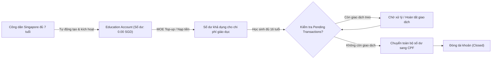
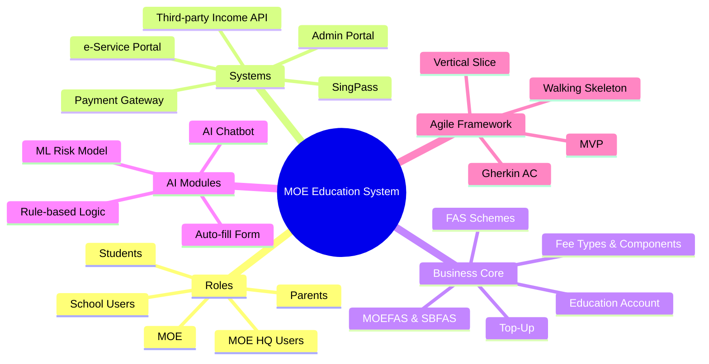

# BÁO CÁO TỔNG HỢP BIÊN BẢN HỌP, QUYẾT ĐỊNH DỰ ÁN VÀ THUẬT NGỮ CHUYÊN NGÀNH
## (MEETINGS, TRANSCRIPTS, CLIENT DECISIONS LOG & AGILE GLOSSARY)

---

> **Dự án:** MOE Education Account & Financial Assistance Scheme (FAS) Management System  
> **Chương trình:** Agile Training Practice — Cohort 3 (Tháng 10/2026)  
> **Chuyên viên phụ trách:** Subagent 3 — Meetings, Transcripts & Decisions Tracker  
> **Tài liệu nguồn bóc tách:**
> 1. `Documentation/MoM - Kickoff meeting - 12_10.docx` (Biên bản họp Khởi động ngày 12/10)
> 2. `Documentation/MoM - Sprint 1 - 16_10.docx` (Biên bản họp Nghiệm thu Sprint 1 ngày 16/10)
> 3. `Documentation/Kickoff Transcript refined.docx` (Bản gỡ băng chi tiết phiên Kickoff)
> 4. `Documentation/Sprint 1 Review Transcript.docx` (Bản gỡ băng chi tiết phiên Sprint 1 Review & Demo)
> 5. `First meeting questions.docx` (Bộ 22 câu hỏi làm rõ yêu cầu & kiến trúc sơ khởi)
> 6. `Nội dung Overview Sprint 1.docx` (Kế hoạch kiến trúc và phạm vi thực thi Sprint 1)
> 7. `Documentation/Agile Glossary.docx` (Từ điển thuật ngữ chuẩn hóa Anh - Việt)
> 8. `Documentation/Questionaire.xlsx` (Ma trận câu hỏi đối soát và phản hồi thực tế của Client)

---

## MỤC LỤC TỔNG QUAN

1. [Lịch Sử & Tiến Trình Các Phiên Họp (Meeting Timeline & Attendees)](#1-lịch-sử--tiến-trình-các-phiên-họp-meeting-timeline--attendees)
   - 1.1 Cuộc họp Khởi động Dự án (Kick-off Meeting - 12/10/2026)
   - 1.2 Cuộc họp Thẩm định & Nghiệm thu Sprint 1 (Sprint 1 Review Meeting - 16/10/2026)
   - 1.3 Bảng so sánh tiến trình và sự tiến hóa yêu cầu
2. [Log Toàn Bộ Quyết Định Nghiệp Vụ Của Client (Client Decisions Log)](#2-log-toàn-bộ-quyết-định-nghiệp-vụ-của-client-client-decisions-log)
   - 2.1 Bảng ma trận Quyết định chuẩn hóa (Decisions Log Matrix)
   - 2.2 Phân tích chi tiết các quyết định then chốt và tác động kiến trúc
3. [Bóc Tách Toàn Diện 22 Câu Hỏi Thảo Luận Ban Đầu (First Meeting Questions Matrix)](#3-bóc-tách-toàn-diện-22-câu-hỏi-thảo-luận-ban-đầu-first-meeting-questions-matrix)
   - 3.1 Ma trận đối soát 22 câu hỏi (Q01 – Q22)
   - 3.2 Phân tích nhóm câu hỏi đã giải quyết vs các câu hỏi còn để ngỏ
4. [Phân Tích Phản Hồi Client Tại Sprint 1 Review & Kế Hoạch Action Items](#4-phân-tích-phản-hồi-client-tại-sprint-1-review--kế-hoạch-action-items)
   - 4.1 Điểm được chấp thuận (Accepted Features)
   - 4.2 Điểm bị từ chối / Phản biện gay gắt (Rejections & Critical Concerns)
   - 4.3 Bảng Action Items chi tiết sau Sprint 1
5. [Từ Điển Thuật Ngữ Chuyên Ngành Chuẩn Hóa (Standardized Agile Glossary)](#5-từ-điển-thuật-ngữ-chuyên-ngành-chuẩn-hóa-standardized-agile-glossary)
   - 5.1 Nhóm 1: Roles — Vai trò & Người dùng
   - 5.2 Nhóm 2: Systems & Integrations — Hệ thống & Tích hợp
   - 5.3 Nhóm 3: Business Terms — Thuật ngữ Nghiệp vụ Cốt lõi
   - 5.4 Nhóm 4: AI Terms — Thuật ngữ Trí tuệ Nhân tạo
   - 5.5 Nhóm 5: Agile / BA Terms — Thuật ngữ Quy trình & Quản lý Dự án
6. [Định Hướng Trọng Tâm & Khuyến Nghị Kỹ Thuật Cho Sprint 2](#6-định-hướng-trọng-tâm--khuyến-nghị-kỹ-thuật-cho-sprint-2)

---

## 1. LỊCH SỬ & TIẾN TRÌNH CÁC PHIÊN HỌP (MEETING TIMELINE & ATTENDEES)

### 1.1 Cuộc họp Khởi động Dự án (Kick-off Meeting - 12/10/2026)

* **Thời gian:** Thứ Hai, ngày 12/10/2026, từ 13:30 đến 14:00 (Thời lượng: ~28 phút theo bản ghi âm `client-meeting_sprint-1.m4a`).
* **Hình thức:** Trực tuyến qua Microsoft Teams.
* **Người lập biên bản (Prepared By):** Daniel Tran.
* **Thành phần tham dự:**
  * **Đại diện Phía Khách hàng (Client / MOE Reviewer):** Đại diện nghiệp vụ & thẩm định từ Bộ Giáo dục Singapore (Ministry of Education - MOE). Đóng vai trò định hướng nghiệp vụ, xác lập ranh giới hệ thống, làm rõ các quy tắc chính sách của chính phủ.
  * **Đội ngũ Triển khai (Delivery Team):**
    * *Đội ngũ BA & Solution:* Trình bày kiến trúc giải pháp mức cao (High-level solution), đề xuất 7 nhóm phân hệ chức năng và phạm vi cho Sprint 1.
    * *Đội ngũ Kỹ thuật & Hiệu năng (Performance Team):* Phỏng vấn và thu thập các chỉ số về quy mô người dùng, khung giờ cao điểm và mục tiêu kiểm thử tải.
* **Mục tiêu phiên họp:**
  1. Thống nhất kiến trúc tổng thể 7 nhóm phân hệ nghiệp vụ: Core Data, Education Account Lifecycle, Funding & Top-Up, Fee Management, Parent Access, Financial Assistance Scheme (FAS), Monitoring & Reporting.
  2. Định hình phạm vi triển khai cho Sprint 1 (ưu tiên luồng Phụ huynh truy cập và xem tài khoản của con).
  3. Đặt câu hỏi làm rõ 22 lỗ hổng yêu cầu (Requirement Gaps Q01 - Q22) nhằm xây dựng nền tảng thiết kế dữ liệu.
* **Diễn biến chính:**
  * Client xác nhận các khối chức năng đề xuất là tương đối đầy đủ ở mức bao quát, nhưng nhấn mạnh rằng các mũi tên trên sơ đồ quy trình chỉ thể hiện luồng nghiệp vụ chứ **không đồng nghĩa với việc toàn bộ các bước đều được tự động hóa**.
  * Client lưu ý rằng cổng phụ huynh không thể làm độc lập ở tầng Frontend mà bắt buộc phải có cơ sở dữ liệu Backend lưu trữ thông tin tài khoản và kết nối với dữ liệu trường học.
  * Đội ngũ kỹ thuật phỏng vấn về các thông số tải hệ thống: Client cung cấp số liệu ước lượng tiềm năng (500 HQ users, 300 trường với ~200 users/trường, ~2 triệu phụ huynh) và phân định rõ thời gian truy cập của từng đối tượng.

---

### 1.2 Cuộc họp Thẩm định & Nghiệm thu Sprint 1 (Sprint 1 Review Meeting - 16/10/2026)

* **Thời gian:** Thứ Sáu, ngày 16/10/2026, từ 14:05 đến 14:36 (Thời lượng: 30 phút 48 giây theo bản ghi âm).
* **Hình thức:** Trực tuyến qua Microsoft Teams.
* **Người lập biên bản (Prepared By):** Daniel Tran.
* **Thành phần tham dự:**
  * **Đại diện Phía Khách hàng (Client / Reviewer - Speaker 1):** Người đánh giá trực tiếp phiên demo, liên tục đặt các câu hỏi truy vấn sâu về tính khả thi nghiệp vụ, trải nghiệm người dùng thực tế và các kịch bản lỗi (unhappy paths).
  * **Đội ngũ Triển khai (Delivery Team - Teams 5 & 8):**
    * *Dory (Speaker 2):* Điều phối phiên họp, thuyết trình phần tổng quan kiến trúc 2 cổng thông tin (Admin Portal & e-Service Portal) và phân nhiệm người dùng.
    * *Hayden (Speaker 3):* Trực tiếp chia sẻ màn hình, thao tác kịch bản demo (Walking skeleton) trên cả 2 portal.
    * *Team Member (Speaker 4):* Giải thích chuyên sâu về kiến trúc dữ liệu, cơ chế đồng bộ (bootstrap vs incremental sync) và logic phân quyền.
* **Mục tiêu phiên họp:**
  1. Trình diễn phiên bản chạy đầu tiên (Walking skeleton / MVP Sprint 1) bao gồm 4 chức năng chính: Function 1 (Đồng bộ EA), Function 3 (Cấu hình trường lớp & Enrolment), Function 8 (Cổng phụ huynh Singpass & xem EA), Function 9 (Quản lý công nợ & Thanh toán cơ bản).
  2. Thu thập phản hồi thực tế từ Client để điều chỉnh thiết kế, chuẩn hóa giao diện và đưa vào Product Backlog của Sprint 2.
* **Diễn biến chính:**
  * Demo diễn ra qua 3 phân đoạn: (1) MOE HQ View trên Admin Portal, (2) School User View trên Admin Portal, và (3) Parent View trên e-Service Portal.
  * Client đưa ra nhiều phản biện gay gắt mang tính quyết định: Bắt buộc bỏ lưu mật khẩu School User và chuyển sang dùng MOE Active Directory; Bắt buộc đổi tên nhãn sang "Citizenship"; Yêu cầu thiết kế lại Student Card trên trang chủ phụ huynh để ưu tiên hiển thị công nợ và số dư; Yêu cầu cho phép phụ huynh chủ động chọn số tiền trích từ EA khi thanh toán phân tách (split payment).

---

### 1.3 Bảng So Sánh Tiến Trình & Sự Tiến Hóa Yêu Cầu (Kickoff vs. Sprint 1 Review)

| Khía Cạnh | Phiên Kickoff (12/10/2026) | Phiên Sprint 1 Review (16/10/2026) | Tiến Hóa & Kết Luận Của Client |
| :--- | :--- | :--- | :--- |
| **Phạm vi hệ thống** | 7 phân hệ lớn mức sơ khởi, chưa có nguyên mẫu | Triển khai Walking Skeleton cho Functions 1, 3, 8, 9 trên 2 cổng độc lập | Chuyển từ khái niệm trừu tượng sang luồng thực thi end-to-end có thể tương tác. |
| **Bản chất tài khoản EA** | Nhận diện sơ bộ là tài khoản giáo dục cho trẻ 7-16 tuổi | Khẳng định là tài khoản quỹ chính phủ, số dư ban đầu 0.00 SGD, phân định với tài khoản đăng nhập | Ranh giới giữa EA và tài khoản đăng nhập hệ thống được xác lập rõ ràng; chỉ công dân Singapore mới có EA. |
| **Cơ chế đồng bộ dữ liệu** | Đặt câu hỏi về nguồn dữ liệu công dân bên thứ 3 | Demo nút "Manual Sync" và job tự động đêm | Client yêu cầu chốt quy chế rõ ràng giữa Bootstrap Full Sync và Incremental Sync hàng ngày. |
| **Xác thực School User** | Dự kiến cấp tài khoản đăng nhập từ Admin Portal | Demo tạo user kèm mật khẩu lưu trong hệ thống và xuất file gửi user | **BỊ BÁC BỎ HOÀN TOÀN:** Client yêu cầu tích hợp MOE Active Directory, cấm lưu mật khẩu. |
| **Danh mục Khối Lớp & Học sinh** | Thảo luận quan hệ giữa Level, Cohort, Class | Demo tạo Class, gán Student, cấu hình Enrolment | Client yêu cầu đổi "Student Category" thành "Citizenship"; Enrolment Date không được giả định. |
| **Giao diện Phụ huynh** | Đề xuất phụ huynh đăng nhập Singpass xem thông tin con | Demo thẻ học sinh hiển thị đầy đủ thông tin nhân khẩu (DOB, Race, Address) | **BỊ PHẢN ĐỐI:** Phụ huynh đã biết rõ thông tin con; yêu cầu nhường chỗ cho Số dư EA và Phí nợ. |
| **Thanh toán & Phân tách** | Đặt câu hỏi về khả năng thanh toán khi thiếu số dư | Demo Split Payment tự động trừ cạn EA balance và phần còn lại qua Gateway | **YÊU CẦU NÂNG CẤP:** Phụ huynh phải được quyền tự chọn số tiền muốn trích từ EA. |

---

## 2. LOG TOÀN BỘ QUYẾT ĐỊNH NGHIỆP VỤ CỦA CLIENT (CLIENT DECISIONS LOG)

### 2.1 Bảng Ma Trận Quyết Định Chuẩn Hóa (Decisions Log Matrix)

| Quyết Định ID | Phân Hệ / Lĩnh Vực | Nội Dung Quyết Định Của Client | Căn Cứ / Thời Điểm | Mức Độ Ưu Tiên | Tác Động Thiết Kế & Kiến Trúc |
| :---: | :--- | :--- | :--- | :---: | :--- |
| **DEC-01** | Education Account Concept | Education Account (EA) là tài khoản quỹ do Chính phủ cấp phát, **không phải tài khoản đăng nhập hệ thống**. | Kickoff (12/10) & MoM Kickoff §4 | **CRITICAL** | Tách bạch hoàn toàn bảng User Authentication với bảng Education Account Entity trong Database. |
| **DEC-02** | EA Lifecycle & Closure | EA tự động kích hoạt ở tuổi 7, đóng ở tuổi 16. Khi đóng, **tuyệt đối không được còn giao dịch treo**; toàn bộ số dư còn lại **chuyển vào tài khoản CPF**. | Kickoff (12/10) & MoM Kickoff §3 | **HIGH** | Thiết kế Batch Job tất toán: kiểm tra pending transactions, flush balance về 0 và gửi lệnh transfer sang CPF API. |
| **DEC-03** | EA vs FAS Eligibility | Tiêu chí mở Education Account và tiêu chí xét duyệt FAS là **hai bộ quy tắc độc lập**. Thường trú nhân (PR) và Du học sinh không có EA nhưng vẫn có thể đi học và tự đóng phí. | Kickoff (12/10) & MoM Kickoff §4 | **HIGH** | Rule Engine tách riêng module kiểm tra eligibility của EA (chỉ dựa vào quốc tịch & độ tuổi) với module xét duyệt FAS. |
| **DEC-04** | Data Source Fields | Dữ liệu trích xuất từ cơ sở dữ liệu công dân bên thứ 3 bao gồm: Tên (Name), Ngày sinh (DOB), Quốc tịch (Citizenship) và Địa chỉ cư trú (Address - nếu có). | Kickoff (12/10) & MoM Kickoff §3 | **MEDIUM** | Chuẩn hóa Data Contract của Mock Citizen Database theo 4 trường cốt lõi này. |
| **DEC-05** | School Hierarchy Terms | Thuật ngữ **"Level"** và **"Cohort"** có thể dùng thay thế nhau tùy thói quen từng trường; **"Class"** là một đơn vị tổ chức riêng biệt. | Kickoff (12/10) & MoM Kickoff §5 | **MEDIUM** | Thiết kế mô hình dữ liệu: School 1-N Academic Year 1-N Level/Cohort 1-N Class 1-N Student. |
| **DEC-06** | Role Permissions Scope | **MOE HQ Users** quản lý toàn bộ bản ghi hệ thống. **School Users** chỉ quản lý dữ liệu thuộc phạm vi trường mình ở cấp độ trường và các cấp con bên dưới. | Kickoff (12/10) & MoM Kickoff §5 | **CRITICAL** | Triển khai Data Scoping / Row-Level Security: lọc dữ liệu tự động theo `school_id` của School User. |
| **DEC-07** | Fee Architecture | Các cấu phần phí (**Fee Components**) phổ biến (ví dụ: thuế GST) phải được thiết kế **tái sử dụng (reusable)** qua nhiều loại phí (**Fee Types**). | Kickoff (12/10) & MoM Kickoff §6 | **HIGH** | Thiết kế quan hệ Nhiều-Nhiều (M-N) giữa `Fee_Type` và `Fee_Component` qua bảng liên kết trung gian. |
| **DEC-08** | Enrolment vs EA Independence | Trạng thái ghi danh đi học (**School Enrolment Status**) và Trạng thái tài khoản giáo dục (**Education Account Status**) hoàn toàn độc lập, không cái nào quyết định cái nào. | Kickoff (12/10) & Transcript §5 | **HIGH** | Học sinh thôi học hoặc chuyển trường không làm đóng hoặc vô hiệu hóa tài khoản EA (miễn là đang trong độ tuổi 7-16). |
| **DEC-09** | Sync Strategy | Áp dụng chiến lược: **Bootstrap Full Sync** cho dữ liệu ban đầu (7-16 tuổi) + **Incremental Daily Sync** lúc nửa đêm (12:00 AM) cho học sinh mới chạm 7 tuổi + **Manual Sync** cho MOE HQ chạy theo nhu cầu. | Review (16/10) & MoM Review §2 | **HIGH** | Xây dựng Scheduler job hàng ngày chạy vào 00:00 và API endpoint cho MOE HQ kích hoạt job Manual Sync tức thời. |
| **DEC-10** | School User Authentication | **TUYỆT ĐỐI KHÔNG lưu trữ mật khẩu** của School User trong hệ thống. Bắt buộc tích hợp Single Sign-On thông qua **MOE Active Directory (AD)**. | Review (16/10) & MoM Review §3 | **CRITICAL** | Loại bỏ bảng/cột lưu Password của School User; tích hợp cơ chế xác thực OAuth2/SAML qua MOE Active Directory. |
| **DEC-11** | School User Relationship | Một School User **chỉ trực thuộc duy nhất một trường**; một trường có thể có nhiều School Users (Quan hệ 1 - Nhiều). | Review (16/10) & MoM Review §3 | **MEDIUM** | Khóa cứng trường `school_id` trong hồ sơ School User là khóa ngoại đơn (Single FK), không cho phép đa trường. |
| **DEC-12** | Data Attribute Naming | Bắt buộc đổi tên nhãn và thuộc tính dữ liệu từ **"Student Category"** thành **"Citizenship"**. Client bác bỏ giải thích của team về học sinh quốc tế. | Review (16/10) & Transcript §54-57 | **MEDIUM** | Đổi toàn bộ nhãn giao diện (UI label), schema cơ sở dữ liệu và API response từ `studentCategory` sang `citizenship`. |
| **DEC-13** | Enrolment Date Integrity | Trường "Enrolled from" và "Enrolled to" phải dựa trên dữ liệu xác thực, **tuyệt đối không được tự ý điền ngày tốt nghiệp giả định**. Chấp nhận giá trị `NULL`. | Review (16/10) & MoM Review §4 | **MEDIUM** | Bỏ logic tự sinh ngày ra trường; trường `enrolled_to` được phép `nullable` cho đến khi có quyết định tốt nghiệp chính thức. |
| **DEC-14** | Parent Dashboard Layout | **Loại bỏ các thông tin nhân khẩu đã biết** (DOB, Gender, Race, Address) khỏi thẻ học sinh trên Dashboard chính; dành không gian hiển thị **EA Balance** và **Outstanding Fees**. | Review (16/10) & MoM Review §5 | **HIGH** | Tái cấu trúc UX trang chủ: Card hiển thị Tổng nợ + Số dư EA + Nút thanh toán; Chuyển thông tin nhân khẩu sang tab "Student Profile". |
| **DEC-15** | Flexible Split Payment | Khi thanh toán phân tách (kết hợp EA Balance và Online Gateway), **phụ huynh phải được quyền tự chọn số tiền muốn trích từ EA**, không ép trừ hết số dư. | Review (16/10) & MoM Review §6 | **HIGH** | Thêm trường Input cho phép phụ huynh nhập số tiền EA mong muốn trích (Validate: `0 < amount <= EA_Balance && amount <= Total_Fee`). |

---

### 2.2 Phân Tích Chi Tiết Các Quyết Định Then Chốt & Tác Động Kiến Trúc

#### 1. Nguyên lý Vận hành Tài khoản Giáo dục (DEC-01, DEC-02, DEC-03, DEC-08)
* **Bản chất pháp lý & tài chính:** Education Account là tài khoản chuyên dụng được nhà nước bảo trợ, cấp cho mọi công dân Singapore từ 7 đến dưới 16 tuổi. Số dư ban đầu khi tạo lập là `0.00 SGD`. Nguồn tiền được rót vào tài khoản thông qua các đợt Top-Up (định kỳ hoặc đột xuất) của Bộ Giáo dục.
* **Quy tắc đóng tài khoản (Account Closure):** Vào đúng ngày học sinh tròn 16 tuổi, hệ thống kích hoạt quy trình đóng tài khoản. Điều kiện tiên quyết: kiểm tra xem có giao dịch đang xử lý (pending transaction) nào không. Nếu có, phải chờ hoàn tất hoặc hủy bỏ. Sau khi sạch nợ và giao dịch, toàn bộ số dư còn thừa sẽ được quét và phát sinh giao dịch chuyển khoản sang tài khoản CPF (Central Provident Fund) của công dân đó.
* **Tách bạch Enrolment và Account:** Việc học sinh chuyển trường, tạm nghỉ học hay bị kỷ luật chỉ ảnh hưởng đến trạng thái tuyển sinh (`Enrolment Status`), hoàn toàn không làm gián đoạn hay đóng tài khoản `Education Account`.

#### 2. Kiến trúc Xác thực & An ninh Dữ liệu Trường học (DEC-10, DEC-11)
* **Vấn đề phát hiện tại Sprint 1:** Nhóm phát triển đã demo chức năng tạo School User với mật khẩu lưu trong cơ sở dữ liệu và dự kiến xuất file CSV gửi mật khẩu cho nhân viên trường. Reviewer đã **ngay lập tức dừng demo và bác bỏ giải pháp này**, đánh giá đây là lỗ hổng an ninh nghiêm trọng.
* **Yêu cầu chuẩn hóa:** Toàn bộ nhân viên trường học trực thuộc MOE đều đã có tài khoản định danh tập trung trên hệ thống Active Directory (MOE AD). Do đó, Admin Portal phải hoạt động như một Service Provider (SP) tích hợp cơ chế Single Sign-On (SSO) qua AD, không được phép duy trì hay quản lý mật khẩu riêng biệt.
* **Mô hình tổ chức:** Mối quan hệ giữa School User và School là quan hệ `1 - N` (Một người dùng chỉ thuộc về một trường tại một thời điểm, nhưng một trường có thể có hàng trăm người dùng). Giao diện chọn user dạng Dropdown đơn giản bị từ chối vì không đáp ứng được khối lượng hàng trăm nhân viên.

#### 3. Trải nghiệm Người dùng (UX) Cổng Phụ huynh & Thanh toán (DEC-14, DEC-15)
* **Triết lý thiết kế hướng thông tin giá trị (Value-driven UX):** Phụ huynh đăng nhập vào e-Service Portal với mục đích chính là xem con mình còn bao nhiêu tiền trong quỹ và có khoản phí nào sắp đến hạn cần nộp hay không. Việc hiển thị ngày sinh, giới tính, dân tộc, địa chỉ nhà trên màn hình chính là lãng phí diện tích hiển thị (screen real estate) vì đây là các thông tin phụ huynh hiển nhiên đã biết rõ.
* **Cơ chế Thanh toán Hỗn hợp Linh hoạt (Flexible Split Payment):** Khi một hóa đơn có giá trị lớn hơn số dư EA (ví dụ: Hóa đơn 1,100 SGD trong khi EA balance có 1,000 SGD), hệ thống cũ tự động ép dùng hết 1,000 SGD từ EA và bắt thanh toán 100 SGD qua Gateway. Client yêu cầu phụ huynh phải có quyền chủ động: phụ huynh có thể chọn chỉ trích 500 SGD từ EA và trả 600 SGD qua Gateway để dành số dư EA cho các khoản phí học tập khác trong tương lai.

---

## 3. BÓC TÁCH TOÀN DIỆN 22 CÂU HỎI THẢO LUẬN BAN ĐẦU (FIRST MEETING QUESTIONS MATRIX)

Bộ 22 câu hỏi làm rõ yêu cầu (First Meeting Questions Q01 – Q22) được Delivery Team xây dựng trước phiên Kickoff để đối thoại với Client. Dưới đây là ma trận bóc tách chi tiết tình trạng giải quyết dựa trên tài liệu `First meeting questions.docx`, biên bản họp Kickoff, biên bản Sprint 1 Review và bảng kiểm soát `Questionaire.xlsx`:

| Mã Câu Hỏi | Lỗ Hổng Yêu Cầu (Requirement Gap) | Giả Định Ban Đầu Của Team | Câu Hỏi Gửi Client | Phản Hồi / Quyết Định Thực Tế Của Client | Trạng Thái Hiện Tại |
| :---: | :--- | :--- | :--- | :--- | :---: |
| **Q01** | Chưa rõ ranh giới chức năng và kết quả kỳ vọng cho Sprint 1 (R1, R3, R8, R9). | Tập trung vào vòng đời tài khoản, phụ huynh tra cứu và dữ liệu trường học nền tảng. | Cần thấy những năng lực kinh doanh tối thiểu nào trong bản demo Sprint 1? | Client đồng ý phạm vi tập trung vào cổng phụ huynh, nhưng nhấn mạnh phải hoàn thiện CSDL backend và một phần admin portal, không chỉ làm giao diện. | **RESOLVED** (Đã demo Sprint 1) |
| **Q02** | Chưa rõ trigger tạo/đóng tài khoản và cách xử lý số dư thừa / giao dịch treo. | Tự động mở lúc 7 tuổi, đóng lúc 16 tuổi; chưa rõ số dư thừa chuyển đi đâu. | Số dư còn lại và giao dịch treo xử lý thế nào khi đóng tài khoản ở tuổi 16? | **Client chốt:** Tuyệt đối không được còn giao dịch treo khi đóng; toàn bộ số dư còn lại được chuyển sang quỹ CPF. | **RESOLVED** |
| **Q03** | Chưa rõ nguồn dữ liệu công dân chuẩn, cách tích hợp, lưu trữ và tần suất đồng bộ. | Dùng Mock data cho Sprint 1, chỉ lưu các trường thiết yếu. | Nguồn dữ liệu công dân chuẩn là gì? Được dùng mock data và có hạn chế lưu trữ không? | Chấp nhận mock data cho Sprint 1. Trường dữ liệu lấy gồm: Name, DOB, Citizenship, Address. Cơ chế sync: Bootstrap + Daily Incremental lúc 00:00 + Manual. | **PARTLY RESOLVED** (Cần chốt giờ job chính thức) |
| **Q04** | Chưa rõ nguồn xác thực quan hệ Phụ huynh - Học sinh sau khi đăng nhập Singpass. | Phụ huynh chỉ xem con đã liên kết; dùng mock mapping cho Sprint 1. | Hệ thống xác minh quan hệ phụ huynh - học sinh qua cơ chế nào sau khi đăng nhập Singpass? | Hệ thống thiết lập liên kết khi nạp dữ liệu học sinh từ bên thứ 3 và đối soát quan hệ sau khi đăng nhập Singpass thành công. | **RESOLVED** |
| **Q05** | Chưa rõ các trường thông tin phụ huynh được xem/sửa và nguồn địa chỉ từ MyInfo. | Phụ huynh xem thông tin cơ bản, sửa liên hệ. Địa chỉ lấy từ MyInfo chỉ đọc. | Phụ huynh được xem/sửa trường nào? Địa chỉ có phải từ MyInfo không? Có cần OTP khi đổi liên hệ? | Client yêu cầu bỏ thông tin nhân khẩu thừa trên thẻ trang chủ, dồn sang Profile. Cho phép sửa Số điện thoại và Email. Địa chỉ lấy từ Singpass/MyInfo. | **RESOLVED** |
| **Q06** | Chưa rõ mối quan hệ giữa School, Level, Cohort, Class, Student và phân quyền HQ vs School. | Mỗi học sinh có 1 lớp active. HQ quản trị toàn hệ thống; School quản trị trường mình. | Xin làm rõ định nghĩa School, Level, Cohort, Class và phân quyền giữa MOE HQ và School user? | **Client chốt:** Level và Cohort có thể dùng tương đương. Class là riêng biệt. HQ quản trị toàn bộ records; School user quản lý records trường mình và cấp con. | **RESOLVED** |
| **Q07** | Chưa rõ quy tắc phân lớp, chuyển lớp, chuyển trường và lên lớp theo niên khóa. | Lưu vết lịch sử ghi danh khi học sinh chuyển lớp/trường hoặc lên lớp mới. | Quy tắc chuyển lớp, chuyển trường và lên lớp mới thế nào? Có phải lưu lịch sử không? | Client yêu cầu ngày ghi danh (Enrolled from/to) phải chính xác, không tự bịa ngày tốt nghiệp, chấp nhận để trống (`null`) khi chưa hoàn tất học tập. | **PARTLY RESOLVED** (Logic chuyển trường chi tiết tiếp tục làm rõ) |
| **Q08** | Quan hệ giữa Fee Type và Fee Component (bản số, khả năng tái sử dụng). | Một Fee Type chứa nhiều Fee Components; chưa rõ khả năng tái sử dụng. | Quan hệ giữa Fee Type và Fee Component? Một Component có dùng chung cho nhiều Type không? | **Client chốt:** Các cấu phần phí dùng chung (như thuế GST) **phải được tái sử dụng** qua nhiều Fee Types khác nhau. | **RESOLVED** |
| **Q09** | Quyền hạn tạo, sửa, ngừng hoạt động Fee Types và Fee Components giữa HQ và School. | MOE HQ quản lý danh mục chuẩn; Trường quản lý phí đặc thù theo phê duyệt. | Ai được tạo/sửa Fee Types và Fee Components: HQ, School hay cả hai? | Client định hướng cả hai bên đều có thể tham gia: HQ quản lý danh mục chung, School quản lý các khoản thu cụ thể của trường. | **NEED CONFIRM** (Cần ma trận phân quyền chi tiết) |
| **Q10** | Danh mục chuẩn Fee Components, định nghĩa và các thuộc tính bắt buộc. | Sử dụng danh mục mẫu sơ bộ phục vụ Sprint 1. | Xin cung cấp danh mục mẫu các nhóm Fee Components và thuộc tính bắt buộc? | Client đưa ra các ví dụ thực tế: Học phí (School fees), Phí phụ thu (Misc fees), Hoạt động ngoại khóa (Music, School trips), Phí bồi thường hư hại tài sản (Broken window). | **PARTLY RESOLVED** (Chưa có bảng schema thuộc tính bắt buộc) |
| **Q11** | Quy tắc áp dụng phí theo Trường, Khối (Level), Lớp (Class), Học sinh và Năm học. | Phí gán theo trường, khối học và năm học; có ngoại lệ theo từng học sinh. | Phí được cấu hình và gán ở cấp độ nào: Trường, Khối, Lớp, Học sinh hay Năm học? | Phí có thể áp dụng theo Khối (Level) hoặc Lớp (Class), hoặc phát sinh đột xuất theo từng cá nhân (Ad-hoc damage). | **PARTLY RESOLVED** |
| **Q12** | Điều kiện cụ thể để học sinh Singapore sử dụng số dư Education Account để trả phí. | Học sinh công dân Singapore có tài khoản active được dùng số dư trả phí giáo dục. | Ngoài quốc tịch Singapore và tài khoản active, có ràng buộc nào khác về loại phí được trả bằng EA không? | **Client chốt:** EA chỉ dùng cho các khoản chi phí giáo dục hợp lệ. Học sinh quốc tế/PR không có EA và phải tự trả tiền túi. | **RESOLVED** |
| **Q13** | Xử lý khi số dư EA không đủ: thanh toán một phần (partial) hoặc kết hợp phương thức. | Chưa hỗ trợ thanh toán phân tách nếu chưa có xác nhận từ khách hàng. | Khi số dư EA không đủ, phụ huynh có được trả một phần bằng EA và phần còn lại qua kênh khác? | **Client chốt:** Cho phép thanh toán kết hợp (Split Payment: EA + Gateway) và **phụ huynh được quyền tự chọn số tiền trích từ EA**. | **RESOLVED** |
| **Q14** | Phạm vi công nợ (Outstanding charges), hạn nộp, gom nhóm theo con hay gia đình. | Khoản nợ gắn theo từng con và hiển thị riêng biệt; có thể thêm tổng hợp. | Phụ huynh xem những khoản nợ nào, hạn nộp ra sao? Hiển thị theo từng con hay gom theo gia đình? | Hiển thị theo từng con trên giao diện, cập nhật real-time. Cần hiển thị rõ tên con, chuẩn hóa định dạng ngày đến hạn (Due date). | **PARTLY RESOLVED** |
| **Q15** | Phương thức thanh toán trực tuyến được hỗ trợ, cổng thanh toán và chuẩn bảo mật. | Giả lập cổng thanh toán trực tuyến cho đến khi chốt được nhà cung cấp. | Hệ thống cần hỗ trợ phương thức thanh toán trực tuyến nào, tích hợp cổng gateway nào? | Đã demo happy path cổng thanh toán trực tuyến cơ bản. Client yêu cầu bổ sung luồng quét mã QR và chi tiết phương thức ở Sprint 2. | **PARTLY RESOLVED** (Bổ sung luồng QR code) |
| **Q16** | Xử lý ngoại lệ thanh toán: Giao dịch thất bại, điều kiện hoàn tiền, quy trình phê duyệt. | Giao dịch thất bại không ghi nhận thành công; quy trình hoàn tiền cần luật riêng. | Xử lý giao dịch thất bại và hoàn tiền thế nào? Ai chịu trách nhiệm phê duyệt hoàn tiền? | Client yêu cầu rà soát kỹ kịch bản lỗi mạng/lỗi hệ thống cho QA; thảo luận việc có nên hiển thị giao dịch thất bại cho phụ huynh hay không. | **OPEN** (Đang thiết kế kịch bản QA ngoại lệ) |
| **Q17** | Yêu cầu lưu vết lịch sử giao dịch, thời hạn lưu trữ và xuất sao kê PDF. | Lưu chi tiết giao dịch để tra cứu; thời hạn lưu và chức năng PDF chưa chốt. | Chi tiết giao dịch nào cần lưu trữ, trong bao lâu? Phụ huynh có cần xuất sao kê PDF không? | Đã demo màn hình xem lịch sử giao dịch. Thời hạn lưu trữ và tính năng xuất file PDF tiếp tục hoàn thiện ở Sprint sau. | **PARTLY RESOLVED** |
| **Q18** | Yêu cầu nhật ký kiểm toán (Audit Trail) cho các thay đổi Master Data của quản trị viên. | Ghi nhận người thực hiện, dấu thời gian và bản ghi bị tác động cho master data. | Những thay đổi dữ liệu nào cần ghi audit trail? Có cần lưu giá trị trước và sau khi sửa không? | Client yêu cầu tích hợp MOE Active Directory để định danh chính xác người thực hiện thao tác quản trị; kiểm toán đăng nhập và bảo mật tài khoản. | **PARTLY RESOLVED** |
| **Q19** | Cách hiển thị phí sau trợ cấp FAS (phí gốc, số tiền trợ cấp, số tiền thực nộp). | Phụ huynh thấy số tiền thực nộp sau khi trừ trợ cấp kèm bảng phân tích. | Học phí gốc, mức trợ cấp FAS và số tiền thực phải đóng hiển thị cho phụ huynh như thế nào? | Trợ cấp áp dụng trực tiếp trên từng Fee Component theo Tier được phê duyệt. Phụ huynh thấy rõ số tiền được miễn giảm và số còn phải trả. | **OPEN** (Trọng tâm thiết kế Sprint 2) |
| **Q20** | Quy trình leo thang (Escalation) khi Trợ lý ảo AI không thể giải đáp thắc mắc. | Trợ lý đưa thông báo dự phòng và hướng dẫn người dùng tới kênh hỗ trợ chính thức. | Khi AI chatbot không trả lời được câu hỏi của phụ huynh thì xử lý thế nào? Có chuyển tiếp sang kênh hỗ trợ không? | Cần có thông báo fallback rõ ràng và chuyển hướng người dùng đến kênh hỗ trợ chính thức của MOE. | **OPEN** (Chưa triển khai module AI) |
| **Q21** | Đơn vị sở hữu và quy trình phê duyệt cơ sở tri thức cho Trợ lý ảo AI. | MOE HQ là đơn vị đề xuất sở hữu nội dung tri thức. | Ai chịu trách nhiệm cung cấp, phê duyệt và duy trì thông tin chính thống cho AI chatbot? | MOE HQ sẽ đóng vai trò quản trị nội dung thông tin và chính sách hỗ trợ. | **OPEN** |
| **Q22** | Bộ câu hỏi kiểm thử và tiêu chuẩn đánh giá độ chính xác của Trợ lý ảo AI. | Đánh giá phản hồi AI dựa trên bộ câu hỏi thống nhất và tiêu chí đo lường cụ thể. | Client có cung cấp bộ câu hỏi mẫu để test AI không? Tiêu chí nào xác định phản hồi đạt yêu cầu? | Sẽ xây dựng bộ test suite riêng khi bước vào phân hệ AI FAS Chatbot. | **OPEN** |

---

## 4. PHÂN TÍCH PHẢN HỒI CLIENT TẠI SPRINT 1 REVIEW & KẾ HOẠCH ACTION ITEMS

### 4.1 Điểm Được Chấp Thuận (Accepted Features)
1. **Kiến trúc phân tách 2 Portal:** Việc chia tách rõ ràng giữa Admin Portal (MOE HQ & Trường) và e-Service Portal (Phụ huynh) được đánh giá là đúng định hướng.
2. **Luồng thao tác đầu cuối (Walking Skeleton):** Nhóm đã kết nối thành công chuỗi dữ liệu từ cấu hình trường lớp $
ightarrow$ ghi danh học sinh $
ightarrow$ tạo tài khoản EA $
ightarrow$ phụ huynh đăng nhập Singpass xem số dư $
ightarrow$ thanh toán phí thành công.
3. **Cập nhật số dư thời gian thực (Real-time Balance Update):** Số dư EA và danh sách phí còn nợ được khấu trừ tức thì ngay sau khi giao dịch thành công.
4. **Cơ chế nạp/đồng bộ dữ liệu linh hoạt:** Chức năng Manual Sync được Client đánh giá cao về tính tiện dụng khi MOE HQ cần kéo dữ liệu mới phát sinh ngay lập tức.

---

### 4.2 Điểm Bị Từ Chối & Phản Biện Gay Gắt (Rejections & Critical Concerns)

> [!CAUTION]
> **1. Bác bỏ cơ chế lưu mật khẩu School User trong cơ sở dữ liệu**
> * **Hiện trạng demo:** Nhóm tạo School User kèm trường mật khẩu trong DB và đề xuất xuất file CSV gửi mật khẩu cho người dùng.
> * **Phản hồi của Client:** *"Why do you have a password here?... School users are supposed to sign in with their MOE account, their AD account. You shouldn't store passwords in your system; that is very sensitive... I cannot accept this solution."*
> * **Yêu cầu bắt buộc:** Bỏ hoàn toàn việc lưu password; tích hợp với Active Directory của MOE.

> [!WARNING]
> **2. Bác bỏ giao diện danh sách chọn School User dạng Dropdown phẳng**
> * **Hiện trạng demo:** Khi gán School User vào trường, giao diện hiển thị danh sách phẳng tất cả user.
> * **Phản hồi của Client:** *"Do you have a better way to manage school users? This is not very effective; there are hundreds of users in a school... I cannot accept this solution. Go back and think of a new solution for this."*
> * **Yêu cầu bắt buộc:** Thiết kế giải pháp tìm kiếm, lọc theo mã trường, phòng ban hoặc phân trang hiệu quả.

> [!IMPORTANT]
> **3. Yêu cầu đổi nhãn "Student Category" thành "Citizenship"**
> * **Hiện trạng demo:** Nhóm dùng nhãn "Student Category" và giải thích rằng muốn bao hàm cả học sinh quốc tế.
> * **Phản hồi của Client:** *"Can you call it 'citizenship' instead of 'student category'?... No, just use it. That's how we use it."*
> * **Yêu cầu bắt buộc:** Đổi toàn bộ nhãn hiển thị và trường dữ liệu thành `Citizenship`.

> [!IMPORTANT]
> **4. Yêu cầu thiết kế lại Thẻ học sinh (Student Cards) trên Dashboard Phụ huynh**
> * **Hiện trạng demo:** Thẻ học sinh dành phần lớn diện tích hiển thị Ngày sinh, Giới tính, Dân tộc, Quốc tịch và Địa chỉ cư trú.
> * **Phản hồi của Client:** *"Do you think a parent doesn't know their child's date of birth, citizenship, race and address?... What I'm saying is you can reserve the space for better use."*
> * **Yêu cầu bắt buộc:** Chuyển thông tin nhân khẩu sang màn hình chi tiết Student Profile; dành toàn bộ thẻ trang chủ để hiển thị Số dư EA, Các khoản phí nợ và nút thanh toán nhanh.

> [!IMPORTANT]
> **5. Yêu cầu phụ huynh được tự chọn số tiền trích từ EA khi thanh toán phân tách**
> * **Hiện trạng demo:** Hệ thống tự động trừ cạn kiệt 100% số dư EA trước khi đẩy phần còn lại sang cổng thanh toán online.
> * **Phản hồi của Client:** *"Can you allow me to choose how much to use from the education account? I may not want to use up the whole $1,000 at once."*
> * **Yêu cầu bắt buộc:** Bổ sung ô nhập số tiền EA muốn trích, cho phép phụ huynh linh hoạt điều phối số dư.

---

### 4.3 Bảng Kế Hoạch Action Items Sau Sprint 1 (Sprint 1 Action Items)

| Mã Action Item | Hạng Mục / Vấn Đề Cần Khắc Phục | Yêu Cầu Cụ Thể Của Client | Giải Pháp Kỹ Thuật Đề Xuất | Người / Đội Phụ Trách | Hạn Chót |
| :---: | :--- | :--- | :--- | :---: | :---: |
| **ACT-01** | **Xác thực School User** | Không lưu password trong DB; đăng nhập bằng MOE Active Directory. | Tích hợp thư viện SSO/LDAP kết nối MOE AD; loại bỏ trường `password` khỏi bảng `school_users`. | Backend Lead / Security | Sprint 2 Demo |
| **ACT-02** | **Quản lý & Tìm kiếm School User** | Tái cấu trúc UX quản lý người dùng trường học với quy mô hàng trăm users. | Thiết kế bảng dữ liệu có phân trang, bộ lọc đa năng (theo Tên, NRIC, Phòng ban, Trạng thái) và ô tìm kiếm tức thời. | Frontend Lead | Sprint 2 Demo |
| **ACT-03** | **Chuẩn hóa nhãn Quốc tịch** | Đổi toàn bộ "Student Category" thành "Citizenship". | Sửa Schema cơ sở dữ liệu (`student_category` $
ightarrow$ `citizenship`), refactor API DTOs và đổi UI text. | Fullstack Dev | Sprint 2 (Ngày 2) |
| **ACT-04** | **Tính chuẩn xác của Enrolment Dates** | Không tự gán ngày tốt nghiệp giả định; ngày nhập học phải chuẩn xác. | Thiết lập trường `enrolled_to` nhận giá trị `NULL`; chỉ cập nhật khi học sinh chính thức có quyết định ra trường. | Backend Dev | Sprint 2 (Ngày 2) |
| **ACT-05** | **Tái cấu trúc Student Cards** | Dành diện tích thẻ cho EA Balance và Phí nợ; chuyển thông tin cơ bản sang Student Profile. | Thiết kế lại Component `StudentCard.tsx`: hiển thị nổi bật Số dư EA, Tổng nợ quá hạn; thêm link xem chi tiết Profile. | UI/UX Designer + Frontend | Sprint 2 (Ngày 3) |
| **ACT-06** | **Tùy chọn số tiền EA trong Split Payment** | Cho phép phụ huynh nhập số tiền EA muốn trích khi thanh toán hỗn hợp. | Bổ sung trường `applied_ea_amount` trên form thanh toán, validate giới hạn `<= min(EA_Balance, Total_Bill)`. | Frontend + Backend | Sprint 2 (Ngày 3) |
| **ACT-07** | **Tối ưu UI Trang Outstanding Fees** | Hiển thị rõ tên học sinh, bỏ lặp lại EA Balance, chỉnh độ rộng cột bảng phí. | Điều chỉnh CSS bảng dữ liệu: Cột Description chiếm 40%, cột Amount 20%; đặt thẻ Tên học sinh cố định trên header. | Frontend Dev | Sprint 2 (Ngày 3) |
| **ACT-08** | **Đồng bộ Định dạng Ngày Tháng** | Chuẩn hóa định dạng ngày trên toàn bộ hệ thống (bao gồm cả Due date). | Cấu hình Utility định dạng ngày toàn cục (ví dụ chuẩn: `DD/MM/YYYY` hoặc `YYYY-MM-DD` thống nhất theo chuẩn MOE). | Frontend Lead | Sprint 2 (Ngày 4) |
| **ACT-09** | **Hoàn thiện Cổng Online Gateway** | Bổ sung chi tiết luồng thanh toán gateway và trải nghiệm quét mã QR. | Tích hợp module hiển thị mã QR động (PayNow / QR Payment Mock) trên giao diện thanh toán cổng phụ huynh. | Fullstack Dev | Sprint 2 Demo |
| **ACT-10** | **Kịch bản Ngoại lệ & QA Testing** | Xây dựng test case cho lỗi mạng, lỗi cổng thanh toán, giao dịch không thành công. | QA Team lên danh mục 20+ test scenarios cho các trường hợp Unhappy Paths; đề xuất chính sách xử lý Failed Txns. | QA Lead | Sprint 2 (Ngày 4) |
| **ACT-11** | **Chốt Cơ chế Đồng bộ & Lịch Job** | Văn bản hóa quy tắc Bootstrap Full Sync, Incremental Sync và giờ chạy job tự động. | Soạn tài liệu System Architecture Interface Spec: chốt job chạy 00:00 hàng ngày, API Trigger cho manual sync. | Technical Architect | Sprint 2 (Ngày 2) |
| **ACT-12** | **Chuẩn bị Dữ liệu Demo Trước Cuộc Họp** | Luôn chuẩn bị sẵn dữ liệu sạch, phong phú trước khi bước vào phiên Review. | Tạo script seed dữ liệu mẫu phong phú (nhiều trường, nhiều khối lớp, học sinh có nhiều loại nợ khác nhau). | Hayden (Demo Lead) | Trước Review Sprint 2 |

---

## 5. TỪ ĐIỂN THUẬT NGỮ CHUYÊN NGÀNH CHUẨN HÓA (STANDARDIZED AGILE GLOSSARY)

*Toàn bộ thuật ngữ được chuẩn hóa giữ nguyên danh xưng tiếng Anh kỹ thuật và định nghĩa chi tiết bằng tiếng Việt căn cứ theo tài liệu `Documentation/Agile Glossary.docx`.*

---

### 5.1 Nhóm 1: Roles — Vai Trò & Người Dùng

| STT | Thuật Ngữ (Term) | Tên Viết Tắt | Giải Thích & Vai Trò Trong Dự Án |
| :---: | :--- | :---: | :--- |
| 1 | **Ministry of Education** | **MOE** | Bộ Giáo dục Singapore — cơ quan chủ quản sở hữu toàn bộ hệ thống và là đơn vị tài trợ nguồn ngân sách cho chương trình trợ cấp MOEFAS và quỹ Education Account. |
| 2 | **MOE Headquarters Users** | **MOE HQ users** | Nhân viên trụ sở Bộ Giáo dục. Sử dụng Admin Portal để: Quản trị trường học, phê duyệt cấu hình Scheme trợ cấp, vận hành nghiệp vụ Top-Up (đơn lẻ hoặc hàng loạt), theo dõi ngân sách toàn quốc và sử dụng tính năng mô phỏng giao diện (Simulate views). |
| 3 | **School Users** | **School users** | Cán bộ, nhân viên tại các trường học trực thuộc. Sử dụng Admin Portal để: Duy trì danh mục dữ liệu trường lớp (Classes, Enrolment), quyết định phê duyệt trợ cấp cấp trường (SBFAS), tiếp nhận đơn giấy (Hardcopy application), quản lý công nợ và thu chi cấp trường. |
| 4 | **Parents / Guardians** | **Parents** | Phụ huynh hoặc người giám hộ hợp pháp của học sinh. Sử dụng e-Service Portal thông qua xác thực Singpass để: Tra cứu số dư Education Account của con, kiểm tra công nợ học phí, thanh toán trực tuyến và nộp đơn xin trợ cấp tài chính FAS. |
| 5 | **Students** | **Students** | Học sinh đang theo học trong hệ thống giáo dục Singapore. Là chủ thể thụ hưởng chính thức của tài khoản Education Account (áp dụng cho công dân Singapore từ 7 đến dưới 16 tuổi). |

---

### 5.2 Nhóm 2: Systems & Integrations — Hệ Thống & Tích Hợp

| STT | Thuật Ngữ (Term) | Tên Viết Tắt | Giải Thích & Phạm Vi Kỹ Thuật |
| :---: | :--- | :---: | :--- |
| 6 | **Administration Portal** | **Admin Portal** | Cổng thông tin web quản trị bảo mật dành riêng cho MOE HQ Users và School Users để quản trị dữ liệu trường lớp, cấu hình phí, đồng bộ công dân và vận hành các chương trình FAS. |
| 7 | **e-Service Portal** | **e-Service Portal** | Cổng dịch vụ công trực tuyến hướng tới người dân, cho phép phụ huynh truy cập 24/7 để quản lý nghĩa vụ tài chính và các quyền lợi giáo dục của con em mình. |
| 8 | **Singapore Personal Access** | **Singpass** | Cổng định danh điện tử quốc gia của Singapore, cung cấp phương thức xác thực tập trung an toàn (SSO) và liên kết hồ sơ công dân thông qua MyInfo. |
| 9 | **Third-party Income API** | **Income API** | Giao diện lập trình ứng dụng kết nối với cơ sở dữ liệu thu nhập quốc gia (như CPF, IRAS) để tự động trích xuất và thẩm định dữ liệu thu nhập hộ gia đình phục vụ xét duyệt FAS. |
| 10 | **Online Payment Gateway** | **Payment Gateway** | Cổng tích hợp thanh toán trực tuyến kết nối với hệ thống ngân hàng thương mại, thẻ tín dụng và mã thanh toán PayNow QR phục vụ việc đóng học phí. |

---

### 5.3 Nhóm 3: Business Terms — Thuật Ngữ Nghiệp Vụ Cốt Lõi

| STT | Thuật Ngữ (Term) | Tên Viết Tắt | Giải Thích Chi Tiết Theo Quy Chuẩn MOE |
| :---: | :--- | :---: | :--- |
| 11 | **Education Account** | **EA** | Tài khoản chuyên dụng do Chính phủ tài trợ, cấp cho mỗi học sinh là công dân Singapore phục vụ việc chi trả các khoản phí giáo dục hợp lệ. Tự động mở lúc 7 tuổi, tự động tất toán lúc 16 tuổi. |
| 12 | **Top-Up** | **Top-Up** | Nghiệp vụ nạp tiền từ ngân sách chính phủ vào tài khoản Education Account. Bao gồm 2 phạm vi: nạp theo lô (**Batch top-up**) và nạp cho từng tài khoản chỉ định (**Specific top-up**); theo 2 chu kỳ: định kỳ (**Regular**) hoặc đột xuất (**Ad-hoc**). |
| 13 | **Batch Top-up Rules** | **Top-up Rules** | Tập hợp các tiêu chí cấu hình trên hệ thống để lọc đối tượng nhận tiền tự động trong đợt nạp theo lô: độ tuổi, mức số dư hiện tại, trạng thái học tập (đang đi học hay thôi học). |
| 14 | **Master Data** | **Master Data** | Danh mục dữ liệu nền tảng cốt lõi của toàn hệ thống, bao gồm: Danh sách trường, Khối/Niên khóa (Level/Cohort), Danh sách Lớp (Classes), Hồ sơ học sinh, Danh mục Loại phí và Cấu phần phí. |
| 15 | **Level / Cohort** | **Level / Cohort** | Khối học hoặc niên khóa của học sinh (ví dụ: Primary 1, Secondary 3). Tùy từng trường có thể sử dụng linh hoạt thay thế nhau; là cấp tổ chức cao hơn Lớp (Class). |
| 16 | **Fee Type** | **Fee Type** | Danh mục loại phí chung phải thu từ học sinh (ví dụ: Học phí cơ bản, Phí hoạt động dã ngoại, Phí tài liệu bổ trợ, Phí đền bù hư hỏng cơ sở vật chất). |
| 17 | **Fee Component** | **Fee Component** | Thành phần cấu thành chi tiết bên trong một Fee Type (ví dụ: trong Phí dã ngoại có: Tiền vé xe, Tiền ăn, Tiền bảo hiểm, Thuế GST). **Đây là đơn vị nhỏ nhất để áp dụng chính sách miễn giảm/trợ cấp (Subsidy)**. |
| 18 | **Financial Assistance Scheme** | **FAS** | Chương trình Trợ cấp Tài chính quốc gia dành cho học sinh có hoàn cảnh kinh tế khó khăn nhằm hỗ trợ học phí, đồng phục, sách giáo khoa và bữa ăn bán trú. |
| 19 | **Scheme** | **Scheme** | Một phác đồ hỗ trợ tài chính cụ thể được cấu hình linh hoạt trong hệ thống (gồm: bộ tiêu chí đủ điều kiện, các bậc hỗ trợ - tiers, tỷ lệ miễn giảm trên từng fee component). Hệ thống cho phép nhiều scheme chạy song song. |
| 20 | **MOE Financial Assistance Scheme** | **MOEFAS** | Chương trình trợ cấp tài chính toàn quốc do Bộ Giáo dục trực tiếp tài trợ ngân sách. Áp dụng cơ chế tự động cấp (**Auto-grant**) ngay khi hồ sơ đáp ứng đủ các tiêu chuẩn cứng quy định. |
| 21 | **School-based FAS** | **SBFAS** | Chương trình trợ cấp riêng do từng trường tự vận hành và cấp kinh phí. Dành cho các học sinh không đủ điều kiện nhận MOEFAS nhưng trường xét thấy có hoàn cảnh đặc biệt khó khăn; do School Users phê duyệt thủ công. |
| 22 | **Funding Source** | **Funding Source** | Nguồn ngân sách chi trả cho từng scheme trợ cấp. Một scheme có thể kết hợp nhiều nguồn (ví dụ: 90% từ MOE HQ và 10% từ quỹ khuyến học của trường). |
| 23 | **Eligibility Criteria** | **Eligibility Criteria**| Bộ tiêu chuẩn xác định quyền lợi hỗ trợ: Quốc tịch (Singapore Citizen), thang thu nhập hộ gia đình (GHI) và thang thu nhập bình quân đầu người (PCI). |
| 24 | **Gross Household Income Band** | **Household Income (GHI)** | Khung/thang phân loại tổng thu nhập hàng tháng của tất cả các thành viên cùng sinh sống trong hộ gia đình. |
| 25 | **Per-Capita Income Band** | **PCI Band** | Khung phân loại thu nhập bình quân đầu người mỗi tháng (bằng Tổng thu nhập hộ gia đình chia cho Tổng số người phụ thuộc thực tế trong hộ). |
| 26 | **Assistance Tier** | **Tier** | Bậc hỗ trợ cụ thể trong một Scheme. Mỗi tier quy định một tỷ lệ phần trăm (%) hoặc số tiền trợ cấp cố định áp dụng trên từng Fee Component. |
| 27 | **Subsidy Amount** | **Subsidy** | Số tiền được giảm trừ trực tiếp vào giá trị của từng Fee Component căn cứ theo Bậc hỗ trợ (Tier) mà học sinh được hưởng. |
| 28 | **Auto-Grant** | **Auto-Grant** | Cơ chế tự động phê duyệt và kích hoạt quyền lợi MOEFAS ngay lập tức khi hệ thống đối soát thấy hồ sơ đạt đầy đủ các tiêu chuẩn thu nhập mà không cần con người can thiệp. |
| 29 | **Application Outcome** | **Outcome** | Kết quả thẩm định chính thức của một hồ sơ xin FAS (Được duyệt MOEFAS, Chuyển sang xét SBFAS, hoặc Từ chối). Kết quả này tự động phản ánh vào hóa đơn công nợ. |
| 30 | **Fees Payable** | **Fees Payable** | Số tiền học phí thực tế mà phụ huynh phải thanh toán sau khi đã trừ đi toàn bộ các khoản trợ cấp (Subsidy) được phê duyệt. |
| 31 | **Outstanding Charges** | **Outstanding Charges** | Tổng số nợ học phí và các khoản thu hiện hữu chưa được thanh toán, hiển thị trực quan trên cổng phụ huynh kèm theo hạn nộp (Due date). |
| 32 | **Hardcopy Application** | **Hardcopy Application** | Đơn xin trợ cấp bằng giấy do phụ huynh không có điều kiện tiếp cận Internet nộp trực tiếp tại trường. School Users có trách nhiệm nhập liệu vào hệ thống. |
| 33 | **Family Unit** | **Family Unit** | Đơn vị gia đình: cơ chế đánh giá tập trung cho phép một đơn FAS đại diện xử lý đồng thời cho tất cả các anh chị em cùng hộ gia đình, áp dụng chung một kết quả thẩm định thu nhập. |
| 34 | **Simulate Views** | **Simulate Views** | Chế độ chuyên biệt cho phép chuyên viên MOE HQ mô phỏng chính xác giao diện hiển thị của một School User hoặc Phụ huynh cụ thể nhằm hỗ trợ giải đáp thắc mắc và kiểm tra dữ liệu. |

---

### 5.4 Nhóm 4: AI Terms — Thuật Ngữ Trí Tuệ Nhân Tạo

| STT | Thuật Ngữ (Term) | Tên Viết Tắt | Giải Thích Cơ Chế Hoạt Động |
| :---: | :--- | :---: | :--- |
| 35 | **Rule-based Logic** | **Rule Logic** | Tầng xử lý logic nghiệp vụ cố định (Bước 1 của quy trình FAS): Kiểm tra tuần tự theo các tiêu chí cứng đã cấu hình để đưa ra quyết định tự động Đạt hoặc Không đạt. |
| 36 | **ML Risk Classification** | **Risk Model** | Mô hình Học máy (Machine Learning) phân loại mức độ rủi ro tài chính của hồ sơ gia đình (Low / Medium / High Risk) dựa trên các biến số phi cấu trúc và biến động thu nhập. |
| 37 | **Assistance Tier Recommendation** | **Tier Recommendation** | Tính năng AI đề xuất bậc hỗ trợ tối ưu nhất cho học sinh; duy trì nguyên tắc "Human-in-the-loop" (School User là người giữ quyền quyết định phê duyệt cuối cùng). |
| 38 | **AI Chatbot** | **AI Assistant** | Trợ lý ảo thông minh tích hợp trên e-Service Portal, giải đáp tự động các thắc mắc của phụ huynh về chính sách giáo dục, hạn mức chi tiêu EA và hướng dẫn làm thủ tục FAS. |
| 39 | **Dynamic Follow-up Questions** | **Dynamic Follow-up** | Khả năng của Trợ lý AI chủ động nhận diện thông tin bị thiếu và đặt các câu hỏi gợi mở tiếp theo nhằm làm rõ ngữ cảnh trước khi đưa ra câu trả lời chuẩn xác. |
| 40 | **Auto-fill Form** | **Auto-fill** | Khả năng tự động điền các trường thông tin trong đơn FAS trực tuyến dựa trên hồ sơ Singpass của phụ huynh và nội dung trích xuất từ cuộc trò chuyện với AI Chatbot. |

---

### 5.5 Nhóm 5: Agile / BA Terms — Thuật Ngữ Quy Trình Agile

| STT | Thuật Ngữ (Term) | Tên Viết Tắt | Giải Thích Ý Nghĩa & Ứng Dụng Trong Dự Án |
| :---: | :--- | :---: | :--- |
| 41 | **User Story** | **US** | Bản mô tả yêu cầu người dùng theo định dạng chuẩn: *"As a [Role], I want [Feature], so that [Benefit]"*. Được quản lý trong Backlog dự án. |
| 42 | **Acceptance Criteria / Gherkin** | **AC** | Tiêu chuẩn nghiệm thu chi tiết của từng User Story, được viết theo cú pháp hành vi: `Given [Ngữ cảnh ban đầu] - When [Hành động kích hoạt] - Then [Kết quả kỳ vọng]`. |
| 43 | **MoSCoW Prioritization** | **MoSCoW** | Phương pháp phân loại mức độ ưu tiên của yêu cầu: Must Have (Bắt buộc), Should Have (Nên có), Could Have (Có thể có), Won't Have (Chưa làm trong đợt này). |
| 44 | **Walking Skeleton** | **Walking Skeleton** | Bản dựng phần mềm tối giản chạy xuyên suốt từ đầu cuối (End-to-end: UI $
ightarrow$ Business Logic $
ightarrow$ Database) nhưng chỉ chứa các chức năng cơ bản nhất; **đây là mục tiêu đã hoàn thành xuất sắc trong Sprint 1**. |
| 45 | **Minimum Viable Product** | **MVP** | Sản phẩm khả dụng tối thiểu có đủ giá trị nghiệp vụ thực tế để người dùng cuối (MOE, Trường, Phụ huynh) có thể đưa vào vận hành thử nghiệm. |
| 46 | **Vertical Slice** | **Vertical Slice** | Kỹ thuật chia nhỏ User Story cắt dọc qua toàn bộ các tầng kiến trúc (Database, API, Business Logic, Giao diện người dùng) để đảm bảo có thể demo và nghiệm thu được sau mỗi sprint. |
| 47 | **Mock / Stub** | **Mock** | Kỹ thuật giả lập các dịch vụ tích hợp bên ngoài (Singpass SSO, Mock Citizen Database, Payment Gateway) để đảm bảo tiến độ phát triển độc lập trong các giai đoạn đầu. |
| 48 | **Definition of Ready / Done** | **DoR / DoD** | Bộ tiêu chí xác định khi nào một User Story đủ điều kiện đưa vào Sprint để dev (DoR) và khi nào một Story được xem là hoàn thành để nghiệm thu (DoD). |

---

## 6. ĐỊNH HƯỚNG TRỌNG TÂM & KHUYẾN NGHỊ KỸ THUẬT CHO SPRINT 2

Căn cứ vào biên bản họp Sprint 1 Review, các phản hồi trực tiếp của Reviewer và lộ trình Product Backlog, đội ngũ dự án cần tập trung vào các ưu tiên kỹ thuật sống còn sau đây cho Sprint 2:

### 1. Kiến Trúc Bảo Mật & Xác Thực (Security & Authentication)
* **Khẩn cấp loại bỏ lưu trữ mật khẩu School User:** Xóa bỏ trường password trong cơ sở dữ liệu. Xây dựng tầng Adapter kết nối mô phỏng chuẩn giao thức SAML 2.0 / OpenID Connect tương thích với MOE Active Directory.
* **Tái thiết kế bộ lọc School Users:** Thay thế Dropdown đơn giản bằng Data Grid có tính năng tìm kiếm theo NRIC/Tên và lọc theo `school_code` nhằm giải quyết bài toán quản trị hàng trăm nhân viên mỗi trường.

### 2. Tinh Chỉnh Giao Diện & Trải Nghiệm Cổng Phụ Huynh (Parent UX/UI)
* **Bố cục Value-first Dashboard:** Tách biệt triệt để màn hình Tổng quan (chỉ tập trung hiển thị Số dư EA Balance, Danh sách nợ học phí kèm Due date, và nút Thanh toán) với màn hình Hồ sơ Học sinh (Student Profile chứa DOB, Giới tính, Dân tộc, Quốc tịch, Lớp học).
* **Thanh toán Hỗn hợp Đa năng (Flexible Split Payment):** Bổ sung ô nhập liệu cho phép phụ huynh linh hoạt quyết định số tiền muốn trích từ Education Account (`0 <= số trích <= Min(Số dư EA, Tổng nợ)`), phần còn lại tự động kết nối sang Cổng thanh toán trực tuyến.
* **Hiển thị Mã QR Payment:** Nâng cấp cổng giả lập thanh toán trực tuyến sang giao diện hiển thị mã PayNow QR động phục vụ việc thanh toán nhanh từ ứng dụng ngân hàng di động.

### 3. Chuẩn Hóa Cơ Sở Dữ Liệu & Quy Tắc Ghi Danh (Data Integrity & Master Data)
* **Đổi nhãn Citizenship:** Đổi toàn bộ nhãn và cấu trúc dữ liệu từ `student_category` thành `citizenship` trên toàn bộ DB Schema, API DTO và UI Components.
* **Tính toàn vẹn của Ngày Enrolment:** Không thiết lập mặc định ngày ra trường cho học sinh mới nhập học; cho phép giá trị `enrolled_to` là `null` cho đến khi có sự kiện chuyển trường hoặc tốt nghiệp.

### 4. Kiểm Thử Chất Lượng & Xử Lý Kịch Bản Ngoại Lệ (QA Unhappy Paths)
* **Kịch bản Giao dịch Thất bại:** Xây dựng quy trình xử lý lỗi mạng khi thanh toán: không trừ tiền oan của phụ huynh, tự động khôi phục số dư nếu gateway trả về mã lỗi, và có thông báo hướng dẫn rõ ràng trên giao diện.
* **Chiến lược Đồng bộ Dữ liệu:** Chốt chính thức cấu hình lịch chạy Incremental Sync hằng ngày lúc 00:00 sáng và cơ chế ghi đè thông tin khi MOE HQ kích hoạt Manual Sync.

---
*Báo cáo được hoàn thiện và xác thực trên toàn bộ dữ liệu dự án bởi Subagent 3 (Meetings, Transcripts & Decisions Tracker) ngày 17/10/2026.*
