# 🛡️ EduFAMS Sprint 3: Advanced Destructive, Security & Performance Test Suite
## Comprehensive 8-Step Deep Attack & Resiliency Matrix (36 Test Cases)

> **Framework:** `/combo-qa` ISTQB-Aligned Test Engineering & Security-First Assurance  
> **Target Systems:**
> - **Admin Portal:** `https://admin.20-255-158-192.sslip.io`  
> - **Parent Singpass E-Service:** `https://eservice.20-255-158-192.sslip.io`  
> **Testing Pillars:**
> 1. **Pillar A: Destructive & Data Corruption Attacks (20 Testcases)**
> 2. **Pillar B: Security, RBAC & IDOR Vulnerability Probing (8 Testcases)**
> 3. **Pillar C: Performance, Latency & Concurrency Stress (8 Testcases)**

---

## 1. Traceability Architecture Across All 8 Pipeline Steps

```mermaid
flowchart TD
    subgraph S1["Step 1: User Provisioning"]
        D01["DEST-SEC-01: XSS Injection"]
        D02["DEST-SEC-02: SQL Injection"]
        D03["DEST-SEC-03: Buffer Overflow 10K"]
        S01["SEC-AUTH-01: 401 Unauth API"]
        P01["PERF-LAT-01: User List < 800ms"]
    end

    subgraph S2["Step 2: View As Support Console"]
        D04["DEST-SEC-04: Read-Only Mutation Attack"]
        D05["DEST-SEC-05: Missing Ticket Bypass"]
        S02["SEC-RBAC-02: 403 Forbidden Cross-Role"]
        P02["PERF-LAT-02: Switch Context < 1200ms"]
    end

    subgraph S3["Step 3: Class Management"]
        D06["DEST-BRK-06: Case Casing Collision"]
        D07["DEST-BRK-07: HTML/Special Chars"]
        S03["SEC-DATA-03: Class IDOR Leak"]
        P03["PERF-LAT-03: Class Search < 500ms"]
    end

    subgraph S4["Step 4: Fee & Rate Rules"]
        D08["DEST-FIN-08: Decimal Attack NaN/0.0001"]
        D09["DEST-FIN-09: Negative/Zero Rates"]
        D10["DEST-DAT-10: 2099 Century Overflow"]
        S04["SEC-COMP-04: Immutable Published Lock"]
        P04["PERF-LAT-04: Rate Engine < 600ms"]
    end

    subgraph S5["Step 5: Fee Batch Publication"]
        D11["DEST-BAT-11: Double-Publish Race"]
        D12["DEST-BAT-12: Inverted Period End < Start"]
        S05["SEC-AUDIT-05: Post-Complete Tampering"]
        P05["PERF-STR-05: Batch Preview < 1500ms"]
    end

    subgraph S6["Step 6: SBFAS Assistance Scheme"]
        D13["DEST-SCH-13: Budget $999M & $0 Cap"]
        D14["DEST-SCH-14: Matrix Abnormal 150%/-50%"]
        D15["DEST-SCH-15: Overlap Scheme Collision"]
        S06["SEC-SCH-06: Direct DELETE Tampering"]
        P06["PERF-LAT-06: Wizard Nav < 800ms"]
    end

    subgraph S7["Step 7: FAS Assessment"]
        D16["DEST-BOL-16: Cross-School BOLA/IDOR"]
        D17["DEST-FAS-17: Reject Remarks < 15 Chars"]
        S07["SEC-PII-07: Masked NRIC/PII Leak"]
        P07["PERF-CON-07: Concurrent Query 10x"]
    end

    subgraph S8["Step 8: Parent Verification & Edusave Payment"]
        D18["DEST-WAL-18: Wallet Overdraft ($50 vs $100)"]
        D19["DEST-RAC-19: Double-Debit Parallel Race"]
        D20["DEST-IDM-20: Replay Token Attack"]
        S08["SEC-PAY-08: Cross-Parent Wallet IDOR"]
        P08["PERF-PAY-08: Payment Authorize < 2000ms"]
    end
```

---

## 2. Master 10-Column ISTQB Test Case Matrix

### 🔴 PILLAR A: DESTRUCTIVE & DATA CORRUPTION ATTACKS (DEST-01 TO DEST-20)

| TC ID | Step | Title | Precondition | Test Input Payload | Exact Action / Locator | Expected Oracle (DOM / HTTP) | Blast Radius | Evidence Output | Status |
| :--- | :---: | :--- | :--- | :--- | :--- | :--- | :--- | :--- | :---: |
| **DEST-SEC-01** | 1 | XSS Script Payload Injection | User Form `/school-user-management/new` | Name = ``, Email = `xss@edu.gov.sg` | Điền `#school-user-name`, click `Create` | Chuỗi được escape an toàn thành plain text; không sinh modal pop-up | Low / Defended | `dest_01_xss_name.png` | **READY** |
| **DEST-SEC-02** | 1 | SQL Injection Vector in NRIC | Admin SSO active | NRIC = `' OR '1'='1' --`, Name = `Arthur Kent` | Điền `#school-user-nric`, click `Create` | Form từ chối định dạng NRIC; HTTP 400 Bad Request; không crash 500 | High / Security | `dest_02_sqli_nric.png` | **READY** |
| **DEST-SEC-03** | 1 | Buffer Overflow (10,000 Chars) | User form active | Name = `"A"*10000` | Điền `#school-user-name`, bấm `Create` | UI giới hạn độ dài `maxlength` hoặc báo lỗi; UI không bị freeze/crash | Medium / Stability | `dest_03_buffer_name.png` | **READY** |
| **DEST-SEC-04** | 2 | View As Read-Only Mutation Attack | Active View As Rosyth | Cố tình tạo lớp hoặc tạo phí khi đang View As | Gửi `POST /api/.../classes` hoặc click submit trên UI | UI hiển thị `title="Read-only in View As"`; API trả về 403 Forbidden | High / RBAC | `dest_04_view_as_readonly.png` | **READY** |
| **DEST-SEC-05** | 2 | Missing Ticket / Reason < 10 Chars | Support Console `/support-console` | Reason = `9 chars!!`, Ticket = `""` | Nhập textarea reason, xóa ticket | Nút `Start View As` bị khóa cứng `disabled="true"` | Medium / Audit | `dest_05_view_as_bva.png` | **READY** |
| **DEST-SEC-06** | 3 | Class Code Case Sensitivity Clash | Class `P1-A` exists | Code = `p1-a`, Level = `Primary 1` | Nhập `#class-code`, click `Create class` | Hệ thống coi là trùng lặp, báo lỗi: `"Class code already exists"` | Medium / Integrity | `dest_06_class_case_clash.png` | **READY** |
| **DEST-SEC-07** | 3 | HTML Tag Injection in Class Name | `/class-management/new` | Name = `1A1_<b>Bold</b>_&%$#@!*` | Nhập `#class-name`, submit | Ký tự đặc biệt được sanitize; HTML tag không bị render thành DOM đậm | Low / XSS | `dest_07_class_html_tag.png` | **READY** |
| **DEST-FIN-08** | 4 | Decimal Precision & NaN Attack | `/rate-rules/new` | Rate = `100.0001`, `NaN`, `Infinity` | Nhập `#fixed-amount`, click `Save rates` | Input format ép chuẩn 2 chữ số thập phân (`100.00`); từ chối NaN/Inf | High / Accounting | `dest_08_decimal_nan.png` | **READY** |
| **DEST-FIN-09** | 4 | Negative & Zero Rate Rules | `/rate-rules/new` | Rate = `-100.00 SGD`, `0.00 SGD` | Nhập số âm vào `#fixed-amount`, submit | Form viền đỏ `aria-invalid="true"`; thông báo số tiền phải $> 0.00$ | High / Revenue | `dest_09_negative_rate.png` | **READY** |
| **DEST-DAT-10** | 4 | Century 2099+ Boundary Overflow | `/rate-rules/new` | From = `20266-05-15`, To = `1899-01-01` | Nhập năm 5 số vào `#fixed-from` | HTML5 validation kích hoạt `rangeOverflow=True`, chặn submit form | High / CSDL | `dest_10_century_overflow.png` | **READY** |
| **DEST-BAT-11** | 5 | Concurrent Double-Publish Race | Draft batch ready | Gửi 2 request `POST /publish` song song | Bấm Publish đồng thời từ 2 worker threads | Đúng 1 request thành công (200), request còn lại bị từ chối (409 Conflict) | Critical / Double-Charge | `dest_11_concurrent_publish.png` | **READY** |
| **DEST-BAT-12** | 5 | Inverted Period (`End < Start`) | `/fee-batches/new` | Start = `2026-12-01`, End = `2026-11-01` | Nhập ngày đảo ngược, click `Create` | Form báo lỗi: `"Period end must be after period start"`; chặn submit | High / Calendar | `dest_12_inverted_period.png` | **READY** |
| **DEST-SCH-13** | 6 | SBFAS Extreme Budget Overflow | `/sbfas-schemes/new` | Budget = `999999999` SGD & `0` SGD | Nhập `#sbfas-budget`, bấm `Next` | Bắt buộc bật viền đỏ và chặn chuyển Bước 2 (Kiểm soát trần $50,000) | Critical / Budget | `dest_13_budget_cap.png` | **DEFECT** |
| **DEST-SCH-14** | 6 | Subsidy Matrix Abnormal Rates | Step 3 Subsidy Matrix | Rate = `150%`, `-50%`, `999%` | Nhập ô table input rate | Trình duyệt hoặc schema chặn giá trị ngoài khoảng $[0, 100]\%$; nút Review khóa | High / Subsidy | `dest_14_abnormal_subsidy.png` | **READY** |
| **DEST-SCH-15** | 6 | Overlapping Scheme Collision | Scheme 2026 Published | Tạo thêm Scheme cùng năm 2026 & cohort | Điền wizard, bấm `Publish` | Bật alert cảnh báo `VR-PUB-02`: Đã có đề án hoạt động cho niên khóa này | High / Overlap | `dest_15_overlap_scheme.png` | **READY** |
| **DEST-BOL-16** | 7 | Cross-Tenant FAS BOLA Attack | Staff Rosyth logged in | Phê duyệt đơn của Trường Tampines | Gửi `POST /api/.../APP-TAMPINES/approve` | API trả về 403 Forbidden hoặc 404 Not Found (Bảo vệ multi-tenant) | Critical / Tenant-Leak | `dest_16_bola_cross_school.png` | **READY** |
| **DEST-FAS-17** | 7 | FAS Rejection Remarks < 15 Chars | `/fas-applications` | Reason = `Income above`, Remarks = `14 chars text!` | Mở modal Reject, nhập 14 ký tự | Nút `Reject application` bị disabled; đủ 15 ký tự mới sáng | Medium / Audit | `dest_17_reject_remarks_bva.png` | **READY** |
| **DEST-WAL-18** | 8 | Edusave Wallet Overdraft Attack | Parent Portal `/pay` | Amount Due = `$100`, Ví EA = `$50` | Chọn pay via Education Account | Giao dịch bị từ chối: `"Insufficient Edusave balance"`; không sinh nợ âm | Critical / Financial | `dest_18_wallet_overdraft.png` | **READY** |
| **DEST-RAC-19** | 8 | Double-Debit Parallel Race | Balance = `$500`, Due = `$40` | Gửi 2 request thanh toán cùng mili-giây | Click `Authorize & Pay` qua 2 tab song song | Idempotency token kích hoạt: Trừ đúng $40 một lần; lần 2 trả về 409 | Critical / Double-Debit | `dest_19_double_debit_race.png` | **READY** |
| **DEST-IDM-20** | 8 | Replay Payment with Expired Token | Payment settled | Dùng lại payment token cũ để gửi request | Gửi `POST /api/v1/payments` với token cũ | API từ chối với mã 400/401/409; không trừ thêm tiền | High / Replay | `dest_20_replay_token.png` | **READY** |

---

### 🛡️ PILLAR B: SECURITY, RBAC & IDOR VULNERABILITY PROBING (SEC-01 TO SEC-08)

| TC ID | Step | Title | Attack Vector | Probe Method | Expected Security Response | Risk Severity | Evidence Output | Status |
| :--- | :---: | :--- | :--- | :--- | :--- | :--- | :--- | :---: |
| **SEC-AUTH-01** | 1 | Unauthenticated User API Probe | API Authorization Bypass | Gửi `GET /api/v1/school-users` không kèm bearer token | Trả về `401 Unauthorized`; tuyệt đối không leak danh sách cán bộ | **CRITICAL** | `sec_01_unauth_users.png` | **READY** |
| **SEC-RBAC-02** | 2 | Privilege Escalation to MOE HQ | Role Boundary Tampering | Tài khoản `staff1@IAM.edu.vn` truy cập `/support-console` | Chuyển hướng về `/unauthorized` hoặc trả về `403 Forbidden` | **HIGH** | `sec_02_privilege_escalation.png` | **READY** |
| **SEC-DATA-03** | 3 | Class Roster BOLA/IDOR Leak | Insecure Direct Object Ref | Gọi `GET /api/schools/SCH-002/classes` với token trường `SCH-003` | Trả về `403 Forbidden`; không được trả về danh sách lớp trường khác | **HIGH** | `sec_03_class_idor.png` | **READY** |
| **SEC-COMP-04** | 4 | Immutable Published Component Lock | State Machine Tampering | Gửi `PUT /api/fee-components/{id}` trên component `Active` | API từ chối sửa: `400/409 Component is locked in active publication` | **HIGH** | `sec_04_immutable_component.png` | **READY** |
| **SEC-AUDIT-05** | 5 | Completed Batch Post-Modification | Financial Audit Integrity | Gửi `DELETE /api/fee-batches/{id}` khi đợt phí đã `Completed` | Không cho phép xóa đợt thu đã phát sinh nợ; trả về `409 Conflict` | **HIGH** | `sec_05_completed_batch_lock.png` | **READY** |
| **SEC-SCH-06** | 6 | Unauthorized SBFAS Scheme Delete | Direct API Tampering | Gửi `DELETE /api/sbfas-schemes/{id}` mà không qua UI | Chỉ cho phép Archive; không cho phép hard-delete làm mất lịch sử | **MEDIUM** | `sec_06_scheme_hard_delete.png` | **READY** |
| **SEC-PII-07** | 7 | PII Leak in Network Response | Privacy / Singapore PDPA | Bắt gói tin response `/api/fas-applications` | Số NRIC bắt buộc phải được hash/mask dạng `*****854C`; không leak raw NRIC | **CRITICAL** | `sec_07_pii_masking.png` | **READY** |
| **SEC-PAY-08** | 8 | Cross-Parent Wallet IDOR Probe | Parent Horizontal Privilege | Phụ huynh `S7654321B` truy cập `/accounts/STU-999/pay` | Trả về `403/404`; phụ huynh chỉ được xem con ruột liên kết trong Singpass | **CRITICAL** | `sec_08_parent_wallet_idor.png` | **READY** |

---

### ⚡ PILLAR C: PERFORMANCE, LATENCY & CONCURRENCY BENCHMARKS (PERF-01 TO PERF-08)

| TC ID | Step | Benchmark Target | Metric | Load / Condition | SLA Threshold (Max) | Target Endpoint | Evidence Output | Status |
| :--- | :---: | :--- | :--- | :--- | :--- | :--- | :--- | :---: |
| **PERF-LAT-01** | 1 | School User Directory Loading | Response Time | Tải danh sách 50 người dùng trường | **$< 800\text{ ms}$** | `/api/school-user-management` | `perf_01_user_list.png` | **READY** |
| **PERF-LAT-02** | 2 | View As Context Switch Roundtrip | Latency | Chuyển quyền từ Bộ sang Trường Rosyth | **$< 1,200\text{ ms}$** | `/api/view-as/start` | `perf_02_view_as_switch.png` | **READY** |
| **PERF-LAT-03** | 3 | Class Directory Filter & Search | Query Time | Tìm kiếm theo mã lớp và niên khóa | **$< 500\text{ ms}$** | `/api/schools/{id}/classes` | `perf_03_class_search.png` | **READY** |
| **PERF-LAT-04** | 4 | Fee Rate Rules Calculation Engine | Compute Latency | Tính toán biểu giá cho 5 khối lớp | **$< 600\text{ ms}$** | `/api/rate-rules/preview` | `perf_04_rate_calc.png` | **READY** |
| **PERF-STR-05** | 5 | Batch Student Charge Preview Gen | Stress Latency | Dự toán công nợ cho học sinh toàn khối P1 | **$< 1,500\text{ ms}$** | `/api/fee-batches/preview` | `perf_05_batch_preview.png` | **READY** |
| **PERF-LAT-06** | 6 | SBFAS Wizard Step Navigation | Client Latency | Chuyển đổi giữa 4 bước của Wizard | **$< 800\text{ ms}$** | Frontend Client State | `perf_06_wizard_stepper.png` | **READY** |
| **PERF-CON-07** | 7 | Concurrent FAS Application Query | Throughput | 10 requests truy vấn danh sách đơn đồng thời | **$100\%\text{ success}, \text{avg} < 1,000\text{ ms}$** | `/api/fas-applications` | `perf_07_concurrent_fas.png` | **READY** |
| **PERF-PAY-08** | 8 | Edusave Payment Authorization | E2E Latency | Từ lúc bấm Authorize đến khi nhận Receipt | **$< 2,000\text{ ms}$** | `/api/payments/edusave` | `perf_08_payment_latency.png` | **READY** |
