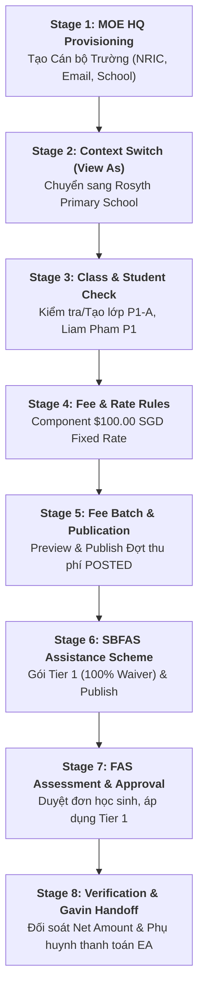

# 📋 EduFAMS Sprint 3 End-to-End Happy Path QA Specification
## Module: Fee Setup, Batch Publication, School Assistance, Assessment & Parent Settlement (Steps 1 – 8)

> **Standard:** Disciplined QA Engineering (`combo-qa` ISTQB-aligned Specification)  
> **Traceability IDs:** `UAT-019`, `UAT-020`, `UAT-021`, `UAT-MOE-01`, `UAT-SCH-02`, `UAT-SCH-03`, `UAT-035`, `UAT-PAR-01`  
> **Actors:** 
> - **Kent** (MOE HQ Admin / School Admin / UAT Lead)
> - **Bui Thi H / staff1** (School Reviewer & Admin at Rosyth Primary School)
> - **Gavin / Pham Van Duc** (Parent Tester paying via Singpass Mock)

---

## 1. 10 QA Lenses Analysis (Happy Path E2E)

| # | QA Lens | Application to Steps 1 – 8 Happy Path |
|---|---|---|
| **L1** | **User Persona & Journey** | Chuyển đổi liền mạch từ MOE HQ Admin (quản trị tập trung biểu phí) ➔ Cán bộ Trường (quản trị lớp, đề án SBFAS, duyệt đơn) ➔ Phụ huynh (xem nợ, đối soát trợ cấp, thanh toán). |
| **L2** | **State Transition** | `DRAFT (Batch)` ➔ `POSTED (Student Charge)` ➔ `PENDING (FAS App)` ➔ `APPROVED (Tier 1)` ➔ `SUBSIDIZED (Net SGD 0.00 - 40.00)` ➔ `PAID (Receipt Generated)`. |
| **L3** | **Data Integrity & Consistency** | Đơn giá 100.00 SGD từ Component Rate Rule phải phản ánh chính xác vào Batch Preview, sinh đúng khoản nợ của Liam Pham, và trừ đúng tỷ lệ trợ cấp trên Cổng E-Service. |
| **L4** | **Financial & Accounting Precision** | $Gross (100.00 SGD) - Subsidy (100.00 SGD) = Net (0.00 SGD)$; nếu nợ gốc còn lại $40.00 SGD, trừ chính xác ví Edusave $500.00 SGD ➔ $460.00 SGD. |
| **L5** | **Security & Access Control (RBAC)** | MOE HQ không được duyệt đơn SBFAS của trường (`UAT-035`); Cán bộ trường chỉ nhìn thấy học sinh trường mình (`SCH-003`); Cổng phụ huynh bắt buộc Singpass NRIC Masked (`*****854C`). |
| **L6** | **Boundary & Eligibility (EP/BVA)** | Effective Dates phải bao trùm kỳ tính phí (From <= Start < End <= To); Trần thu nhập GHI $\le$ $3,000$, PCI $\le$ $1,000$. |
| **L7** | **Zero-Negative Oracle** | Ở bước Preview Batch (Draft), tuyệt đối KHÔNG sinh nợ thật trong Ledger học sinh và KHÔNG trừ ví Edusave của phụ huynh trước khi bấm Publish. |
| **L8** | **Human Control & Audit Trail** | Chức năng View As ghi nhận Ticket Reference (`UAT-SPRINT3-HAPPYPATH`) và Reason ($\ge 10$ ký tự); Phê duyệt đơn trợ cấp ghi nhận Remarks của reviewer. |
| **L9** | **Handoff Safety Gates (G1, G2, G3)** | **Gate G1:** Kent đối soát công nợ trước khi chuyển giao. **Gate G2:** Gavin xác nhận số dư ví EA $\ge$ Net Due. **Gate G3:** Giao dịch thanh toán sinh biên nhận duy nhất và không cho thanh toán trùng. |
| **L10**| **Observability & Evidence** | Chụp ảnh bằng chứng trực tiếp tại mỗi cột mốc thành công (1 screenshot / PASS checkpoint) kèm Live HUD status banner. |

---

## 2. 8-Stage End-to-End Pipeline Architecture

---

## 3. End-to-End Traceability Matrix (10-Column ISTQB Format)

| TC ID | Step / Module | Precondition | Input Data | Exact Action / Locator | Expected Result (DOM / Oracle) | State Before $\rightarrow$ After | Security / RBAC | Evidence Output | Status |
| :--- | :--- | :--- | :--- | :--- | :--- | :--- | :--- | :--- | :---: |
| **TC-E2E-01** | Step 1: Create School User | Admin SSO session active | NRIC `S...A`, Name `Arthur Kent`, Email `kent.uat@edu.gov.sg`, School `Rosyth` | Điền `#school-user-*`, chọn Rosyth combobox, click `Create` | Hiển thị thông báo tạo thành công hoặc chuyển về danh sách cán bộ | N/A $\rightarrow$ User Created | MOE HQ only | `01_school_user_created.png` | **READY** |
| **TC-E2E-02** | Step 2: View As Console | Logged in as `moehq` | Persona `Rosyth (RPS-0201)`, Staff `staff1`, Reason $\ge 10$ ký tự, Ticket `UAT-SPRINT3` | Điền textarea reason, ticket, click `Start View As` | Header hiển thị "Viewing as Rosyth", menu trường xuất hiện | MOE HQ $\rightarrow$ School Context | Audit Logged | `02_view_as_active.png` | **READY** |
| **TC-E2E-03** | Step 3: Class Verification | School Context active | Class Name `P1-A`, Academic Level `Primary 1` | Tìm `P1-A` trên table `/class-management`; nếu chưa có bấm `Create class` | Lớp `P1-A` hiển thị trên bảng, sẵn sàng cho học sinh P1 | Unverified $\rightarrow$ Verified Active | School Admin | `03_class_p1a_ready.png` | **READY** |
| **TC-E2E-04** | Step 4: Fee & Rate Rules | MOE HQ session at `/fee-management` | Name `Tuition Fee UAT <time>`, Fixed Rate `100.00 SGD`, Dates `2026-11-01` to `2027-11-01` | Mở Wizard, chọn Fixed amount, điền 100.00, click `Save rates` | Component ở trạng thái Active, xuất hiện nút `Publish batch` | Draft $\rightarrow$ Active Component | MOE HQ only | `04_fee_rate_active.png` | **READY** |
| **TC-E2E-05** | Step 5: Batch Publish | Component ID created | School `Rosyth`, Level `P1`, Title `P1 Tuition Batch`, Dates Nov-Dec 2026 | Bấm `Preview`, xác nhận Liam Pham $100; bấm `Publish` | Trạng thái chuyển `Completed`, bản ghi công nợ sinh ở trạng thái `POSTED` | Draft $\rightarrow$ Completed / POSTED | MOE HQ only | `05_batch_published.png` | **READY** |
| **TC-E2E-06** | Step 6: SBFAS Scheme | School staff at `/sbfas-schemes` | Scheme `SBFAS Tier 1 UAT <time>`, Budget 50K, GHI $\le$ 3000, PCI $\le$ 1000, 100% Rate | Điền 4 bước wizard, add Tuition component 100%, click `Publish` | Đề án cấp mã `SBF-XXXXX`, trạng thái `Published` | Draft $\rightarrow$ Published Scheme | School Reviewer | `06_sbfas_published.png` | **READY** |
| **TC-E2E-07** | Step 7: FAS Assessment | School staff at `/fas-applications` | App `APP-RAHMAN-2026` / Liam Pham, Tier `Tier 1`, Remarks `Eligible` | Bấm `View details` ➔ `Approve` ➔ Chọn `Tier 1` ➔ Xác nhận | Trạng thái đổi thành `Approved`, trợ cấp kích hoạt vào tài khoản học sinh | Pending $\rightarrow$ Approved | Strict School Boundary | `07_fas_approved.png` | **READY** |
| **TC-E2E-08** | Step 8: Handoff & Payment | Kent & Gavin (Parent Portal) | Parent Singpass `S7654321B`, Edusave `EDU-01001`, Charge `Tuition Fee` | Kent xác nhận Net due ➔ Gavin login E-Service, chọn Charge, Pay via `EducationAccount` | Giao dịch thành công, hiển thị Receipt, ví EA trừ đúng tiền, nợ = $0.00 | Unpaid $\rightarrow$ PAID Settlement | Parent Singpass Auth | `08_payment_settled.png` | **READY** |

---

## 4. Verification Checkpoints & Concrete Oracles

1. **CP-01 (User Provisioning):** `button:has-text('Create')` is active; form submit responds without 4xx/5xx errors.
2. **CP-02 (Context Switching):** Top navigation contains `Viewing as Rosyth Primary School` or school banner; menu includes `Classes` & `SBFAS`.
3. **CP-03 (Class Roster):** Table row `tr:has-text('P1-A')` exists with academic level `Primary 1`.
4. **CP-04 (Fee Component):** URL matches `/fee-management/components/*`, badge shows `Active`, rate is `SGD 100.00`.
5. **CP-05 (Batch Publication):** Preview shows Liam Pham ($100.00); Publish transitions batch to `Completed`.
6. **CP-06 (SBFAS Scheme):** Table shows Scheme with badge `Published` and component tuition fee attached.
7. **CP-07 (FAS Approval):** Detail view shows badge `Approved`, status pill updated, tier assigned = `Tier 1`.
8. **CP-08 (Parent Settlement):** Invoice table displays breakdown; payment execution displays `Payment successful` or `Receipt`.
