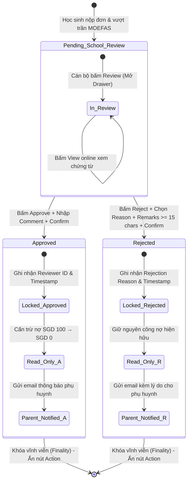

# Ma Trận Test Case: Thẩm Định & Phê Duyệt Đơn Trợ Cấp SBFAS (FAS Assessment & Decision Engine)

> **Mô đun**: `Financial Management` / `FAS Applications & Assessment`  
> **Kịch bản UAT tương ứng**: `UAT-SCH-03` (Approve SBFAS application), `UAT-SCH-03-N1` (Reject SBFAS application), `UAT-035` (School grants or rejects SBFAS under human control & role finality)  
> **User Stories & Specs**: `US-045`, `US-050`, `FS04 §2.3`, `FS04 §6.1`, `FS04 §6.2`, `FS04 §8`, `BR11`, Gate `G3` (FAS routing & decision rights), Gate `D05` (Budget unapproved policy)  
> **Phạm vi giao diện**: `/fas-applications`, FAS Review Drawer, Approve FAS Dialog, Reject FAS Dialog, `/moe-hq/fas-applications` (HQ Observer), Cổng Phụ huynh (Parent Portal)  
> **Tiêu chuẩn chất lượng**: ISTQB Foundation / ISO/IEC/IEEE 29119-3 / `combo-qa` Specification Standard / 5-Pillars Framework  
> **Nguyên tắc cốt lõi**: Pure Black-Box Testing (Kiểm thử Hộp Đen tuyệt đối, bám sát Live DOM và Đặc tả UAT Kent, không phụ thuộc mã nguồn nội bộ)

---

## 1. Bóc Tách Thực Thể & Kiến Trúc Nghiệp Vụ (The 5 Pillars)

```mermaid
flowchart TD
    BR["[1] Business Rules (BR)<br>• Cấp trường thẩm định (SBFAS)<br>• Cấn trừ 100% học phí POSTED<br>• Human Control > ML Advisory"] --> CORE["ĐỘNG CƠ THẨM ĐỊNH FAS<br>(FAS Assessment Engine)"]
    AC["[2] Acceptance Criteria (AC)<br>• Status: Pending → Approved / Rejected<br>• Ghi vết Reviewer ID & Timestamp<br>• Khóa hồ sơ Read-only"] --> CORE
    VR["[3] Validation Rules<br>• Rejection: Reason + Remarks >= 15 chars<br>• Chặn submit rỗng (aria-invalid)<br>• BVA 14 / 15 / 16 ký tự"] --> CORE
    FF["[4] Functional Flow<br>• Filter Pending → Drawer Review<br>• Đối chiếu GHI/PCI & Documents<br>• Dialog xác nhận → Ledger offset"] --> CORE
    EH["[5] Error & Isolation Guard<br>• Chặn truy cập chéo (Cross-School)<br>• HQ Observer Read-only cấm duyệt<br>• Khóa quyết định bất biến (Finality)"] --> CORE
    CORE --> OUTPUT["BỘ TEST CASE UAT HOÀN CHỈNH<br>(10 Cột ISTQB / Black-Box)"]
    style BR fill:#e3f2fd,stroke:#1565c0
    style AC fill:#e8f5e9,stroke:#2e7d32
    VR fill:#fff3e0,stroke:#e65100
    FF fill:#f3e5f5,stroke:#7b1fa2
    EH fill:#fce4ec,stroke:#c2185b
    OUTPUT fill:#e8f5e9,stroke:#2e7d32,stroke-width:2px
```

### 1.1 Bảng Từ Điển Dữ Liệu & Ràng Buộc Biểu Mẫu (Data Dictionary & Constraints)

| Thực Thể | Trường Dữ Liệu | Kiểu / Format | Bắt Buộc | Ràng Buộc Nghiệp Vụ & Kỹ Thuật | Ý Nghĩa Nghiệp Vụ |
| :--- | :--- | :--- | :---: | :--- | :--- |
| **FAS Application Record** | `application_code` | String (`APP-XXXXX`) | Có | Tự động sinh, hiển thị dạng liên kết hoặc badge trên bảng danh sách | Mã định danh hồ sơ đơn trợ cấp |
| | `beneficiary_name` | String | Có | Họ tên học sinh thụ hưởng (vd: `Ethan Rahman`, `Liam Pham`) | Đối tượng học sinh xét trợ cấp |
| | `school_id` / `school_name` | String | Có | Bắt buộc thuộc trường của cán bộ đang đăng nhập (`Rosyth Primary School`) | Ranh giới dữ liệu đơn vị trường học |
| | `income_verification` | Enum | Có | Giá trị: `Verified`, `Pending Verification` | Tình trạng kiểm chứng thu nhập từ GovTech/Singpass |
| | `status` | Enum | Có | Giá trị chuyển đổi: `Pending School Review` $\rightarrow$ `Approved` hoặc `Rejected` | Vòng đời xét duyệt đơn trợ cấp |
| **Household Financials** | `ghi_amount` | Currency (SGD) | Có | Tổng thu nhập hộ gia đình (Gross Household Income - GHI), vd: `$4,400.00 /month` | Căn cứ thẩm định khả năng kinh tế |
| | `household_size` | Integer | Có | Tổng số nhân khẩu gồm người lớn và trẻ em trong hộ gia đình (vd: `4`) | Số người phụ thuộc trong gia đình |
| | `pci_amount` | Currency (SGD) | Có | Công thức: $\text{PCI} = \frac{\text{GHI}}{\text{Household Size}}$ (vd: $\frac{\$4,400}{4} = \$1,100.00 /month$) | Thu nhập bình quân đầu người |
| | `evaluation_result` | String / Badge | Có | Nếu $\text{GHI} > \$3,000$ hoặc $\text{PCI} > \$750$: Hiển thị *"Evaluating at school level"* | Kết quả điều hướng từ Rule Engine quốc gia |
| **ML Advisory** | `need_score` | Decimal / Gauge | Không | Thang đo mức độ cần hỗ trợ được AI tính toán từ dữ liệu hồ sơ | Điểm định lượng nhu cầu hỗ trợ |
| | `recommended_tier` | String | Có | Gợi ý gói trợ cấp: *"Recommended: SBFAS Tier 1"* (Chỉ mang tính tham khảo) | Gợi ý hỗ trợ không mang tính cưỡng chế |
| **Approve FAS Dialog** | `scheme_tier` | Select / Dropdown | Có | Danh sách các gói trợ cấp Active của trường; mặc định pre-select theo ML recommendation | Gói trợ cấp quyết định trao cho học sinh |
| | `subsidized_breakdown` | Table / Calculated | Có | Bảng tính toán tự động mức miễn giảm tương ứng (vd: `100% Fee Waiver` cho học phí P1) | Chi tiết các loại phí được cấn trừ |
| | `effective_from` | Date (`YYYY-MM-DD`) | Có | Ngày bắt đầu có hiệu lực của gói trợ cấp | Mốc thời gian bắt đầu hưởng quyền lợi |
| | `approval_comment` | Textarea | Có | Tối thiểu 1 ký tự (vd: `Eligible` hoặc lý do đạt chuẩn) | Ghi chú phê duyệt lưu hồ sơ kiểm toán |
| **Reject FAS Dialog** | `rejection_reason` | Select / Dropdown | Có | Bắt buộc chọn từ dropdown (vd: `Income above limit`, `Incomplete documentation`, `Other`) | Nhóm lý do từ chối chính thức |
| | `rejection_remarks` | Textarea | Có | Bắt buộc tối thiểu **15 ký tự**; nút Confirm bị `disabled` nếu $<15$ ký tự | Giải thích chi tiết gửi cho phụ huynh |
| **Fee Ledger Mutation** | `charge_amount` | Currency (SGD) | Có | Số tiền công nợ học phí ban đầu (vd: `SGD 100.00`, Status: `POSTED`) | Khoản nợ học phí phát sinh ở Bước 5 |
| | `subsidy_amount` | Currency (SGD) | Có | Mức tiền được cấn trừ sau khi Approve (vd: `SGD 100.00` - 100% Waiver) | Giá trị tài chính được miễn giảm |
| | `outstanding_balance` | Currency (SGD) | Có | Số dư sau cấn trừ: $\text{Balance} = \$0.00$, Status: `SUBSIDIZED_PAID` | Số tiền còn lại phụ huynh cần nộp |

---

## 2. Ma Trận Chuyển Trạng Thái & Tính Bất Biến (State Transition & Finality)



### 2.1 Bảng Chi Tiết Chuyển Trạng Thái (State Transition Table)

| Trạng Thái Ban Đầu | Sự Kiện / Hành Động Trigger | Điều Kiện Guard | Trạng Thái Đích | Tác Động Phụ & Biểu Hiện UI / DB / Ledger |
| :--- | :--- | :--- | :--- | :--- |
| `[None / New]` | Đơn nộp chuyển sang cấp trường | GHI > $3,000 hoặc PCI > $750 | `Pending School Review` | Hồ sơ xuất hiện trong bảng danh sách tại `/fas-applications` với status `Pending School Review` |
| `Pending School Review` | Bấm `Review` tại dòng hồ sơ | User có quyền `School Reviewer` thuộc đúng trường | `Review Drawer: Open` | Drawer trượt mở; hiển thị thông tin Household Financials, ML Advisory và nút xem chứng từ |
| `Review Drawer: Open` | Bấm `Approve` | User là School Reviewer | `Approve Dialog: Open` | Hiển thị Dialog phê duyệt; pre-select Tier 1; bảng Subsidized Fees hiển thị mức miễn giảm 100% |
| `Approve Dialog: Open` | Bấm `Confirm approval` | Comment không để trống | `Approved` | Badge đổi thành `Approved`; Reviewer ID & Timestamp được lưu; Toast: *"Subsidy applied to the student's EA fees"*; Nợ SGD 100 chuyển thành SGD 0 (`SUBSIDIZED_PAID`); Khóa Read-only |
| `Review Drawer: Open` | Bấm `Reject` | User là School Reviewer | `Reject Dialog: Open` | Hiển thị Dialog từ chối; trường Reason và Comment rỗng; nút `Reject application` ở trạng thái `disabled` |
| `Reject Dialog: Open` | Nhập Comment $<15$ ký tự | Reason đã chọn, Remarks $<15$ ký tự | `Reject Dialog: Invalid` | Nút `Reject application` tiếp tục bị `disabled`; viền đỏ `aria-invalid="true"` hiển thị kèm thông báo độ dài |
| `Reject Dialog: Open` | Nhập đủ Reason và Remarks $\ge 15$ ký tự | Cả 2 trường hợp lệ | `Reject Dialog: Ready` | Nút `Reject application` được kích hoạt (Enabled, đổi màu tương tác) |
| `Reject Dialog: Ready` | Bấm `Reject application` | Validation Gate thỏa mãn | `Rejected` | Badge đổi thành `Rejected`; Toast: *"Application rejected. Parent notified by email"*; Nợ học phí giữ nguyên; Khóa Read-only |
| `Approved` / `Rejected` | Mở lại hồ sơ đã hoàn tất | Hồ sơ đã ở trạng thái Final | `Finalized: Read-Only` | Toàn bộ nút `Approve`, `Reject` biến mất; hiển thị Banner quyết định Read-only; cấm can thiệp thay đổi |

---

## 3. Bảng Quyết Định: Cổng Thẩm Quyền & Xác Thực (Decision Tables)

### 3.1 Decision Table 1: Validation Gate Hộp Thoại Từ Chối (Reject FAS Dialog)

| Điều Kiện / Yếu Tố Đầu Vào | Quy Tắc 1 (R1) | Quy Tắc 2 (R2) | Quy Tắc 3 (R3) | Quy Tắc 4 (R4) |
| :--- | :---: | :---: | :---: | :---: |
| **Trường Lý do (`rejection_reason`) đã chọn?** | Không (Chưa chọn) | Có (Đã chọn) | Có (Đã chọn) | Có (Đã chọn) |
| **Độ dài Ghi chú giải thích (`rejection_remarks`)** | 0 ký tự (Rỗng) | $<15$ ký tự (vd: 14 ký tự) | $\ge 15$ ký tự (vd: 15 ký tự) | $>15$ ký tự (vd: 35 ký tự) |
| **Trạng thái Nút Submit (`Reject application`)** | **DISABLED** | **DISABLED** | **ENABLED** | **ENABLED** |
| **Cờ kiểm tra giao diện (`aria-invalid`)** | `true` (khi blur) | `true` (báo lỗi độ dài) | `false` | `false` |
| **Cho phép đóng đơn và gửi thông báo?** | **CHẶN** | **CHẶN** | **CHO PHÉP** | **CHO PHÉP** |

### 3.2 Decision Table 2: Quyền Làm Chủ Con Người (Human Control Over ML Advisory)

| Tình Huống Thẩm Định | Gợi Ý AI (ML Advisory) | Cán Bộ Trường Chọn Quyết Định | Kết Quả Thực Thi Hệ Thống | Tuân Thủ UAT-035? |
| :---: | :---: | :---: | :--- | :---: |
| **Tình huống 1** | Recommended: SBFAS Tier 1 | Chọn Approve Tier 1 | Phê duyệt Tier 1, cấn trừ 100% học phí | Đạt (Đồng thuận) |
| **Tình huống 2** | Recommended: SBFAS Tier 1 | Chọn Approve Tier 2 (Khác AI) | Phê duyệt Tier 2, áp dụng mức giảm Tier 2; không chặn hay cảnh báo lỗi | Đạt (Human Override) |
| **Tình huống 3** | Recommended: SBFAS Tier 1 | Chọn Reject (Từ chối) | Chuyển Rejected kèm lý do cán bộ nhập; hệ thống không ép buộc duyệt | Đạt (Human Override) |
| **Tình huống 4** | Không có gợi ý / ML Offline | Tự đánh giá thủ công | Cho phép Approve/Reject bình thường dựa trên tài liệu đính kèm | Đạt (Manual Fallback) |

---

## 4. Phân Tích Phân Vùng Tương Đương & Giá Trị Biên (EP & BVA Matrix)

### 4.1 BVA & EP cho Trường Ghi Chú Từ Chối (`rejection_remarks`) — Ngưỡng 15 Ký Tự

```
                       BOUNDARY ANALYSIS: MIN 15 CHARS
        Invalid Partition (< 15)       │      Valid Partition (>= 15)
  ──────────────────────────────────────┼────────────────────────────────────►
         Length = 0       Length = 14   │  Length = 15       Length = 16
          (Empty)         (Boundary -1) │  (Boundary exact)  (Boundary +1)
          DISABLED          DISABLED    │     ENABLED           ENABLED
```

| Phân Vùng | Giá Trị Kiểm Thử (Input Sample) | Độ Dài (Chars) | Trạng Thái Kỳ Vọng | Giao Diện Kiểm Thử |
| :--- | :--- | :---: | :---: | :--- |
| **EP Hợp lệ** | `"Income above the Tier 1 limit."` | 31 | Hợp lệ (Valid) | Nút Submit kích hoạt, không lỗi |
| **BVA Biên chính xác** | `"Income high 123"` | 15 | Hợp lệ (Valid) | Nút Submit kích hoạt ngay khi gõ ký tự 15 |
| **BVA Biên cận trên** | `"Income high 1234"` | 16 | Hợp lệ (Valid) | Nút Submit kích hoạt |
| **BVA Biên cận dưới** | `"Income high 12"` | 14 | Không hợp lệ (Invalid) | Nút Submit DISABLED; inline text: "Minimum 15 characters required" |
| **BVA Rỗng** | `""` | 0 | Không hợp lệ (Invalid) | Nút Submit DISABLED; `aria-invalid="true"` |
| **Khoảng trắng thừa** | `"               "` (15 dấu cách) | 15 | Không hợp lệ (Invalid) | Hệ thống trim whitespace, coi là rỗng $\rightarrow$ DISABLED |

### 4.2 BVA & EP cho Ngưỡng Thu Nhập Chuyển Về Cấp Trường (GHI & PCI Limits)

| Tiêu Chí | Ngưỡng MOEFAS Quốc Gia | Dữ Liệu Thực Tế Bước 7 | Kết Quả Đánh Giá Cấp Xét Duyệt |
| :--- | :---: | :---: | :--- |
| **Tổng Thu Nhập Hộ (GHI)** | $\le \$3,000.00$ | **`$4,400.00 /month`** (Vượt trần) | Đơn rớt chuẩn quốc gia $\rightarrow$ Chuyển về Trường |
| **Bình Quân Đầu Người (PCI)** | $\le \$750.00$ | **`$1,100.00 /month`** (Vượt trần) | Đơn rớt chuẩn quốc gia $\rightarrow$ Chuyển về Trường |
| **Household Size** | $\ge 1$ | **`4 người`** (2 lớn, 2 trẻ) | $\text{PCI} = \frac{\$4,400}{4} = \$1,100.00$ (Khớp toán học) |

---

## 5. Ma Trận Phân Quyền & Ranh Giới Đa Trường (RBAC & Cross-School Boundary)

| Vai Trò Người Dùng (Role) | Tài Khoản Đăng Nhập | Xem Đơn Trường Rosyth | Duyệt / Từ Chối Đơn Rosyth | Xem Đơn Trường Khác (School B) | Duyệt Đơn Trường Khác | Ghi Chú Bảo Mật |
| :--- | :--- | :---: | :---: | :---: | :---: | :--- |
| **School Reviewer (Trường Rosyth)** | `staff1@IAM.edu.vn` | **CÓ** | **CÓ** | **KHÔNG** (403 / Ẩn dòng) | **KHÔNG** (Cấm tuyệt đối) | Phân quyền đúng trường phụ trách |
| **School User (Trường Khác - B)** | `staff_b@IAM.edu.vn` | **KHÔNG** | **KHÔNG** | **CÓ** | **CÓ** | Cô lập đa người thuê (Multi-tenant) |
| **MOE HQ Admin / Observer** | `admin@IAM.edu.vn` | **CÓ** (Tại `/moe-hq/fas-applications`) | **KHÔNG** (Read-Only) | **CÓ** (Toàn quốc) | **KHÔNG** (Chỉ xem) | Tuân thủ F4 v1.3: HQ chỉ giám sát |
| **Parent (Phụ Huynh Học Sinh)** | Singpass Mock | **CÓ** (Chỉ xem đơn của con mình) | **KHÔNG** | **KHÔNG** | **KHÔNG** | Xem kết quả và lý do từ chối |

---

## 6. Bảng Ma Trận Test Case Chi Tiết (Standard 10-Column ISTQB / combo-qa)

| TC_ID | Module / Feature | Test Title / Objective | Preconditions | Test Data | Steps to Execute | Expected Observable Result | Technique | Suite | Priority |
| :--- | :--- | :--- | :--- | :--- | :--- | :--- | :--- | :--- | :--- |
| `TC-FAS-001` | FAS Applications | Kiểm tra hiển thị danh sách đơn chờ duyệt và lọc theo trạng thái Pending | Tài khoản `staff1@IAM.edu.vn` đã đăng nhập; hồ sơ đơn của học sinh Ethan Rahman tồn tại ở trạng thái Pending School Review | `status_filter="Pending"` | 1. Truy cập `/fas-applications`<br>2. Chọn bộ lọc Status: "Pending" (hoặc Pending School Review)<br>3. Kiểm tra danh sách hiển thị | Bảng hiển thị đơn của Ethan Rahman; các cột Application Code, Beneficiaries, Income Verification ("Verified"), Status hiển thị đúng; nút "Review" hiển thị sẵn sàng | EP (Valid) | Smoke | P1 |
| `TC-FAS-002` | FAS Review Drawer | Kiểm tra mở Drawer thẩm định và tính chính xác của dữ liệu tài chính GHI/PCI | Đang ở bảng `/fas-applications`; hồ sơ Ethan Rahman có GHI $4,400 và 4 nhân khẩu | `app_code="APP-01004", ghi=4400.00, size=4` | 1. Bấm nút "Review" tại dòng hồ sơ của Ethan Rahman<br>2. Kiểm tra thông tin trong khối Household Financials | FAS Review Drawer mở trượt từ cạnh phải; GHI hiển thị `$4,400.00 /month`, Size hiển thị `4`, PCI tính toán chính xác `$1,100.00 /month`; Kết quả Rule Engine hiển thị rõ: *"Evaluating at school level"* | Decision Table | Sprint | P1 |
| `TC-FAS-003` | FAS Review Drawer | Kiểm tra khuyến nghị AI và nguyên tắc Human Control (Advisory, non-binding) | Đã mở Review Drawer hồ sơ Ethan Rahman; hệ thống AI đã phân tích điểm Need Score | `expected_recommendation="Recommended: SBFAS Tier 1"` | 1. Cuộn đến khối ML Advisory Recommendation trong Drawer<br>2. Kiểm tra nội dung đề xuất và nhãn khuyến nghị | Hiển thị Need Score và dòng chữ *"Recommended: SBFAS Tier 1"*; có nhãn biểu thị Advisory/Tham khảo; hệ thống không tự động phê duyệt (no auto-grant); nút Approve và Reject hiển thị để con người quyết định | Exploratory | Sprint | P2 |
| `TC-FAS-004` | FAS Documents | Kiểm tra tính năng xem chứng từ trực tuyến trên trình duyệt (View online) | Đã mở Review Drawer; hồ sơ có đính kèm bảng lương/phiếu thu nhập | `doc_name="payslip_2026.pdf"` | 1. Tại khối Documents, tìm mục chứng từ bảng lương<br>2. Bấm nút "View online" | Trình duyệt mở trực tiếp tài liệu trong tab mới hoặc modal viewer nội bộ; không tự động kích hoạt tải file về máy (no forced download) | Functional | Sprint | P3 |
| `TC-FAS-005` | FAS Approval Flow | Phê duyệt đơn trợ cấp SBFAS Tier 1 thành công (UAT-SCH-03 Happy Path) | Hồ sơ Ethan Rahman ở trạng thái Pending School Review; gói SBFAS Tier 1 đang Active; nợ học phí SGD 100.00 ở trạng thái POSTED | `tier="Tier 1", comment="Eligible"` | 1. Trong Drawer, bấm "Approve"<br>2. Xác nhận Tier 1 được chọn sẵn<br>3. Kiểm tra bảng Subsidized Fees hiển thị mức 100% Fee Waiver<br>4. Nhập Comment "Eligible"<br>5. Bấm "Confirm approval" | Toast hiển thị: *"Subsidy applied to the student's EA fees"*; Trạng thái đơn chuyển sang "Approved"; Ghi nhận Reviewer ID và Timestamp; Dialog đóng; hồ sơ chuyển sang trạng thái khóa Read-only | Scenario-based | Smoke | P1 |
| `TC-FAS-006` | Fee Ledger Mutation | Kiểm tra cấn trừ 100% công nợ học phí sau khi đơn được duyệt thành công | Hồ sơ Ethan Rahman vừa được Approve ở `TC-FAS-005`; khoản nợ gốc là SGD 100.00 | `student_name="Ethan Rahman", initial_debt=100.00` | 1. Truy cập mục Financial > Student Charges / Fee Ledger<br>2. Tìm khoản nợ học phí của học sinh Ethan Rahman | Khoản nợ SGD 100.00 được cấn trừ đủ 100%; số dư phải trả (Outstanding Balance) về chính xác `SGD 0.00`; Trạng thái khoản phí chuyển thành `SUBSIDIZED_PAID` | State Transition | Sprint | P1 |
| `TC-FAS-007` | FAS Rejection Flow | Chặn gửi yêu cầu từ chối khi để trống cả Lý do và Ghi chú (Validation Gate) | Hồ sơ Liam Pham ở trạng thái Pending School Review độc lập | `reason="", comment=""` | 1. Mở hồ sơ Liam Pham, bấm nút "Reject"<br>2. Không chọn Reason, không nhập Comment<br>3. Kiểm tra trạng thái nút "Reject application" | Hộp thoại Reject FAS Dialog hiển thị; nút "Reject application" ở trạng thái disabled; không thể gửi form; nếu click ra ngoài xuất hiện viền đỏ `aria-invalid="true"` | EP (Invalid) | Sprint | P1 |
| `TC-FAS-008` | FAS Rejection Flow | Chặn gửi yêu cầu từ chối khi Ghi chú dưới 15 ký tự (BVA Boundary - 14 chars) | Hộp thoại Reject FAS Dialog đang mở cho hồ sơ Liam Pham | `reason="Income above limit", comment="Income high 12"` (14 ký tự) | 1. Chọn Reason: "Income above limit"<br>2. Nhập Comment đúng 14 ký tự<br>3. Quan sát nút Submit và cảnh báo | Nút "Reject application" tiếp tục bị disabled; hiển thị cảnh báo lỗi độ dài (tối thiểu 15 ký tự); trường nhập có viền đỏ `aria-invalid="true"` | BVA (Boundary) | Sprint | P2 |
| `TC-FAS-009` | FAS Rejection Flow | Kích hoạt nút Submit khi Ghi chú đạt đúng ngưỡng tối thiểu 15 ký tự (BVA Boundary - 15 chars) | Hộp thoại Reject FAS Dialog đang mở cho hồ sơ Liam Pham | `reason="Income above limit", comment="Income high 123"` (15 ký tự) | 1. Chọn Reason: "Income above limit"<br>2. Nhập thêm 1 ký tự để đạt đúng 15 ký tự | Nút "Reject application" lập tức chuyển sang trạng thái enabled (sẵn sàng bấm); viền đỏ lỗi biến mất | BVA (Boundary) | Sprint | P2 |
| `TC-FAS-010` | FAS Rejection Flow | Từ chối đơn trợ cấp SBFAS thành công khi đủ điều kiện validation (UAT-SCH-03-N1) | Hộp thoại Reject FAS Dialog đang mở; Reason và Comment hợp lệ | `reason="Income above limit", comment="Income above the Tier 1 limit."` (31 ký tự) | 1. Bấm nút "Reject application"<br>2. Quan sát thông báo và trạng thái hồ sơ | Thông báo xuất hiện: *"Application rejected. Parent notified by email"*; Trạng thái đơn chuyển sang "Rejected"; Lý do từ chối được lưu trữ minh bạch vào hồ sơ | Scenario-based | Smoke | P1 |
| `TC-FAS-011` | Fee Ledger Integrity | Kiểm tra bảo toàn công nợ học phí không bị suy suyển sau khi từ chối đơn | Hồ sơ Liam Pham vừa bị Rejected ở `TC-FAS-010`; khoản nợ gốc là SGD 100.00 | `student_name="Liam Pham", initial_debt=100.00` | 1. Truy cập Financial > Student Charges / Fee Ledger<br>2. Kiểm tra khoản nợ của học sinh Liam Pham | Khoản nợ học phí SGD 100.00 giữ nguyên 100%; số dư phải trả vẫn là `SGD 100.00`; Trạng thái vẫn là `POSTED` (không có cấn trừ trợ cấp) | State Transition | Sprint | P1 |
| `TC-FAS-012` | Decision Finality | Kiểm chứng tính bất biến và khóa hồ sơ sau khi Approved (UAT-035 Finality Gate) | Đơn của Ethan Rahman đã Approved ở `TC-FAS-005` | `app_code="APP-01004"` | 1. Mở lại hồ sơ Ethan Rahman tại `/fas-applications`<br>2. Kiểm tra các nút hành động trong Drawer | Toàn bộ nút "Approve" và "Reject" biến mất hoàn toàn; hiển thị Banner quyết định Read-only: *"Approved by [User] on [Date] (Tier 1)"*; form bị khóa, không cho chỉnh sửa | Security / State | Regression | P1 |
| `TC-FAS-013` | Decision Finality | Kiểm chứng tính bất biến và khóa hồ sơ sau khi Rejected (UAT-035 Finality Gate) | Đơn của Liam Pham đã Rejected ở `TC-FAS-010` | `app_code="APP-01005"` | 1. Mở lại hồ sơ Liam Pham tại `/fas-applications`<br>2. Kiểm tra các nút hành động trong Drawer | Toàn bộ nút "Approve" và "Reject" biến mất hoàn toàn; hiển thị Banner quyết định Read-only: *"Rejected on [Date] - Reason: Income above limit"*; cấm tái thẩm định | Security / State | Regression | P1 |
| `TC-FAS-014` | Human Control Override | Kiểm chứng cán bộ trường phê duyệt gói khác với khuyến nghị AI (UAT-035 Human Overrides AI) | Hồ sơ đơn mới ở trạng thái Pending; AI khuyến nghị Tier 1 | `recommended="Tier 1", selected_tier="Tier 2", comment="Eligible for partial support"` | 1. Mở hồ sơ, bấm "Approve"<br>2. Thay đổi chọn gói từ Tier 1 sang Tier 2<br>3. Nhập Comment và bấm Confirm | Hệ thống chấp nhận quyết định của con người mà không chặn hay hiển thị cảnh báo lỗi; đơn được duyệt theo Tier 2; minh chứng nguyên tắc Human Control | Decision Table | Sprint | P2 |
| `TC-FAS-015` | Cross-School Isolation | Kiểm chứng cách ly dữ liệu giữa các trường học (Cross-School Boundary) | Đăng nhập tài khoản `staff1@IAM.edu.vn` (Trường Rosyth); trường khác có học sinh nộp đơn | `school_a="Rosyth Primary School", school_b="Changkat Primary School"` | 1. Tìm kiếm học sinh thuộc Trường B trong bảng danh sách<br>2. Thử truy cập trực tiếp URL `/fas-applications?appId=<id_truong_b>` | Học sinh Trường B không xuất hiện trong bảng danh sách của Trường A; truy cập trực tiếp URL bị chặn (hiển thị 403 Forbidden hoặc 404 Not Found) | Authorization | Regression | P1 |
| `TC-FAS-016` | Cross-School Isolation | Kiểm chứng tài khoản Trường B không thể phê duyệt đơn của Trường A | Đăng nhập tài khoản cán bộ Trường B (`staff_b@IAM.edu.vn`) | `target_app_code="APP-01004"` (Đơn của Trường Rosyth) | 1. Gửi request hoặc thao tác mở đơn của Trường Rosyth bằng tài khoản Trường B | Hệ thống từ chối truy cập; không hiển thị nút Review/Approve; bảo toàn tuyệt đối ranh giới trường học | Authorization | Regression | P1 |
| `TC-FAS-017` | HQ Observer Read-Only | Kiểm chứng tài khoản MOE HQ chỉ có quyền xem, không có quyền duyệt (UAT-035 Role Scope) | Đăng nhập tài khoản MOE HQ (`admin@IAM.edu.vn`) | `url="/moe-hq/fas-applications"` | 1. Truy cập `/moe-hq/fas-applications`<br>2. Mở chi tiết đơn trợ cấp thuộc trường Rosyth | Màn hình hiển thị đầy đủ thông tin hồ sơ ở chế độ Read-only; tuyệt đối KHÔNG có nút "Approve" hay "Reject"; bảo đảm đúng thẩm quyền phân cấp | Authorization | Regression | P1 |
| `TC-FAS-018` | Parent Portal Sync | Kiểm chứng đồng bộ kết quả phê duyệt và số dư nợ lên Cổng Phụ huynh | Đơn Ethan Rahman đã Approved; Phụ huynh đăng nhập e-Service Singpass | `parent_id="P-01004", student_id="STU-01004"` | 1. Đăng nhập Cổng Phụ huynh bằng Singpass<br>2. Xem mục Trạng thái đơn FAS và Bảng kê học phí | Trạng thái đơn hiển thị "Approved (SBFAS Tier 1)"; Hóa đơn học phí hiển thị số dư phải thanh toán là `SGD 0.00` với ghi chú cấn trừ trợ cấp 100% | Functional | UAT | P2 |
| `TC-FAS-019` | Parent Portal Sync | Kiểm chứng hiển thị lý do từ chối minh bạch cho phụ huynh trên Cổng Phụ huynh | Đơn Liam Pham đã Rejected; Phụ huynh đăng nhập e-Service Singpass | `parent_id="P-01005", student_id="STU-01005"` | 1. Đăng nhập Cổng Phụ huynh bằng Singpass<br>2. Xem chi tiết đơn FAS bị từ chối | Trạng thái hiển thị "Rejected"; hiển thị đầy đủ Lý do chính thức ("Income above limit") và phần giải thích chi tiết để phụ huynh nắm bắt | Functional | UAT | P2 |
| `TC-FAS-020` | Concurrent Approval Guard | Kiểm chứng chống xung đột duyệt đồng thời (Race Condition / Double Submit) | Hồ sơ Pending; mở 2 tab trình duyệt cùng lúc hoặc gửi 2 request Approve song song | `app_code="APP-01006"` | 1. Tại Tab 1: Bấm Confirm approval<br>2. Ngay lập tức tại Tab 2: Bấm Confirm approval | Tab 1 phê duyệt thành công; Tab 2 bị từ chối với thông báo "Application already finalized" hoặc "State conflict"; số dư chỉ cấn trừ đúng 1 lần duy nhất | Concurrency | Regression | P2 |

---

## 7. Bộ Dữ Liệu Kiểm Thử Mẫu (Test Fixtures JSON)

```json
{
  "test_environment": {
    "base_url": "https://admin.20-255-158-192.sslip.io",
    "fas_endpoint": "/fas-applications",
    "moe_hq_endpoint": "/moe-hq/fas-applications"
  },
  "roles": {
    "school_reviewer": {
      "email": "staff1@IAM.edu.vn",
      "school": "Rosyth Primary School",
      "role": "School Reviewer"
    },
    "school_reviewer_other": {
      "email": "staff_b@IAM.edu.vn",
      "school": "Changkat Primary School",
      "role": "School Reviewer"
    },
    "moe_hq_admin": {
      "email": "admin@IAM.edu.vn",
      "role": "MOE HQ Observer / Admin"
    }
  },
  "applications": [
    {
      "id": "UAT-SCH-03-CASE-A",
      "application_code": "APP-01004",
      "student_name": "Ethan Rahman",
      "school": "Rosyth Primary School",
      "household_financials": {
        "ghi": 4400.00,
        "household_size": 4,
        "pci": 1100.00,
        "national_limit_breached": true,
        "evaluation_flow": "Evaluating at school level"
      },
      "ml_recommendation": {
        "need_score": 0.82,
        "recommended_tier": "SBFAS Tier 1",
        "is_advisory": true
      },
      "initial_charge": {
        "charge_id": "CHG-2026-P1-001",
        "description": "Primary 1 School Fees",
        "amount": 100.00,
        "status": "POSTED"
      },
      "expected_outcome": {
        "target_status": "Approved",
        "selected_tier": "Tier 1",
        "subsidy_waiver_pct": 100,
        "final_charge_status": "SUBSIDIZED_PAID",
        "final_charge_balance": 0.00
      }
    },
    {
      "id": "UAT-SCH-03-N1-CASE-B",
      "application_code": "APP-01005",
      "student_name": "Liam Pham",
      "school": "Rosyth Primary School",
      "household_financials": {
        "ghi": 4400.00,
        "household_size": 4,
        "pci": 1100.00,
        "national_limit_breached": true
      },
      "rejection_data": {
        "reason_code": "INCOME_ABOVE_LIMIT",
        "reason_text": "Income above limit",
        "remarks_valid": "Income above the Tier 1 limit.",
        "remarks_invalid_boundary": "Income high 12"
      },
      "initial_charge": {
        "charge_id": "CHG-2026-P1-002",
        "amount": 100.00,
        "status": "POSTED"
      },
      "expected_outcome": {
        "target_status": "Rejected",
        "final_charge_status": "POSTED",
        "final_charge_balance": 100.00
      }
    }
  ]
}
```
