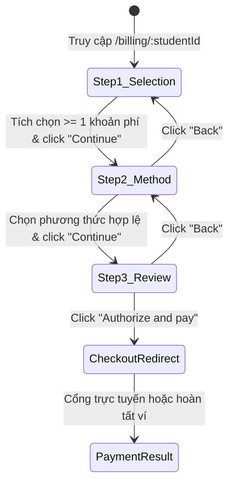

# 🏛️ Đặc Tả Kiến Trúc Biểu Mẫu (Forms), Giao Dịch (Transactions) & Error Handling - EduFAMS UI Automation

Tài liệu này đóng vai trò là **kim chỉ nam kiến trúc** (Architectural Blueprint) cho toàn bộ hệ sinh thái kiểm thử tự động EduFAMS. Mọi Page Object, Component Object và kịch bản kiểm thử tự động (Playwright + Pytest) phải tuân thủ nghiêm ngặt các mẫu thiết kế (Design Patterns), nguyên tắc bắt lỗi (Error Handling), và đặc tả tương tác giao diện được chuẩn hóa dưới đây.

---

## 📑 1. Kiến Trúc Biểu Mẫu Chuẩn (Standard Form Automation Architecture)

Toàn bộ hệ thống giao diện EduFAMS (cả Cổng Quản trị `:5173` và Cổng Công dân `:5174`) được xây dựng trên Design System dựa trên chuẩn trợ năng **W3C WAI-ARIA & UK GDS / Singapore WOG**.

### 1.1 Cấu Trúc DOM Của Form Field (`FormField` / `TextField` / `Select`)
Mỗi trường nhập liệu trên form luôn tuân theo mô hình 4 thành phần ngữ nghĩa:

```html
<!-- Wrapper khối trường nhập liệu -->
<div class="FormField_root">
  <!-- 1. Nhãn (Label) gắn chặt với Control qua htmlFor -->
  <label class="FormField_label" for="school-name">
    School Name
    <span class="FormField_required" aria-hidden="true"> *</span>
  </label>

  <!-- 2. Điều khiển (Input / Select / Textarea) mang trạng thái ARIA -->
  <div class="FormField_control">
    <input 
      id="school-name"
      name="name"
      class="TextField_input"
      aria-invalid="true" 
      aria-describedby="school-name-hint school-name-error"
      required
    />
  </div>

  <!-- 3. Hướng dẫn nhập liệu (Hint - nếu có) -->
  <p class="FormField_hint" id="school-name-hint">
    Enter the official registered school name.
  </p>

  <!-- 4. Thông báo lỗi ngữ nghĩa (Error Message) -->
  <p class="FormField_error" id="school-name-error" role="alert">
    School name is required and must not exceed 100 characters.
  </p>
</div>
```

### 1.2 Hộp Tổng Hợp Lỗi Form Đầu Trang (`FormErrorSummary`)
Khi nhấn Submit một form có nhiều lỗi, hệ thống kích hoạt khối `FormErrorSummary` ngay đầu trang:

```html
<section class="FormErrorSummary_root" role="alert" aria-labelledby="form-errors-heading" tabindex="-1">
  <h2 class="FormErrorSummary_heading" id="form-errors-heading">
    There is a problem with your submission
  </h2>
  <ul class="FormErrorSummary_list">
    <li><a href="#school-name">School name is required</a></li>
    <li><a href="#school-code">School code must start with SCH followed by 4 digits</a></li>
    <li><a href="#contact-email">Enter a valid official email address</a></li>
  </ul>
</section>
```

> [!TIP]
> **Chiến lược bắt lỗi tự động tối ưu**:
> - Thay vì `assert False, "Form failed to submit"` mù quáng, Automation Page Object gọi `form.get_field_errors()` để đọc trực tiếp danh sách `{ "name": "School name is required", ... }`.
> - Click vào anchor link trong `FormErrorSummary` sẽ cuộn thẳng trình duyệt tới trường lỗi và focus vào input đó.

---

## 💳 2. Kiến Trúc Thành Phần Giao Dịch (Transaction Components Architecture)

Các phân hệ tài chính (Billing, Top-up, Fee Batches, Edusave Wallet, FAS Scheme) sở hữu các luồng giao dịch phức tạp cần được tối ưu cho Automation.

### 2.1 Luồng Thanh Toán 3 Bước (3-Step Checkout Wizard)



#### Quy tắc nghiệp vụ phương thức thanh toán (`Step 2: Method`):
1. **`EducationAccount` (Thuần ví Edusave)**:
   - Khả dụng khi $\text{EA Balance} \ge \text{Total Charges}$.
   - Disabled nếu $\text{EA Balance} < \text{Total Charges}$.
2. **`OnlineGateway` (Cổng trực tuyến)**:
   - Luôn khả dụng, hỗ trợ PayNow QR, Thẻ tín dụng, Thẻ ghi nợ.
3. **`Both` (Thanh toán kết hợp Split Payment)**:
   - Chỉ xuất hiện khi $0 < \text{EA Balance} < \text{Total Charges}$.
   - Kích hoạt ô nhập số tiền trích từ ví `eaAmount`:
     - Ràng buộc: $0.01 \le \text{eaAmount} \le \min(\text{EA Balance}, \text{Total Charges})$.
     - Phần tiền trực tuyến tự động tính: $\text{OnlineGateway} = \text{Total Charges} - \text{eaAmount}$.
     - Nếu nhập sai phạm vi, ô hiện lỗi: `features.billingPayment.split.educationAccountAmountError` và nút `Continue` bị vô hiệu hóa.

### 2.2 Bảng Dữ Liệu Mở Rộng Hóa Đơn (`InvoiceDisclosure`)
Trong màn hình Lịch sử Giao dịch (`/transactions`), mỗi dòng hóa đơn là một accordion tương tác:
- Cột Action chứa nút `<button class="disclosureButton" aria-expanded="true/false" aria-controls="invoice-details-{id}">`.
- Khi `aria-expanded="true"`, bảng chèn ngay phía dưới một dòng phụ `td#invoice-details-{id}` chứa:
  1. **Bảng phân bổ nguồn tiền (`Funding Sources Table`)**: Liệt kê số tiền đã trích từ ví Edusave và số tiền qua cổng thanh toán kèm thời điểm hoàn tất.
  2. **Bảng chi tiết các khoản phí lẻ (`Invoice Charges Table`)**: Liệt kê từng môn học/khoản thu lẻ.
  3. **Alert báo lỗi và nút Retry cục bộ**: Nếu việc nạp chi tiết phí gặp lỗi 500 từ backend, chỉ vùng con này hiện lỗi mà không làm sập toàn bộ trang.

---

## 🛡️ 3. Ma Trận Xử Lý Lỗi Chi Tiết Cho Automation Testing (Detailed Error Diagnostics)

Để tránh trường hợp kịch bản kiểm thử bị treo (hang) do `TimeoutError` không rõ nguyên nhân, hệ thống bổ sung mô-đun chuẩn hóa **`ErrorDiagnostics`** và **`FormHelper`**:

```mermaid
flowchart TD
    Action[Thực hiện hành động UI (Click Submit / Chuyển Bước / Mở Chi Tiết)] --> CheckSuccess{Giao diện thành công?}
    CheckSuccess -- Có --> ReturnSnapshot[Trả snapshot success=True, errors={}]
    CheckSuccess -- Không --> TriggerDiagnostics[Kích hoạt ErrorDiagnostics.capture]
    
    subgraph DiagnosticEngine ["Bộ Phân Tích Lỗi Đa Tầng"]
        TriggerDiagnostics --> ScanAria[Quét input[aria-invalid='true']]
        TriggerDiagnostics --> ScanSummary[Quét FormErrorSummary li]
        TriggerDiagnostics --> ScanBanners[Quét Alert tone='error'/'warning']
        TriggerDiagnostics --> ScanToasts[Quét Toast role='alert']
        TriggerDiagnostics --> ScanConsole[Đọc unhandled JS exceptions & console.error]
    end
    
    ScanAria --> CompileReport[Tổng hợp báo cáo chẩn đoán chi tiết]
    ScanSummary --> CompileReport
    ScanBanners --> CompileReport
    ScanToasts --> CompileReport
    ScanConsole --> CompileReport
    
    CompileReport --> RaiseError[Ném BusinessAssertionError / InfrastructureError kèm lý do chính xác]
```

### 3.1 Bảng Phân Loại Các Lớp Lỗi (12 Validation & Error Layers)

| STT | Lớp Lỗi (Error Layer) | Vị Trí DOM / Indicator | Phương Pháp Bắt Lỗi Tối Ưu |
| :---: | :--- | :--- | :--- |
| 1 | **Required / Mandatory** | `input:invalid`, `aria-invalid="true"` | `form_helper.get_field_errors()` |
| 2 | **Format / Regex (Email, Phone, NRIC)** | `p[id$="-error"][role="alert"]` | So khớp nội dung thông báo lỗi cụ thể |
| 3 | **BVA / Length (Min, Max, Number)** | `input[aria-invalid="true"]` | Trích xuất thông báo biên (BVA violation) |
| 4 | **Cross-Field / Duplicate ID** | Banner `[role="alert"]` hoặc dialog | Kiểm tra lỗi phụ thuộc giữa các trường |
| 5 | **State Guard / Disabled Button** | `button[disabled]`, `aria-busy="true"` | Kiểm tra `is_submit_disabled()` |
| 6 | **Alertdialog / Confirmation Modal** | `div[role="alertdialog"]` | Bắt modal xác nhận trước khi lưu |
| 7 | **Toast Notification** | `ol[aria-label="Notifications"] li` | `ErrorDiagnostics.capture()["toasts"]` |
| 8 | **Backend 400 / 422 Bad Request** | `FormErrorSummary` hoặc banner lỗi | Đọc chi tiết lỗi nghiệp vụ từ server |
| 9 | **Backend 500 / 502 Server Fault** | `Alert tone="error"` kèm nút Retry | Kiểm tra `alert["has_retry"]` và click retry |
| 10 | **Data Staleness / Concurrency** | Alert cảnh báo dữ liệu cũ | Xác định thông báo "Stale data detected" |
| 11 | **Access Control / IDOR (403)** | `Alert` báo "Scope mismatch" / "Forbidden" | Kiểm tra phân quyền học sinh / trường học |
| 12 | **Console / Runtime Exceptions** | `window.errors` & `console.error` | Trích xuất từ listener `BasePage` |

---

## 🚀 4. Mẫu Triển Khai Code Cho Kỹ Sư Tự Động Hóa

### 4.1 Sử Dụng `FormHelper` Trong Page Object
```python
from pages.base_page import BasePage
from components.form_helper import FormHelper

class SchoolCreatePage(BasePage):
    def __init__(self, page):
        super().__init__(page)
        self.form = FormHelper(page, container="form#school-create-form")

    def submit_school(self, school_data: dict):
        self.form.fill_fields(school_data)
        self.form.click_submit()

    def get_validation_snapshot(self):
        """Trả về snapshot chuẩn cho Exceptor kiểm định."""
        return self.form.get_form_snapshot(
            success_selector="p[role='status']:has-text('School created')",
            submit_selector="button[type='submit']"
        )
```

### 4.2 Sử Dụng `TransactionHelper` Trong Page Object
```python
from pages.base_page import BasePage
from components.transaction_helper import TransactionHelper

class TransactionsPage(BasePage):
    def __init__(self, page):
        super().__init__(page)
        self.grid = TransactionHelper(page, table_selector="table")

    def inspect_invoice(self, invoice_number: str):
        # Mở dòng chi tiết
        self.grid.toggle_disclosure(invoice_number, open=True)
        # Kiểm tra bảng phân bổ nguồn tiền
        return self.grid.get_rows_data()
```

### 4.3 Sử Dụng `Exceptor` Trong Kịch Bản Kiểm Thử (`tests/`)
```python
from core.exceptor import Exceptor

def test_tc_school_invalid_email_rejected(school_create_page):
    # 1. Nhập dữ liệu email không hợp lệ
    school_create_page.submit_school({"email": "invalid-email"})
    
    # 2. Lấy snapshot trạng thái
    snapshot = school_create_page.get_validation_snapshot()
    
    # 3. Assert chuẩn theo Exceptor (Không fail mù quáng, bắt chính xác lỗi)
    Exceptor.expect_rejection(
        snapshot=snapshot,
        field="email",
        message_contains="Enter a valid official email address",
        context="TC-SCH-004: Validate email RFC compliance"
    )
```
