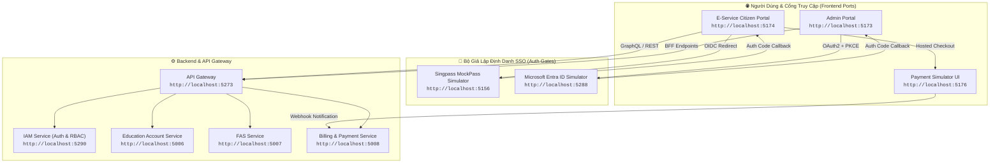
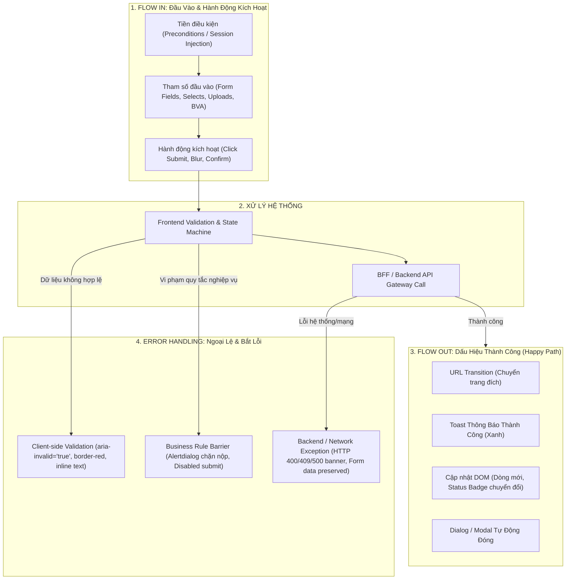

# 🌐 Kho Tài Liệu BSK Locators & Functional Flow - Toàn Bộ Hệ Thống EduFAMS

> [!IMPORTANT]
> **Canonical location**: `specs/ui_bsk/`. Đây là kho bằng chứng UI/DOM đã thu thập; `tools/` chỉ chứa script recon. Alias `locator-bsk` trỏ vào thư mục này để tương thích. Mỗi selector/flow phải được xem là snapshot theo môi trường và thời điểm recon; nếu DOM hiện tại khác, đánh dấu stale và thu thập lại, không tự suy diễn.

Tài liệu này tổng hợp toàn bộ kết quả trinh sát DOM thực tế (**BSK Live DOM Reconnaissance**), đặc tả luồng nghiệp vụ (**Functional Flow & State Machine**), và kiến trúc chuẩn hóa Biểu mẫu & Giao dịch (**[00_form_and_transaction_patterns.md](file:///home/baudui/Projects/automation-ui/1_Nghiep_Vu_va_Specs/specs/ui_bsk/00_form_and_transaction_patterns.md)**) cho hai cổng dịch vụ trọng yếu của hệ thống EduFAMS:
- 🏛️ **Cổng Dịch Vụ Công Dân / Phụ Huynh (EduSave E-Service Portal)**: `http://localhost:5174`
- 🏢 **Cổng Quản Trị Hệ Thống (EduFAMS Admin Portal)**: `http://localhost:5173`

> [!TIP]
> **Tối ưu hóa Automation**: Mọi biểu mẫu (Forms) và thành phần giao dịch (Transactions) được tích hợp sẵn lớp chẩn đoán lỗi chi tiết (**`ErrorDiagnostics`** & **`FormHelper`**) tự động bắt lỗi từ cấp độ trường (`aria-invalid`), khối tổng hợp (`FormErrorSummary`), đến thông báo nổi (`Toast`) và cảnh báo máy chủ (`Alert`).

Toàn bộ 27 tài nguyên đặc tả đã được bóc tách chi tiết theo từng màn hình, xác thực 100% qua môi trường sống, tuân thủ nghiêm ngặt **12 Nguyên Tắc Bất Biến (12 Golden Invariants)** của [AGENTS.md](file:///home/baudui/Projects/automation-ui/AGENTS.md).

---

## 🗺️ 1. Bản Đồ Topology Dịch Vụ Khảo Sát Thực Tế



---

## 📑 2. Danh Mục Đặc Tả Chi Tiết Theo Phân Hệ (Master Index)

### 2.1 Cổng Dịch Vụ Phụ Huynh / Công Dân (localhost:5174)

#### 🔹 Nhóm Dịch Vụ Cốt Lõi (Core Citizen Services)
Thư mục: [`specs/ui_bsk/localhost-5174/`](file:///home/baudui/Projects/automation-ui/specs/ui_bsk/localhost-5174/)

| STT | Màn Hình / Tính Năng | File Đặc Tả BSK & Functional Flow | URL Thực Tế / Scope | Điểm Nhấn Nghiệp Vụ |
| :---: | :--- | :--- | :--- | :--- |
| 1 | **Đăng nhập Singpass & MockPass** | [01_parent_login_and_mockpass.md](file:///home/baudui/Projects/automation-ui/specs/ui_bsk/localhost-5174/01_parent_login_and_mockpass.md) | `/parent/login`<br>`:5156/singpass/login`<br>`/parent/callback` | OIDC Authorization Code Flow, State CSRF matching, Lưu session vào `sessionStorage["edusave.parent-auth.user"]`. |
| 2 | **Trang Chủ / Dashboard Phụ Huynh** | [02_eservice_dashboard_home.md](file:///home/baudui/Projects/automation-ui/specs/ui_bsk/localhost-5174/02_eservice_dashboard_home.md) | `/` | Thẻ học sinh (Children cards), Số dư ví Edusave bất đồng bộ per-student, Masked NRIC `*****567A`, Deep-link giao dịch. |
| 3 | **Hồ Sơ Cá Nhân & Liên Lạc** | [03_parent_profile_and_contact.md](file:///home/baudui/Projects/automation-ui/specs/ui_bsk/localhost-5174/03_parent_profile_and_contact.md) | `/profile`<br>`/parent/profile` | Chuyển đổi View/Edit mode, Cụm địa chỉ bưu điện, Xác thực SĐT SG (`^[689]\d{7}$`), Confirm Alertdialog trước khi lưu. |
| 4 | **Lịch Sử Giao Dịch & Hóa Đơn** | [04_transaction_history.md](file:///home/baudui/Projects/automation-ui/specs/ui_bsk/localhost-5174/04_transaction_history.md) | `/transactions`<br>`?student=:studentId` | Hóa đơn `INV-XXXX`, Nút mở rộng `InvoiceDisclosure`, Bảng chi tiết nguồn tiền `Funding Sources` & phí lẻ `Invoice Charges`, Phân trang 10/20/50/100, Bắt lỗi API retry. |
| 5 | **Công Nợ Học Phí & Thanh Toán** | [05_billing_and_payments.md](file:///home/baudui/Projects/automation-ui/specs/ui_bsk/localhost-5174/05_billing_and_payments.md) | `/billing`<br>`/billing/:studentId` | Quy trình 3 bước (Selection -> Method -> Review), Hỗ trợ Split payment (Ví Edusave + Cổng trực tuyến), Chống double-pay. |
| 6 | **Kết Quả Thanh Toán & Simulator** | [06_payment_checkout_simulator.md](file:///home/baudui/Projects/automation-ui/specs/ui_bsk/localhost-5174/06_payment_checkout_simulator.md) | `/payment-result`<br>`:5176` (Simulator) | Xử lý redirect sau thanh toán, Đối soát mã tham chiếu, Giả lập thanh toán Thành công/Thất bại tại `:5176`, Webhook xử lý nợ. |

#### 🔹 Nhóm Đơn Trợ Cấp Tài Chính (Online FAS Application Wizard)
Thư mục: [`specs/ui_bsk/localhost-5174/fas-application/`](file:///home/baudui/Projects/automation-ui/specs/ui_bsk/localhost-5174/fas-application/)

| STT | Bước / Step | File Đặc Tả BSK & Functional Flow | URL / Identifier | Điểm Nhấn Nghiệp Vụ & Live Locators |
| :---: | :--- | :--- | :--- | :--- |
| 7 | **FAS Landing & Điều Kiện Tiên Quyết** | [01_fas_landing_and_prerequisites.md](file:///home/baudui/Projects/automation-ui/specs/ui_bsk/localhost-5174/fas-application/01_fas_landing_and_prerequisites.md) | `/fas-application` | Rào chắn xác thực phụ huynh, Kiểm tra điều kiện (Khóa khi con $\ge 16$ tuổi hoặc đã có đơn PENDING), Quản lý 1 bản nháp duy nhất. |
| 8 | **Bước 1: Chọn Học Sinh Thụ Hưởng** | [02_step1_student_selection.md](file:///home/baudui/Projects/automation-ui/specs/ui_bsk/localhost-5174/fas-application/02_step1_student_selection.md) | `Step 1: Beneficiary` | Thẻ động học sinh `beneficiary-<UUID>-*`, Nút thêm/xóa con cái, BVA độ tuổi (7-16), Chống trùng lặp NRIC cha-con. |
| 9 | **Bước 2: Hộ Gia Đình & Thu Nhập** | [03_step2_household_and_income.md](file:///home/baudui/Projects/automation-ui/specs/ui_bsk/localhost-5174/fas-application/03_step2_household_and_income.md) | `Step 2: Household` | Thẻ động thành viên `family-member-<UUID>-*`, Tình trạng việc làm, Tự động tính Gross Household Income (GHI) & Per Capita Income (PCI). |
| 10 | **Bước 3: Đính Kèm Hồ Sơ & Cam Kết** | [04_step3_documents_and_declaration.md](file:///home/baudui/Projects/automation-ui/specs/ui_bsk/localhost-5174/fas-application/04_step3_documents_and_declaration.md) | `Step 3: Documents` | File input upload giấy tờ ($\le 5\text{MB}$), Checkbox cam kết pháp lý bắt buộc, Checkbox chuyển tiếp xét duyệt cấp trường SBFAS. |
| 11 | **Bước 4: Xem Lại & Nộp Đơn** | [05_step4_review_and_submission.md](file:///home/baudui/Projects/automation-ui/specs/ui_bsk/localhost-5174/fas-application/05_step4_review_and_submission.md) | `Step 4: Review` | Bảng tổng hợp hồ sơ, Hộp thoại xác nhận trước nộp `role="alertdialog"`, Idempotency key chống duplicate, Màn hình mã đơn `APP-XXXXX`. |

---

### 2.2 Cổng Quản Trị Hệ Thống (localhost:5173)

#### 🔹 Nhóm Học Vụ & Quản Trị Người Dùng (Academic & Users)
Thư mục: [`specs/ui_bsk/localhost-5173/academic-and-users/`](file:///home/baudui/Projects/automation-ui/specs/ui_bsk/localhost-5173/academic-and-users/)

| STT | Màn Hình / Phân Hệ | File Đặc Tả BSK & Functional Flow | URL Thực Tế / Scope | Điểm Nhấn Nghiệp Vụ & Live Locators |
| :---: | :--- | :--- | :--- | :--- |
| 12 | **Admin Login & Microsoft SSO** | [01_admin_login_and_sso.md](file:///home/baudui/Projects/automation-ui/specs/ui_bsk/localhost-5173/academic-and-users/01_admin_login_and_sso.md) | `/login`<br>`:5288/microsoft-provider`<br>`/login/microsoft/callback` | Microsoft Entra ID OAuth2 + PKCE flow, Chọn tài khoản tile (`admin@IAM.edu.vn` vs `staff1@IAM.edu.vn`), Phiên làm việc cookie `IAM_Session`. |
| 13 | **Admin Dashboard & Shell Navigation** | [02_admin_dashboard_shell.md](file:///home/baudui/Projects/automation-ui/specs/ui_bsk/localhost-5173/academic-and-users/02_admin_dashboard_shell.md) | `/` (Shell) | Header toàn cục, Chuyển đổi ngôn ngữ (EN/VI), Menu cá nhân, Phân quyền cây sidebar (MOEHQ thấy toàn bộ; SCHOOL chỉ thấy Academic). |
| 14 | **Quản Lý Trường Học (Schools)** | [03_school_management.md](file:///home/baudui/Projects/automation-ui/specs/ui_bsk/localhost-5173/academic-and-users/03_school_management.md) | `/school-management`<br>`/school-management/new`<br>`/school-management/:id` | Tìm kiếm mã/tên trường, Lọc loại trường (`GOVERNMENT`, `INDEPENDENT`), Form tạo trường (`#school-moeSchoolCode`), Gán cấp học tối thiểu. |
| 15 | **Quản Lý Cán Bộ Trường (Users)** | [04_school_user_management.md](file:///home/baudui/Projects/automation-ui/specs/ui_bsk/localhost-5173/academic-and-users/04_school_user_management.md) | `/school-user-management`<br>`/school-user-management/new`<br>`/school-user-management/:id` | Tìm kiếm cán bộ, Form Single/Bulk CSV, Xác thực NRIC Singapore, Chuẩn RFC 5322 cho Email, Gán trường quản lý (`#school-user-school`). |
| 16 | **Năm Học & Cấp Học (Years & Levels)**| [05_academic_years_and_levels.md](file:///home/baudui/Projects/automation-ui/specs/ui_bsk/localhost-5173/academic-and-users/05_academic_years_and_levels.md) | `/academic-years`<br>`/academic-years/new`<br>`/academic-levels`<br>`/academic-levels/new` | Vòng đời niên khóa (`DRAFT` -> `ACTIVE` -> `COMPLETED`), Ràng buộc `endDate > startDate`, Cấp học theo stage (`PRIMARY`, `SECONDARY`, `PRE_UNIVERSITY`). |
| 17 | **Quản Lý Lớp Học (Classes)** | [06_class_management.md](file:///home/baudui/Projects/automation-ui/specs/ui_bsk/localhost-5173/academic-and-users/06_class_management.md) | `/class-management`<br>`/class-management/new`<br>`/class-management/:id` | Cô lập dữ liệu lớp theo `schoolId` của cán bộ, Form tạo lớp (`#class-classCode`), Trang chi tiết lớp & Danh sách học sinh trong lớp. |
| 18 | **Quản Lý & Nhập Học Học Sinh** | [07_student_management_and_enrollment.md](file:///home/baudui/Projects/automation-ui/specs/ui_bsk/localhost-5173/academic-and-users/07_student_management_and_enrollment.md) | `/student-management`<br>`/student-management/new`<br>`/student-management/enroll`<br>`/student-management/assign` | Danh sách học sinh theo Category (`SC`, `PR`, `IS`), Form tạo học sinh mới, Quy trình nhập học (Enrollment) và Phân lớp học sinh. |
| 19 | **Cấu Hình Nội Bộ Trường (School Config)**| [08_school_config.md](file:///home/baudui/Projects/automation-ui/specs/ui_bsk/localhost-5173/academic-and-users/08_school_config.md) | `/school-config` | Chọn niên khóa vận hành, Nút sao chép cấu hình niên khóa trước (`Copy Previous Year`), Thêm nhanh cấp học & lớp học, Khóa sửa khi năm học đã COMPLETED. |

#### 🔹 Nhóm Tài Chính, Biểu Phí & Đề Án FAS (Finance & FAS)
Thư mục: [`specs/ui_bsk/localhost-5173/finance-and-fas/`](file:///home/baudui/Projects/automation-ui/specs/ui_bsk/localhost-5173/finance-and-fas/)

| STT | Màn Hình / Phân Hệ | File Đặc Tả BSK & Functional Flow | URL Thực Tế / Scope | Điểm Nhấn Nghiệp Vụ & Live Locators |
| :---: | :--- | :--- | :--- | :--- |
| 20 | **Sổ Cái Tài Khoản Edusave** | [01_education_accounts.md](file:///home/baudui/Projects/automation-ui/specs/ui_bsk/localhost-5173/finance-and-fas/01_education_accounts.md) | `/education-accounts` | Tìm kiếm NRIC/Học sinh, Lọc quốc tịch, Nút `Trigger citizen sync` kèm Confirm dialog đồng bộ dữ liệu dân cư, Modal xem chi tiết số dư & giao dịch. |
| 21 | **Chiến Dịch Nạp Tiền (Top-Up)** | [02_top_up_management.md](file:///home/baudui/Projects/automation-ui/specs/ui_bsk/localhost-5173/finance-and-fas/02_top_up_management.md) | `/top-up`<br>`/top-up/campaigns/new`<br>`/top-up/campaigns/:id`<br>`/top-up/runs/:id` | Tabs (Annual / Ad-hoc), Wizard tạo chiến dịch (Độ tuổi 6-16, Số tiền per student, Tiêu chí số dư), Màn hình Preview dự toán ngân sách, Nhật ký giải ngân runs. |
| 22 | **Danh Mục Học Phí & Biểu Phí** | [03_fee_management_and_rate_rules.md](file:///home/baudui/Projects/automation-ui/specs/ui_bsk/localhost-5173/finance-and-fas/03_fee_management_and_rate_rules.md) | `/fee-management`<br>`/fee-management/components`<br>`.../rate-rules/new` | Bảng loại phí & thành phần phí, Wizard tạo phí (Fee Type, Stages, Categories, Cờ Taxable), Cấu hình Rate Rule theo ma trận Stage × Category. |
| 23 | **Đợt Thu Học Phí (Fee Batches)** | [04_fee_batches.md](file:///home/baudui/Projects/automation-ui/specs/ui_bsk/localhost-5173/finance-and-fas/04_fee_batches.md) | `/fee-batches`<br>`/fee-batches/new`<br>`/fee-batches/:id` | Vòng đời đợt thu (`DRAFT` -> `PROCESSING` -> `COMPLETED` -> `PUBLISHED`), Ràng buộc ngày BVA (`dueDate >= chargeDate`), Chọn danh sách trường thu phí. |
| 24 | **Đề Án Trợ Cấp Cấp Bộ (MOE FAS)** | [05_moe_fas_schemes.md](file:///home/baudui/Projects/automation-ui/specs/ui_bsk/localhost-5173/finance-and-fas/05_moe_fas_schemes.md) | `/moe-hq/moe-fas`<br>`/moe-hq/moe-fas/new`<br>`.../:id/add-fee` | Wizard 4 bước cấu hình đề án cấp Bộ, Ngưỡng trần GHI/PCI, Danh mục phí được hỗ trợ (% miễn giảm), Ràng buộc thời hạn nộp đơn. |
| 25 | **Đề Án Trợ Cấp Cấp Trường (SBFAS)** | [06_sbfas_schemes.md](file:///home/baudui/Projects/automation-ui/specs/ui_bsk/localhost-5173/finance-and-fas/06_sbfas_schemes.md) | `/sbfas-schemes`<br>`/sbfas-schemes/new` | Phân quyền bắt buộc vai trò **`SCHOOL`** (`staff1@IAM.edu.vn`), Form tạo đề án nội bộ trường (`#sbfas-name`, `#sbfas-budget`), Cấu hình trợ cấp bổ sung ngoài MOE. |
| 26 | **Quản Lý Thẩm Định Đơn FAS** | [07_fas_application_management.md](file:///home/baudui/Projects/automation-ui/specs/ui_bsk/localhost-5173/finance-and-fas/07_fas_application_management.md) | `/fas-application-management`<br>`/fas-application-management/:code` | Điều hướng theo vai trò (School User vào thẩm định, MOEHQ xem thống kê), Kiểm tra chéo 4 thẻ thông tin đối soát thu nhập, Các nút Approve / Reject / Clarify. |

---

## 👥 3. Ma Trận Vai Trò & Tài Khoản Kiểm Thử (RBAC & Test Personas)

| Cổng Ứng Dụng | Định Danh / Persona | Username / NRIC | Mật Khẩu | Vai Trò (RBAC) | Phạm Vi Quyền Hạn Kiểm Thử |
| :--- | :--- | :--- | :--- | :--- | :--- |
| **Admin Portal** (`:5173`) | **System Administrator** | `admin@IAM.edu.vn` | SSO Simulator | `MOEHQ` | Toàn quyền quản trị cấp Bộ (EduSave, Top-Up, MOE FAS, Toàn bộ trường học). |
| **Admin Portal** (`:5173`) | **School Staff 1** | `staff1@IAM.edu.vn` | SSO Simulator | `SCHOOL` | Cán bộ trường Rosyth Primary School (`RPS-0201`), thẩm định đơn FAS trường, quản lý lớp và học sinh trường. |
| **E-Service Portal** (`:5174`) | **Lim Wei Minh** | `S7890123F` | MockPass (App/Pass) | `PARENT` | Phụ huynh có con `S1234567A` (Tan Wei Ming, 11 tuổi, đủ điều kiện FAS & có số dư Edusave). |
| **E-Service Portal** (`:5174`) | **Pham Van Duc** | `S7654321B` | MockPass (App/Pass) | `PARENT` | Phụ huynh có con `T0000784X` (Lucas Lim) và `T0000785Y` (Nathan Lim). |
| **E-Service Portal** (`:5174`) | **Ng Wee Kiat** | `S8901234H` | MockPass (App/Pass) | `PARENT` | Phụ huynh có con lớn (> 16 tuổi), dùng kiểm thử kịch bản Ineligibility Lock của FAS. |

---

## 🛠️ 4. Hướng Dẫn Sử Dụng Trong Automation Testing

### 4.1 Khởi Tạo Session Đăng Nhập Nhanh (Bypass UI Simulator)
Để tăng tốc độ test và giảm tiêu thụ RAM theo Invariant 8, các bài test Playwright có thể tiêm trực tiếp auth storage thay vì thao tác qua giao diện web simulator:

```python
# Cho E-Service Citizen Portal (http://localhost:5174)
def inject_parent_session(page, nric="S7890123F", name="LIM WEI MINH"):
    user_payload = {
        "nric": nric,
        "name": name,
        "uinfin": nric,
        "email": "lim.wm@example.com"
    }
    page.goto("http://localhost:5174/parent/login")
    page.evaluate("""(user) => {
        sessionStorage.setItem('edusave.parent-auth.user', JSON.stringify(user));
    }""", user_payload)
    page.goto("http://localhost:5174/")
```

### 4.2 Nhập Khẩu & Sử Dụng Page Objects
Mỗi file tài liệu đều cung cấp một class Page Object hoàn chỉnh tuân thủ Invariant 1 (Zero assertions in Page Objects). Ví dụ sử dụng `ParentProfilePage`:

```python
from pages.fs08.parent_profile_page import ParentProfilePage

def test_update_contact_happy_path(page):
    profile = ParentProfilePage(page)
    profile.open()
    profile.click_update_details()
    profile.fill_contact(phone="91234567", email="parent@example.sg")
    profile.click_save_changes()
    profile.confirm_save()
    
    # Assertions nằm tại file test (Invariant 1)
    expect(profile.phone_display).to_have_text("91234567")
    expect(profile.toast_notification).to_contain_text("Profile updated successfully")
```

---

## 🎯 5. Quy Chuẩn Xác Nhận Pass/Fail & Error Handling Cho AI Coding (Standard Section 4)

> [!IMPORTANT]
> **Kim chỉ nam cho AI Coding & QA**:
> Để AI Coding không phải suy đoán trạng thái test pass hay fail, mỗi file đặc tả BSK bắt buộc phải có **Mục 4: Tiêu Chí Xác Nhận Pass/Fail & Error Handling**.
> - **Nguyên tắc Invariant 1**: Mọi câu lệnh `expect(...)` xác nhận Pass/Fail nằm trong `tests/`, Page Object chỉ cung cấp locator và getter snapshot state.
> - **Bảng 4.1 Pass Oracles**: Xác định các dấu hiệu khi nghiệp vụ thành công (Toast xanh, đóng Dialog, cập nhật DOM, chuyển URL).
> - **Bảng 4.2 Fail & Error Handling Feedback**: Bóc tách mọi trường hợp lỗi (viền đỏ `border-red-500`, cờ `aria-invalid="true"`, modal giữ nguyên kèm alert, toast lỗi đỏ, mã lỗi `MSG-xxxx`).

### Cấu Trúc 5 Cột Chuẩn Hóa Bắt Buộc Của Section 4:
1. `Hành Động / Kịch Bản Kiểm Thử (Trigger Action / Scenario)`: Thao tác người dùng hoặc tình huống kiểm thử (Submit form, blur ô nhập, mock HTTP 500...).
2. `Loại UI Feedback (Feedback Type)`: Toast banner, Inline input error, Dialog alert banner, URL redirect, Field highlight...
3. `Selector Playwright Tối Ưu (Target Locator)`: Bộ chọn chuẩn xác theo live DOM.
4. `Kỳ Vọng Text / Giá Trị / Mã Lỗi Chuẩn (Expected Text / Value / MSG-xxxx)`: Nội dung thông điệp chính xác hoặc regex.
5. `Playwright Assertion Cú Pháp Mẫu (Assertion Code)`: Lệnh `expect(...)` hoàn chỉnh sẵn sàng copy vào test function.

---

## 🔄 6. Chuẩn Hóa Function Flow: IN – OUT – ERROR HANDLING

Mỗi component/màn hình trong số 26 modules của hệ thống EduFAMS đều được chuẩn hóa theo mô hình 3 pha tương tác:



### 6.1 FLOW IN (Dữ Liệu & Hành Động Kích Hoạt)
1. **Tiền điều kiện (Preconditions)**:
   - Trạng thái phân quyền (RBAC): `PARENT`, `MOEHQ`, hoặc `SCHOOL`.
   - Tiêm session trực tiếp vào `sessionStorage["edusave.parent-auth.user"]` (cho Portal `:5174`) hoặc cookie `IAM_Session` (cho Admin `:5173`) để bỏ qua bước đăng nhập UI tốn thời gian.
2. **Tham số đầu vào (Input Parameters)**:
   - Các trường nhập liệu (Họ tên, NRIC Singapore, Số điện thoại `^[689]\d{7}$`, Số tiền nạp/thu, Mức thu nhập GHI/PCI).
   - Dropdown selection (Loại trường, Cấp học, Trạng thái niên khóa).
   - Tệp đính kèm (File PDF/PNG $\le 5\text{MB}$ hợp lệ).
3. **Hành động kích hoạt (Trigger Actions)**:
   - `page.click("button[type='submit']")` hoặc click nút lưu.
   - `page.locator("#field").blur()` để kích hoạt validation on blur.
   - Xác nhận hộp thoại `alertdialog` trước khi nộp.

### 6.2 FLOW OUT (Dấu Hiệu Kết Quả Thành Công)
1. **URL Redirect**: Điều hướng từ form tạo mới sang trang chi tiết hoặc danh sách (ví dụ: `/new` $\rightarrow$ `/:id` hoặc quay về `/`).
2. **Toast Feedback**: Xuất hiện banner toast màu xanh báo thành công (`Profile updated successfully`, `Scheme created successfully`).
3. **Cập nhật trạng thái DOM**:
   - Dòng mới xuất hiện trong bảng dữ liệu (`table tbody tr`).
   - Huy hiệu trạng thái chuyển đổi (ví dụ: từ `DRAFT` sang `ACTIVE`, `SUBMITTED`, hoặc `APPROVED`).
   - Modal/Drawer tự động đóng hoàn toàn (`expect(dialog).to_be_hidden()`).

### 6.3 ERROR HANDLING (Ngoại Lệ & Phản Hồi Lỗi)
1. **Client-Side Validation (Tầng 1 - 3)**:
   - Ô nhập bị đánh dấu thuộc tính `aria-invalid="true"` và class `border-red-500`.
   - Text lỗi hiển thị trực tiếp bên dưới field (inline error message).
   - Nút Submit bị vô hiệu hóa (`disabled`) hoặc ngăn chặn form submit.
2. **Business Rule Barriers (Tầng 4 - 6)**:
   - Vi phạm điều kiện nghiệp vụ (ví dụ: học sinh $> 16$ tuổi nộp đơn FAS, hoặc đợt thu có `dueDate < chargeDate`).
   - Hiển thị hộp thoại cảnh báo `role="alertdialog"` giải thích lý do không đủ điều kiện.
3. **Backend & Network Failures (Tầng 7 - 12)**:
   - Khi mock phản hồi HTTP 400 (Bad Request), 409 (Conflict), hoặc 500 (Internal Server Error):
     - Dữ liệu người dùng đã điền trên form **bắt buộc phải được giữ nguyên (Form Preservation)**, không được reset trắng xóa.
     - Hiển thị banner lỗi màu đỏ `role="alert"` mang nội dung lỗi rõ ràng.

---

## 🎯 7. Hướng Dẫn Gôm Scope & Ma Trận Xác Định PASS / FAIL (Pass/Fail Oracles)

### 7.1 Ma Trận Phân Định Test Case PASS hay FAIL

| Loại Kịch Bản | Dấu hiệu Đạt (**PASS**) | Dấu hiệu Hỏng (**FAIL**) |
| :--- | :--- | :--- |
| **Happy Path (Tích cực)** | • Chuyển đúng URL đích.<br>• Xuất hiện Toast thành công xanh.<br>• Dòng dữ liệu mới xuất hiện trên Table.<br>• Modal/Dialog tự động đóng lại. | • URL không chuyển hướng.<br>• Xuất hiện lỗi inline đỏ hoặc lỗi 500.<br>• Dữ liệu trên Table không đổi.<br>• Modal bị treo không đóng. |
| **Negative Path (Biên & Lỗi nhập)** | • Hệ thống **chặn đứng** không cho nộp.<br>• Field bật `aria-invalid="true"`.<br>• Hiển thị đúng câu text lỗi theo spec.<br>• Dữ liệu hợp lệ khác được giữ nguyên. | • Hệ thống cho phép submit thành công (Bug lọt dữ liệu).<br>• Không hiển thị thông báo lỗi.<br>• Xóa sạch toàn bộ form khi báo lỗi. |
| **Mock Network 500 / Conflict** | • Alert banner thông báo lỗi hệ thống hiển thị.<br>• Toàn bộ dữ liệu đã nhập được bảo toàn nguyên vẹn. | • Màn hình trắng (Crash UI / White Screen).<br>• Form bị xóa trắng tinh.<br>• Throw lỗi Unhandled JavaScript Exception trong Console. |

### 7.2 Phân Biệt Product Defect vs Infrastructure Error

1. **Product Defect (Bug Nghiệp Vụ - Lỗi Ứng Dụng)**:
   - Xảy ra khi UI/ứng dụng phản hồi sai khác với FSD/BSK spec (ví dụ: công thức tính GHI/PCI bị sai, rò rỉ translation key `i18n.error.msg`, thiếu cờ `aria-invalid`).
   - **Xử lý**: Đánh dấu bằng `Exceptor.expect_bug_if_accepted(...)` hoặc `@pytest.mark.xfail(strict=True)`. Tuyệt đối không sửa assertion để làm cho test pass giả tạo!
2. **Infrastructure Error (Lỗi Môi Trường / Test Flake)**:
   - Xảy ra khi selector bị timeout do server frontend/backend chưa chạy, crash browser process, hoặc lỗi mạng nội bộ runner.
   - **Xử lý**: Ghi nhận qua `pytest_runtest_makereport`, kiểm tra live DOM và khởi động lại dịch vụ.

### 7.3 Bằng Chứng Thị Giác Bắt Buộc (Visual Evidence Standard)
- Mỗi thao tác quan trọng: Chụp ảnh highlight `step_X_<action>.png`.
- Khi kết thúc kịch bản:
  - Nếu **PASS**: Chụp `actual_result.png` với khung viền xanh lá (Green badge).
  - Nếu **DEFECT**: Chụp `actual_result.png` với khung viền đỏ kèm nhãn lỗi (Red badge).
- Xuất liên kết trực tiếp vào báo cáo: `TEST_EXECUTION_EVIDENCE_R<XX>_UAT_MASTER.xlsx` và `R<XX>_UAT_MASTER_DASHBOARD.html`.

---

## 💻 8. Mẫu Test Function Hoàn Chỉnh Tuân Thủ Invariant 1

```python
import pytest
from playwright.sync_api import expect, Page
from pages.fs08.parent_profile_page import ParentProfilePage

def test_tc_01_update_phone_success(page: Page, test_data):
    """Happy Path: Cập nhật số điện thoại Singapore hợp lệ thành công."""
    profile_page = ParentProfilePage(page)
    profile_page.navigate()
    profile_page.click_edit_mode()
    profile_page.fill_phone(test_data["valid_phone"])
    profile_page.submit_form()
    profile_page.confirm_dialog()

    # --- TIÊU CHÍ PASS ORACLE ---
    expect(profile_page.toast_success).to_be_visible()
    expect(profile_page.toast_success).to_contain_text("Profile updated successfully")
    expect(profile_page.phone_display).to_have_text(test_data["valid_phone"])

def test_tc_02_update_invalid_phone_blocked(page: Page, test_data):
    """Negative Path: Nhập số điện thoại sai định dạng bị chặn ngay tại client."""
    profile_page = ParentProfilePage(page)
    profile_page.navigate()
    profile_page.click_edit_mode()
    profile_page.fill_phone(test_data["invalid_phone"])  # '12345'
    profile_page.trigger_blur()

    # --- TIÊU CHÍ PASS CHO NEGATIVE PATH (Bắt buộc phải chặn và thông báo đúng) ---
    expect(profile_page.phone_input).to_have_attribute("aria-invalid", "true")
    expect(profile_page.phone_error_message).to_be_visible()
    expect(profile_page.phone_error_message).to_contain_text("Invalid Singapore phone number")
    expect(profile_page.save_button).to_be_disabled()
```

