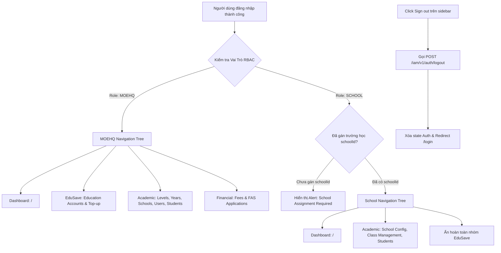

# 📋 BSK Locator & Functional Flow Spec: Admin Dashboard & Navigation Shell

| Trường Thông Tin | Chi Tiết |
| :--- | :--- |
| **Portal / Cổng Dịch Vụ** | `localhost:5173` |
| **Đường Dẫn Thực Tế (URL)** | `http://localhost:5173/` (Root Navigation Shell) |
| **Tiêu Đề Trang (Title)** | `EduFAMS | Admin Portal` |
| **Heading Chính (H1)** | `main#admin-main-content h1` (nội dung thay đổi theo role) |
| **RBAC / Phân Quyền** | `MOEHQ`, `SCHOOL` (Tất cả tài khoản Admin đã đăng nhập) |
| **Backend API Endpoints** | `GET /iam/v1/auth/me`<br>`POST /iam/v1/auth/logout` |
| **Thời Điểm Trích Xuất (BSK)** | Live DOM Verified via Playwright Engine |

---

## 🔍 1. Bảng Locators Chi Tiết (BSK Verified DOM Elements)

### 1.1 Khung Điều Hướng Toàn Cục (Global Header)
| Phần Tử / Nhãn | Loại | Selector Tối Ưu (Playwright) | Trạng Thái & Ý Nghĩa |
| :--- | :--- | :--- | :--- |
| Skip to main content | `link` | `a[href="#admin-main-content"]` | Bỏ qua menu và chuyển focus đến main |
| Brand Logo / Link | `link` | `aside a[aria-label="EduFAMS Admin Portal"][href="/"]` | Điều hướng về Dashboard |
| Nút thu gọn sidebar | `button` | `header button[aria-label="Collapse sidebar"]` (sau đó đổi thành `Expand sidebar`) | Thu gọn / mở rộng navigation sidebar |
| Breadcrumb | `navigation` | `header nav[aria-label="Breadcrumb"]` | Hiển thị đường dẫn hiện tại |
| Danh tính tài khoản | `header` content | `header [aria-label*="("]:has(strong)` | Hiển thị tên người dùng và role/code; không mở menu |
| Nút Menu Mobile | `button` | `header button[aria-label="Open navigation"]` | Mở navigation trên màn hình nhỏ; có `aria-controls="admin-mobile-navigation"` |

---

### 1.2 Thanh Điều Hướng Bên Trái (Sidebar Navigation Links)
| Nhóm / Group | Nhãn Mục Điều Hướng | Đường Dẫn (Href) | Selector Playwright | Phân Quyền Hạn Định (RBAC) |
| :--- | :--- | :--- | :--- | :--- |
| **WORKSPACE** | Dashboard | `/` | `aside nav[aria-label="Admin navigation"] a[href="/"]` | MOEHQ và SCHOOL |
| **EDUSAVE** | Education Accounts | `/education-accounts` | `aside nav[aria-label="Admin navigation"] a[href="/education-accounts"]` | MOEHQ |
| **EDUSAVE** | Top-up | `/top-up` | `aside nav[aria-label="Admin navigation"] a[href="/top-up"]` | MOEHQ |
| **EDUSAVE** | View As | `/support-console` | `aside nav[aria-label="Admin navigation"] a[href="/support-console"]` | MOEHQ |
| **ACADEMIC RESOURCES** | School Users | `/school-user-management` | `aside nav[aria-label="Admin navigation"] a[href="/school-user-management"]` | MOEHQ |
| **ACADEMIC RESOURCES** | School management | `/school-management` | `aside nav[aria-label="Admin navigation"] a[href="/school-management"]` | MOEHQ |
| **ACADEMIC RESOURCES** | Students | `/student-management` | `aside nav[aria-label="Admin navigation"] a[href="/student-management"]` | MOEHQ và SCHOOL |
| **ACADEMIC RESOURCES** | School configuration | `/school-config` | `aside nav[aria-label="Admin navigation"] a[href="/school-config"]` | SCHOOL |
| **ACADEMIC RESOURCES** | Classes | `/class-management` | `aside nav[aria-label="Admin navigation"] a[href="/class-management"]` | SCHOOL |
| **FINANCIAL** | Fee Batches | `/fee-batches` | `aside nav[aria-label="Admin navigation"] a[href="/fee-batches"]` | MOEHQ và SCHOOL |
| **FINANCIAL** | Fees | `/fee-management` | `aside nav[aria-label="Admin navigation"] a[href="/fee-management"]` | MOEHQ và SCHOOL |
| **FINANCIAL** | FAS / SBFAS | `/fas-application-management`, `/sbfas-schemes` | `aside nav[aria-label="Admin navigation"] a[href="..."]` | Tùy role |
| **FINANCIAL** | MOEFAS / FAS Applications | `/moe-hq/moe-fas`, `/moe-hq/fas-applications`, `/fas-applications` | `aside nav[aria-label="Admin navigation"] a[href="..."]` | Tùy role |

---

### 1.3 Danh Tính Tài Khoản & Đăng Xuất
| Phần Tử / Thao Tác | Loại | Selector Playwright | Mô Tả |
| :--- | :--- | :--- | :--- |
| Danh tính người dùng | `div[aria-label]` | `header [aria-label*="("]:has(strong)` | Hiển thị tên và role; không phải nút tương tác |
| Nút Sign Out (Đăng xuất) | `button` | `aside button[aria-label="Sign out"]` | Gọi API `/iam/v1/auth/logout` và chuyển hướng về `/login` |

---

### 1.4 Trạng Thái Cảnh Báo & Quyền Hạn (Access States & Banners)
| Loại Thông Báo / Banner | Trạng Thái | Selector Playwright | Kịch Bản Kích Hoạt |
| :--- | :--- | :--- | :--- |
| School Assignment Required | `warning` | `[role="alert"]:has-text("School assignment required")` | Cán bộ trường có role `SCHOOL` nhưng chưa được gán `schoolId` |
| Authorization Denied | `redirect` | Xác nhận URL `/` và `main#admin-main-content` sau điều hướng | Truy cập route MOEHQ bằng SCHOOL sẽ chuyển về Dashboard |

---

## 🔄 2. Đặc Tả Luồng Nghiệp Vụ Chi Tiết (Functional Flow & State Machine)

### 2.1 Sơ đồ Phân Quyền & Hiển Thị Menu Theo Role (Mermaid)



### 2.2 Quy tắc Trạng thái Menu (Navigation Active States)
- Liên kết trang hiện tại tự động nhận class `navigationLinkActive` và thuộc tính `aria-current="page"`.
- Liên kết trang hiện tại nhận thuộc tính `aria-current="page"`.

---

## 💻 3. Playwright Page Object Snippet Khuyến Nghị

```python
from playwright.sync_api import Page, Locator
from pages.base_page import BasePage

class AdminShellPage(BasePage):
    """Page Object quản lý Khung Shell, Thanh Navigation và Profile Header của Admin Portal."""
    URL = "http://localhost:5173/"

    def __init__(self, page: Page):
        super().__init__(page)

    # Header & Global Controls
    @property
    def brand_link(self) -> Locator:
        return self.page.locator('aside a[aria-label="EduFAMS Admin Portal"][href="/"]')

    # Sidebar Navigation Links
    @property
    def nav_dashboard(self) -> Locator:
        return self.page.locator('aside nav[aria-label="Admin navigation"] a[href="/"]')

    @property
    def nav_school_management(self) -> Locator:
        return self.page.locator('aside nav[aria-label="Admin navigation"] a[href="/school-management"]')

    @property
    def nav_school_user_management(self) -> Locator:
        return self.page.locator('aside nav[aria-label="Admin navigation"] a[href="/school-user-management"]')

    @property
    def nav_education_accounts(self) -> Locator:
        return self.page.locator('aside nav[aria-label="Admin navigation"] a[href="/education-accounts"]')

    @property
    def nav_top_up(self) -> Locator:
        return self.page.locator('aside nav[aria-label="Admin navigation"] a[href="/top-up"]')

    @property
    def nav_class_management(self) -> Locator:
        return self.page.locator('aside nav[aria-label="Admin navigation"] a[href="/class-management"]')

    @property
    def nav_student_management(self) -> Locator:
        return self.page.locator('aside nav[aria-label="Admin navigation"] a[href="/student-management"]')

    @property
    def nav_school_config(self) -> Locator:
        return self.page.locator('aside nav[aria-label="Admin navigation"] a[href="/school-config"]')

    # Account Identity & Sign Out
    @property
    def account_identity(self) -> Locator:
        return self.page.locator('header [aria-label*="("]:has(strong)')

    @property
    def sign_out_btn(self) -> Locator:
        return self.page.locator('aside button[aria-label="Sign out"]')

    # Actions
    def sign_out(self):
        self.sign_out_btn.click()
        self.page.wait_for_url("**/login", timeout=10000)
```

---

## 🎯 4. Tiêu Chí Xác Nhận Pass/Fail & Error Handling (Pass/Fail Oracles & Assertions)

### 4.1 Tiêu Chí Xác Nhận Thành Công (Pass Oracles)
| Hành Động / Kịch Bản Kiểm Thử | Loại UI Feedback | Selector Playwright Tối Ưu | Kỳ Vọng Text / Giá Trị | Playwright Assertion Cú Pháp Mẫu (Dành Cho `tests/`) |
| :--- | :--- | :--- | :--- | :--- |
| **Tải Shell Admin thành công** | Cây Sidebar & Header hiển thị | `aside[aria-label="Admin navigation sidebar"], header:has(nav[aria-label="Breadcrumb"])` | Sidebar chứa các link chức năng | `expect(page.locator('aside[aria-label="Admin navigation sidebar"]')).to_be_visible()` |
| **Phân quyền Menu MOEHQ (RBAC MOEHQ)** | Hiển thị menu theo role | `aside nav[aria-label="Admin navigation"] a[href="/school-management"]` | Hiển thị menu Quản lý trường học | `expect(page.locator('aside nav[aria-label="Admin navigation"] a[href="/school-management"]')).to_be_visible()` |
| **Phân quyền Menu SCHOOL Staff (RBAC)** | Ẩn menu MOEHQ | `aside nav[aria-label="Admin navigation"] a[href="/school-management"]` | Không có trong DOM; truy cập trực tiếp sẽ redirect về `/` | `expect(page.locator('aside nav[aria-label="Admin navigation"] a[href="/school-management"]')).to_have_count(0)` |
| **Đăng xuất thành công (Sign out)** | Chuyển hướng về Login & Xóa Session | URL và Chuyển hướng | URL về `/login` | `page.wait_for_url("**/login")`<br>`expect(page).to_have_url(re.compile(r".*/login.*"))` |

---

### 4.2 Tiêu Chí Bắt Lỗi & Xử Lý Ngoại Lệ (Fail & Error Handling Feedback)
| Tình Huống Lỗi / Trigger | Loại UI Feedback | Selector Playwright Tối Ưu | Mã Lỗi & Text Kỳ Vọng | Playwright Assertion Cú Pháp Mẫu (Dành Cho `tests/`) |
| :--- | :--- | :--- | :--- | :--- |
| **Truy cập khi chưa đăng nhập (Unauthenticated)** | Tự động chuyển hướng về Login | Chuyển hướng URL | URL chuyển về `/login` | `page.goto("http://localhost:5173/")`<br>`page.wait_for_url("**/login")` |
| **Truy cập URL vượt quyền (SCHOOL vào link MOE)** | Redirect về Dashboard | `main#admin-main-content` và URL `/` | Trang role SCHOOL được tải lại tại Dashboard | `page.wait_for_url("**/")`<br>`expect(page.locator('main#admin-main-content')).to_be_visible()` |

