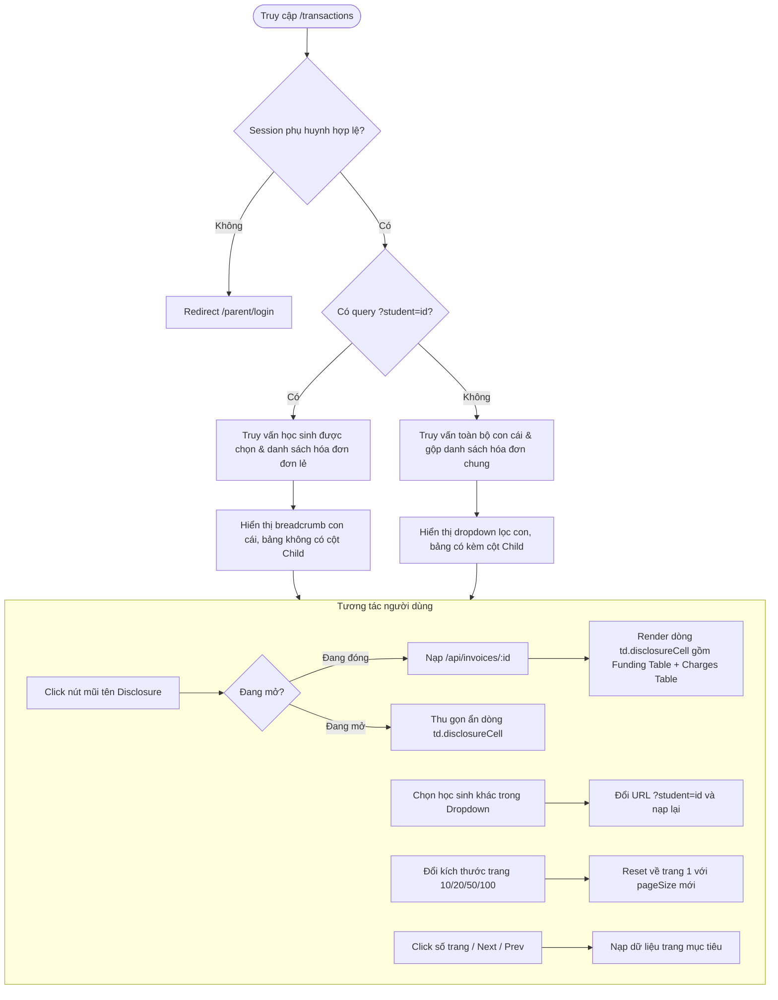

# 📋 BSK Locator & Functional Flow Spec: Edusave Transaction History & Invoice Disclosure

| Trường Thông Tin | Chi Tiết |
| :--- | :--- |
| **Portal / Ứng Dụng** | Citizen Portal / EduSave E-Service (`localhost:5174`) |
| **Đường Dẫn Thực Tế (URL)** | `https://localhost:5174/transactions`<br>`https://localhost:5174/transactions?student={studentId}` |
| **Tiêu Đề Trang (Title)** | `EduFAMS \| E-Service` |
| **Heading Chính (H1)** | `Transaction History` / `{FullName} ({Code})` (Localized) |
| **RBAC / Phân Quyền** | `ParentSession` (Bắt buộc session phụ huynh đã đăng nhập qua Singpass) |
| **Thời Điểm Cập Nhật** | Live DOM Verified (EduFAMS UI Design System v2) |

---

## 🔍 1. Bảng Locators Chi Tiết (BSK Verified DOM Elements)

### 1.1 Thanh Công Cụ Lọc & Header Toàn Cục (Filter Toolbar & EServicePageHeader)
| Tên Phần Tử | Loại (Tag) | Selector Playwright Tối Ưu | Giá Trị Mặc Định / Options | Mô Tả Kỹ Thuật |
| :--- | :--- | :--- | :--- | :--- |
| **Page Header Container** | `<header>` | `header[class*="EServicePageHeader"]` | - | Banner trang chứa tiêu đề, mô tả và artwork |
| **Breadcrumb Navigation** | `<nav>` | `nav[aria-label="Breadcrumb"]` | Home > Transactions | Điều hướng phân cấp |
| **Student Filter Toolbar** | `<div>` | `div[class*="toolbar"]` | - | Thanh lọc học sinh khi ở chế độ xem 'All' |
| **Student Filter Label** | `<label>` | `label[class*="selectLabel"]` | "Filter by student" | Nhãn liên kết select qua `htmlFor` |
| **Student Select Dropdown** | `<select>` | `div[class*="toolbar"] select, select[id^=":r"]` | `all` (Tất cả học sinh) | Đổi sang `studentId` cập nhật URL `?student={id}` |
| **Section Title** | `<h2>` | `h2[class*="invoiceSectionTitle"]` | "Invoices" | Tiêu đề danh sách hóa đơn thanh toán |
| **Invoice Record Count** | `<span>` | `span[class*="invoiceCount"]` | "{count} invoices" | Tổng số bản ghi hóa đơn hiện tại |

---

### 1.2 Bảng Hóa Đơn & Giao Dịch (Invoices & Transactions DataTable)
| Tên Cột / Phần Tử | Vị Trí / Header | Selector Playwright Tối Ưu | Mô Tả Dữ Liệu Hiển Thị |
| :--- | :--- | :--- | :--- |
| **Table Container** | `<table>` | `table` | Bảng ngữ nghĩa chính |
| **Table Caption** | `<caption>` | `table caption` | Caption trợ năng mô tả phạm vi hiển thị |
| **Column: Invoice** | Cột 1 | `table th:has-text("Invoice")` | Mã hóa đơn (`INV-XXXX`) kèm badge trạng thái nếu chưa nộp |
| **Column: Child** | Cột 2 (Khi All) | `table th:has-text("Child")` | Tên học sinh (Link chuyển tới sao kê riêng của con) |
| **Column: Amount** | Cột 3 | `table th:has-text("Amount")` | Số tiền thực đóng định dạng `SGD X.XX` |
| **Column: Payment Date** | Cột 4 | `table th:has-text("Payment date")` | Ngày thanh toán (format: `DD MMM YYYY`) |
| **Column: Method** | Cột 5 | `table th:has-text("Method")` | Phương thức: `Education Account`, `Online Gateway`, `Both` |
| **Column: Details** | Cột 6 | `table th[class*="invoiceActionCell"]` | Cột nút mở rộng chi tiết giao dịch |
| **Disclosure Toggle Button** | Ô Action | `button[class*="disclosureButton"], button[aria-expanded]` | Nút toggle: có `aria-expanded` và `aria-controls` |

---

### 1.3 Khối Chi Tiết Mở Rộng Hóa Đơn (Expanded Invoice Payment Details)
Khi click nút `disclosureButton`, một dòng phụ `tr > td[id="invoice-details-{id}"]` xuất hiện:

| Tên Khối / Bảng Con | Tag & Type | Selector Playwright Tối Ưu | Mô Tả Chi Tiết |
| :--- | :--- | :--- | :--- |
| **Details Container** | `<td>` | `td[class*="disclosureCell"], td[id^="invoice-details-"]` | Ô bao phủ toàn bộ chiều rộng bảng (`colspan=5/6`) |
| **Payment Details Section** | `<section>` | `section[aria-label="Payment details"]` | Vùng ngữ nghĩa chứa nguồn tiền và các khoản phí |
| **Funding Sources Table** | `<table>` | `table[class*="fundingTable"]` | Bảng phân bổ nguồn tiền thanh toán |
| **Funding Head: Source** | `<th>` | `table[class*="fundingTable"] th:has-text("Funding source")` | Cột nguồn chi trả (Ví Edusave / Cổng thanh toán) |
| **Funding Head: Requested** | `<th>` | `table[class*="fundingTable"] th:has-text("Requested amount")` | Số tiền yêu cầu trích |
| **Funding Head: Settled** | `<th>` | `table[class*="fundingTable"] th:has-text("Settled amount")` | Số tiền thực tế đã quyết toán thành công |
| **Funding Head: Completed** | `<th>` | `table[class*="fundingTable"] th:has-text("Completed at")` | Thời điểm hoàn tất giao dịch |
| **Charges Section Title** | `<h3>` | `h3[class*="chargeHeading"]` | Text: "Invoice charges" |
| **Invoice Charges Table** | `<table>` | `section[aria-label*="charges"] table` | Danh mục từng khoản phí lẻ thuộc hóa đơn |
| **Charges Error Alert** | `[role="alert"]` | `section[aria-label*="charges"] div[role="alert"]` | Alert lỗi nạp chi tiết phí kèm nút retry |

---

### 1.4 Thanh Phân Trang & Điều Khiển (Pagination Controls)
| Tên Nút / Control | Loại (Tag) | Selector Playwright Tối Ưu | Trạng Thái / Giá Trị |
| :--- | :--- | :--- | :--- |
| **Pagination Bar** | `<div>` | `div[class*="paginationBar"]` | Container chân bảng |
| **Page Size Select** | `<select>` | `div[class*="paginationBar"] select, select[class*="pageSize"]` | Tùy chọn 10, 20, 50, 100 bản ghi |
| **Pagination Nav** | `<nav>` | `nav[aria-label="Pagination"]` | Khối trợ năng chứa các nút trang |
| **First Page Button** | `<button>` | `button[aria-label="First page"]` | Chuyển về trang 1 |
| **Previous Page Button** | `<button>` | `button[aria-label="Previous page"], button:has-text("Previous")` | Lùi 1 trang (Disabled ở trang đầu) |
| **Next Page Button** | `<button>` | `button[aria-label="Next page"], button:has-text("Next")` | Tiến 1 trang (Disabled ở trang cuối) |
| **Last Page Button** | `<button>` | `button[aria-label="Last page"]` | Nhảy tới trang cuối cùng |
| **Page Number Button** | `<button>` | `nav[aria-label="Pagination"] button:has-text("{pageNumber}")` | Nhảy trực tiếp tới số trang cụ thể |

---

### 1.5 Trạng Thái Lỗi, Cảnh Báo & Rỗng (Error, Warning & Empty States)
| Trạng Thái | Vai Trò (Role) | Selector Playwright Tối Ưu | Nội Dung / Hành Động |
| :--- | :--- | :--- | :--- |
| **List API Error Alert** | `[role="alert"]` | `div[role="alert"][class*="error"], div[role="alert"]:has(h3:has-text("Unable"))` | Báo lỗi nạp danh sách, kèm nút `button:has-text("Try again")` |
| **Scope Mismatch Alert** | `[role="alert"]` | `div[role="alert"]:has-text("scope mismatch")` | Phát hiện hóa đơn không thuộc danh sách con cái hợp lệ |
| **Account Unavailable Warning** | `[role="alert"]` | `div[role="alert"][class*="warning"]` | Cảnh báo tài khoản Edusave học sinh tạm khóa / không tìm thấy |
| **Empty State** | `[role="status"]` | `div[class*="emptyState"], [role="status"]:has-text("No transactions")` | Hiển thị khi học sinh chưa từng phát sinh giao dịch |
| **Loading Spinner** | `[role="status"]` | `p[role="status"]:has-text("Loading")` | Trạng thái truy vấn dữ liệu bất đồng bộ |

---

## 🔄 2. Đặc Tả Luồng Nghiệp Vụ (Functional Flow & State Transitions)



---

## 🛡️ 3. Chiến Lược Error Handling Cho Automation Testing

Để tối ưu hóa quá trình kiểm thử tự động, toàn bộ Page Object và Test Case cần tuân thủ quy chuẩn bắt lỗi chi tiết:

1. **Bắt lỗi danh sách hóa đơn (Table Load Failure)**:
   ```python
   # Không dùng timeout chung chung; kiểm tra ngay alert banner
   alert = transactions_page.get_error_alert()
   if alert:
       print(f"Failed to load: {alert['heading']} - {alert['message']}")
       transactions_page.click_retry()
   ```

2. **Bắt lỗi chi tiết trong dòng mở rộng (Invoice Charge Error)**:
   Khi mở dòng chi tiết (`toggle_invoice_details`), nếu API trả về 500 cho khoản phí:
   - Dòng phụ xuất hiện `section[aria-label*="charges"] div[role="alert"]`.
   - Có nút thử lại `Button variant="outline"` riêng cho khoản phí đó.

3. **Chống Flaky Khi Tải Dữ Liệu Lớn**:
   - Chờ `p[role="status"]:has-text("Loading")` chuyển sang trạng thái detached trước khi đọc dòng.
   - Khi chuyển trang hoặc đổi filter, luôn đợi bảng ổn định qua `wait_for_page_loaded()`.
